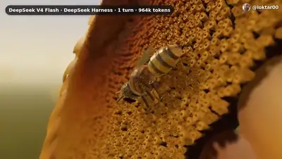
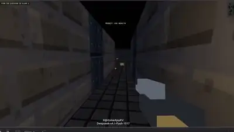
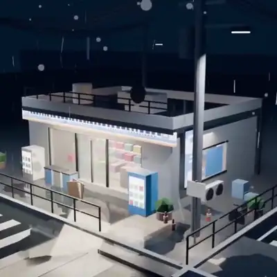
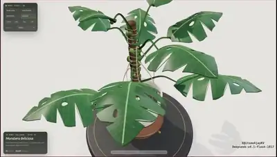

# Awesome DeepSeek V4.1 Flash 1017

English · [简体中文](README.zh-CN.md)

[](https://awesome.re) [](#contents) [](docs/prompts.md) [](https://github.com/sandbase-lab/awesome-deepseek-v4.1-flash-1017/actions/workflows/sync.yml) [](https://www.sandbase.ai/model/deepseek/deepseek-v4.1-flash?utm_source=github&utm_medium=readme&utm_campaign=awesome-deepseek-v4.1-flash-1017)

[](https://www.sandbase.ai/lab/ai-videos/deepseek-v4-1-flash-1017?utm_source=github&utm_medium=readme&utm_campaign=awesome-deepseek-v4.1-flash-1017&utm_content=banner)

A curated list of **DeepSeek V4.1 Flash 1017 examples**: videos, prompts and demos made with DeepSeek-V4.1-Flash-1017, the October 17, 2026 update of DeepSeek's V4.1 Flash model. Three.js and WebGL 3D scenes, SVG and canvas animation, motion graphics and playable browser games, most of them written as code from a prompt, each one credited to its creator and linked to the original post.

**61 videos** from **51 creators** · **11** with the creator's prompt · synced daily from [SandBase Lab](https://www.sandbase.ai/lab/ai-videos/deepseek-v4-1-flash-1017?utm_source=github&utm_medium=readme&utm_campaign=awesome-deepseek-v4.1-flash-1017&utm_content=stats)

## Start here

| I want to… | Go to |
|---|---|
| Watch the videos | [Browse by category](#contents) below, or [play them full-size on SandBase Lab](https://www.sandbase.ai/lab/ai-videos/deepseek-v4-1-flash-1017?utm_source=github&utm_medium=readme&utm_campaign=awesome-deepseek-v4.1-flash-1017&utm_content=quickstart) |
| Copy a prompt | [Prompt index](docs/prompts.md): every video that comes with its prompt |
| Write your own prompt | [Prompt guide](docs/prompt-guide.md): 7 patterns and a fill-in template |
| Make a video | [Tutorial](docs/tutorial.md): prompt → HTML → MP4, with the API, the CLI and a recording script |
| Pick a model | [DeepSeek V4.1 Flash 1017 vs. Claude Opus 5.5, GPT-6 and Gemini 4 Argon](docs/model-comparison.md) |
| Try it now | [Run DeepSeek V4.1 Flash 1017 in the Lab arena](https://www.sandbase.ai/lab/x/llm-arena?models=deepseek%2Fdeepseek-v4.1-flash&utm_source=github&utm_medium=readme&utm_campaign=awesome-deepseek-v4.1-flash-1017&utm_content=quickstart), next to other models |

<a id="contents"></a>

## Contents

- [Featured](#featured) (8)
- [3D scenes](#3d-scene) (24)
- [Motion graphics](#motion-graphics) (6)
- [Games](#game) (7)
- [Product UI](#ui-demo) (3)
- [Explainers](#explainer) (2)
- [Launch films](#launch-film) (2)
- [Tests & comparisons](#comparison) (17)
- [Recreate a video with DeepSeek V4.1 Flash 1017](#recreate)
- [FAQ](#faq)
- [Further reading](#reading)
- [Suggest a video](#contribute)

Click a preview to play the video. Click a title for the post, the prompt and **Recreate** on SandBase Lab. **@handle** links to the creator's post on X.

<a id="featured"></a>

## Featured

<table>
<tr><td width="33%" valign="top"><a href="https://www.sandbase.ai/lab/media/x/deepseek-v4-1-flash-1017/2111401362713968942/video.mp4"></a><br><a href="https://www.sandbase.ai/lab/ai-videos/deepseek-v4-1-flash-1017/2111401362713968942?utm_source=github&utm_medium=readme&utm_campaign=awesome-deepseek-v4.1-flash-1017&utm_content=card"><b>Massive medieval voxel world generated in code</b></a><br><sub><a href="https://x.com/marcthecreatorr/status/2111401362713968942">@marcthecreatorr</a> · 0:51</sub></td><td width="33%" valign="top"><a href="https://www.sandbase.ai/lab/media/x/deepseek-v4-1-flash-1017/2111440345032790310/video.mp4"></a><br><a href="https://www.sandbase.ai/lab/ai-videos/deepseek-v4-1-flash-1017/2111440345032790310?utm_source=github&utm_medium=readme&utm_campaign=awesome-deepseek-v4.1-flash-1017&utm_content=card"><b>Quick guide to using the OpenDesign API</b></a><br><sub><a href="https://x.com/OpenDesignHQ/status/2111440345032790310">@OpenDesignHQ</a> · 1:07</sub></td><td width="33%" valign="top"><a href="https://www.sandbase.ai/lab/media/x/deepseek-v4-1-flash-1017/2111442747999789204/video.mp4"></a><br><a href="https://www.sandbase.ai/lab/ai-videos/deepseek-v4-1-flash-1017/2111442747999789204?utm_source=github&utm_medium=readme&utm_campaign=awesome-deepseek-v4.1-flash-1017&utm_content=card"><b>Motion design tutorial for OpenDesign API</b></a><br><sub><a href="https://x.com/tuturetom/status/2111442747999789204">@tuturetom</a> · 1:07</sub></td></tr>
<tr><td width="33%" valign="top"><a href="https://www.sandbase.ai/lab/media/x/deepseek-v4-1-flash-1017/2111415760681849025/video.mp4"></a><br><a href="https://www.sandbase.ai/lab/ai-videos/deepseek-v4-1-flash-1017/2111415760681849025?utm_source=github&utm_medium=readme&utm_campaign=awesome-deepseek-v4.1-flash-1017&utm_content=card"><b>Peacock test animation generated with DeepSeek</b></a><br><sub><a href="https://x.com/SahilPanhotra/status/2111415760681849025">@SahilPanhotra</a> · 0:10</sub></td><td width="33%" valign="top"><a href="https://www.sandbase.ai/lab/media/x/deepseek-v4-1-flash-1017/2111387136264126744/video.mp4"></a><br><a href="https://www.sandbase.ai/lab/ai-videos/deepseek-v4-1-flash-1017/2111387136264126744?utm_source=github&utm_medium=readme&utm_campaign=awesome-deepseek-v4.1-flash-1017&utm_content=card"><b>Interactive 3D Tesla Roadster demo</b></a><br><sub><a href="https://x.com/dtzy_88/status/2111387136264126744">@dtzy_88</a> · 0:18</sub></td><td width="33%" valign="top"><a href="https://www.sandbase.ai/lab/media/x/deepseek-v4-1-flash-1017/2111464046113493422/video.mp4"></a><br><a href="https://www.sandbase.ai/lab/ai-videos/deepseek-v4-1-flash-1017/2111464046113493422?utm_source=github&utm_medium=readme&utm_campaign=awesome-deepseek-v4.1-flash-1017&utm_content=card"><b>AI generated motion design video</b></a><br><sub><a href="https://x.com/yohakujpn/status/2111464046113493422">@yohakujpn</a> · 0:35</sub></td></tr>
<tr><td width="33%" valign="top"><a href="https://www.sandbase.ai/lab/media/x/deepseek-v4-1-flash-1017/2111470277309997492/video.mp4"></a><br><a href="https://www.sandbase.ai/lab/ai-videos/deepseek-v4-1-flash-1017/2111470277309997492?utm_source=github&utm_medium=readme&utm_campaign=awesome-deepseek-v4.1-flash-1017&utm_content=card"><b>Motion showcase for open source browser skill project</b></a><br><sub><a href="https://x.com/hqmank/status/2111470277309997492">@hqmank</a> · 0:20</sub></td><td width="33%" valign="top"><a href="https://www.sandbase.ai/lab/media/x/deepseek-v4-1-flash-1017/2111451107318993293/video.mp4"></a><br><a href="https://www.sandbase.ai/lab/ai-videos/deepseek-v4-1-flash-1017/2111451107318993293?utm_source=github&utm_medium=readme&utm_campaign=awesome-deepseek-v4.1-flash-1017&utm_content=card"><b>Promotional video for web platform</b></a><br><sub><a href="https://x.com/hkdom/status/2111451107318993293">@hkdom</a> · 1:47 · <a href="https://www.sandbase.ai/lab/ai-videos/deepseek-v4-1-flash-1017/2111451107318993293?utm_source=github&utm_medium=readme&utm_campaign=awesome-deepseek-v4.1-flash-1017&utm_content=card">prompt</a></sub></td></tr>
</table>

<a id="3d-scene"></a>

## 3D scenes

<table>
<tr><td width="33%" valign="top"><a href="https://www.sandbase.ai/lab/media/x/deepseek-v4-1-flash-1017/2111377927791067250/video.mp4"></a><br><a href="https://www.sandbase.ai/lab/ai-videos/deepseek-v4-1-flash-1017/2111377927791067250?utm_source=github&utm_medium=readme&utm_campaign=awesome-deepseek-v4.1-flash-1017&utm_content=card"><b>Interactive gummy bear physics simulation</b></a><br><sub><a href="https://x.com/0xNotFounder/status/2111377927791067250">@0xNotFounder</a> · 0:16</sub></td><td width="33%" valign="top"><a href="https://www.sandbase.ai/lab/media/x/deepseek-v4-1-flash-1017/2111387136264126744/video.mp4"></a><br><a href="https://www.sandbase.ai/lab/ai-videos/deepseek-v4-1-flash-1017/2111387136264126744?utm_source=github&utm_medium=readme&utm_campaign=awesome-deepseek-v4.1-flash-1017&utm_content=card"><b>Interactive 3D Tesla Roadster demo</b></a><br><sub><a href="https://x.com/dtzy_88/status/2111387136264126744">@dtzy_88</a> · 0:18</sub></td><td width="33%" valign="top"><a href="https://www.sandbase.ai/lab/media/x/deepseek-v4-1-flash-1017/2111388754573398252/video.mp4"></a><br><a href="https://www.sandbase.ai/lab/ai-videos/deepseek-v4-1-flash-1017/2111388754573398252?utm_source=github&utm_medium=readme&utm_campaign=awesome-deepseek-v4.1-flash-1017&utm_content=card"><b>Showcase of four 3D GIF demos</b></a><br><sub><a href="https://x.com/YxzRainy/status/2111388754573398252">@YxzRainy</a> · 0:15</sub></td></tr>
<tr><td width="33%" valign="top"><a href="https://www.sandbase.ai/lab/media/x/deepseek-v4-1-flash-1017/2111390831244460473/video.mp4"></a><br><a href="https://www.sandbase.ai/lab/ai-videos/deepseek-v4-1-flash-1017/2111390831244460473?utm_source=github&utm_medium=readme&utm_campaign=awesome-deepseek-v4.1-flash-1017&utm_content=card"><b>Speed and 3D capabilities test of DeepSeek V4.1</b></a><br><sub><a href="https://x.com/SPAC89/status/2111390831244460473">@SPAC89</a> · 1:06</sub></td><td width="33%" valign="top"><a href="https://www.sandbase.ai/lab/media/x/deepseek-v4-1-flash-1017/2111395155505033338/video.mp4"></a><br><a href="https://www.sandbase.ai/lab/ai-videos/deepseek-v4-1-flash-1017/2111395155505033338?utm_source=github&utm_medium=readme&utm_campaign=awesome-deepseek-v4.1-flash-1017&utm_content=card"><b>Four 3D demos generated by DeepSeek</b></a><br><sub><a href="https://x.com/AndyL5cc/status/2111395155505033338">@AndyL5cc</a> · 0:15</sub></td><td width="33%" valign="top"><a href="https://www.sandbase.ai/lab/media/x/deepseek-v4-1-flash-1017/2111401362713968942/video.mp4"></a><br><a href="https://www.sandbase.ai/lab/ai-videos/deepseek-v4-1-flash-1017/2111401362713968942?utm_source=github&utm_medium=readme&utm_campaign=awesome-deepseek-v4.1-flash-1017&utm_content=card"><b>Massive medieval voxel world generated in code</b></a><br><sub><a href="https://x.com/marcthecreatorr/status/2111401362713968942">@marcthecreatorr</a> · 0:51</sub></td></tr>
</table>

<details>
<summary><b>Show all 24</b></summary>

<table>
<tr><td width="33%" valign="top"><a href="https://www.sandbase.ai/lab/media/x/deepseek-v4-1-flash-1017/2111411889217651196/video.mp4"></a><br><a href="https://www.sandbase.ai/lab/ai-videos/deepseek-v4-1-flash-1017/2111411889217651196?utm_source=github&utm_medium=readme&utm_campaign=awesome-deepseek-v4.1-flash-1017&utm_content=card"><b>Blender and Three.js scene generated by DeepSeek V4.1</b></a><br><sub><a href="https://x.com/superalesha/status/2111411889217651196">@superalesha</a> · 0:24</sub></td><td width="33%" valign="top"><a href="https://www.sandbase.ai/lab/media/x/deepseek-v4-1-flash-1017/2111426130549117402/video.mp4"></a><br><a href="https://www.sandbase.ai/lab/ai-videos/deepseek-v4-1-flash-1017/2111426130549117402?utm_source=github&utm_medium=readme&utm_campaign=awesome-deepseek-v4.1-flash-1017&utm_content=card"><b>Voxel pelican riding a unicycle in Web3D</b></a><br><sub><a href="https://x.com/UFO2002616/status/2111426130549117402">@UFO2002616</a> · 0:42 · <a href="https://www.sandbase.ai/lab/ai-videos/deepseek-v4-1-flash-1017/2111426130549117402?utm_source=github&utm_medium=readme&utm_campaign=awesome-deepseek-v4.1-flash-1017&utm_content=card">prompt</a></sub></td><td width="33%" valign="top"><a href="https://www.sandbase.ai/lab/media/x/deepseek-v4-1-flash-1017/2111429622734762462/video.mp4"></a><br><a href="https://www.sandbase.ai/lab/ai-videos/deepseek-v4-1-flash-1017/2111429622734762462?utm_source=github&utm_medium=readme&utm_campaign=awesome-deepseek-v4.1-flash-1017&utm_content=card"><b>3D simulation of a volcanic eruption</b></a><br><sub><a href="https://x.com/hungryturbo/status/2111429622734762462">@hungryturbo</a> · 0:14</sub></td></tr>
<tr><td width="33%" valign="top"><a href="https://www.sandbase.ai/lab/media/x/deepseek-v4-1-flash-1017/2111434381323907105/video.mp4"></a><br><a href="https://www.sandbase.ai/lab/ai-videos/deepseek-v4-1-flash-1017/2111434381323907105?utm_source=github&utm_medium=readme&utm_campaign=awesome-deepseek-v4.1-flash-1017&utm_content=card"><b>One-shot 3D scene built with Three.js</b></a><br><sub><a href="https://x.com/ItsmeAjayKV/status/2111434381323907105">@ItsmeAjayKV</a> · 0:36</sub></td><td width="33%" valign="top"><a href="https://www.sandbase.ai/lab/media/x/deepseek-v4-1-flash-1017/2111438861318418817/video.mp4"></a><br><a href="https://www.sandbase.ai/lab/ai-videos/deepseek-v4-1-flash-1017/2111438861318418817?utm_source=github&utm_medium=readme&utm_campaign=awesome-deepseek-v4.1-flash-1017&utm_content=card"><b>3D Tokyo Tower scene in Three.js</b></a><br><sub><a href="https://x.com/vincent_ddup/status/2111438861318418817">@vincent_ddup</a> · 0:48 · <a href="https://www.sandbase.ai/lab/ai-videos/deepseek-v4-1-flash-1017/2111438861318418817?utm_source=github&utm_medium=readme&utm_campaign=awesome-deepseek-v4.1-flash-1017&utm_content=card">prompt</a></sub></td><td width="33%" valign="top"><a href="https://www.sandbase.ai/lab/media/x/deepseek-v4-1-flash-1017/2111440821484667343/video.mp4"></a><br><a href="https://www.sandbase.ai/lab/ai-videos/deepseek-v4-1-flash-1017/2111440821484667343?utm_source=github&utm_medium=readme&utm_campaign=awesome-deepseek-v4.1-flash-1017&utm_content=card"><b>Single-generation test video from DeepSeek V4.1</b></a><br><sub><a href="https://x.com/MaxForAI/status/2111440821484667343">@MaxForAI</a> · 0:46</sub></td></tr>
<tr><td width="33%" valign="top"><a href="https://www.sandbase.ai/lab/media/x/deepseek-v4-1-flash-1017/2111442531594670085/video.mp4"></a><br><a href="https://www.sandbase.ai/lab/ai-videos/deepseek-v4-1-flash-1017/2111442531594670085?utm_source=github&utm_medium=readme&utm_campaign=awesome-deepseek-v4.1-flash-1017&utm_content=card"><b>Interactive 3D moon base demo</b></a><br><sub><a href="https://x.com/a_g_e_n_c/status/2111442531594670085">@a_g_e_n_c</a> · 0:14</sub></td><td width="33%" valign="top"><a href="https://www.sandbase.ai/lab/media/x/deepseek-v4-1-flash-1017/2111450021849944508/video.mp4"></a><br><a href="https://www.sandbase.ai/lab/ai-videos/deepseek-v4-1-flash-1017/2111450021849944508?utm_source=github&utm_medium=readme&utm_campaign=awesome-deepseek-v4.1-flash-1017&utm_content=card"><b>3D rollercoaster video generated via Blender</b></a><br><sub><a href="https://x.com/Yunn260414/status/2111450021849944508">@Yunn260414</a> · 0:28 · <a href="https://www.sandbase.ai/lab/ai-videos/deepseek-v4-1-flash-1017/2111450021849944508?utm_source=github&utm_medium=readme&utm_campaign=awesome-deepseek-v4.1-flash-1017&utm_content=card">prompt</a></sub></td><td width="33%" valign="top"><a href="https://www.sandbase.ai/lab/media/x/deepseek-v4-1-flash-1017/2111450154448609633/video.mp4"></a><br><a href="https://www.sandbase.ai/lab/ai-videos/deepseek-v4-1-flash-1017/2111450154448609633?utm_source=github&utm_medium=readme&utm_campaign=awesome-deepseek-v4.1-flash-1017&utm_content=card"><b>Three-story Victorian townhouse in Three.js</b></a><br><sub><a href="https://x.com/ItsmeAjayKV/status/2111450154448609633">@ItsmeAjayKV</a> · 0:54</sub></td></tr>
<tr><td width="33%" valign="top"><a href="https://www.sandbase.ai/lab/media/x/deepseek-v4-1-flash-1017/2111454710498766979/video.mp4"></a><br><a href="https://www.sandbase.ai/lab/ai-videos/deepseek-v4-1-flash-1017/2111454710498766979?utm_source=github&utm_medium=readme&utm_campaign=awesome-deepseek-v4.1-flash-1017&utm_content=card"><b>Blender 3D model recreated from image</b></a><br><sub><a href="https://x.com/npaka123/status/2111454710498766979">@npaka123</a> · 0:04 · <a href="https://www.sandbase.ai/lab/ai-videos/deepseek-v4-1-flash-1017/2111454710498766979?utm_source=github&utm_medium=readme&utm_campaign=awesome-deepseek-v4.1-flash-1017&utm_content=card">prompt</a></sub></td><td width="33%" valign="top"><a href="https://www.sandbase.ai/lab/media/x/deepseek-v4-1-flash-1017/2111456300563603569/video.mp4"></a><br><a href="https://www.sandbase.ai/lab/ai-videos/deepseek-v4-1-flash-1017/2111456300563603569?utm_source=github&utm_medium=readme&utm_campaign=awesome-deepseek-v4.1-flash-1017&utm_content=card"><b>Tesla Roadster 3D model with interior details</b></a><br><sub><a href="https://x.com/tspy/status/2111456300563603569">@tspy</a> · 1:04</sub></td><td width="33%" valign="top"><a href="https://www.sandbase.ai/lab/media/x/deepseek-v4-1-flash-1017/2111459465472176150/video.mp4"></a><br><a href="https://www.sandbase.ai/lab/ai-videos/deepseek-v4-1-flash-1017/2111459465472176150?utm_source=github&utm_medium=readme&utm_campaign=awesome-deepseek-v4.1-flash-1017&utm_content=card"><b>Three.js tour of a gauntlet rig</b></a><br><sub><a href="https://x.com/wikiwayne/status/2111459465472176150">@wikiwayne</a> · 0:26</sub></td></tr>
<tr><td width="33%" valign="top"><a href="https://www.sandbase.ai/lab/media/x/deepseek-v4-1-flash-1017/2111462244668031446/video.mp4"></a><br><a href="https://www.sandbase.ai/lab/ai-videos/deepseek-v4-1-flash-1017/2111462244668031446?utm_source=github&utm_medium=readme&utm_campaign=awesome-deepseek-v4.1-flash-1017&utm_content=card"><b>Interactive 3D moon base in Three.js</b></a><br><sub><a href="https://x.com/Octoberry/status/2111462244668031446">@Octoberry</a> · 0:14</sub></td><td width="33%" valign="top"><a href="https://www.sandbase.ai/lab/media/x/deepseek-v4-1-flash-1017/2111466763959271873/video.mp4"></a><br><a href="https://www.sandbase.ai/lab/ai-videos/deepseek-v4-1-flash-1017/2111466763959271873?utm_source=github&utm_medium=readme&utm_campaign=awesome-deepseek-v4.1-flash-1017&utm_content=card"><b>Robo-assembly and launch test in Three.js</b></a><br><sub><a href="https://x.com/alohaproxy/status/2111466763959271873">@alohaproxy</a> · 0:37</sub></td><td width="33%" valign="top"><a href="https://www.sandbase.ai/lab/media/x/deepseek-v4-1-flash-1017/2111468860935127532/video.mp4"></a><br><a href="https://www.sandbase.ai/lab/ai-videos/deepseek-v4-1-flash-1017/2111468860935127532?utm_source=github&utm_medium=readme&utm_campaign=awesome-deepseek-v4.1-flash-1017&utm_content=card"><b>3D honeybee on a sunflower</b></a><br><sub><a href="https://x.com/loktar00/status/2111468860935127532">@loktar00</a> · 1:30</sub></td></tr>
<tr><td width="33%" valign="top"><a href="https://www.sandbase.ai/lab/media/x/deepseek-v4-1-flash-1017/2111475884222038190/video.mp4"></a><br><a href="https://www.sandbase.ai/lab/ai-videos/deepseek-v4-1-flash-1017/2111475884222038190?utm_source=github&utm_medium=readme&utm_campaign=awesome-deepseek-v4.1-flash-1017&utm_content=card"><b>Realistic 3D rendering generated on Harness</b></a><br><sub><a href="https://x.com/laopai1990/status/2111475884222038190">@laopai1990</a> · 1:30</sub></td><td width="33%" valign="top"><a href="https://www.sandbase.ai/lab/media/x/deepseek-v4-1-flash-1017/2111487932515410366/video.mp4"></a><br><a href="https://www.sandbase.ai/lab/ai-videos/deepseek-v4-1-flash-1017/2111487932515410366?utm_source=github&utm_medium=readme&utm_campaign=awesome-deepseek-v4.1-flash-1017&utm_content=card"><b>3D lawn mower recreation scene</b></a><br><sub><a href="https://x.com/GeekCatX/status/2111487932515410366">@GeekCatX</a> · 0:44</sub></td><td width="33%" valign="top"><a href="https://www.sandbase.ai/lab/media/x/deepseek-v4-1-flash-1017/2111488300192334142/video.mp4"></a><br><a href="https://www.sandbase.ai/lab/ai-videos/deepseek-v4-1-flash-1017/2111488300192334142?utm_source=github&utm_medium=readme&utm_campaign=awesome-deepseek-v4.1-flash-1017&utm_content=card"><b>Girl waiting for Halloween 3D scene</b></a><br><sub><a href="https://x.com/abhinavflac/status/2111488300192334142">@abhinavflac</a> · 0:17</sub></td></tr>
</table>

</details>

<a id="motion-graphics"></a>

## Motion graphics

<table>
<tr><td width="33%" valign="top"><a href="https://www.sandbase.ai/lab/media/x/deepseek-v4-1-flash-1017/2111392745155936690/video.mp4"></a><br><a href="https://www.sandbase.ai/lab/ai-videos/deepseek-v4-1-flash-1017/2111392745155936690?utm_source=github&utm_medium=readme&utm_campaign=awesome-deepseek-v4.1-flash-1017&utm_content=card"><b>Pelican riding a bicycle animated in SVG</b></a><br><sub><a href="https://x.com/GKev1n/status/2111392745155936690">@GKev1n</a> · 0:11</sub></td><td width="33%" valign="top"><a href="https://www.sandbase.ai/lab/media/x/deepseek-v4-1-flash-1017/2111415760681849025/video.mp4"></a><br><a href="https://www.sandbase.ai/lab/ai-videos/deepseek-v4-1-flash-1017/2111415760681849025?utm_source=github&utm_medium=readme&utm_campaign=awesome-deepseek-v4.1-flash-1017&utm_content=card"><b>Peacock test animation generated with DeepSeek</b></a><br><sub><a href="https://x.com/SahilPanhotra/status/2111415760681849025">@SahilPanhotra</a> · 0:10</sub></td><td width="33%" valign="top"><a href="https://www.sandbase.ai/lab/media/x/deepseek-v4-1-flash-1017/2111454840337600839/video.mp4"></a><br><a href="https://www.sandbase.ai/lab/ai-videos/deepseek-v4-1-flash-1017/2111454840337600839?utm_source=github&utm_medium=readme&utm_campaign=awesome-deepseek-v4.1-flash-1017&utm_content=card"><b>Animated character pedaling generated in SVG</b></a><br><sub><a href="https://x.com/SahilPanhotra/status/2111454840337600839">@SahilPanhotra</a> · 0:10</sub></td></tr>
<tr><td width="33%" valign="top"><a href="https://www.sandbase.ai/lab/media/x/deepseek-v4-1-flash-1017/2111460614656913914/video.mp4"></a><br><a href="https://www.sandbase.ai/lab/ai-videos/deepseek-v4-1-flash-1017/2111460614656913914?utm_source=github&utm_medium=readme&utm_campaign=awesome-deepseek-v4.1-flash-1017&utm_content=card"><b>Pelican riding a bicycle drawn in SVG</b></a><br><sub><a href="https://x.com/aizhibeibei/status/2111460614656913914">@aizhibeibei</a> · 0:06 · <a href="https://www.sandbase.ai/lab/ai-videos/deepseek-v4-1-flash-1017/2111460614656913914?utm_source=github&utm_medium=readme&utm_campaign=awesome-deepseek-v4.1-flash-1017&utm_content=card">prompt</a></sub></td><td width="33%" valign="top"><a href="https://www.sandbase.ai/lab/media/x/deepseek-v4-1-flash-1017/2111464046113493422/video.mp4"></a><br><a href="https://www.sandbase.ai/lab/ai-videos/deepseek-v4-1-flash-1017/2111464046113493422?utm_source=github&utm_medium=readme&utm_campaign=awesome-deepseek-v4.1-flash-1017&utm_content=card"><b>AI generated motion design video</b></a><br><sub><a href="https://x.com/yohakujpn/status/2111464046113493422">@yohakujpn</a> · 0:35</sub></td><td width="33%" valign="top"><a href="https://www.sandbase.ai/lab/media/x/deepseek-v4-1-flash-1017/2111476965429645706/video.mp4"></a><br><a href="https://www.sandbase.ai/lab/ai-videos/deepseek-v4-1-flash-1017/2111476965429645706?utm_source=github&utm_medium=readme&utm_campaign=awesome-deepseek-v4.1-flash-1017&utm_content=card"><b>SVG drawing of Frieren with background music</b></a><br><sub><a href="https://x.com/notjazii/status/2111476965429645706">@notjazii</a> · 0:29</sub></td></tr>
</table>

<a id="game"></a>

## Games

<table>
<tr><td width="33%" valign="top"><a href="https://www.sandbase.ai/lab/media/x/deepseek-v4-1-flash-1017/2111410853522129220/video.mp4"></a><br><a href="https://www.sandbase.ai/lab/ai-videos/deepseek-v4-1-flash-1017/2111410853522129220?utm_source=github&utm_medium=readme&utm_campaign=awesome-deepseek-v4.1-flash-1017&utm_content=card"><b>First-person shooter game built in Three.js</b></a><br><sub><a href="https://x.com/YifeiZhou/status/2111410853522129220">@YifeiZhou</a> · 1:36 · <a href="https://www.sandbase.ai/lab/ai-videos/deepseek-v4-1-flash-1017/2111410853522129220?utm_source=github&utm_medium=readme&utm_campaign=awesome-deepseek-v4.1-flash-1017&utm_content=card">prompt</a></sub></td><td width="33%" valign="top"><a href="https://www.sandbase.ai/lab/media/x/deepseek-v4-1-flash-1017/2111416511932117424/video.mp4"></a><br><a href="https://www.sandbase.ai/lab/ai-videos/deepseek-v4-1-flash-1017/2111416511932117424?utm_source=github&utm_medium=readme&utm_campaign=awesome-deepseek-v4.1-flash-1017&utm_content=card"><b>Code-generated FPS game built with DeepSeek</b></a><br><sub><a href="https://x.com/ItsmeAjayKV/status/2111416511932117424">@ItsmeAjayKV</a> · 2:30</sub></td><td width="33%" valign="top"><a href="https://www.sandbase.ai/lab/media/x/deepseek-v4-1-flash-1017/2111426732217532722/video.mp4"></a><br><a href="https://www.sandbase.ai/lab/ai-videos/deepseek-v4-1-flash-1017/2111426732217532722?utm_source=github&utm_medium=readme&utm_campaign=awesome-deepseek-v4.1-flash-1017&utm_content=card"><b>Seven playable browser games generated with DeepSeek</b></a><br><sub><a href="https://x.com/wikiwayne/status/2111426732217532722">@wikiwayne</a> · 1:04</sub></td></tr>
<tr><td width="33%" valign="top"><a href="https://www.sandbase.ai/lab/media/x/deepseek-v4-1-flash-1017/2111439745150857295/video.mp4"></a><br><a href="https://www.sandbase.ai/lab/ai-videos/deepseek-v4-1-flash-1017/2111439745150857295?utm_source=github&utm_medium=readme&utm_campaign=awesome-deepseek-v4.1-flash-1017&utm_content=card"><b>Game demo built with Three.js</b></a><br><sub><a href="https://x.com/vibe_aikaka/status/2111439745150857295">@vibe_aikaka</a> · 0:35</sub></td><td width="33%" valign="top"><a href="https://www.sandbase.ai/lab/media/x/deepseek-v4-1-flash-1017/2111466214333755785/video.mp4"></a><br><a href="https://www.sandbase.ai/lab/ai-videos/deepseek-v4-1-flash-1017/2111466214333755785?utm_source=github&utm_medium=readme&utm_campaign=awesome-deepseek-v4.1-flash-1017&utm_content=card"><b>3D FPS game built in DeepSeek Harness</b></a><br><sub><a href="https://x.com/leo114119/status/2111466214333755785">@leo114119</a> · 2:30</sub></td><td width="33%" valign="top"><a href="https://www.sandbase.ai/lab/media/x/deepseek-v4-1-flash-1017/2111477584924209246/video.mp4"></a><br><a href="https://www.sandbase.ai/lab/ai-videos/deepseek-v4-1-flash-1017/2111477584924209246?utm_source=github&utm_medium=readme&utm_campaign=awesome-deepseek-v4.1-flash-1017&utm_content=card"><b>Three.js rogue-like game inspired by Isaac</b></a><br><sub><a href="https://x.com/zmdsb259414/status/2111477584924209246">@zmdsb259414</a> · 4:02 · <a href="https://www.sandbase.ai/lab/ai-videos/deepseek-v4-1-flash-1017/2111477584924209246?utm_source=github&utm_medium=readme&utm_campaign=awesome-deepseek-v4.1-flash-1017&utm_content=card">prompt</a></sub></td></tr>
</table>

<details>
<summary><b>Show all 7</b></summary>

<table>
<tr><td width="33%" valign="top"><a href="https://www.sandbase.ai/lab/media/x/deepseek-v4-1-flash-1017/2111502099020464394/video.mp4"></a><br><a href="https://www.sandbase.ai/lab/ai-videos/deepseek-v4-1-flash-1017/2111502099020464394?utm_source=github&utm_medium=readme&utm_campaign=awesome-deepseek-v4.1-flash-1017&utm_content=card"><b>Nineties styled retro game in single HTML</b></a><br><sub><a href="https://x.com/ItsmeAjayKV/status/2111502099020464394">@ItsmeAjayKV</a> · 2:06</sub></td></tr>
</table>

</details>

<a id="ui-demo"></a>

## Product UI

<table>
<tr><td width="33%" valign="top"><a href="https://www.sandbase.ai/lab/media/x/deepseek-v4-1-flash-1017/2111453908002562494/video.mp4"></a><br><a href="https://www.sandbase.ai/lab/ai-videos/deepseek-v4-1-flash-1017/2111453908002562494?utm_source=github&utm_medium=readme&utm_campaign=awesome-deepseek-v4.1-flash-1017&utm_content=card"><b>3D globe dashboard in Three.js</b></a><br><sub><a href="https://x.com/aibuilderclub_/status/2111453908002562494">@aibuilderclub_</a> · 0:37</sub></td><td width="33%" valign="top"><a href="https://www.sandbase.ai/lab/media/x/deepseek-v4-1-flash-1017/2111456771533611064/video.mp4"></a><br><a href="https://www.sandbase.ai/lab/ai-videos/deepseek-v4-1-flash-1017/2111456771533611064?utm_source=github&utm_medium=readme&utm_campaign=awesome-deepseek-v4.1-flash-1017&utm_content=card"><b>Tesla experiment demo generated by AI</b></a><br><sub><a href="https://x.com/alannnfx/status/2111456771533611064">@alannnfx</a> · 0:46</sub></td><td width="33%" valign="top"><a href="https://www.sandbase.ai/lab/media/x/deepseek-v4-1-flash-1017/2111470277309997492/video.mp4"></a><br><a href="https://www.sandbase.ai/lab/ai-videos/deepseek-v4-1-flash-1017/2111470277309997492?utm_source=github&utm_medium=readme&utm_campaign=awesome-deepseek-v4.1-flash-1017&utm_content=card"><b>Motion showcase for open source browser skill project</b></a><br><sub><a href="https://x.com/hqmank/status/2111470277309997492">@hqmank</a> · 0:20</sub></td></tr>
</table>

<a id="explainer"></a>

## Explainers

<table>
<tr><td width="33%" valign="top"><a href="https://www.sandbase.ai/lab/media/x/deepseek-v4-1-flash-1017/2111440345032790310/video.mp4"></a><br><a href="https://www.sandbase.ai/lab/ai-videos/deepseek-v4-1-flash-1017/2111440345032790310?utm_source=github&utm_medium=readme&utm_campaign=awesome-deepseek-v4.1-flash-1017&utm_content=card"><b>Quick guide to using the OpenDesign API</b></a><br><sub><a href="https://x.com/OpenDesignHQ/status/2111440345032790310">@OpenDesignHQ</a> · 1:07</sub></td><td width="33%" valign="top"><a href="https://www.sandbase.ai/lab/media/x/deepseek-v4-1-flash-1017/2111442747999789204/video.mp4"></a><br><a href="https://www.sandbase.ai/lab/ai-videos/deepseek-v4-1-flash-1017/2111442747999789204?utm_source=github&utm_medium=readme&utm_campaign=awesome-deepseek-v4.1-flash-1017&utm_content=card"><b>Motion design tutorial for OpenDesign API</b></a><br><sub><a href="https://x.com/tuturetom/status/2111442747999789204">@tuturetom</a> · 1:07</sub></td></tr>
</table>

<a id="launch-film"></a>

## Launch films

<table>
<tr><td width="33%" valign="top"><a href="https://www.sandbase.ai/lab/media/x/deepseek-v4-1-flash-1017/2111402753566310600/video.mp4"></a><br><a href="https://www.sandbase.ai/lab/ai-videos/deepseek-v4-1-flash-1017/2111402753566310600?utm_source=github&utm_medium=readme&utm_campaign=awesome-deepseek-v4.1-flash-1017&utm_content=card"><b>Promo video of DeepSeek whale in WebGL</b></a><br><sub><a href="https://x.com/hiwise_aigc/status/2111402753566310600">@hiwise_aigc</a> · 0:36 · <a href="https://www.sandbase.ai/lab/ai-videos/deepseek-v4-1-flash-1017/2111402753566310600?utm_source=github&utm_medium=readme&utm_campaign=awesome-deepseek-v4.1-flash-1017&utm_content=card">prompt</a></sub></td><td width="33%" valign="top"><a href="https://www.sandbase.ai/lab/media/x/deepseek-v4-1-flash-1017/2111451107318993293/video.mp4"></a><br><a href="https://www.sandbase.ai/lab/ai-videos/deepseek-v4-1-flash-1017/2111451107318993293?utm_source=github&utm_medium=readme&utm_campaign=awesome-deepseek-v4.1-flash-1017&utm_content=card"><b>Promotional video for web platform</b></a><br><sub><a href="https://x.com/hkdom/status/2111451107318993293">@hkdom</a> · 1:47 · <a href="https://www.sandbase.ai/lab/ai-videos/deepseek-v4-1-flash-1017/2111451107318993293?utm_source=github&utm_medium=readme&utm_campaign=awesome-deepseek-v4.1-flash-1017&utm_content=card">prompt</a></sub></td></tr>
</table>

<a id="comparison"></a>

## Tests & comparisons

<table>
<tr><td width="33%" valign="top"><a href="https://www.sandbase.ai/lab/media/x/deepseek-v4-1-flash-1017/2111354975213519082/video.mp4"></a><br><a href="https://www.sandbase.ai/lab/ai-videos/deepseek-v4-1-flash-1017/2111354975213519082?utm_source=github&utm_medium=readme&utm_campaign=awesome-deepseek-v4.1-flash-1017&utm_content=card"><b>Night rain convenience store comparison between DeepSeek versions</b></a><br><sub><a href="https://x.com/NFT_Chen/status/2111354975213519082">@NFT_Chen</a> · 0:11</sub></td><td width="33%" valign="top"><a href="https://www.sandbase.ai/lab/media/x/deepseek-v4-1-flash-1017/2111371468399689740/video.mp4"></a><br><a href="https://www.sandbase.ai/lab/ai-videos/deepseek-v4-1-flash-1017/2111371468399689740?utm_source=github&utm_medium=readme&utm_campaign=awesome-deepseek-v4.1-flash-1017&utm_content=card"><b>Side-by-side comparison between DeepSeek Flash versions</b></a><br><sub><a href="https://x.com/karanC_12/status/2111371468399689740">@karanC_12</a> · 0:11</sub></td><td width="33%" valign="top"><a href="https://www.sandbase.ai/lab/media/x/deepseek-v4-1-flash-1017/2111394568725774765/video.mp4"></a><br><a href="https://www.sandbase.ai/lab/ai-videos/deepseek-v4-1-flash-1017/2111394568725774765?utm_source=github&utm_medium=readme&utm_campaign=awesome-deepseek-v4.1-flash-1017&utm_content=card"><b>Turtle prompt generation speed comparison</b></a><br><sub><a href="https://x.com/teortaxesTex/status/2111394568725774765">@teortaxesTex</a> · 0:17</sub></td></tr>
<tr><td width="33%" valign="top"><a href="https://www.sandbase.ai/lab/media/x/deepseek-v4-1-flash-1017/2111397507674857813/video.mp4"></a><br><a href="https://www.sandbase.ai/lab/ai-videos/deepseek-v4-1-flash-1017/2111397507674857813?utm_source=github&utm_medium=readme&utm_campaign=awesome-deepseek-v4.1-flash-1017&utm_content=card"><b>Comparison of rainy night convenience store 3D scene</b></a><br><sub><a href="https://x.com/AndyL5cc/status/2111397507674857813">@AndyL5cc</a> · 0:11</sub></td><td width="33%" valign="top"><a href="https://www.sandbase.ai/lab/media/x/deepseek-v4-1-flash-1017/2111413922989224089/video.mp4"></a><br><a href="https://www.sandbase.ai/lab/ai-videos/deepseek-v4-1-flash-1017/2111413922989224089?utm_source=github&utm_medium=readme&utm_campaign=awesome-deepseek-v4.1-flash-1017&utm_content=card"><b>Comparison between GPT 6.1 Sol and DeepSeek V4.1</b></a><br><sub><a href="https://x.com/SPAC89/status/2111413922989224089">@SPAC89</a> · 0:20</sub></td><td width="33%" valign="top"><a href="https://www.sandbase.ai/lab/media/x/deepseek-v4-1-flash-1017/2111417280366031318/video.mp4"></a><br><a href="https://www.sandbase.ai/lab/ai-videos/deepseek-v4-1-flash-1017/2111417280366031318?utm_source=github&utm_medium=readme&utm_campaign=awesome-deepseek-v4.1-flash-1017&utm_content=card"><b>Whale breach generation test comparing AI models</b></a><br><sub><a href="https://x.com/Bhavani_00007/status/2111417280366031318">@Bhavani_00007</a> · 0:18</sub></td></tr>
</table>

<details>
<summary><b>Show all 17</b></summary>

<table>
<tr><td width="33%" valign="top"><a href="https://www.sandbase.ai/lab/media/x/deepseek-v4-1-flash-1017/2111421758691827905/video.mp4"></a><br><a href="https://www.sandbase.ai/lab/ai-videos/deepseek-v4-1-flash-1017/2111421758691827905?utm_source=github&utm_medium=readme&utm_campaign=awesome-deepseek-v4.1-flash-1017&utm_content=card"><b>Five Nights at Freddy&#x27;s game comparison</b></a><br><sub><a href="https://x.com/kepochnik/status/2111421758691827905">@kepochnik</a> · 2:24</sub></td><td width="33%" valign="top"><a href="https://www.sandbase.ai/lab/media/x/deepseek-v4-1-flash-1017/2111427716142571554/video.mp4"></a><br><a href="https://www.sandbase.ai/lab/ai-videos/deepseek-v4-1-flash-1017/2111427716142571554?utm_source=github&utm_medium=readme&utm_campaign=awesome-deepseek-v4.1-flash-1017&utm_content=card"><b>Opus 5.5 compared with DeepSeek V4.1 Flash</b></a><br><sub><a href="https://x.com/marcthecreatorr/status/2111427716142571554">@marcthecreatorr</a> · 0:57</sub></td><td width="33%" valign="top"><a href="https://www.sandbase.ai/lab/media/x/deepseek-v4-1-flash-1017/2111440074831536446/video.mp4"></a><br><a href="https://www.sandbase.ai/lab/ai-videos/deepseek-v4-1-flash-1017/2111440074831536446?utm_source=github&utm_medium=readme&utm_campaign=awesome-deepseek-v4.1-flash-1017&utm_content=card"><b>Opus 5.5 vs DeepSeek V4.1 Flash side by side</b></a><br><sub><a href="https://x.com/ItsWonda_/status/2111440074831536446">@ItsWonda_</a> · 0:57</sub></td></tr>
<tr><td width="33%" valign="top"><a href="https://www.sandbase.ai/lab/media/x/deepseek-v4-1-flash-1017/2111440154078703961/video.mp4"></a><br><a href="https://www.sandbase.ai/lab/ai-videos/deepseek-v4-1-flash-1017/2111440154078703961?utm_source=github&utm_medium=readme&utm_campaign=awesome-deepseek-v4.1-flash-1017&utm_content=card"><b>Interactive gummy bear 3D physics comparison</b></a><br><sub><a href="https://x.com/wquguru/status/2111440154078703961">@wquguru</a> · 0:30</sub></td><td width="33%" valign="top"><a href="https://www.sandbase.ai/lab/media/x/deepseek-v4-1-flash-1017/2111466664613269898/video.mp4"></a><br><a href="https://www.sandbase.ai/lab/ai-videos/deepseek-v4-1-flash-1017/2111466664613269898?utm_source=github&utm_medium=readme&utm_campaign=awesome-deepseek-v4.1-flash-1017&utm_content=card"><b>Comparison of Three.js 3D modeling across versions</b></a><br><sub><a href="https://x.com/leo114119/status/2111466664613269898">@leo114119</a> · 0:36</sub></td><td width="33%" valign="top"><a href="https://www.sandbase.ai/lab/media/x/deepseek-v4-1-flash-1017/2111466670405599370/video.mp4"></a><br><a href="https://www.sandbase.ai/lab/ai-videos/deepseek-v4-1-flash-1017/2111466670405599370?utm_source=github&utm_medium=readme&utm_campaign=awesome-deepseek-v4.1-flash-1017&utm_content=card"><b>Motion graphics showreel comparison across models</b></a><br><sub><a href="https://x.com/aGim_asf/status/2111466670405599370">@aGim_asf</a> · 0:15 · <a href="https://www.sandbase.ai/lab/ai-videos/deepseek-v4-1-flash-1017/2111466670405599370?utm_source=github&utm_medium=readme&utm_campaign=awesome-deepseek-v4.1-flash-1017&utm_content=card">prompt</a></sub></td></tr>
<tr><td width="33%" valign="top"><a href="https://www.sandbase.ai/lab/media/x/deepseek-v4-1-flash-1017/2111472170190684243/video.mp4"></a><br><a href="https://www.sandbase.ai/lab/ai-videos/deepseek-v4-1-flash-1017/2111472170190684243?utm_source=github&utm_medium=readme&utm_campaign=awesome-deepseek-v4.1-flash-1017&utm_content=card"><b>Comparison of first person parkour run models</b></a><br><sub><a href="https://x.com/thehypedotnews/status/2111472170190684243">@thehypedotnews</a> · 0:30 · <a href="https://www.sandbase.ai/lab/ai-videos/deepseek-v4-1-flash-1017/2111472170190684243?utm_source=github&utm_medium=readme&utm_campaign=awesome-deepseek-v4.1-flash-1017&utm_content=card">prompt</a></sub></td><td width="33%" valign="top"><a href="https://www.sandbase.ai/lab/media/x/deepseek-v4-1-flash-1017/2111474429410566422/video.mp4"></a><br><a href="https://www.sandbase.ai/lab/ai-videos/deepseek-v4-1-flash-1017/2111474429410566422?utm_source=github&utm_medium=readme&utm_campaign=awesome-deepseek-v4.1-flash-1017&utm_content=card"><b>Comparison of Tesla Roadster voxel scenes</b></a><br><sub><a href="https://x.com/atomic_chat_hq/status/2111474429410566422">@atomic_chat_hq</a> · 0:16</sub></td><td width="33%" valign="top"><a href="https://www.sandbase.ai/lab/media/x/deepseek-v4-1-flash-1017/2111476518694384061/video.mp4"></a><br><a href="https://www.sandbase.ai/lab/ai-videos/deepseek-v4-1-flash-1017/2111476518694384061?utm_source=github&utm_medium=readme&utm_campaign=awesome-deepseek-v4.1-flash-1017&utm_content=card"><b>Comparison of voxel pelican benchmark scenes</b></a><br><sub><a href="https://x.com/VulKan42069/status/2111476518694384061">@VulKan42069</a> · 0:18</sub></td></tr>
<tr><td width="33%" valign="top"><a href="https://www.sandbase.ai/lab/media/x/deepseek-v4-1-flash-1017/2111495903672438850/video.mp4"></a><br><a href="https://www.sandbase.ai/lab/ai-videos/deepseek-v4-1-flash-1017/2111495903672438850?utm_source=github&utm_medium=readme&utm_campaign=awesome-deepseek-v4.1-flash-1017&utm_content=card"><b>DeepSeek model benchmark results and animation test</b></a><br><sub><a href="https://x.com/erhanmeydan/status/2111495903672438850">@erhanmeydan</a> · 0:11</sub></td><td width="33%" valign="top"><a href="https://www.sandbase.ai/lab/media/x/deepseek-v4-1-flash-1017/2111501438564331534/video.mp4"></a><br><a href="https://www.sandbase.ai/lab/ai-videos/deepseek-v4-1-flash-1017/2111501438564331534?utm_source=github&utm_medium=readme&utm_campaign=awesome-deepseek-v4.1-flash-1017&utm_content=card"><b>Comparison of rocket launch scenes</b></a><br><sub><a href="https://x.com/Bhavani_00007/status/2111501438564331534">@Bhavani_00007</a> · 0:25</sub></td></tr>
</table>

</details>

**[See all 61 on SandBase Lab →](https://www.sandbase.ai/lab/ai-videos/deepseek-v4-1-flash-1017?utm_source=github&utm_medium=readme&utm_campaign=awesome-deepseek-v4.1-flash-1017&utm_content=section)**

<a id="recreate"></a>

## Recreate a video with DeepSeek V4.1 Flash 1017

Every video page on [SandBase Lab](https://www.sandbase.ai/lab/ai-videos/deepseek-v4-1-flash-1017?utm_source=github&utm_medium=readme&utm_campaign=awesome-deepseek-v4.1-flash-1017&utm_content=recreate) has a **Recreate** button: it sends the post to V4.1 Flash in the Lab text arena and returns the code, ready to play in the browser.

With the API, DeepSeek V4.1 Flash 1017 is `deepseek/deepseek-v4.1-flash` on SandBase (OpenAI-compatible); the id has served the 1017 checkpoint since October 17, 2026. Put a prompt in `prompt.txt`, create a key in the [console](https://www.sandbase.ai/console/keys?utm_source=github&utm_medium=readme&utm_campaign=awesome-deepseek-v4.1-flash-1017), and run:

```bash
jq -n --rawfile prompt prompt.txt \
  '{model: "deepseek/deepseek-v4.1-flash", max_tokens: 32000, messages: [{role: "user", content: $prompt}]}' |
curl -sS --max-time 900 https://api.sandbase.ai/v1/chat/completions \
  -H "Authorization: Bearer $SANDBASE_API_KEY" \
  -H "Content-Type: application/json" \
  -d @- | jq -r '.choices[0].message.content' | sed '/^```/d' > deepseek.html
```

Open `deepseek.html` in a browser, or run it in a [SandBase Sandbox](https://www.sandbase.ai/landing/sandbox?utm_source=github&utm_medium=readme&utm_campaign=awesome-deepseek-v4.1-flash-1017) to keep generated code isolated. The model reasons before it answers and those tokens count toward `max_tokens`, so leave room. Full walkthrough: [tutorial](docs/tutorial.md). Pricing: [model page](https://www.sandbase.ai/model/deepseek/deepseek-v4.1-flash?utm_source=github&utm_medium=readme&utm_campaign=awesome-deepseek-v4.1-flash-1017).

<a id="faq"></a>

## FAQ

### What is DeepSeek V4.1 Flash 1017?

DeepSeek-V4.1-Flash-1017 is the October 17, 2026 update of DeepSeek V4.1 Flash, the September model it replaced. DeepSeek moved its `deepseek-flash` API name to it with no change to the calling method or price, and published the weights under the MIT license. On SandBase it is `deepseek/deepseek-v4.1-flash`, with a 1M-token context window and up to 384K output tokens. Source: [the 1017 update, explained](https://blog.sandbase.ai/deepseek-v4-1-flash-1017-update-2026/?utm_source=github&utm_medium=readme&utm_campaign=awesome-deepseek-v4.1-flash-1017&utm_content=reading).

### How are these DeepSeek V4.1 Flash 1017 videos made?

The model doesn't render video. It writes a web page (HTML with Three.js, WebGL, Canvas or SVG), and the creator records the page playing. Some creators ran it in DeepSeek's Harness, where it also drove Blender. See the [tutorial](docs/tutorial.md).

### Where do I find the prompt for a video?

Videos tagged **prompt** come with the creator's prompt on their Lab page. The [prompt index](docs/prompts.md) lists all of them.

### How do I write a good DeepSeek V4.1 Flash 1017 prompt?

Ask for one self-contained HTML file, list every input and rule, ban external assets, and ask it to test its own page. Leave a large `max_tokens`: hidden reasoning shares that budget. Details and a template: [prompt guide](docs/prompt-guide.md).

### How do I use the DeepSeek V4.1 Flash 1017 API?

On SandBase the model id is `deepseek/deepseek-v4.1-flash` on the OpenAI-compatible `/v1/chat/completions` endpoint. One key works for every model, and existing code picked up 1017 without changes. See [Recreate](#recreate) and the [model page](https://www.sandbase.ai/model/deepseek/deepseek-v4.1-flash?utm_source=github&utm_medium=readme&utm_campaign=awesome-deepseek-v4.1-flash-1017).

### Is DeepSeek V4.1 Flash 1017 better than Claude Opus 5.5, GPT-6 or Gemini 4 Argon?

It depends on the rival. In creators' same-prompt tests against Opus 5.5, Opus usually wins on polish and controls while V4.1 Flash costs a small fraction (for example $0.23 against about $6). Against GPT-6.1 Sol and GPT-6 Luna, several creators preferred the DeepSeek result at a lower price. Against Argon, one creator reports the same seven game prompts cost $0.21 against $1.34. On the Lab [Evals boards](https://www.sandbase.ai/lab/evals?utm_source=github&utm_medium=readme&utm_campaign=awesome-deepseek-v4.1-flash-1017) (Artificial Analysis data, 2026-10-17) the V4.1 Flash row trails Opus 5.5, GPT-6 Astra, GPT-6.1 Sol and Argon on the Intelligence Index and costs less per task than all four; that row has not changed since before the 1017 release. Details: [model comparison](docs/model-comparison.md).

### How much does one video cost?

Creators report from about $0.03 (a 24-second Three.js tour) to about $5 (a 2-million-voxel world on max reasoning); most one-shot pages cost cents. The list price on SandBase is $0.30 per million input tokens and $1.20 per million output tokens, and reasoning tokens bill as output.

### Can I reuse these videos?

No, not by default. They belong to their creators. See [MEDIA-RIGHTS](MEDIA-RIGHTS.md).

<a id="reading"></a>

## Further reading

In-depth articles on the SandBase blog, with our own runs, token counts and costs:

- [DeepSeek V4.1-Flash-1017: What the October Update Changes](https://blog.sandbase.ai/deepseek-v4-1-flash-1017-update-2026/?utm_source=github&utm_medium=readme&utm_campaign=awesome-deepseek-v4.1-flash-1017&utm_content=reading)
- [DeepSeek V4.1-Flash-1017 in Python: Tested Code for Tools, JSON and Reasoning](https://blog.sandbase.ai/deepseek-v4-1-flash-1017-api-python-tutorial-2026/?utm_source=github&utm_medium=readme&utm_campaign=awesome-deepseek-v4.1-flash-1017&utm_content=reading)
- [DeepSeek V4.1 Flash vs V4 Pro: Prices, Vision, Pro Status](https://blog.sandbase.ai/deepseek-v4-1-flash-vs-v4-flash-pro-2026/?utm_source=github&utm_medium=readme&utm_campaign=awesome-deepseek-v4.1-flash-1017&utm_content=reading)
- [DeepSeek V4.1 Flash API: Preview Access and Harness Setup](https://blog.sandbase.ai/deepseek-v4-1-flash-api-harness-preview-2026/?utm_source=github&utm_medium=readme&utm_campaign=awesome-deepseek-v4.1-flash-1017&utm_content=reading)

<a id="contribute"></a>

## Suggest a video

Know a DeepSeek V4.1 Flash 1017 creation that should be here? [Open a submission](https://github.com/sandbase-lab/awesome-deepseek-v4.1-flash-1017/issues/new?template=submit-video.yml) with the original X post. Accepted posts are added on SandBase Lab and show up here on the next daily sync. If this list helped you, a ⭐ helps others find it.

## Credits & rights

Every video, prompt and post belongs to its creator. Cards credit the author and link to the original post. The MIT license covers this repository's scripts only. To correct a credit or remove a video, see [MEDIA-RIGHTS](MEDIA-RIGHTS.md).

Not affiliated with or endorsed by DeepSeek.

---

Maintained by [SandBase Lab](https://www.sandbase.ai/lab/?utm_source=github&utm_medium=readme&utm_campaign=awesome-deepseek-v4.1-flash-1017) · [All AI video collections](https://www.sandbase.ai/lab/ai-videos?utm_source=github&utm_medium=readme&utm_campaign=awesome-deepseek-v4.1-flash-1017)
