# Awesome DeepSeek V4.1 Flash 1017

English · [简体中文](README.zh-CN.md)

[](https://awesome.re) [](#contents) [](docs/prompts.md) [](https://github.com/sandbase-lab/awesome-deepseek-v4.1-flash-1017/actions/workflows/sync.yml) [](https://www.sandbase.ai/model/deepseek/deepseek-v4.1-flash?utm_source=github&utm_medium=readme&utm_campaign=awesome-deepseek-v4.1-flash-1017)

[](https://www.sandbase.ai/lab/ai-videos/deepseek-v4-1-flash-1017?utm_source=github&utm_medium=readme&utm_campaign=awesome-deepseek-v4.1-flash-1017&utm_content=banner)

A curated list of **DeepSeek V4.1 Flash 1017 examples**: videos, prompts and demos made with DeepSeek-V4.1-Flash-1017, the October 17, 2026 update of DeepSeek's V4.1 Flash model. Three.js and WebGL 3D scenes, SVG and canvas animation, motion graphics and playable browser games, most of them written as code from a prompt, each one credited to its creator and linked to the original post.

**256 videos** from **157 creators** · **34** with the creator's prompt · synced daily from [SandBase Lab](https://www.sandbase.ai/lab/ai-videos/deepseek-v4-1-flash-1017?utm_source=github&utm_medium=readme&utm_campaign=awesome-deepseek-v4.1-flash-1017&utm_content=stats)

## Start here

| I want to… | Go to |
|---|---|
| Watch the videos | [Browse by category](#contents) below, or [play them full-size on SandBase Lab](https://www.sandbase.ai/lab/ai-videos/deepseek-v4-1-flash-1017?utm_source=github&utm_medium=readme&utm_campaign=awesome-deepseek-v4.1-flash-1017&utm_content=quickstart) |
| Copy a prompt | [Prompt index](docs/prompts.md): every video that comes with its prompt |
| Write your own prompt | [Prompt guide](docs/prompt-guide.md): 7 patterns and a fill-in template |
| Make a video | [Tutorial](docs/tutorial.md): prompt → HTML → MP4, with the API, the CLI and a recording script |
| Pick a model | [DeepSeek V4.1 Flash 1017 vs. Claude Opus 5.5, GPT-6 and Gemini 4 Argon](docs/model-comparison.md) |
| Try it now | [Run DeepSeek V4.1 Flash 1017 in the Lab arena](https://www.sandbase.ai/lab/x/llm-arena?models=deepseek%2Fdeepseek-v4.1-flash&utm_source=github&utm_medium=readme&utm_campaign=awesome-deepseek-v4.1-flash-1017&utm_content=quickstart), next to other models |

<a id="contents"></a>

## Contents

- [Featured](#featured) (8)
- [3D scenes](#3d-scene) (77)
- [Motion graphics](#motion-graphics) (24)
- [Games](#game) (22)
- [Product UI](#ui-demo) (14)
- [Particles & shapes](#particles) (2)
- [Charts & diagrams](#data-viz) (2)
- [Explainers](#explainer) (3)
- [Launch films](#launch-film) (6)
- [Tests & comparisons](#comparison) (106)
- [Recreate a video with DeepSeek V4.1 Flash 1017](#recreate)
- [FAQ](#faq)
- [Further reading](#reading)
- [Suggest a video](#contribute)

Click a preview to play the video. Click a title for the post, the prompt and **Recreate** on SandBase Lab. **@handle** links to the creator's post on X.

<a id="featured"></a>

## Featured

<table>
<tr><td width="33%" valign="top"><a href="https://www.sandbase.ai/lab/media/x/deepseek-v4-1-flash-1017/2111442747999789204/video.mp4"></a><br><a href="https://www.sandbase.ai/lab/ai-videos/deepseek-v4-1-flash-1017/2111442747999789204?utm_source=github&utm_medium=readme&utm_campaign=awesome-deepseek-v4.1-flash-1017&utm_content=card"><b>Motion design tutorial for OpenDesign API</b></a><br><sub><a href="https://x.com/tuturetom/status/2111442747999789204">@tuturetom</a> · 1:07</sub></td><td width="33%" valign="top"><a href="https://www.sandbase.ai/lab/media/x/deepseek-v4-1-flash-1017/2111411889217651196/video.mp4"></a><br><a href="https://www.sandbase.ai/lab/ai-videos/deepseek-v4-1-flash-1017/2111411889217651196?utm_source=github&utm_medium=readme&utm_campaign=awesome-deepseek-v4.1-flash-1017&utm_content=card"><b>Blender and Three.js scene generated by DeepSeek V4.1</b></a><br><sub><a href="https://x.com/superalesha/status/2111411889217651196">@superalesha</a> · 0:24</sub></td><td width="33%" valign="top"><a href="https://www.sandbase.ai/lab/media/x/deepseek-v4-1-flash-1017/2115035083694555148/video.mp4">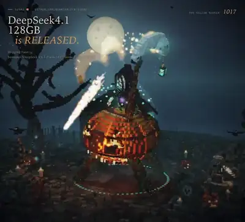</a><br><a href="https://www.sandbase.ai/lab/ai-videos/deepseek-v4-1-flash-1017/2115035083694555148?utm_source=github&utm_medium=readme&utm_campaign=awesome-deepseek-v4.1-flash-1017&utm_content=card"><b>Grim reaper animation rendered by quantized model</b></a><br><sub><a href="https://x.com/Beamsters1/status/2115035083694555148">@Beamsters1</a> · 0:21</sub></td></tr>
<tr><td width="33%" valign="top"><a href="https://www.sandbase.ai/lab/media/x/deepseek-v4-1-flash-1017/2111401362713968942/video.mp4"></a><br><a href="https://www.sandbase.ai/lab/ai-videos/deepseek-v4-1-flash-1017/2111401362713968942?utm_source=github&utm_medium=readme&utm_campaign=awesome-deepseek-v4.1-flash-1017&utm_content=card"><b>Massive medieval voxel world generated in code</b></a><br><sub><a href="https://x.com/marcthecreatorr/status/2111401362713968942">@marcthecreatorr</a> · 0:51</sub></td><td width="33%" valign="top"><a href="https://www.sandbase.ai/lab/media/x/deepseek-v4-1-flash-1017/2111464046113493422/video.mp4"></a><br><a href="https://www.sandbase.ai/lab/ai-videos/deepseek-v4-1-flash-1017/2111464046113493422?utm_source=github&utm_medium=readme&utm_campaign=awesome-deepseek-v4.1-flash-1017&utm_content=card"><b>AI generated motion design video</b></a><br><sub><a href="https://x.com/yohakujpn/status/2111464046113493422">@yohakujpn</a> · 0:35</sub></td><td width="33%" valign="top"><a href="https://www.sandbase.ai/lab/media/x/deepseek-v4-1-flash-1017/2111416511932117424/video.mp4"></a><br><a href="https://www.sandbase.ai/lab/ai-videos/deepseek-v4-1-flash-1017/2111416511932117424?utm_source=github&utm_medium=readme&utm_campaign=awesome-deepseek-v4.1-flash-1017&utm_content=card"><b>Code-generated FPS game built with DeepSeek</b></a><br><sub><a href="https://x.com/ItsmeAjayKV/status/2111416511932117424">@ItsmeAjayKV</a> · 2:30</sub></td></tr>
<tr><td width="33%" valign="top"><a href="https://www.sandbase.ai/lab/media/x/deepseek-v4-1-flash-1017/2114364317089034693/video.mp4"></a><br><a href="https://www.sandbase.ai/lab/ai-videos/deepseek-v4-1-flash-1017/2114364317089034693?utm_source=github&utm_medium=readme&utm_campaign=awesome-deepseek-v4.1-flash-1017&utm_content=card"><b>Digest bot sending morning news and app creation</b></a><br><sub><a href="https://x.com/fayazara/status/2114364317089034693">@fayazara</a> · 1:25</sub></td><td width="33%" valign="top"><a href="https://www.sandbase.ai/lab/media/x/deepseek-v4-1-flash-1017/2112464983002906928/video.mp4"></a><br><a href="https://www.sandbase.ai/lab/ai-videos/deepseek-v4-1-flash-1017/2112464983002906928?utm_source=github&utm_medium=readme&utm_campaign=awesome-deepseek-v4.1-flash-1017&utm_content=card"><b>WebGL2 particle film generated by DeepSeek</b></a><br><sub><a href="https://x.com/SamiBizConsult/status/2112464983002906928">@SamiBizConsult</a> · 0:48</sub></td></tr>
</table>

<a id="3d-scene"></a>

## 3D scenes

<table>
<tr><td width="33%" valign="top"><a href="https://www.sandbase.ai/lab/media/x/deepseek-v4-1-flash-1017/2111307024797753793/video.mp4"></a><br><a href="https://www.sandbase.ai/lab/ai-videos/deepseek-v4-1-flash-1017/2111307024797753793?utm_source=github&utm_medium=readme&utm_campaign=awesome-deepseek-v4.1-flash-1017&utm_content=card"><b>Creation Generated by DeepSeek V4.1F-1017</b></a><br><sub><a href="https://x.com/teortaxesTex/status/2111307024797753793">@teortaxesTex</a> · 0:16</sub></td><td width="33%" valign="top"><a href="https://www.sandbase.ai/lab/media/x/deepseek-v4-1-flash-1017/2111377927791067250/video.mp4"></a><br><a href="https://www.sandbase.ai/lab/ai-videos/deepseek-v4-1-flash-1017/2111377927791067250?utm_source=github&utm_medium=readme&utm_campaign=awesome-deepseek-v4.1-flash-1017&utm_content=card"><b>Interactive gummy bear physics simulation</b></a><br><sub><a href="https://x.com/0xNotFounder/status/2111377927791067250">@0xNotFounder</a> · 0:16</sub></td><td width="33%" valign="top"><a href="https://www.sandbase.ai/lab/media/x/deepseek-v4-1-flash-1017/2111387136264126744/video.mp4"></a><br><a href="https://www.sandbase.ai/lab/ai-videos/deepseek-v4-1-flash-1017/2111387136264126744?utm_source=github&utm_medium=readme&utm_campaign=awesome-deepseek-v4.1-flash-1017&utm_content=card"><b>Interactive 3D Tesla Roadster demo</b></a><br><sub><a href="https://x.com/dtzy_88/status/2111387136264126744">@dtzy_88</a> · 0:18</sub></td></tr>
<tr><td width="33%" valign="top"><a href="https://www.sandbase.ai/lab/media/x/deepseek-v4-1-flash-1017/2111388754573398252/video.mp4"></a><br><a href="https://www.sandbase.ai/lab/ai-videos/deepseek-v4-1-flash-1017/2111388754573398252?utm_source=github&utm_medium=readme&utm_campaign=awesome-deepseek-v4.1-flash-1017&utm_content=card"><b>Showcase of four 3D GIF demos</b></a><br><sub><a href="https://x.com/YxzRainy/status/2111388754573398252">@YxzRainy</a> · 0:15</sub></td><td width="33%" valign="top"><a href="https://www.sandbase.ai/lab/media/x/deepseek-v4-1-flash-1017/2111390831244460473/video.mp4"></a><br><a href="https://www.sandbase.ai/lab/ai-videos/deepseek-v4-1-flash-1017/2111390831244460473?utm_source=github&utm_medium=readme&utm_campaign=awesome-deepseek-v4.1-flash-1017&utm_content=card"><b>Speed and 3D capabilities test of DeepSeek V4.1</b></a><br><sub><a href="https://x.com/SPAC89/status/2111390831244460473">@SPAC89</a> · 1:06</sub></td><td width="33%" valign="top"><a href="https://www.sandbase.ai/lab/media/x/deepseek-v4-1-flash-1017/2111395155505033338/video.mp4"></a><br><a href="https://www.sandbase.ai/lab/ai-videos/deepseek-v4-1-flash-1017/2111395155505033338?utm_source=github&utm_medium=readme&utm_campaign=awesome-deepseek-v4.1-flash-1017&utm_content=card"><b>Four 3D demos generated by DeepSeek</b></a><br><sub><a href="https://x.com/AndyL5cc/status/2111395155505033338">@AndyL5cc</a> · 0:15</sub></td></tr>
</table>

<details>
<summary><b>Show all 77</b></summary>

<table>
<tr><td width="33%" valign="top"><a href="https://www.sandbase.ai/lab/media/x/deepseek-v4-1-flash-1017/2111401362713968942/video.mp4"></a><br><a href="https://www.sandbase.ai/lab/ai-videos/deepseek-v4-1-flash-1017/2111401362713968942?utm_source=github&utm_medium=readme&utm_campaign=awesome-deepseek-v4.1-flash-1017&utm_content=card"><b>Massive medieval voxel world generated in code</b></a><br><sub><a href="https://x.com/marcthecreatorr/status/2111401362713968942">@marcthecreatorr</a> · 0:51</sub></td><td width="33%" valign="top"><a href="https://www.sandbase.ai/lab/media/x/deepseek-v4-1-flash-1017/2111411889217651196/video.mp4"></a><br><a href="https://www.sandbase.ai/lab/ai-videos/deepseek-v4-1-flash-1017/2111411889217651196?utm_source=github&utm_medium=readme&utm_campaign=awesome-deepseek-v4.1-flash-1017&utm_content=card"><b>Blender and Three.js scene generated by DeepSeek V4.1</b></a><br><sub><a href="https://x.com/superalesha/status/2111411889217651196">@superalesha</a> · 0:24</sub></td><td width="33%" valign="top"><a href="https://www.sandbase.ai/lab/media/x/deepseek-v4-1-flash-1017/2111416683713957990/video.mp4"></a><br><a href="https://www.sandbase.ai/lab/ai-videos/deepseek-v4-1-flash-1017/2111416683713957990?utm_source=github&utm_medium=readme&utm_campaign=awesome-deepseek-v4.1-flash-1017&utm_content=card"><b>A roller-coaster highway ride simulation</b></a><br><sub><a href="https://x.com/y3185381880/status/2111416683713957990">@y3185381880</a> · 0:42</sub></td></tr>
<tr><td width="33%" valign="top"><a href="https://www.sandbase.ai/lab/media/x/deepseek-v4-1-flash-1017/2111426130549117402/video.mp4"></a><br><a href="https://www.sandbase.ai/lab/ai-videos/deepseek-v4-1-flash-1017/2111426130549117402?utm_source=github&utm_medium=readme&utm_campaign=awesome-deepseek-v4.1-flash-1017&utm_content=card"><b>Voxel pelican riding a unicycle in Web3D</b></a><br><sub><a href="https://x.com/UFO2002616/status/2111426130549117402">@UFO2002616</a> · 0:42 · <a href="https://www.sandbase.ai/lab/ai-videos/deepseek-v4-1-flash-1017/2111426130549117402?utm_source=github&utm_medium=readme&utm_campaign=awesome-deepseek-v4.1-flash-1017&utm_content=card">prompt</a></sub></td><td width="33%" valign="top"><a href="https://www.sandbase.ai/lab/media/x/deepseek-v4-1-flash-1017/2111429622734762462/video.mp4"></a><br><a href="https://www.sandbase.ai/lab/ai-videos/deepseek-v4-1-flash-1017/2111429622734762462?utm_source=github&utm_medium=readme&utm_campaign=awesome-deepseek-v4.1-flash-1017&utm_content=card"><b>3D simulation of a volcanic eruption</b></a><br><sub><a href="https://x.com/hungryturbo/status/2111429622734762462">@hungryturbo</a> · 0:14</sub></td><td width="33%" valign="top"><a href="https://www.sandbase.ai/lab/media/x/deepseek-v4-1-flash-1017/2111438320773570573/video.mp4"></a><br><a href="https://www.sandbase.ai/lab/ai-videos/deepseek-v4-1-flash-1017/2111438320773570573?utm_source=github&utm_medium=readme&utm_campaign=awesome-deepseek-v4.1-flash-1017&utm_content=card"><b>Voxel Eiffel Tower in Paris</b></a><br><sub><a href="https://x.com/nawariokra/status/2111438320773570573">@nawariokra</a> · 0:59</sub></td></tr>
<tr><td width="33%" valign="top"><a href="https://www.sandbase.ai/lab/media/x/deepseek-v4-1-flash-1017/2111438861318418817/video.mp4"></a><br><a href="https://www.sandbase.ai/lab/ai-videos/deepseek-v4-1-flash-1017/2111438861318418817?utm_source=github&utm_medium=readme&utm_campaign=awesome-deepseek-v4.1-flash-1017&utm_content=card"><b>3D Tokyo Tower scene in Three.js</b></a><br><sub><a href="https://x.com/vincent_ddup/status/2111438861318418817">@vincent_ddup</a> · 0:48 · <a href="https://www.sandbase.ai/lab/ai-videos/deepseek-v4-1-flash-1017/2111438861318418817?utm_source=github&utm_medium=readme&utm_campaign=awesome-deepseek-v4.1-flash-1017&utm_content=card">prompt</a></sub></td><td width="33%" valign="top"><a href="https://www.sandbase.ai/lab/media/x/deepseek-v4-1-flash-1017/2111440821484667343/video.mp4"></a><br><a href="https://www.sandbase.ai/lab/ai-videos/deepseek-v4-1-flash-1017/2111440821484667343?utm_source=github&utm_medium=readme&utm_campaign=awesome-deepseek-v4.1-flash-1017&utm_content=card"><b>Single-generation test video from DeepSeek V4.1</b></a><br><sub><a href="https://x.com/MaxForAI/status/2111440821484667343">@MaxForAI</a> · 0:46</sub></td><td width="33%" valign="top"><a href="https://www.sandbase.ai/lab/media/x/deepseek-v4-1-flash-1017/2111441312323088473/video.mp4"></a><br><a href="https://www.sandbase.ai/lab/ai-videos/deepseek-v4-1-flash-1017/2111441312323088473?utm_source=github&utm_medium=readme&utm_campaign=awesome-deepseek-v4.1-flash-1017&utm_content=card"><b>Tesla Roadster telemetry simulation in Three.js</b></a><br><sub><a href="https://x.com/IFITALEX/status/2111441312323088473">@IFITALEX</a> · 0:20 · <a href="https://www.sandbase.ai/lab/ai-videos/deepseek-v4-1-flash-1017/2111441312323088473?utm_source=github&utm_medium=readme&utm_campaign=awesome-deepseek-v4.1-flash-1017&utm_content=card">prompt</a></sub></td></tr>
<tr><td width="33%" valign="top"><a href="https://www.sandbase.ai/lab/media/x/deepseek-v4-1-flash-1017/2111442531594670085/video.mp4"></a><br><a href="https://www.sandbase.ai/lab/ai-videos/deepseek-v4-1-flash-1017/2111442531594670085?utm_source=github&utm_medium=readme&utm_campaign=awesome-deepseek-v4.1-flash-1017&utm_content=card"><b>Interactive 3D moon base demo</b></a><br><sub><a href="https://x.com/a_g_e_n_c/status/2111442531594670085">@a_g_e_n_c</a> · 0:14</sub></td><td width="33%" valign="top"><a href="https://www.sandbase.ai/lab/media/x/deepseek-v4-1-flash-1017/2111450021849944508/video.mp4"></a><br><a href="https://www.sandbase.ai/lab/ai-videos/deepseek-v4-1-flash-1017/2111450021849944508?utm_source=github&utm_medium=readme&utm_campaign=awesome-deepseek-v4.1-flash-1017&utm_content=card"><b>3D rollercoaster video generated via Blender</b></a><br><sub><a href="https://x.com/Yunn260414/status/2111450021849944508">@Yunn260414</a> · 0:28 · <a href="https://www.sandbase.ai/lab/ai-videos/deepseek-v4-1-flash-1017/2111450021849944508?utm_source=github&utm_medium=readme&utm_campaign=awesome-deepseek-v4.1-flash-1017&utm_content=card">prompt</a></sub></td><td width="33%" valign="top"><a href="https://www.sandbase.ai/lab/media/x/deepseek-v4-1-flash-1017/2111450154448609633/video.mp4"></a><br><a href="https://www.sandbase.ai/lab/ai-videos/deepseek-v4-1-flash-1017/2111450154448609633?utm_source=github&utm_medium=readme&utm_campaign=awesome-deepseek-v4.1-flash-1017&utm_content=card"><b>Three-story Victorian townhouse in Three.js</b></a><br><sub><a href="https://x.com/ItsmeAjayKV/status/2111450154448609633">@ItsmeAjayKV</a> · 0:54</sub></td></tr>
<tr><td width="33%" valign="top"><a href="https://www.sandbase.ai/lab/media/x/deepseek-v4-1-flash-1017/2111454710498766979/video.mp4"></a><br><a href="https://www.sandbase.ai/lab/ai-videos/deepseek-v4-1-flash-1017/2111454710498766979?utm_source=github&utm_medium=readme&utm_campaign=awesome-deepseek-v4.1-flash-1017&utm_content=card"><b>Blender 3D model recreated from image</b></a><br><sub><a href="https://x.com/npaka123/status/2111454710498766979">@npaka123</a> · 0:04 · <a href="https://www.sandbase.ai/lab/ai-videos/deepseek-v4-1-flash-1017/2111454710498766979?utm_source=github&utm_medium=readme&utm_campaign=awesome-deepseek-v4.1-flash-1017&utm_content=card">prompt</a></sub></td><td width="33%" valign="top"><a href="https://www.sandbase.ai/lab/media/x/deepseek-v4-1-flash-1017/2111456300563603569/video.mp4"></a><br><a href="https://www.sandbase.ai/lab/ai-videos/deepseek-v4-1-flash-1017/2111456300563603569?utm_source=github&utm_medium=readme&utm_campaign=awesome-deepseek-v4.1-flash-1017&utm_content=card"><b>Tesla Roadster 3D model with interior details</b></a><br><sub><a href="https://x.com/tspy/status/2111456300563603569">@tspy</a> · 1:04</sub></td><td width="33%" valign="top"><a href="https://www.sandbase.ai/lab/media/x/deepseek-v4-1-flash-1017/2111459465472176150/video.mp4"></a><br><a href="https://www.sandbase.ai/lab/ai-videos/deepseek-v4-1-flash-1017/2111459465472176150?utm_source=github&utm_medium=readme&utm_campaign=awesome-deepseek-v4.1-flash-1017&utm_content=card"><b>Three.js tour of a gauntlet rig</b></a><br><sub><a href="https://x.com/wikiwayne/status/2111459465472176150">@wikiwayne</a> · 0:26</sub></td></tr>
<tr><td width="33%" valign="top"><a href="https://www.sandbase.ai/lab/media/x/deepseek-v4-1-flash-1017/2111462244668031446/video.mp4"></a><br><a href="https://www.sandbase.ai/lab/ai-videos/deepseek-v4-1-flash-1017/2111462244668031446?utm_source=github&utm_medium=readme&utm_campaign=awesome-deepseek-v4.1-flash-1017&utm_content=card"><b>Interactive 3D moon base in Three.js</b></a><br><sub><a href="https://x.com/Octoberry/status/2111462244668031446">@Octoberry</a> · 0:14</sub></td><td width="33%" valign="top"><a href="https://www.sandbase.ai/lab/media/x/deepseek-v4-1-flash-1017/2111466763959271873/video.mp4"></a><br><a href="https://www.sandbase.ai/lab/ai-videos/deepseek-v4-1-flash-1017/2111466763959271873?utm_source=github&utm_medium=readme&utm_campaign=awesome-deepseek-v4.1-flash-1017&utm_content=card"><b>Robo-assembly and launch test in Three.js</b></a><br><sub><a href="https://x.com/alohaproxy/status/2111466763959271873">@alohaproxy</a> · 0:37</sub></td><td width="33%" valign="top"><a href="https://www.sandbase.ai/lab/media/x/deepseek-v4-1-flash-1017/2111468860935127532/video.mp4"></a><br><a href="https://www.sandbase.ai/lab/ai-videos/deepseek-v4-1-flash-1017/2111468860935127532?utm_source=github&utm_medium=readme&utm_campaign=awesome-deepseek-v4.1-flash-1017&utm_content=card"><b>3D honeybee on a sunflower</b></a><br><sub><a href="https://x.com/loktar00/status/2111468860935127532">@loktar00</a> · 1:30</sub></td></tr>
<tr><td width="33%" valign="top"><a href="https://www.sandbase.ai/lab/media/x/deepseek-v4-1-flash-1017/2111485486175039679/video.mp4"></a><br><a href="https://www.sandbase.ai/lab/ai-videos/deepseek-v4-1-flash-1017/2111485486175039679?utm_source=github&utm_medium=readme&utm_campaign=awesome-deepseek-v4.1-flash-1017&utm_content=card"><b>Camera zoom from orbit into a single atom</b></a><br><sub><a href="https://x.com/benjistacked/status/2111485486175039679">@benjistacked</a> · 0:29</sub></td><td width="33%" valign="top"><a href="https://www.sandbase.ai/lab/media/x/deepseek-v4-1-flash-1017/2111487932515410366/video.mp4"></a><br><a href="https://www.sandbase.ai/lab/ai-videos/deepseek-v4-1-flash-1017/2111487932515410366?utm_source=github&utm_medium=readme&utm_campaign=awesome-deepseek-v4.1-flash-1017&utm_content=card"><b>3D lawn mower recreation scene</b></a><br><sub><a href="https://x.com/GeekCatX/status/2111487932515410366">@GeekCatX</a> · 0:44</sub></td><td width="33%" valign="top"><a href="https://www.sandbase.ai/lab/media/x/deepseek-v4-1-flash-1017/2111488300192334142/video.mp4"></a><br><a href="https://www.sandbase.ai/lab/ai-videos/deepseek-v4-1-flash-1017/2111488300192334142?utm_source=github&utm_medium=readme&utm_campaign=awesome-deepseek-v4.1-flash-1017&utm_content=card"><b>Girl waiting for Halloween 3D scene</b></a><br><sub><a href="https://x.com/abhinavflac/status/2111488300192334142">@abhinavflac</a> · 0:17</sub></td></tr>
<tr><td width="33%" valign="top"><a href="https://www.sandbase.ai/lab/media/x/deepseek-v4-1-flash-1017/2111498348880433384/video.mp4"></a><br><a href="https://www.sandbase.ai/lab/ai-videos/deepseek-v4-1-flash-1017/2111498348880433384?utm_source=github&utm_medium=readme&utm_campaign=awesome-deepseek-v4.1-flash-1017&utm_content=card"><b>Interactive Three.js website with 3D sculpture</b></a><br><sub><a href="https://x.com/Huoimo/status/2111498348880433384">@Huoimo</a> · 0:17</sub></td><td width="33%" valign="top"><a href="https://www.sandbase.ai/lab/media/x/deepseek-v4-1-flash-1017/2111503929083359640/video.mp4"></a><br><a href="https://www.sandbase.ai/lab/ai-videos/deepseek-v4-1-flash-1017/2111503929083359640?utm_source=github&utm_medium=readme&utm_campaign=awesome-deepseek-v4.1-flash-1017&utm_content=card"><b>SpongeBob underwater scene in Three.js</b></a><br><sub><a href="https://x.com/yuhasbeentaken/status/2111503929083359640">@yuhasbeentaken</a> · 0:30</sub></td><td width="33%" valign="top"><a href="https://www.sandbase.ai/lab/media/x/deepseek-v4-1-flash-1017/2111512236753830100/video.mp4"></a><br><a href="https://www.sandbase.ai/lab/ai-videos/deepseek-v4-1-flash-1017/2111512236753830100?utm_source=github&utm_medium=readme&utm_campaign=awesome-deepseek-v4.1-flash-1017&utm_content=card"><b>A little island showing seasonal changes</b></a><br><sub><a href="https://x.com/doe_naps/status/2111512236753830100">@doe_naps</a> · 0:40</sub></td></tr>
<tr><td width="33%" valign="top"><a href="https://www.sandbase.ai/lab/media/x/deepseek-v4-1-flash-1017/2111527586832765275/video.mp4"></a><br><a href="https://www.sandbase.ai/lab/ai-videos/deepseek-v4-1-flash-1017/2111527586832765275?utm_source=github&utm_medium=readme&utm_campaign=awesome-deepseek-v4.1-flash-1017&utm_content=card"><b>Procedural 3D village built entirely with code</b></a><br><sub><a href="https://x.com/AndyL5cc/status/2111527586832765275">@AndyL5cc</a> · 0:20</sub></td><td width="33%" valign="top"><a href="https://www.sandbase.ai/lab/media/x/deepseek-v4-1-flash-1017/2111545919661289674/video.mp4"></a><br><a href="https://www.sandbase.ai/lab/ai-videos/deepseek-v4-1-flash-1017/2111545919661289674?utm_source=github&utm_medium=readme&utm_campaign=awesome-deepseek-v4.1-flash-1017&utm_content=card"><b>Cinematic Tour of an Interactive Voxel Village</b></a><br><sub><a href="https://x.com/TechMDAI/status/2111545919661289674">@TechMDAI</a> · 0:38</sub></td><td width="33%" valign="top"><a href="https://www.sandbase.ai/lab/media/x/deepseek-v4-1-flash-1017/2111551744756846721/video.mp4"></a><br><a href="https://www.sandbase.ai/lab/ai-videos/deepseek-v4-1-flash-1017/2111551744756846721?utm_source=github&utm_medium=readme&utm_campaign=awesome-deepseek-v4.1-flash-1017&utm_content=card"><b>Interactive voxel village above the clouds</b></a><br><sub><a href="https://x.com/TechMDAI/status/2111551744756846721">@TechMDAI</a> · 0:38</sub></td></tr>
<tr><td width="33%" valign="top"><a href="https://www.sandbase.ai/lab/media/x/deepseek-v4-1-flash-1017/2111580009664307475/video.mp4"></a><br><a href="https://www.sandbase.ai/lab/ai-videos/deepseek-v4-1-flash-1017/2111580009664307475?utm_source=github&utm_medium=readme&utm_campaign=awesome-deepseek-v4.1-flash-1017&utm_content=card"><b>A Relaxing Autumn Scene Generated by DeepSeek</b></a><br><sub><a href="https://x.com/loktar00/status/2111580009664307475">@loktar00</a> · 0:40</sub></td><td width="33%" valign="top"><a href="https://www.sandbase.ai/lab/media/x/deepseek-v4-1-flash-1017/2111580937246900357/video.mp4"></a><br><a href="https://www.sandbase.ai/lab/ai-videos/deepseek-v4-1-flash-1017/2111580937246900357?utm_source=github&utm_medium=readme&utm_campaign=awesome-deepseek-v4.1-flash-1017&utm_content=card"><b>Interstellar Gargantua black hole rendered in Three.js</b></a><br><sub><a href="https://x.com/TokenGremlin/status/2111580937246900357">@TokenGremlin</a> · 0:12</sub></td><td width="33%" valign="top"><a href="https://www.sandbase.ai/lab/media/x/deepseek-v4-1-flash-1017/2111581758575550546/video.mp4"></a><br><a href="https://www.sandbase.ai/lab/ai-videos/deepseek-v4-1-flash-1017/2111581758575550546?utm_source=github&utm_medium=readme&utm_campaign=awesome-deepseek-v4.1-flash-1017&utm_content=card"><b>A lighthouse in a storm built with Three.js</b></a><br><sub><a href="https://x.com/TokenGremlin/status/2111581758575550546">@TokenGremlin</a> · 0:30 · <a href="https://www.sandbase.ai/lab/ai-videos/deepseek-v4-1-flash-1017/2111581758575550546?utm_source=github&utm_medium=readme&utm_campaign=awesome-deepseek-v4.1-flash-1017&utm_content=card">prompt</a></sub></td></tr>
<tr><td width="33%" valign="top"><a href="https://www.sandbase.ai/lab/media/x/deepseek-v4-1-flash-1017/2111584413280792581/video.mp4"></a><br><a href="https://www.sandbase.ai/lab/ai-videos/deepseek-v4-1-flash-1017/2111584413280792581?utm_source=github&utm_medium=readme&utm_campaign=awesome-deepseek-v4.1-flash-1017&utm_content=card"><b>Starling flock and hawk simulation in Three.js</b></a><br><sub><a href="https://x.com/TokenGremlin/status/2111584413280792581">@TokenGremlin</a> · 0:28 · <a href="https://www.sandbase.ai/lab/ai-videos/deepseek-v4-1-flash-1017/2111584413280792581?utm_source=github&utm_medium=readme&utm_campaign=awesome-deepseek-v4.1-flash-1017&utm_content=card">prompt</a></sub></td><td width="33%" valign="top"><a href="https://www.sandbase.ai/lab/media/x/deepseek-v4-1-flash-1017/2111659534817353905/video.mp4"></a><br><a href="https://www.sandbase.ai/lab/ai-videos/deepseek-v4-1-flash-1017/2111659534817353905?utm_source=github&utm_medium=readme&utm_campaign=awesome-deepseek-v4.1-flash-1017&utm_content=card"><b>Three.js cruise simulator and promo video</b></a><br><sub><a href="https://x.com/izag82161/status/2111659534817353905">@izag82161</a> · 0:15</sub></td><td width="33%" valign="top"><a href="https://www.sandbase.ai/lab/media/x/deepseek-v4-1-flash-1017/2111709068356419724/video.mp4"></a><br><a href="https://www.sandbase.ai/lab/ai-videos/deepseek-v4-1-flash-1017/2111709068356419724?utm_source=github&utm_medium=readme&utm_campaign=awesome-deepseek-v4.1-flash-1017&utm_content=card"><b>Interactive 3D model of Leifeng Pagoda</b></a><br><sub><a href="https://x.com/NFT_Chen/status/2111709068356419724">@NFT_Chen</a> · 0:59</sub></td></tr>
<tr><td width="33%" valign="top"><a href="https://www.sandbase.ai/lab/media/x/deepseek-v4-1-flash-1017/2111757593806819789/video.mp4"></a><br><a href="https://www.sandbase.ai/lab/ai-videos/deepseek-v4-1-flash-1017/2111757593806819789?utm_source=github&utm_medium=readme&utm_campaign=awesome-deepseek-v4.1-flash-1017&utm_content=card"><b>Floating 3D island with cotton clouds</b></a><br><sub><a href="https://x.com/YxzRainy/status/2111757593806819789">@YxzRainy</a> · 0:13</sub></td><td width="33%" valign="top"><a href="https://www.sandbase.ai/lab/media/x/deepseek-v4-1-flash-1017/2111759181321822604/video.mp4"></a><br><a href="https://www.sandbase.ai/lab/ai-videos/deepseek-v4-1-flash-1017/2111759181321822604?utm_source=github&utm_medium=readme&utm_campaign=awesome-deepseek-v4.1-flash-1017&utm_content=card"><b>Interactive rotatable low-poly 3D mini planet</b></a><br><sub><a href="https://x.com/NFT_Chen/status/2111759181321822604">@NFT_Chen</a> · 0:27</sub></td><td width="33%" valign="top"><a href="https://www.sandbase.ai/lab/media/x/deepseek-v4-1-flash-1017/2111795634827354332/video.mp4"></a><br><a href="https://www.sandbase.ai/lab/ai-videos/deepseek-v4-1-flash-1017/2111795634827354332?utm_source=github&utm_medium=readme&utm_campaign=awesome-deepseek-v4.1-flash-1017&utm_content=card"><b>Interactive Three.js physics animation of Tesla Roadster</b></a><br><sub><a href="https://x.com/my189/status/2111795634827354332">@my189</a> · 0:13 · <a href="https://www.sandbase.ai/lab/ai-videos/deepseek-v4-1-flash-1017/2111795634827354332?utm_source=github&utm_medium=readme&utm_campaign=awesome-deepseek-v4.1-flash-1017&utm_content=card">prompt</a></sub></td></tr>
<tr><td width="33%" valign="top"><a href="https://www.sandbase.ai/lab/media/x/deepseek-v4-1-flash-1017/2111807210976379052/video.mp4"></a><br><a href="https://www.sandbase.ai/lab/ai-videos/deepseek-v4-1-flash-1017/2111807210976379052?utm_source=github&utm_medium=readme&utm_campaign=awesome-deepseek-v4.1-flash-1017&utm_content=card"><b>Rocket scene generated for Blender with volumetric clouds</b></a><br><sub><a href="https://x.com/superalesha/status/2111807210976379052">@superalesha</a> · 0:32</sub></td><td width="33%" valign="top"><a href="https://www.sandbase.ai/lab/media/x/deepseek-v4-1-flash-1017/2111827460409229336/video.mp4"></a><br><a href="https://www.sandbase.ai/lab/ai-videos/deepseek-v4-1-flash-1017/2111827460409229336?utm_source=github&utm_medium=readme&utm_campaign=awesome-deepseek-v4.1-flash-1017&utm_content=card"><b>A 3D BMW M5 built using Three.js</b></a><br><sub><a href="https://x.com/k2sbhai/status/2111827460409229336">@k2sbhai</a> · 0:31</sub></td><td width="33%" valign="top"><a href="https://www.sandbase.ai/lab/media/x/deepseek-v4-1-flash-1017/2111830546313781515/video.mp4"></a><br><a href="https://www.sandbase.ai/lab/ai-videos/deepseek-v4-1-flash-1017/2111830546313781515?utm_source=github&utm_medium=readme&utm_campaign=awesome-deepseek-v4.1-flash-1017&utm_content=card"><b>A 3D pelican riding a bicycle in Three.js</b></a><br><sub><a href="https://x.com/dextune/status/2111830546313781515">@dextune</a> · 0:30 · <a href="https://www.sandbase.ai/lab/ai-videos/deepseek-v4-1-flash-1017/2111830546313781515?utm_source=github&utm_medium=readme&utm_campaign=awesome-deepseek-v4.1-flash-1017&utm_content=card">prompt</a></sub></td></tr>
<tr><td width="33%" valign="top"><a href="https://www.sandbase.ai/lab/media/x/deepseek-v4-1-flash-1017/2111832005222793362/video.mp4"></a><br><a href="https://www.sandbase.ai/lab/ai-videos/deepseek-v4-1-flash-1017/2111832005222793362?utm_source=github&utm_medium=readme&utm_campaign=awesome-deepseek-v4.1-flash-1017&utm_content=card"><b>A 3D pelican riding a bicycle in Three.js</b></a><br><sub><a href="https://x.com/0xmomonifty/status/2111832005222793362">@0xmomonifty</a> · 0:20 · <a href="https://www.sandbase.ai/lab/ai-videos/deepseek-v4-1-flash-1017/2111832005222793362?utm_source=github&utm_medium=readme&utm_campaign=awesome-deepseek-v4.1-flash-1017&utm_content=card">prompt</a></sub></td><td width="33%" valign="top"><a href="https://www.sandbase.ai/lab/media/x/deepseek-v4-1-flash-1017/2111850077966995855/video.mp4"></a><br><a href="https://www.sandbase.ai/lab/ai-videos/deepseek-v4-1-flash-1017/2111850077966995855?utm_source=github&utm_medium=readme&utm_campaign=awesome-deepseek-v4.1-flash-1017&utm_content=card"><b>Interactive 3D developer workspace built with Three.js</b></a><br><sub><a href="https://x.com/WaelAbdrabbo/status/2111850077966995855">@WaelAbdrabbo</a> · 0:23</sub></td><td width="33%" valign="top"><a href="https://www.sandbase.ai/lab/media/x/deepseek-v4-1-flash-1017/2111852714174881987/video.mp4"></a><br><a href="https://www.sandbase.ai/lab/ai-videos/deepseek-v4-1-flash-1017/2111852714174881987?utm_source=github&utm_medium=readme&utm_campaign=awesome-deepseek-v4.1-flash-1017&utm_content=card"><b>Interactive voxel village above the clouds</b></a><br><sub><a href="https://x.com/TechMDAI/status/2111852714174881987">@TechMDAI</a> · 1:11</sub></td></tr>
<tr><td width="33%" valign="top"><a href="https://www.sandbase.ai/lab/media/x/deepseek-v4-1-flash-1017/2111905877016170549/video.mp4"></a><br><a href="https://www.sandbase.ai/lab/ai-videos/deepseek-v4-1-flash-1017/2111905877016170549?utm_source=github&utm_medium=readme&utm_campaign=awesome-deepseek-v4.1-flash-1017&utm_content=card"><b>Three.js demo in a single HTML file</b></a><br><sub><a href="https://x.com/beyondwudan/status/2111905877016170549">@beyondwudan</a> · 0:48</sub></td><td width="33%" valign="top"><a href="https://www.sandbase.ai/lab/media/x/deepseek-v4-1-flash-1017/2112000994930237463/video.mp4"></a><br><a href="https://www.sandbase.ai/lab/ai-videos/deepseek-v4-1-flash-1017/2112000994930237463?utm_source=github&utm_medium=readme&utm_campaign=awesome-deepseek-v4.1-flash-1017&utm_content=card"><b>A misty waterfall gorge scene</b></a><br><sub><a href="https://x.com/wikiwayne/status/2112000994930237463">@wikiwayne</a> · 1:05</sub></td><td width="33%" valign="top"><a href="https://www.sandbase.ai/lab/media/x/deepseek-v4-1-flash-1017/2112064816475177269/video.mp4"></a><br><a href="https://www.sandbase.ai/lab/ai-videos/deepseek-v4-1-flash-1017/2112064816475177269?utm_source=github&utm_medium=readme&utm_campaign=awesome-deepseek-v4.1-flash-1017&utm_content=card"><b>A 3D video created with Three.js and Remotion</b></a><br><sub><a href="https://x.com/direkturcrypto/status/2112064816475177269">@direkturcrypto</a> · 1:01</sub></td></tr>
<tr><td width="33%" valign="top"><a href="https://www.sandbase.ai/lab/media/x/deepseek-v4-1-flash-1017/2112095534123229361/video.mp4"></a><br><a href="https://www.sandbase.ai/lab/ai-videos/deepseek-v4-1-flash-1017/2112095534123229361?utm_source=github&utm_medium=readme&utm_campaign=awesome-deepseek-v4.1-flash-1017&utm_content=card"><b>Interactive 3D koi pond with swimming fish</b></a><br><sub><a href="https://x.com/SahilPanhotra/status/2112095534123229361">@SahilPanhotra</a> · 0:24</sub></td><td width="33%" valign="top"><a href="https://www.sandbase.ai/lab/media/x/deepseek-v4-1-flash-1017/2112132875042820585/video.mp4"></a><br><a href="https://www.sandbase.ai/lab/ai-videos/deepseek-v4-1-flash-1017/2112132875042820585?utm_source=github&utm_medium=readme&utm_campaign=awesome-deepseek-v4.1-flash-1017&utm_content=card"><b>Golden desert oasis at sunset scene</b></a><br><sub><a href="https://x.com/wikiwayne/status/2112132875042820585">@wikiwayne</a> · 1:02</sub></td><td width="33%" valign="top"><a href="https://www.sandbase.ai/lab/media/x/deepseek-v4-1-flash-1017/2112160485114270128/video.mp4"></a><br><a href="https://www.sandbase.ai/lab/ai-videos/deepseek-v4-1-flash-1017/2112160485114270128?utm_source=github&utm_medium=readme&utm_campaign=awesome-deepseek-v4.1-flash-1017&utm_content=card"><b>Banana test rendering with DeepSeek V4.1 Flash</b></a><br><sub><a href="https://x.com/AdamHoltererer/status/2112160485114270128">@AdamHoltererer</a> · 0:06</sub></td></tr>
<tr><td width="33%" valign="top"><a href="https://www.sandbase.ai/lab/media/x/deepseek-v4-1-flash-1017/2112170183209226383/video.mp4"></a><br><a href="https://www.sandbase.ai/lab/ai-videos/deepseek-v4-1-flash-1017/2112170183209226383?utm_source=github&utm_medium=readme&utm_campaign=awesome-deepseek-v4.1-flash-1017&utm_content=card"><b>A mechanical tourbillon watch modeled in Three.js</b></a><br><sub><a href="https://x.com/GeekCatX/status/2112170183209226383">@GeekCatX</a> · 0:30 · <a href="https://www.sandbase.ai/lab/ai-videos/deepseek-v4-1-flash-1017/2112170183209226383?utm_source=github&utm_medium=readme&utm_campaign=awesome-deepseek-v4.1-flash-1017&utm_content=card">prompt</a></sub></td><td width="33%" valign="top"><a href="https://www.sandbase.ai/lab/media/x/deepseek-v4-1-flash-1017/2112189081870618781/video.mp4"></a><br><a href="https://www.sandbase.ai/lab/ai-videos/deepseek-v4-1-flash-1017/2112189081870618781?utm_source=github&utm_medium=readme&utm_campaign=awesome-deepseek-v4.1-flash-1017&utm_content=card"><b>Three.js gummy bears built in one shot</b></a><br><sub><a href="https://x.com/k2sbhai/status/2112189081870618781">@k2sbhai</a> · 0:54</sub></td><td width="33%" valign="top"><a href="https://www.sandbase.ai/lab/media/x/deepseek-v4-1-flash-1017/2112221137598115861/video.mp4"></a><br><a href="https://www.sandbase.ai/lab/ai-videos/deepseek-v4-1-flash-1017/2112221137598115861?utm_source=github&utm_medium=readme&utm_campaign=awesome-deepseek-v4.1-flash-1017&utm_content=card"><b>Yingxian Pagoda build animation in HTML</b></a><br><sub><a href="https://x.com/BigAvenu3/status/2112221137598115861">@BigAvenu3</a> · 0:24</sub></td></tr>
<tr><td width="33%" valign="top"><a href="https://www.sandbase.ai/lab/media/x/deepseek-v4-1-flash-1017/2112243591472980063/video.mp4"></a><br><a href="https://www.sandbase.ai/lab/ai-videos/deepseek-v4-1-flash-1017/2112243591472980063?utm_source=github&utm_medium=readme&utm_campaign=awesome-deepseek-v4.1-flash-1017&utm_content=card"><b>Local 3D modeling with DeepSeek in Solidcraft</b></a><br><sub><a href="https://x.com/jaita/status/2112243591472980063">@jaita</a> · 0:37</sub></td><td width="33%" valign="top"><a href="https://www.sandbase.ai/lab/media/x/deepseek-v4-1-flash-1017/2112293216913347010/video.mp4"></a><br><a href="https://www.sandbase.ai/lab/ai-videos/deepseek-v4-1-flash-1017/2112293216913347010?utm_source=github&utm_medium=readme&utm_campaign=awesome-deepseek-v4.1-flash-1017&utm_content=card"><b>UFO landing on the White House lawn</b></a><br><sub><a href="https://x.com/Tech2Wild/status/2112293216913347010">@Tech2Wild</a> · 0:41</sub></td><td width="33%" valign="top"><a href="https://www.sandbase.ai/lab/media/x/deepseek-v4-1-flash-1017/2112652706091352471/video.mp4"></a><br><a href="https://www.sandbase.ai/lab/ai-videos/deepseek-v4-1-flash-1017/2112652706091352471?utm_source=github&utm_medium=readme&utm_campaign=awesome-deepseek-v4.1-flash-1017&utm_content=card"><b>Animated voxel pagoda built in Three.js</b></a><br><sub><a href="https://x.com/Chris_Wozniczek/status/2112652706091352471">@Chris_Wozniczek</a> · 1:19 · <a href="https://www.sandbase.ai/lab/ai-videos/deepseek-v4-1-flash-1017/2112652706091352471?utm_source=github&utm_medium=readme&utm_campaign=awesome-deepseek-v4.1-flash-1017&utm_content=card">prompt</a></sub></td></tr>
<tr><td width="33%" valign="top"><a href="https://www.sandbase.ai/lab/media/x/deepseek-v4-1-flash-1017/2112696676758491263/video.mp4"></a><br><a href="https://www.sandbase.ai/lab/ai-videos/deepseek-v4-1-flash-1017/2112696676758491263?utm_source=github&utm_medium=readme&utm_campaign=awesome-deepseek-v4.1-flash-1017&utm_content=card"><b>Voxel pagoda garden with falling petals and pond</b></a><br><sub><a href="https://x.com/WescheNex1q/status/2112696676758491263">@WescheNex1q</a> · 0:20</sub></td><td width="33%" valign="top"><a href="https://www.sandbase.ai/lab/media/x/deepseek-v4-1-flash-1017/2112767389058396606/video.mp4">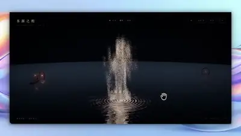</a><br><a href="https://www.sandbase.ai/lab/ai-videos/deepseek-v4-1-flash-1017/2112767389058396606?utm_source=github&utm_medium=readme&utm_campaign=awesome-deepseek-v4.1-flash-1017&utm_content=card"><b>Interactive 3D Zen scene with particle shaders</b></a><br><sub><a href="https://x.com/GeekCatX/status/2112767389058396606">@GeekCatX</a> · 1:31</sub></td><td width="33%" valign="top"><a href="https://www.sandbase.ai/lab/media/x/deepseek-v4-1-flash-1017/2112789987196600761/video.mp4">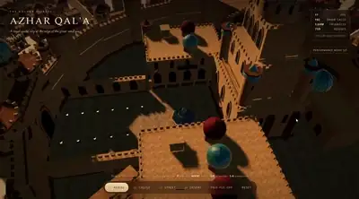</a><br><a href="https://www.sandbase.ai/lab/ai-videos/deepseek-v4-1-flash-1017/2112789987196600761?utm_source=github&utm_medium=readme&utm_campaign=awesome-deepseek-v4.1-flash-1017&utm_content=card"><b>A castle in a desert city render</b></a><br><sub><a href="https://x.com/Rohit_115/status/2112789987196600761">@Rohit_115</a> · 2:28</sub></td></tr>
<tr><td width="33%" valign="top"><a href="https://www.sandbase.ai/lab/media/x/deepseek-v4-1-flash-1017/2112836206723563684/video.mp4"></a><br><a href="https://www.sandbase.ai/lab/ai-videos/deepseek-v4-1-flash-1017/2112836206723563684?utm_source=github&utm_medium=readme&utm_campaign=awesome-deepseek-v4.1-flash-1017&utm_content=card"><b>A 3D koi courtyard with swimming fish</b></a><br><sub><a href="https://x.com/SahilPanhotra/status/2112836206723563684">@SahilPanhotra</a> · 0:34</sub></td><td width="33%" valign="top"><a href="https://www.sandbase.ai/lab/media/x/deepseek-v4-1-flash-1017/2112960492696457278/video.mp4"></a><br><a href="https://www.sandbase.ai/lab/ai-videos/deepseek-v4-1-flash-1017/2112960492696457278?utm_source=github&utm_medium=readme&utm_campaign=awesome-deepseek-v4.1-flash-1017&utm_content=card"><b>Realistic sky and water rendered in Three.js</b></a><br><sub><a href="https://x.com/rubenssoto_ai/status/2112960492696457278">@rubenssoto_ai</a> · 1:00</sub></td><td width="33%" valign="top"><a href="https://www.sandbase.ai/lab/media/x/deepseek-v4-1-flash-1017/2113002016394096769/video.mp4"></a><br><a href="https://www.sandbase.ai/lab/ai-videos/deepseek-v4-1-flash-1017/2113002016394096769?utm_source=github&utm_medium=readme&utm_campaign=awesome-deepseek-v4.1-flash-1017&utm_content=card"><b>WWII voxel scene generated by DeepSeek</b></a><br><sub><a href="https://x.com/Tech2Wild/status/2113002016394096769">@Tech2Wild</a> · 1:05</sub></td></tr>
<tr><td width="33%" valign="top"><a href="https://www.sandbase.ai/lab/media/x/deepseek-v4-1-flash-1017/2113043936075993399/video.mp4">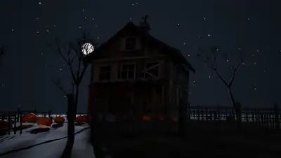</a><br><a href="https://www.sandbase.ai/lab/ai-videos/deepseek-v4-1-flash-1017/2113043936075993399?utm_source=github&utm_medium=readme&utm_campaign=awesome-deepseek-v4.1-flash-1017&utm_content=card"><b>Blender video generated with DeepSeek 1017 Max</b></a><br><sub><a href="https://x.com/X_rayzn/status/2113043936075993399">@X_rayzn</a> · 0:28</sub></td><td width="33%" valign="top"><a href="https://www.sandbase.ai/lab/media/x/deepseek-v4-1-flash-1017/2113138781381615819/video.mp4"></a><br><a href="https://www.sandbase.ai/lab/ai-videos/deepseek-v4-1-flash-1017/2113138781381615819?utm_source=github&utm_medium=readme&utm_campaign=awesome-deepseek-v4.1-flash-1017&utm_content=card"><b>Cinematic 3D MacBook and M5 chip scene</b></a><br><sub><a href="https://x.com/bebuu_ai/status/2113138781381615819">@bebuu_ai</a> · 0:21</sub></td><td width="33%" valign="top"><a href="https://www.sandbase.ai/lab/media/x/deepseek-v4-1-flash-1017/2113342060887433562/video.mp4">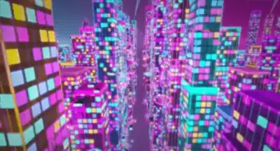</a><br><a href="https://www.sandbase.ai/lab/ai-videos/deepseek-v4-1-flash-1017/2113342060887433562?utm_source=github&utm_medium=readme&utm_campaign=awesome-deepseek-v4.1-flash-1017&utm_content=card"><b>One-shot neon city generated on DGX Sparks</b></a><br><sub><a href="https://x.com/calvarado2004/status/2113342060887433562">@calvarado2004</a> · 1:03</sub></td></tr>
<tr><td width="33%" valign="top"><a href="https://www.sandbase.ai/lab/media/x/deepseek-v4-1-flash-1017/2113343755184926791/video.mp4">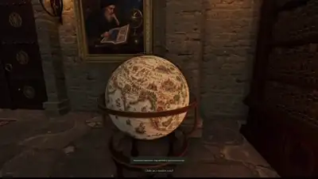</a><br><a href="https://www.sandbase.ai/lab/ai-videos/deepseek-v4-1-flash-1017/2113343755184926791?utm_source=github&utm_medium=readme&utm_campaign=awesome-deepseek-v4.1-flash-1017&utm_content=card"><b>Interactive 3D medieval library built with Three.js</b></a><br><sub><a href="https://x.com/swarogan/status/2113343755184926791">@swarogan</a> · 2:10</sub></td><td width="33%" valign="top"><a href="https://www.sandbase.ai/lab/media/x/deepseek-v4-1-flash-1017/2113660518439456831/video.mp4">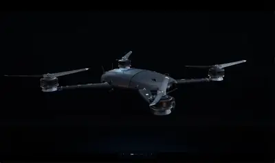</a><br><a href="https://www.sandbase.ai/lab/ai-videos/deepseek-v4-1-flash-1017/2113660518439456831?utm_source=github&utm_medium=readme&utm_campaign=awesome-deepseek-v4.1-flash-1017&utm_content=card"><b>Interactive 3D drone generated in one turn</b></a><br><sub><a href="https://x.com/YxzRainy/status/2113660518439456831">@YxzRainy</a> · 0:21</sub></td><td width="33%" valign="top"><a href="https://www.sandbase.ai/lab/media/x/deepseek-v4-1-flash-1017/2113698217560862949/video.mp4">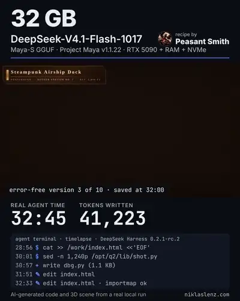</a><br><a href="https://www.sandbase.ai/lab/ai-videos/deepseek-v4-1-flash-1017/2113698217560862949?utm_source=github&utm_medium=readme&utm_campaign=awesome-deepseek-v4.1-flash-1017&utm_content=card"><b>Steampunk voxel airship dock generated in 3D</b></a><br><sub><a href="https://x.com/niklaslenz_ai/status/2113698217560862949">@niklaslenz_ai</a> · 0:42</sub></td></tr>
<tr><td width="33%" valign="top"><a href="https://www.sandbase.ai/lab/media/x/deepseek-v4-1-flash-1017/2113736583060885652/video.mp4">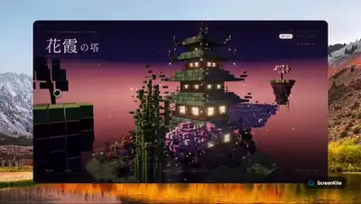</a><br><a href="https://www.sandbase.ai/lab/ai-videos/deepseek-v4-1-flash-1017/2113736583060885652?utm_source=github&utm_medium=readme&utm_campaign=awesome-deepseek-v4.1-flash-1017&utm_content=card"><b>Interactive voxel pagoda garden scene</b></a><br><sub><a href="https://x.com/Chris_Wozniczek/status/2113736583060885652">@Chris_Wozniczek</a> · 1:21</sub></td><td width="33%" valign="top"><a href="https://www.sandbase.ai/lab/media/x/deepseek-v4-1-flash-1017/2114036230354788581/video.mp4">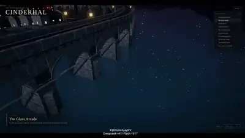</a><br><a href="https://www.sandbase.ai/lab/ai-videos/deepseek-v4-1-flash-1017/2114036230354788581?utm_source=github&utm_medium=readme&utm_campaign=awesome-deepseek-v4.1-flash-1017&utm_content=card"><b>Procedural 3D steam-harbour city in code</b></a><br><sub><a href="https://x.com/ItsmeAjayKV/status/2114036230354788581">@ItsmeAjayKV</a> · 2:45</sub></td><td width="33%" valign="top"><a href="https://www.sandbase.ai/lab/media/x/deepseek-v4-1-flash-1017/2114655559106572681/video.mp4">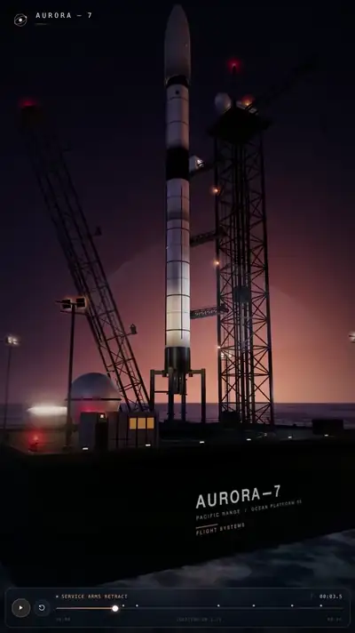</a><br><a href="https://www.sandbase.ai/lab/ai-videos/deepseek-v4-1-flash-1017/2114655559106572681?utm_source=github&utm_medium=readme&utm_campaign=awesome-deepseek-v4.1-flash-1017&utm_content=card"><b>Rocket test in Codewhale</b></a><br><sub><a href="https://x.com/goodhunt/status/2114655559106572681">@goodhunt</a> · 0:46</sub></td></tr>
<tr><td width="33%" valign="top"><a href="https://www.sandbase.ai/lab/media/x/deepseek-v4-1-flash-1017/2115336591245987956/video.mp4">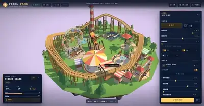</a><br><a href="https://www.sandbase.ai/lab/ai-videos/deepseek-v4-1-flash-1017/2115336591245987956?utm_source=github&utm_medium=readme&utm_campaign=awesome-deepseek-v4.1-flash-1017&utm_content=card"><b>Voxel amusement park on a floating island</b></a><br><sub><a href="https://x.com/cfenghub/status/2115336591245987956">@cfenghub</a> · 0:48</sub></td><td width="33%" valign="top"><a href="https://www.sandbase.ai/lab/media/x/deepseek-v4-1-flash-1017/2115447988877418496/video.mp4">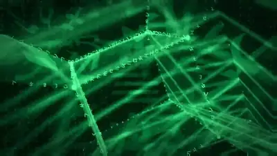</a><br><a href="https://www.sandbase.ai/lab/ai-videos/deepseek-v4-1-flash-1017/2115447988877418496?utm_source=github&utm_medium=readme&utm_campaign=awesome-deepseek-v4.1-flash-1017&utm_content=card"><b>Matrix tesseract 90s style demoscene animation</b></a><br><sub><a href="https://x.com/axitek/status/2115447988877418496">@axitek</a> · 0:30</sub></td></tr>
</table>

</details>

<a id="motion-graphics"></a>

## Motion graphics

<table>
<tr><td width="33%" valign="top"><a href="https://www.sandbase.ai/lab/media/x/deepseek-v4-1-flash-1017/2111392745155936690/video.mp4"></a><br><a href="https://www.sandbase.ai/lab/ai-videos/deepseek-v4-1-flash-1017/2111392745155936690?utm_source=github&utm_medium=readme&utm_campaign=awesome-deepseek-v4.1-flash-1017&utm_content=card"><b>Pelican riding a bicycle animated in SVG</b></a><br><sub><a href="https://x.com/GKev1n/status/2111392745155936690">@GKev1n</a> · 0:11</sub></td><td width="33%" valign="top"><a href="https://www.sandbase.ai/lab/media/x/deepseek-v4-1-flash-1017/2111415760681849025/video.mp4"></a><br><a href="https://www.sandbase.ai/lab/ai-videos/deepseek-v4-1-flash-1017/2111415760681849025?utm_source=github&utm_medium=readme&utm_campaign=awesome-deepseek-v4.1-flash-1017&utm_content=card"><b>Peacock test animation generated with DeepSeek</b></a><br><sub><a href="https://x.com/SahilPanhotra/status/2111415760681849025">@SahilPanhotra</a> · 0:10</sub></td><td width="33%" valign="top"><a href="https://www.sandbase.ai/lab/media/x/deepseek-v4-1-flash-1017/2111417566224896054/video.mp4"></a><br><a href="https://www.sandbase.ai/lab/ai-videos/deepseek-v4-1-flash-1017/2111417566224896054?utm_source=github&utm_medium=readme&utm_campaign=awesome-deepseek-v4.1-flash-1017&utm_content=card"><b>SVG animation of a rhino riding a giraffe</b></a><br><sub><a href="https://x.com/atomtanstudio/status/2111417566224896054">@atomtanstudio</a> · 0:16</sub></td></tr>
<tr><td width="33%" valign="top"><a href="https://www.sandbase.ai/lab/media/x/deepseek-v4-1-flash-1017/2111454840337600839/video.mp4"></a><br><a href="https://www.sandbase.ai/lab/ai-videos/deepseek-v4-1-flash-1017/2111454840337600839?utm_source=github&utm_medium=readme&utm_campaign=awesome-deepseek-v4.1-flash-1017&utm_content=card"><b>Animated character pedaling generated in SVG</b></a><br><sub><a href="https://x.com/SahilPanhotra/status/2111454840337600839">@SahilPanhotra</a> · 0:10</sub></td><td width="33%" valign="top"><a href="https://www.sandbase.ai/lab/media/x/deepseek-v4-1-flash-1017/2111460614656913914/video.mp4"></a><br><a href="https://www.sandbase.ai/lab/ai-videos/deepseek-v4-1-flash-1017/2111460614656913914?utm_source=github&utm_medium=readme&utm_campaign=awesome-deepseek-v4.1-flash-1017&utm_content=card"><b>Pelican riding a bicycle drawn in SVG</b></a><br><sub><a href="https://x.com/aizhibeibei/status/2111460614656913914">@aizhibeibei</a> · 0:06 · <a href="https://www.sandbase.ai/lab/ai-videos/deepseek-v4-1-flash-1017/2111460614656913914?utm_source=github&utm_medium=readme&utm_campaign=awesome-deepseek-v4.1-flash-1017&utm_content=card">prompt</a></sub></td><td width="33%" valign="top"><a href="https://www.sandbase.ai/lab/media/x/deepseek-v4-1-flash-1017/2111464046113493422/video.mp4"></a><br><a href="https://www.sandbase.ai/lab/ai-videos/deepseek-v4-1-flash-1017/2111464046113493422?utm_source=github&utm_medium=readme&utm_campaign=awesome-deepseek-v4.1-flash-1017&utm_content=card"><b>AI generated motion design video</b></a><br><sub><a href="https://x.com/yohakujpn/status/2111464046113493422">@yohakujpn</a> · 0:35</sub></td></tr>
</table>

<details>
<summary><b>Show all 24</b></summary>

<table>
<tr><td width="33%" valign="top"><a href="https://www.sandbase.ai/lab/media/x/deepseek-v4-1-flash-1017/2111476965429645706/video.mp4"></a><br><a href="https://www.sandbase.ai/lab/ai-videos/deepseek-v4-1-flash-1017/2111476965429645706?utm_source=github&utm_medium=readme&utm_campaign=awesome-deepseek-v4.1-flash-1017&utm_content=card"><b>SVG drawing of Frieren with background music</b></a><br><sub><a href="https://x.com/notjazii/status/2111476965429645706">@notjazii</a> · 0:29</sub></td><td width="33%" valign="top"><a href="https://www.sandbase.ai/lab/media/x/deepseek-v4-1-flash-1017/2111506897656545394/video.mp4"></a><br><a href="https://www.sandbase.ai/lab/ai-videos/deepseek-v4-1-flash-1017/2111506897656545394?utm_source=github&utm_medium=readme&utm_campaign=awesome-deepseek-v4.1-flash-1017&utm_content=card"><b>Visual test with DeepSeek V4.1 Flash</b></a><br><sub><a href="https://x.com/seanphan/status/2111506897656545394">@seanphan</a> · 0:45</sub></td><td width="33%" valign="top"><a href="https://www.sandbase.ai/lab/media/x/deepseek-v4-1-flash-1017/2111517607304319355/video.mp4"></a><br><a href="https://www.sandbase.ai/lab/ai-videos/deepseek-v4-1-flash-1017/2111517607304319355?utm_source=github&utm_medium=readme&utm_campaign=awesome-deepseek-v4.1-flash-1017&utm_content=card"><b>Documentary trailer about video game history in code</b></a><br><sub><a href="https://x.com/NFT_Chen/status/2111517607304319355">@NFT_Chen</a> · 2:00</sub></td></tr>
<tr><td width="33%" valign="top"><a href="https://www.sandbase.ai/lab/media/x/deepseek-v4-1-flash-1017/2111549642668458009/video.mp4"></a><br><a href="https://www.sandbase.ai/lab/ai-videos/deepseek-v4-1-flash-1017/2111549642668458009?utm_source=github&utm_medium=readme&utm_campaign=awesome-deepseek-v4.1-flash-1017&utm_content=card"><b>SVG animation of a monkey climbing a tree</b></a><br><sub><a href="https://x.com/Huoimo/status/2111549642668458009">@Huoimo</a> · 0:15</sub></td><td width="33%" valign="top"><a href="https://www.sandbase.ai/lab/media/x/deepseek-v4-1-flash-1017/2111580391161110899/video.mp4"></a><br><a href="https://www.sandbase.ai/lab/ai-videos/deepseek-v4-1-flash-1017/2111580391161110899?utm_source=github&utm_medium=readme&utm_campaign=awesome-deepseek-v4.1-flash-1017&utm_content=card"><b>Cerebras chip benchmark creation by DeepSeek</b></a><br><sub><a href="https://x.com/SPAC89/status/2111580391161110899">@SPAC89</a> · 0:18</sub></td><td width="33%" valign="top"><a href="https://www.sandbase.ai/lab/media/x/deepseek-v4-1-flash-1017/2111623294810251526/video.mp4"></a><br><a href="https://www.sandbase.ai/lab/ai-videos/deepseek-v4-1-flash-1017/2111623294810251526?utm_source=github&utm_medium=readme&utm_campaign=awesome-deepseek-v4.1-flash-1017&utm_content=card"><b>Satellite briefing style video in DeepSeek V4.1</b></a><br><sub><a href="https://x.com/lemomo_ai/status/2111623294810251526">@lemomo_ai</a> · 0:58</sub></td></tr>
<tr><td width="33%" valign="top"><a href="https://www.sandbase.ai/lab/media/x/deepseek-v4-1-flash-1017/2111623798428446964/video.mp4"></a><br><a href="https://www.sandbase.ai/lab/ai-videos/deepseek-v4-1-flash-1017/2111623798428446964?utm_source=github&utm_medium=readme&utm_campaign=awesome-deepseek-v4.1-flash-1017&utm_content=card"><b>Pixel art cross section of an espresso machine</b></a><br><sub><a href="https://x.com/loktar00/status/2111623798428446964">@loktar00</a> · 0:52</sub></td><td width="33%" valign="top"><a href="https://www.sandbase.ai/lab/media/x/deepseek-v4-1-flash-1017/2111700522344517825/video.mp4"></a><br><a href="https://www.sandbase.ai/lab/ai-videos/deepseek-v4-1-flash-1017/2111700522344517825?utm_source=github&utm_medium=readme&utm_campaign=awesome-deepseek-v4.1-flash-1017&utm_content=card"><b>Motion graphic video created for Pie</b></a><br><sub><a href="https://x.com/hieuSSR/status/2111700522344517825">@hieuSSR</a> · 0:15</sub></td><td width="33%" valign="top"><a href="https://www.sandbase.ai/lab/media/x/deepseek-v4-1-flash-1017/2111741087710949431/video.mp4"></a><br><a href="https://www.sandbase.ai/lab/ai-videos/deepseek-v4-1-flash-1017/2111741087710949431?utm_source=github&utm_medium=readme&utm_campaign=awesome-deepseek-v4.1-flash-1017&utm_content=card"><b>Self-promotional MP4 video generated with Remotion</b></a><br><sub><a href="https://x.com/cheery9998/status/2111741087710949431">@cheery9998</a> · 0:52</sub></td></tr>
<tr><td width="33%" valign="top"><a href="https://www.sandbase.ai/lab/media/x/deepseek-v4-1-flash-1017/2111795761994461291/video.mp4"></a><br><a href="https://www.sandbase.ai/lab/ai-videos/deepseek-v4-1-flash-1017/2111795761994461291?utm_source=github&utm_medium=readme&utm_campaign=awesome-deepseek-v4.1-flash-1017&utm_content=card"><b>Video created with DeepSeek V4.1 Flash 1017</b></a><br><sub><a href="https://x.com/direkturcrypto/status/2111795761994461291">@direkturcrypto</a> · 0:54</sub></td><td width="33%" valign="top"><a href="https://www.sandbase.ai/lab/media/x/deepseek-v4-1-flash-1017/2111987269594984920/video.mp4"></a><br><a href="https://www.sandbase.ai/lab/ai-videos/deepseek-v4-1-flash-1017/2111987269594984920?utm_source=github&utm_medium=readme&utm_campaign=awesome-deepseek-v4.1-flash-1017&utm_content=card"><b>Motion design test using MUSE AI</b></a><br><sub><a href="https://x.com/tirtaVEX/status/2111987269594984920">@tirtaVEX</a> · 0:22</sub></td><td width="33%" valign="top"><a href="https://www.sandbase.ai/lab/media/x/deepseek-v4-1-flash-1017/2112314662712729941/video.mp4"></a><br><a href="https://www.sandbase.ai/lab/ai-videos/deepseek-v4-1-flash-1017/2112314662712729941?utm_source=github&utm_medium=readme&utm_campaign=awesome-deepseek-v4.1-flash-1017&utm_content=card"><b>JavaScript animation and song about DeepSeek</b></a><br><sub><a href="https://x.com/quimedesu/status/2112314662712729941">@quimedesu</a> · 4:42</sub></td></tr>
<tr><td width="33%" valign="top"><a href="https://www.sandbase.ai/lab/media/x/deepseek-v4-1-flash-1017/2112623058586677349/video.mp4"></a><br><a href="https://www.sandbase.ai/lab/ai-videos/deepseek-v4-1-flash-1017/2112623058586677349?utm_source=github&utm_medium=readme&utm_campaign=awesome-deepseek-v4.1-flash-1017&utm_content=card"><b>Local benchmark and sample video run</b></a><br><sub><a href="https://x.com/seanphan/status/2112623058586677349">@seanphan</a> · 0:45</sub></td><td width="33%" valign="top"><a href="https://www.sandbase.ai/lab/media/x/deepseek-v4-1-flash-1017/2113205877289156878/video.mp4"></a><br><a href="https://www.sandbase.ai/lab/ai-videos/deepseek-v4-1-flash-1017/2113205877289156878?utm_source=github&utm_medium=readme&utm_campaign=awesome-deepseek-v4.1-flash-1017&utm_content=card"><b>First test scene generated with DeepSeek</b></a><br><sub><a href="https://x.com/doth4580/status/2113205877289156878">@doth4580</a> · 0:32</sub></td><td width="33%" valign="top"><a href="https://www.sandbase.ai/lab/media/x/deepseek-v4-1-flash-1017/2113529870022255061/video.mp4">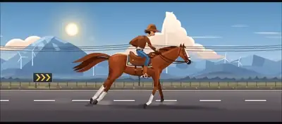</a><br><a href="https://www.sandbase.ai/lab/ai-videos/deepseek-v4-1-flash-1017/2113529870022255061?utm_source=github&utm_medium=readme&utm_campaign=awesome-deepseek-v4.1-flash-1017&utm_content=card"><b>Animated riding motion generated from an image</b></a><br><sub><a href="https://x.com/bebuu_ai/status/2113529870022255061">@bebuu_ai</a> · 0:06</sub></td></tr>
<tr><td width="33%" valign="top"><a href="https://www.sandbase.ai/lab/media/x/deepseek-v4-1-flash-1017/2114722860447182997/video.mp4">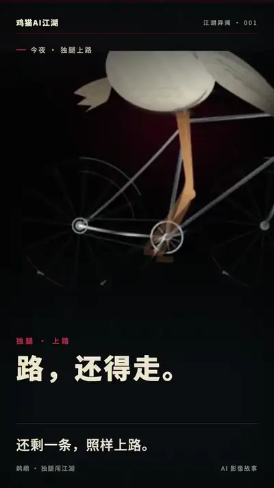</a><br><a href="https://www.sandbase.ai/lab/ai-videos/deepseek-v4-1-flash-1017/2114722860447182997?utm_source=github&utm_medium=readme&utm_campaign=awesome-deepseek-v4.1-flash-1017&utm_content=card"><b>Pelican riding a bicycle video remix</b></a><br><sub><a href="https://x.com/mspd4100/status/2114722860447182997">@mspd4100</a> · 0:22</sub></td><td width="33%" valign="top"><a href="https://www.sandbase.ai/lab/media/x/deepseek-v4-1-flash-1017/2115035083694555148/video.mp4"></a><br><a href="https://www.sandbase.ai/lab/ai-videos/deepseek-v4-1-flash-1017/2115035083694555148?utm_source=github&utm_medium=readme&utm_campaign=awesome-deepseek-v4.1-flash-1017&utm_content=card"><b>Grim reaper animation rendered by quantized model</b></a><br><sub><a href="https://x.com/Beamsters1/status/2115035083694555148">@Beamsters1</a> · 0:21</sub></td><td width="33%" valign="top"><a href="https://www.sandbase.ai/lab/media/x/deepseek-v4-1-flash-1017/2115485768348995998/video.mp4">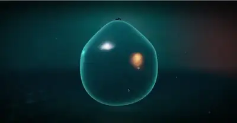</a><br><a href="https://www.sandbase.ai/lab/ai-videos/deepseek-v4-1-flash-1017/2115485768348995998?utm_source=github&utm_medium=readme&utm_campaign=awesome-deepseek-v4.1-flash-1017&utm_content=card"><b>Local generation test with DeepSeek-V4.1-Flash</b></a><br><sub><a href="https://x.com/sfxnz/status/2115485768348995998">@sfxnz</a> · 0:08</sub></td></tr>
</table>

</details>

<a id="game"></a>

## Games

<table>
<tr><td width="33%" valign="top"><a href="https://www.sandbase.ai/lab/media/x/deepseek-v4-1-flash-1017/2111410853522129220/video.mp4"></a><br><a href="https://www.sandbase.ai/lab/ai-videos/deepseek-v4-1-flash-1017/2111410853522129220?utm_source=github&utm_medium=readme&utm_campaign=awesome-deepseek-v4.1-flash-1017&utm_content=card"><b>First-person shooter game built in Three.js</b></a><br><sub><a href="https://x.com/YifeiZhou/status/2111410853522129220">@YifeiZhou</a> · 1:36 · <a href="https://www.sandbase.ai/lab/ai-videos/deepseek-v4-1-flash-1017/2111410853522129220?utm_source=github&utm_medium=readme&utm_campaign=awesome-deepseek-v4.1-flash-1017&utm_content=card">prompt</a></sub></td><td width="33%" valign="top"><a href="https://www.sandbase.ai/lab/media/x/deepseek-v4-1-flash-1017/2111416511932117424/video.mp4"></a><br><a href="https://www.sandbase.ai/lab/ai-videos/deepseek-v4-1-flash-1017/2111416511932117424?utm_source=github&utm_medium=readme&utm_campaign=awesome-deepseek-v4.1-flash-1017&utm_content=card"><b>Code-generated FPS game built with DeepSeek</b></a><br><sub><a href="https://x.com/ItsmeAjayKV/status/2111416511932117424">@ItsmeAjayKV</a> · 2:30</sub></td><td width="33%" valign="top"><a href="https://www.sandbase.ai/lab/media/x/deepseek-v4-1-flash-1017/2111426732217532722/video.mp4"></a><br><a href="https://www.sandbase.ai/lab/ai-videos/deepseek-v4-1-flash-1017/2111426732217532722?utm_source=github&utm_medium=readme&utm_campaign=awesome-deepseek-v4.1-flash-1017&utm_content=card"><b>Seven playable browser games generated with DeepSeek</b></a><br><sub><a href="https://x.com/wikiwayne/status/2111426732217532722">@wikiwayne</a> · 1:04</sub></td></tr>
<tr><td width="33%" valign="top"><a href="https://www.sandbase.ai/lab/media/x/deepseek-v4-1-flash-1017/2111439745150857295/video.mp4"></a><br><a href="https://www.sandbase.ai/lab/ai-videos/deepseek-v4-1-flash-1017/2111439745150857295?utm_source=github&utm_medium=readme&utm_campaign=awesome-deepseek-v4.1-flash-1017&utm_content=card"><b>Game demo built with Three.js</b></a><br><sub><a href="https://x.com/vibe_aikaka/status/2111439745150857295">@vibe_aikaka</a> · 0:35</sub></td><td width="33%" valign="top"><a href="https://www.sandbase.ai/lab/media/x/deepseek-v4-1-flash-1017/2111477584924209246/video.mp4"></a><br><a href="https://www.sandbase.ai/lab/ai-videos/deepseek-v4-1-flash-1017/2111477584924209246?utm_source=github&utm_medium=readme&utm_campaign=awesome-deepseek-v4.1-flash-1017&utm_content=card"><b>Three.js rogue-like game inspired by Isaac</b></a><br><sub><a href="https://x.com/zmdsb259414/status/2111477584924209246">@zmdsb259414</a> · 4:02 · <a href="https://www.sandbase.ai/lab/ai-videos/deepseek-v4-1-flash-1017/2111477584924209246?utm_source=github&utm_medium=readme&utm_campaign=awesome-deepseek-v4.1-flash-1017&utm_content=card">prompt</a></sub></td><td width="33%" valign="top"><a href="https://www.sandbase.ai/lab/media/x/deepseek-v4-1-flash-1017/2111512124379828381/video.mp4"></a><br><a href="https://www.sandbase.ai/lab/ai-videos/deepseek-v4-1-flash-1017/2111512124379828381?utm_source=github&utm_medium=readme&utm_campaign=awesome-deepseek-v4.1-flash-1017&utm_content=card"><b>3D Mario game generated with DeepSeek</b></a><br><sub><a href="https://x.com/quimedesu/status/2111512124379828381">@quimedesu</a> · 0:37</sub></td></tr>
</table>

<details>
<summary><b>Show all 22</b></summary>

<table>
<tr><td width="33%" valign="top"><a href="https://www.sandbase.ai/lab/media/x/deepseek-v4-1-flash-1017/2111529924096147823/video.mp4"></a><br><a href="https://www.sandbase.ai/lab/ai-videos/deepseek-v4-1-flash-1017/2111529924096147823?utm_source=github&utm_medium=readme&utm_campaign=awesome-deepseek-v4.1-flash-1017&utm_content=card"><b>A procedural street racing WebGL game demo</b></a><br><sub><a href="https://x.com/XingYao47854/status/2111529924096147823">@XingYao47854</a> · 0:42</sub></td><td width="33%" valign="top"><a href="https://www.sandbase.ai/lab/media/x/deepseek-v4-1-flash-1017/2111565644370248128/video.mp4"></a><br><a href="https://www.sandbase.ai/lab/ai-videos/deepseek-v4-1-flash-1017/2111565644370248128?utm_source=github&utm_medium=readme&utm_campaign=awesome-deepseek-v4.1-flash-1017&utm_content=card"><b>Playable mini game and trailer in Three.js</b></a><br><sub><a href="https://x.com/DerekNee/status/2111565644370248128">@DerekNee</a> · 1:03</sub></td><td width="33%" valign="top"><a href="https://www.sandbase.ai/lab/media/x/deepseek-v4-1-flash-1017/2111623304469791193/video.mp4"></a><br><a href="https://www.sandbase.ai/lab/ai-videos/deepseek-v4-1-flash-1017/2111623304469791193?utm_source=github&utm_medium=readme&utm_campaign=awesome-deepseek-v4.1-flash-1017&utm_content=card"><b>A neon tunnel flight game in Three.js</b></a><br><sub><a href="https://x.com/FromSummerF/status/2111623304469791193">@FromSummerF</a> · 0:59</sub></td></tr>
<tr><td width="33%" valign="top"><a href="https://www.sandbase.ai/lab/media/x/deepseek-v4-1-flash-1017/2111749742929883258/video.mp4"></a><br><a href="https://www.sandbase.ai/lab/ai-videos/deepseek-v4-1-flash-1017/2111749742929883258?utm_source=github&utm_medium=readme&utm_campaign=awesome-deepseek-v4.1-flash-1017&utm_content=card"><b>Playable racing game and SVG camera demo</b></a><br><sub><a href="https://x.com/datouboshibb/status/2111749742929883258">@datouboshibb</a> · 0:15 · <a href="https://www.sandbase.ai/lab/ai-videos/deepseek-v4-1-flash-1017/2111749742929883258?utm_source=github&utm_medium=readme&utm_campaign=awesome-deepseek-v4.1-flash-1017&utm_content=card">prompt</a></sub></td><td width="33%" valign="top"><a href="https://www.sandbase.ai/lab/media/x/deepseek-v4-1-flash-1017/2111770397570126118/video.mp4"></a><br><a href="https://www.sandbase.ai/lab/ai-videos/deepseek-v4-1-flash-1017/2111770397570126118?utm_source=github&utm_medium=readme&utm_campaign=awesome-deepseek-v4.1-flash-1017&utm_content=card"><b>A playable Minecraft clone built from scratch in WebGL</b></a><br><sub><a href="https://x.com/XingYao47854/status/2111770397570126118">@XingYao47854</a> · 1:45 · <a href="https://www.sandbase.ai/lab/ai-videos/deepseek-v4-1-flash-1017/2111770397570126118?utm_source=github&utm_medium=readme&utm_campaign=awesome-deepseek-v4.1-flash-1017&utm_content=card">prompt</a></sub></td><td width="33%" valign="top"><a href="https://www.sandbase.ai/lab/media/x/deepseek-v4-1-flash-1017/2111855752830910655/video.mp4"></a><br><a href="https://www.sandbase.ai/lab/ai-videos/deepseek-v4-1-flash-1017/2111855752830910655?utm_source=github&utm_medium=readme&utm_campaign=awesome-deepseek-v4.1-flash-1017&utm_content=card"><b>A rhythm racing game in C++ and DirectX</b></a><br><sub><a href="https://x.com/quimedesu/status/2111855752830910655">@quimedesu</a> · 2:09</sub></td></tr>
<tr><td width="33%" valign="top"><a href="https://www.sandbase.ai/lab/media/x/deepseek-v4-1-flash-1017/2111865800705331296/video.mp4"></a><br><a href="https://www.sandbase.ai/lab/ai-videos/deepseek-v4-1-flash-1017/2111865800705331296?utm_source=github&utm_medium=readme&utm_campaign=awesome-deepseek-v4.1-flash-1017&utm_content=card"><b>Minecraft in a single HTML file</b></a><br><sub><a href="https://x.com/dummerspast39/status/2111865800705331296">@dummerspast39</a> · 1:56</sub></td><td width="33%" valign="top"><a href="https://www.sandbase.ai/lab/media/x/deepseek-v4-1-flash-1017/2112114744870248643/video.mp4"></a><br><a href="https://www.sandbase.ai/lab/ai-videos/deepseek-v4-1-flash-1017/2112114744870248643?utm_source=github&utm_medium=readme&utm_campaign=awesome-deepseek-v4.1-flash-1017&utm_content=card"><b>End-to-end project generation showcase</b></a><br><sub><a href="https://x.com/FinanceYF5/status/2112114744870248643">@FinanceYF5</a> · 0:15</sub></td><td width="33%" valign="top"><a href="https://www.sandbase.ai/lab/media/x/deepseek-v4-1-flash-1017/2112160375299055863/video.mp4"></a><br><a href="https://www.sandbase.ai/lab/ai-videos/deepseek-v4-1-flash-1017/2112160375299055863?utm_source=github&utm_medium=readme&utm_campaign=awesome-deepseek-v4.1-flash-1017&utm_content=card"><b>DeepSeek V4.1 Flash game test</b></a><br><sub><a href="https://x.com/AdamHoltererer/status/2112160375299055863">@AdamHoltererer</a> · 0:42</sub></td></tr>
<tr><td width="33%" valign="top"><a href="https://www.sandbase.ai/lab/media/x/deepseek-v4-1-flash-1017/2112522568523714617/video.mp4"></a><br><a href="https://www.sandbase.ai/lab/ai-videos/deepseek-v4-1-flash-1017/2112522568523714617?utm_source=github&utm_medium=readme&utm_campaign=awesome-deepseek-v4.1-flash-1017&utm_content=card"><b>Slice Master game built with DeepSeek</b></a><br><sub><a href="https://x.com/TypingMindApp/status/2112522568523714617">@TypingMindApp</a> · 0:48</sub></td><td width="33%" valign="top"><a href="https://www.sandbase.ai/lab/media/x/deepseek-v4-1-flash-1017/2112706283555971156/video.mp4">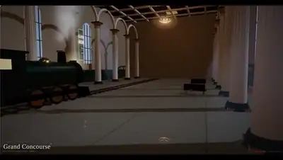</a><br><a href="https://www.sandbase.ai/lab/ai-videos/deepseek-v4-1-flash-1017/2112706283555971156?utm_source=github&utm_medium=readme&utm_campaign=awesome-deepseek-v4.1-flash-1017&utm_content=card"><b>Three procedurally generated levels with music</b></a><br><sub><a href="https://x.com/quimedesu/status/2112706283555971156">@quimedesu</a> · 0:39</sub></td><td width="33%" valign="top"><a href="https://www.sandbase.ai/lab/media/x/deepseek-v4-1-flash-1017/2112896112847982928/video.mp4"></a><br><a href="https://www.sandbase.ai/lab/ai-videos/deepseek-v4-1-flash-1017/2112896112847982928?utm_source=github&utm_medium=readme&utm_campaign=awesome-deepseek-v4.1-flash-1017&utm_content=card"><b>Minecraft-style 3D miniature sandbox game</b></a><br><sub><a href="https://x.com/jun1228909/status/2112896112847982928">@jun1228909</a> · 0:17 · <a href="https://www.sandbase.ai/lab/ai-videos/deepseek-v4-1-flash-1017/2112896112847982928?utm_source=github&utm_medium=readme&utm_campaign=awesome-deepseek-v4.1-flash-1017&utm_content=card">prompt</a></sub></td></tr>
<tr><td width="33%" valign="top"><a href="https://www.sandbase.ai/lab/media/x/deepseek-v4-1-flash-1017/2113263765000986874/video.mp4">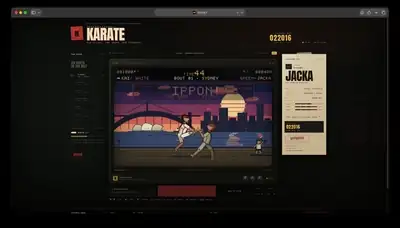</a><br><a href="https://www.sandbase.ai/lab/ai-videos/deepseek-v4-1-flash-1017/2113263765000986874?utm_source=github&utm_medium=readme&utm_campaign=awesome-deepseek-v4.1-flash-1017&utm_content=card"><b>Recreating C64 International Karate game with DeepSeek</b></a><br><sub><a href="https://x.com/ivanfioravanti/status/2113263765000986874">@ivanfioravanti</a> · 0:56 · <a href="https://www.sandbase.ai/lab/ai-videos/deepseek-v4-1-flash-1017/2113263765000986874?utm_source=github&utm_medium=readme&utm_campaign=awesome-deepseek-v4.1-flash-1017&utm_content=card">prompt</a></sub></td><td width="33%" valign="top"><a href="https://www.sandbase.ai/lab/media/x/deepseek-v4-1-flash-1017/2113309219202158652/video.mp4">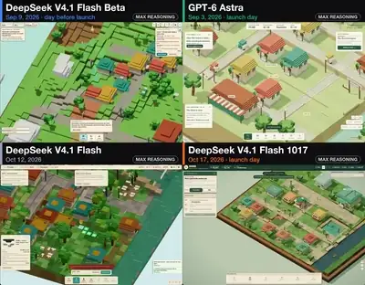</a><br><a href="https://www.sandbase.ai/lab/ai-videos/deepseek-v4-1-flash-1017/2113309219202158652?utm_source=github&utm_medium=readme&utm_campaign=awesome-deepseek-v4.1-flash-1017&utm_content=card"><b>Isometric flood-control game set in neighborhood</b></a><br><sub><a href="https://x.com/BuildFastWithAI/status/2113309219202158652">@BuildFastWithAI</a> · 2:45 · <a href="https://www.sandbase.ai/lab/ai-videos/deepseek-v4-1-flash-1017/2113309219202158652?utm_source=github&utm_medium=readme&utm_campaign=awesome-deepseek-v4.1-flash-1017&utm_content=card">prompt</a></sub></td><td width="33%" valign="top"><a href="https://www.sandbase.ai/lab/media/x/deepseek-v4-1-flash-1017/2113909072131178576/video.mp4">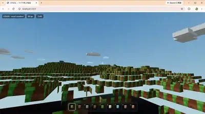</a><br><a href="https://www.sandbase.ai/lab/ai-videos/deepseek-v4-1-flash-1017/2113909072131178576?utm_source=github&utm_medium=readme&utm_campaign=awesome-deepseek-v4.1-flash-1017&utm_content=card"><b>Minecraft-style 3D sandbox game generated with DeepSeek-V4.1</b></a><br><sub><a href="https://x.com/jun1228909/status/2113909072131178576">@jun1228909</a> · 0:48</sub></td></tr>
<tr><td width="33%" valign="top"><a href="https://www.sandbase.ai/lab/media/x/deepseek-v4-1-flash-1017/2114572693899186181/video.mp4">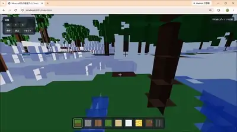</a><br><a href="https://www.sandbase.ai/lab/ai-videos/deepseek-v4-1-flash-1017/2114572693899186181?utm_source=github&utm_medium=readme&utm_campaign=awesome-deepseek-v4.1-flash-1017&utm_content=card"><b>Minecraft style 3D sandbox game</b></a><br><sub><a href="https://x.com/jun1228909/status/2114572693899186181">@jun1228909</a> · 0:19 · <a href="https://www.sandbase.ai/lab/ai-videos/deepseek-v4-1-flash-1017/2114572693899186181?utm_source=github&utm_medium=readme&utm_campaign=awesome-deepseek-v4.1-flash-1017&utm_content=card">prompt</a></sub></td></tr>
</table>

</details>

<a id="ui-demo"></a>

## Product UI

<table>
<tr><td width="33%" valign="top"><a href="https://www.sandbase.ai/lab/media/x/deepseek-v4-1-flash-1017/2111453908002562494/video.mp4"></a><br><a href="https://www.sandbase.ai/lab/ai-videos/deepseek-v4-1-flash-1017/2111453908002562494?utm_source=github&utm_medium=readme&utm_campaign=awesome-deepseek-v4.1-flash-1017&utm_content=card"><b>3D globe dashboard in Three.js</b></a><br><sub><a href="https://x.com/aibuilderclub_/status/2111453908002562494">@aibuilderclub_</a> · 0:37</sub></td><td width="33%" valign="top"><a href="https://www.sandbase.ai/lab/media/x/deepseek-v4-1-flash-1017/2111456771533611064/video.mp4"></a><br><a href="https://www.sandbase.ai/lab/ai-videos/deepseek-v4-1-flash-1017/2111456771533611064?utm_source=github&utm_medium=readme&utm_campaign=awesome-deepseek-v4.1-flash-1017&utm_content=card"><b>Tesla experiment demo generated by AI</b></a><br><sub><a href="https://x.com/alannnfx/status/2111456771533611064">@alannnfx</a> · 0:46</sub></td><td width="33%" valign="top"><a href="https://www.sandbase.ai/lab/media/x/deepseek-v4-1-flash-1017/2111470277309997492/video.mp4"></a><br><a href="https://www.sandbase.ai/lab/ai-videos/deepseek-v4-1-flash-1017/2111470277309997492?utm_source=github&utm_medium=readme&utm_campaign=awesome-deepseek-v4.1-flash-1017&utm_content=card"><b>Motion showcase for open source browser skill project</b></a><br><sub><a href="https://x.com/hqmank/status/2111470277309997492">@hqmank</a> · 0:20</sub></td></tr>
<tr><td width="33%" valign="top"><a href="https://www.sandbase.ai/lab/media/x/deepseek-v4-1-flash-1017/2111795739361677717/video.mp4"></a><br><a href="https://www.sandbase.ai/lab/ai-videos/deepseek-v4-1-flash-1017/2111795739361677717?utm_source=github&utm_medium=readme&utm_campaign=awesome-deepseek-v4.1-flash-1017&utm_content=card"><b>Motion designer websites created with DeepSeek V4.1 Flash</b></a><br><sub><a href="https://x.com/lotar_vk/status/2111795739361677717">@lotar_vk</a> · 0:29</sub></td><td width="33%" valign="top"><a href="https://www.sandbase.ai/lab/media/x/deepseek-v4-1-flash-1017/2111893173933130039/video.mp4"></a><br><a href="https://www.sandbase.ai/lab/ai-videos/deepseek-v4-1-flash-1017/2111893173933130039?utm_source=github&utm_medium=readme&utm_campaign=awesome-deepseek-v4.1-flash-1017&utm_content=card"><b>DeepSeek V4.1 Flash running on M3 Ultra</b></a><br><sub><a href="https://x.com/ivanfioravanti/status/2111893173933130039">@ivanfioravanti</a> · 0:11</sub></td><td width="33%" valign="top"><a href="https://www.sandbase.ai/lab/media/x/deepseek-v4-1-flash-1017/2112219791381479492/video.mp4"></a><br><a href="https://www.sandbase.ai/lab/ai-videos/deepseek-v4-1-flash-1017/2112219791381479492?utm_source=github&utm_medium=readme&utm_campaign=awesome-deepseek-v4.1-flash-1017&utm_content=card"><b>Claude Code workflow with DeepSeek Flash</b></a><br><sub><a href="https://x.com/zer0point_eth/status/2112219791381479492">@zer0point_eth</a> · 0:20</sub></td></tr>
</table>

<details>
<summary><b>Show all 14</b></summary>

<table>
<tr><td width="33%" valign="top"><a href="https://www.sandbase.ai/lab/media/x/deepseek-v4-1-flash-1017/2113850530774802611/video.mp4">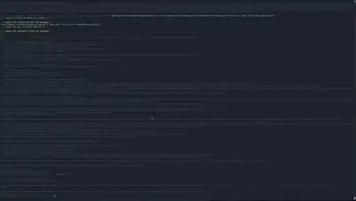</a><br><a href="https://www.sandbase.ai/lab/ai-videos/deepseek-v4-1-flash-1017/2113850530774802611?utm_source=github&utm_medium=readme&utm_campaign=awesome-deepseek-v4.1-flash-1017&utm_content=card"><b>Coding with DeepSeek V4.1 on DGX Spark cluster</b></a><br><sub><a href="https://x.com/sash__mit/status/2113850530774802611">@sash__mit</a> · 0:35</sub></td><td width="33%" valign="top"><a href="https://www.sandbase.ai/lab/media/x/deepseek-v4-1-flash-1017/2113891994569200078/video.mp4">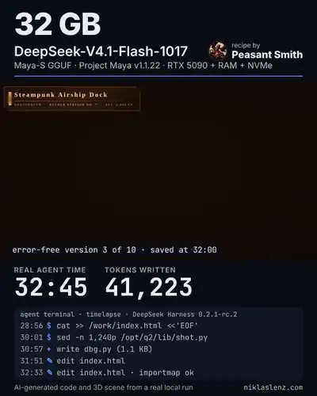</a><br><a href="https://www.sandbase.ai/lab/ai-videos/deepseek-v4-1-flash-1017/2113891994569200078?utm_source=github&utm_medium=readme&utm_campaign=awesome-deepseek-v4.1-flash-1017&utm_content=card"><b>Running a 748B model locally on RTX 5090</b></a><br><sub><a href="https://x.com/_elenajoseph_/status/2113891994569200078">@_elenajoseph_</a> · 0:42</sub></td><td width="33%" valign="top"><a href="https://www.sandbase.ai/lab/media/x/deepseek-v4-1-flash-1017/2113948624359166103/video.mp4">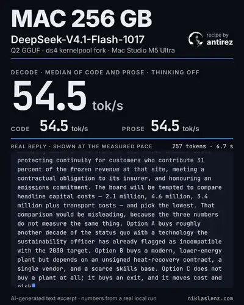</a><br><a href="https://www.sandbase.ai/lab/ai-videos/deepseek-v4-1-flash-1017/2113948624359166103?utm_source=github&utm_medium=readme&utm_campaign=awesome-deepseek-v4.1-flash-1017&utm_content=card"><b>Inference benchmark of DeepSeek-V4.1-Flash on Mac Studio</b></a><br><sub><a href="https://x.com/niklaslenz_ai/status/2113948624359166103">@niklaslenz_ai</a> · 0:23</sub></td></tr>
<tr><td width="33%" valign="top"><a href="https://www.sandbase.ai/lab/media/x/deepseek-v4-1-flash-1017/2113957322116813206/video.mp4">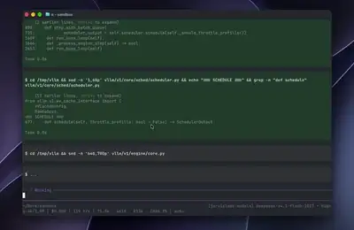</a><br><a href="https://www.sandbase.ai/lab/ai-videos/deepseek-v4-1-flash-1017/2113957322116813206?utm_source=github&utm_medium=readme&utm_campaign=awesome-deepseek-v4.1-flash-1017&utm_content=card"><b>Real-time generation speed of DeepSeek V4.1</b></a><br><sub><a href="https://x.com/AtharvaIngle7/status/2113957322116813206">@AtharvaIngle7</a> · 0:40</sub></td><td width="33%" valign="top"><a href="https://www.sandbase.ai/lab/media/x/deepseek-v4-1-flash-1017/2114194687959740679/video.mp4"></a><br><a href="https://www.sandbase.ai/lab/ai-videos/deepseek-v4-1-flash-1017/2114194687959740679?utm_source=github&utm_medium=readme&utm_campaign=awesome-deepseek-v4.1-flash-1017&utm_content=card"><b>Personal intro and media kit Remotion animations</b></a><br><sub><a href="https://x.com/chasen_liao/status/2114194687959740679">@chasen_liao</a> · 0:15</sub></td><td width="33%" valign="top"><a href="https://www.sandbase.ai/lab/media/x/deepseek-v4-1-flash-1017/2114364317089034693/video.mp4"></a><br><a href="https://www.sandbase.ai/lab/ai-videos/deepseek-v4-1-flash-1017/2114364317089034693?utm_source=github&utm_medium=readme&utm_campaign=awesome-deepseek-v4.1-flash-1017&utm_content=card"><b>Digest bot sending morning news and app creation</b></a><br><sub><a href="https://x.com/fayazara/status/2114364317089034693">@fayazara</a> · 1:25</sub></td></tr>
<tr><td width="33%" valign="top"><a href="https://www.sandbase.ai/lab/media/x/deepseek-v4-1-flash-1017/2115144517729050755/video.mp4">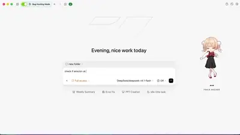</a><br><a href="https://www.sandbase.ai/lab/ai-videos/deepseek-v4-1-flash-1017/2115144517729050755?utm_source=github&utm_medium=readme&utm_campaign=awesome-deepseek-v4.1-flash-1017&utm_content=card"><b>Local AI inference benchmark and stats monitor</b></a><br><sub><a href="https://x.com/norsyx/status/2115144517729050755">@norsyx</a> · 0:23</sub></td><td width="33%" valign="top"><a href="https://www.sandbase.ai/lab/media/x/deepseek-v4-1-flash-1017/2115481653045076373/video.mp4">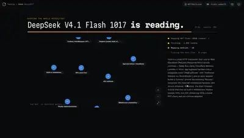</a><br><a href="https://www.sandbase.ai/lab/ai-videos/deepseek-v4-1-flash-1017/2115481653045076373?utm_source=github&utm_medium=readme&utm_campaign=awesome-deepseek-v4.1-flash-1017&utm_content=card"><b>Codebase exploration and architecture mapping tool</b></a><br><sub><a href="https://x.com/Astrodevil_/status/2115481653045076373">@Astrodevil_</a> · 1:21</sub></td></tr>
</table>

</details>

<a id="particles"></a>

## Particles & shapes

<table>
<tr><td width="33%" valign="top"><a href="https://www.sandbase.ai/lab/media/x/deepseek-v4-1-flash-1017/2111876302714044632/video.mp4"></a><br><a href="https://www.sandbase.ai/lab/ai-videos/deepseek-v4-1-flash-1017/2111876302714044632?utm_source=github&utm_medium=readme&utm_campaign=awesome-deepseek-v4.1-flash-1017&utm_content=card"><b>Simulation of 100,000 synchronizing metronomes in the browser</b></a><br><sub><a href="https://x.com/aijoey/status/2111876302714044632">@aijoey</a> · 1:26</sub></td><td width="33%" valign="top"><a href="https://www.sandbase.ai/lab/media/x/deepseek-v4-1-flash-1017/2112464983002906928/video.mp4"></a><br><a href="https://www.sandbase.ai/lab/ai-videos/deepseek-v4-1-flash-1017/2112464983002906928?utm_source=github&utm_medium=readme&utm_campaign=awesome-deepseek-v4.1-flash-1017&utm_content=card"><b>WebGL2 particle film generated by DeepSeek</b></a><br><sub><a href="https://x.com/SamiBizConsult/status/2112464983002906928">@SamiBizConsult</a> · 0:48</sub></td></tr>
</table>

<a id="data-viz"></a>

## Charts & diagrams

<table>
<tr><td width="33%" valign="top"><a href="https://www.sandbase.ai/lab/media/x/deepseek-v4-1-flash-1017/2112902787570786590/video.mp4">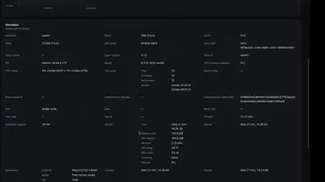</a><br><a href="https://www.sandbase.ai/lab/ai-videos/deepseek-v4-1-flash-1017/2112902787570786590?utm_source=github&utm_medium=readme&utm_campaign=awesome-deepseek-v4.1-flash-1017&utm_content=card"><b>Inference benchmark running in Sparkline</b></a><br><sub><a href="https://x.com/sfxnz/status/2112902787570786590">@sfxnz</a> · 0:25</sub></td><td width="33%" valign="top"><a href="https://www.sandbase.ai/lab/media/x/deepseek-v4-1-flash-1017/2114635646375526756/video.mp4">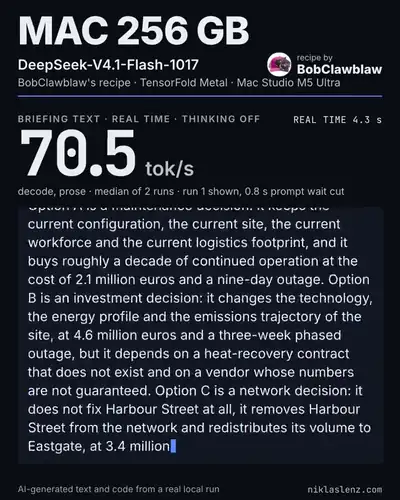</a><br><a href="https://www.sandbase.ai/lab/ai-videos/deepseek-v4-1-flash-1017/2114635646375526756?utm_source=github&utm_medium=readme&utm_campaign=awesome-deepseek-v4.1-flash-1017&utm_content=card"><b>DeepSeek V4.1 Flash Benchmark on Mac Studio</b></a><br><sub><a href="https://x.com/niklaslenz_ai/status/2114635646375526756">@niklaslenz_ai</a> · 0:57</sub></td></tr>
</table>

<a id="explainer"></a>

## Explainers

<table>
<tr><td width="33%" valign="top"><a href="https://www.sandbase.ai/lab/media/x/deepseek-v4-1-flash-1017/2111442747999789204/video.mp4"></a><br><a href="https://www.sandbase.ai/lab/ai-videos/deepseek-v4-1-flash-1017/2111442747999789204?utm_source=github&utm_medium=readme&utm_campaign=awesome-deepseek-v4.1-flash-1017&utm_content=card"><b>Motion design tutorial for OpenDesign API</b></a><br><sub><a href="https://x.com/tuturetom/status/2111442747999789204">@tuturetom</a> · 1:07</sub></td><td width="33%" valign="top"><a href="https://www.sandbase.ai/lab/media/x/deepseek-v4-1-flash-1017/2111917405404361211/video.mp4"></a><br><a href="https://www.sandbase.ai/lab/ai-videos/deepseek-v4-1-flash-1017/2111917405404361211?utm_source=github&utm_medium=readme&utm_campaign=awesome-deepseek-v4.1-flash-1017&utm_content=card"><b>Autonomous agent workflow using Grok Bot and DeepSeek Flash</b></a><br><sub><a href="https://x.com/yurshevv/status/2111917405404361211">@yurshevv</a> · 0:20</sub></td><td width="33%" valign="top"><a href="https://www.sandbase.ai/lab/media/x/deepseek-v4-1-flash-1017/2112145681582620767/video.mp4"></a><br><a href="https://www.sandbase.ai/lab/ai-videos/deepseek-v4-1-flash-1017/2112145681582620767?utm_source=github&utm_medium=readme&utm_campaign=awesome-deepseek-v4.1-flash-1017&utm_content=card"><b>Roadster 2 explainer presentation and video package</b></a><br><sub><a href="https://x.com/ZhihuFrontier/status/2112145681582620767">@ZhihuFrontier</a> · 0:44</sub></td></tr>
</table>

<a id="launch-film"></a>

## Launch films

<table>
<tr><td width="33%" valign="top"><a href="https://www.sandbase.ai/lab/media/x/deepseek-v4-1-flash-1017/2111400595412160727/video.mp4"></a><br><a href="https://www.sandbase.ai/lab/ai-videos/deepseek-v4-1-flash-1017/2111400595412160727?utm_source=github&utm_medium=readme&utm_campaign=awesome-deepseek-v4.1-flash-1017&utm_content=card"><b>Launch video for the tool-mode project</b></a><br><sub><a href="https://x.com/trydotworks/status/2111400595412160727">@trydotworks</a> · 1:00</sub></td><td width="33%" valign="top"><a href="https://www.sandbase.ai/lab/media/x/deepseek-v4-1-flash-1017/2111402753566310600/video.mp4"></a><br><a href="https://www.sandbase.ai/lab/ai-videos/deepseek-v4-1-flash-1017/2111402753566310600?utm_source=github&utm_medium=readme&utm_campaign=awesome-deepseek-v4.1-flash-1017&utm_content=card"><b>Promo video of DeepSeek whale in WebGL</b></a><br><sub><a href="https://x.com/hiwise_aigc/status/2111402753566310600">@hiwise_aigc</a> · 0:36 · <a href="https://www.sandbase.ai/lab/ai-videos/deepseek-v4-1-flash-1017/2111402753566310600?utm_source=github&utm_medium=readme&utm_campaign=awesome-deepseek-v4.1-flash-1017&utm_content=card">prompt</a></sub></td><td width="33%" valign="top"><a href="https://www.sandbase.ai/lab/media/x/deepseek-v4-1-flash-1017/2111451107318993293/video.mp4"></a><br><a href="https://www.sandbase.ai/lab/ai-videos/deepseek-v4-1-flash-1017/2111451107318993293?utm_source=github&utm_medium=readme&utm_campaign=awesome-deepseek-v4.1-flash-1017&utm_content=card"><b>Promotional video for web platform</b></a><br><sub><a href="https://x.com/hkdom/status/2111451107318993293">@hkdom</a> · 1:47 · <a href="https://www.sandbase.ai/lab/ai-videos/deepseek-v4-1-flash-1017/2111451107318993293?utm_source=github&utm_medium=readme&utm_campaign=awesome-deepseek-v4.1-flash-1017&utm_content=card">prompt</a></sub></td></tr>
<tr><td width="33%" valign="top"><a href="https://www.sandbase.ai/lab/media/x/deepseek-v4-1-flash-1017/2111538273797771729/video.mp4"></a><br><a href="https://www.sandbase.ai/lab/ai-videos/deepseek-v4-1-flash-1017/2111538273797771729?utm_source=github&utm_medium=readme&utm_campaign=awesome-deepseek-v4.1-flash-1017&utm_content=card"><b>Self-promotional advertising video for DeepSeek</b></a><br><sub><a href="https://x.com/kdnbmb/status/2111538273797771729">@kdnbmb</a> · 0:05</sub></td><td width="33%" valign="top"><a href="https://www.sandbase.ai/lab/media/x/deepseek-v4-1-flash-1017/2112282060757078494/video.mp4"></a><br><a href="https://www.sandbase.ai/lab/ai-videos/deepseek-v4-1-flash-1017/2112282060757078494?utm_source=github&utm_medium=readme&utm_campaign=awesome-deepseek-v4.1-flash-1017&utm_content=card"><b>A model announcement motion video</b></a><br><sub><a href="https://x.com/noctus91/status/2112282060757078494">@noctus91</a> · 0:48</sub></td><td width="33%" valign="top"><a href="https://www.sandbase.ai/lab/media/x/deepseek-v4-1-flash-1017/2112943758828511496/video.mp4"></a><br><a href="https://www.sandbase.ai/lab/ai-videos/deepseek-v4-1-flash-1017/2112943758828511496?utm_source=github&utm_medium=readme&utm_campaign=awesome-deepseek-v4.1-flash-1017&utm_content=card"><b>3D remake of classic puzzle game Doctor&#x27;s House</b></a><br><sub><a href="https://x.com/qizong007/status/2112943758828511496">@qizong007</a> · 0:30</sub></td></tr>
</table>

<a id="comparison"></a>

## Tests & comparisons

<table>
<tr><td width="33%" valign="top"><a href="https://www.sandbase.ai/lab/media/x/deepseek-v4-1-flash-1017/2111371468399689740/video.mp4"></a><br><a href="https://www.sandbase.ai/lab/ai-videos/deepseek-v4-1-flash-1017/2111371468399689740?utm_source=github&utm_medium=readme&utm_campaign=awesome-deepseek-v4.1-flash-1017&utm_content=card"><b>Side-by-side comparison between DeepSeek Flash versions</b></a><br><sub><a href="https://x.com/karanC_12/status/2111371468399689740">@karanC_12</a> · 0:11</sub></td><td width="33%" valign="top"><a href="https://www.sandbase.ai/lab/media/x/deepseek-v4-1-flash-1017/2111394568725774765/video.mp4"></a><br><a href="https://www.sandbase.ai/lab/ai-videos/deepseek-v4-1-flash-1017/2111394568725774765?utm_source=github&utm_medium=readme&utm_campaign=awesome-deepseek-v4.1-flash-1017&utm_content=card"><b>Turtle prompt generation speed comparison</b></a><br><sub><a href="https://x.com/teortaxesTex/status/2111394568725774765">@teortaxesTex</a> · 0:17</sub></td><td width="33%" valign="top"><a href="https://www.sandbase.ai/lab/media/x/deepseek-v4-1-flash-1017/2111398174548214218/video.mp4"></a><br><a href="https://www.sandbase.ai/lab/ai-videos/deepseek-v4-1-flash-1017/2111398174548214218?utm_source=github&utm_medium=readme&utm_campaign=awesome-deepseek-v4.1-flash-1017&utm_content=card"><b>Comparison of SpaceX Super Heavy booster catch animation</b></a><br><sub><a href="https://x.com/adamshafizullah/status/2111398174548214218">@adamshafizullah</a> · 0:22 · <a href="https://www.sandbase.ai/lab/ai-videos/deepseek-v4-1-flash-1017/2111398174548214218?utm_source=github&utm_medium=readme&utm_campaign=awesome-deepseek-v4.1-flash-1017&utm_content=card">prompt</a></sub></td></tr>
<tr><td width="33%" valign="top"><a href="https://www.sandbase.ai/lab/media/x/deepseek-v4-1-flash-1017/2111413922989224089/video.mp4"></a><br><a href="https://www.sandbase.ai/lab/ai-videos/deepseek-v4-1-flash-1017/2111413922989224089?utm_source=github&utm_medium=readme&utm_campaign=awesome-deepseek-v4.1-flash-1017&utm_content=card"><b>Comparison between GPT 6.1 Sol and DeepSeek V4.1</b></a><br><sub><a href="https://x.com/SPAC89/status/2111413922989224089">@SPAC89</a> · 0:20</sub></td><td width="33%" valign="top"><a href="https://www.sandbase.ai/lab/media/x/deepseek-v4-1-flash-1017/2111417280366031318/video.mp4"></a><br><a href="https://www.sandbase.ai/lab/ai-videos/deepseek-v4-1-flash-1017/2111417280366031318?utm_source=github&utm_medium=readme&utm_campaign=awesome-deepseek-v4.1-flash-1017&utm_content=card"><b>Whale breach generation test comparing AI models</b></a><br><sub><a href="https://x.com/Bhavani_00007/status/2111417280366031318">@Bhavani_00007</a> · 0:18</sub></td><td width="33%" valign="top"><a href="https://www.sandbase.ai/lab/media/x/deepseek-v4-1-flash-1017/2111421758691827905/video.mp4"></a><br><a href="https://www.sandbase.ai/lab/ai-videos/deepseek-v4-1-flash-1017/2111421758691827905?utm_source=github&utm_medium=readme&utm_campaign=awesome-deepseek-v4.1-flash-1017&utm_content=card"><b>Five Nights at Freddy&#x27;s game comparison</b></a><br><sub><a href="https://x.com/kepochnik/status/2111421758691827905">@kepochnik</a> · 2:24</sub></td></tr>
</table>

<details>
<summary><b>Show all 106</b></summary>

<table>
<tr><td width="33%" valign="top"><a href="https://www.sandbase.ai/lab/media/x/deepseek-v4-1-flash-1017/2111427716142571554/video.mp4"></a><br><a href="https://www.sandbase.ai/lab/ai-videos/deepseek-v4-1-flash-1017/2111427716142571554?utm_source=github&utm_medium=readme&utm_campaign=awesome-deepseek-v4.1-flash-1017&utm_content=card"><b>Opus 5.5 compared with DeepSeek V4.1 Flash</b></a><br><sub><a href="https://x.com/marcthecreatorr/status/2111427716142571554">@marcthecreatorr</a> · 0:57</sub></td><td width="33%" valign="top"><a href="https://www.sandbase.ai/lab/media/x/deepseek-v4-1-flash-1017/2111433898194305091/video.mp4"></a><br><a href="https://www.sandbase.ai/lab/ai-videos/deepseek-v4-1-flash-1017/2111433898194305091?utm_source=github&utm_medium=readme&utm_campaign=awesome-deepseek-v4.1-flash-1017&utm_content=card"><b>Side-by-side comparison of DeepSeek and Opus</b></a><br><sub><a href="https://x.com/Haleeeemahh/status/2111433898194305091">@Haleeeemahh</a> · 0:15</sub></td><td width="33%" valign="top"><a href="https://www.sandbase.ai/lab/media/x/deepseek-v4-1-flash-1017/2111440154078703961/video.mp4"></a><br><a href="https://www.sandbase.ai/lab/ai-videos/deepseek-v4-1-flash-1017/2111440154078703961?utm_source=github&utm_medium=readme&utm_campaign=awesome-deepseek-v4.1-flash-1017&utm_content=card"><b>Interactive gummy bear 3D physics comparison</b></a><br><sub><a href="https://x.com/wquguru/status/2111440154078703961">@wquguru</a> · 0:30</sub></td></tr>
<tr><td width="33%" valign="top"><a href="https://www.sandbase.ai/lab/media/x/deepseek-v4-1-flash-1017/2111446763475435807/video.mp4"></a><br><a href="https://www.sandbase.ai/lab/ai-videos/deepseek-v4-1-flash-1017/2111446763475435807?utm_source=github&utm_medium=readme&utm_campaign=awesome-deepseek-v4.1-flash-1017&utm_content=card"><b>Astra and DeepSeek tested on koi fish environment</b></a><br><sub><a href="https://x.com/notjazii/status/2111446763475435807">@notjazii</a> · 0:32</sub></td><td width="33%" valign="top"><a href="https://www.sandbase.ai/lab/media/x/deepseek-v4-1-flash-1017/2111452292994261133/video.mp4"></a><br><a href="https://www.sandbase.ai/lab/ai-videos/deepseek-v4-1-flash-1017/2111452292994261133?utm_source=github&utm_medium=readme&utm_campaign=awesome-deepseek-v4.1-flash-1017&utm_content=card"><b>Opus 5 vs DeepSeek Voxel Art Comparison</b></a><br><sub><a href="https://x.com/badboyfoxy/status/2111452292994261133">@badboyfoxy</a> · 0:37</sub></td><td width="33%" valign="top"><a href="https://www.sandbase.ai/lab/media/x/deepseek-v4-1-flash-1017/2111466664613269898/video.mp4"></a><br><a href="https://www.sandbase.ai/lab/ai-videos/deepseek-v4-1-flash-1017/2111466664613269898?utm_source=github&utm_medium=readme&utm_campaign=awesome-deepseek-v4.1-flash-1017&utm_content=card"><b>Comparison of Three.js 3D modeling across versions</b></a><br><sub><a href="https://x.com/leo114119/status/2111466664613269898">@leo114119</a> · 0:36</sub></td></tr>
<tr><td width="33%" valign="top"><a href="https://www.sandbase.ai/lab/media/x/deepseek-v4-1-flash-1017/2111466670405599370/video.mp4"></a><br><a href="https://www.sandbase.ai/lab/ai-videos/deepseek-v4-1-flash-1017/2111466670405599370?utm_source=github&utm_medium=readme&utm_campaign=awesome-deepseek-v4.1-flash-1017&utm_content=card"><b>Motion graphics showreel comparison across models</b></a><br><sub><a href="https://x.com/aGim_asf/status/2111466670405599370">@aGim_asf</a> · 0:15 · <a href="https://www.sandbase.ai/lab/ai-videos/deepseek-v4-1-flash-1017/2111466670405599370?utm_source=github&utm_medium=readme&utm_campaign=awesome-deepseek-v4.1-flash-1017&utm_content=card">prompt</a></sub></td><td width="33%" valign="top"><a href="https://www.sandbase.ai/lab/media/x/deepseek-v4-1-flash-1017/2111472170190684243/video.mp4"></a><br><a href="https://www.sandbase.ai/lab/ai-videos/deepseek-v4-1-flash-1017/2111472170190684243?utm_source=github&utm_medium=readme&utm_campaign=awesome-deepseek-v4.1-flash-1017&utm_content=card"><b>Comparison of first person parkour run models</b></a><br><sub><a href="https://x.com/thehypedotnews/status/2111472170190684243">@thehypedotnews</a> · 0:30 · <a href="https://www.sandbase.ai/lab/ai-videos/deepseek-v4-1-flash-1017/2111472170190684243?utm_source=github&utm_medium=readme&utm_campaign=awesome-deepseek-v4.1-flash-1017&utm_content=card">prompt</a></sub></td><td width="33%" valign="top"><a href="https://www.sandbase.ai/lab/media/x/deepseek-v4-1-flash-1017/2111474429410566422/video.mp4"></a><br><a href="https://www.sandbase.ai/lab/ai-videos/deepseek-v4-1-flash-1017/2111474429410566422?utm_source=github&utm_medium=readme&utm_campaign=awesome-deepseek-v4.1-flash-1017&utm_content=card"><b>Comparison of Tesla Roadster voxel scenes</b></a><br><sub><a href="https://x.com/atomic_chat_hq/status/2111474429410566422">@atomic_chat_hq</a> · 0:16</sub></td></tr>
<tr><td width="33%" valign="top"><a href="https://www.sandbase.ai/lab/media/x/deepseek-v4-1-flash-1017/2111476518694384061/video.mp4"></a><br><a href="https://www.sandbase.ai/lab/ai-videos/deepseek-v4-1-flash-1017/2111476518694384061?utm_source=github&utm_medium=readme&utm_campaign=awesome-deepseek-v4.1-flash-1017&utm_content=card"><b>Comparison of voxel pelican benchmark scenes</b></a><br><sub><a href="https://x.com/VulKan42069/status/2111476518694384061">@VulKan42069</a> · 0:18</sub></td><td width="33%" valign="top"><a href="https://www.sandbase.ai/lab/media/x/deepseek-v4-1-flash-1017/2111478113624600842/video.mp4"></a><br><a href="https://www.sandbase.ai/lab/ai-videos/deepseek-v4-1-flash-1017/2111478113624600842?utm_source=github&utm_medium=readme&utm_campaign=awesome-deepseek-v4.1-flash-1017&utm_content=card"><b>Full video song generation comparison</b></a><br><sub><a href="https://x.com/Iampuranthapa/status/2111478113624600842">@Iampuranthapa</a> · 2:54</sub></td><td width="33%" valign="top"><a href="https://www.sandbase.ai/lab/media/x/deepseek-v4-1-flash-1017/2111495903672438850/video.mp4"></a><br><a href="https://www.sandbase.ai/lab/ai-videos/deepseek-v4-1-flash-1017/2111495903672438850?utm_source=github&utm_medium=readme&utm_campaign=awesome-deepseek-v4.1-flash-1017&utm_content=card"><b>DeepSeek model benchmark results and animation test</b></a><br><sub><a href="https://x.com/erhanmeydan/status/2111495903672438850">@erhanmeydan</a> · 0:11</sub></td></tr>
<tr><td width="33%" valign="top"><a href="https://www.sandbase.ai/lab/media/x/deepseek-v4-1-flash-1017/2111501438564331534/video.mp4"></a><br><a href="https://www.sandbase.ai/lab/ai-videos/deepseek-v4-1-flash-1017/2111501438564331534?utm_source=github&utm_medium=readme&utm_campaign=awesome-deepseek-v4.1-flash-1017&utm_content=card"><b>Comparison of rocket launch scenes</b></a><br><sub><a href="https://x.com/Bhavani_00007/status/2111501438564331534">@Bhavani_00007</a> · 0:25</sub></td><td width="33%" valign="top"><a href="https://www.sandbase.ai/lab/media/x/deepseek-v4-1-flash-1017/2111506980733120860/video.mp4"></a><br><a href="https://www.sandbase.ai/lab/ai-videos/deepseek-v4-1-flash-1017/2111506980733120860?utm_source=github&utm_medium=readme&utm_campaign=awesome-deepseek-v4.1-flash-1017&utm_content=card"><b>Comparison between GPT 6.1 Sol and DeepSeek</b></a><br><sub><a href="https://x.com/AiHubMix/status/2111506980733120860">@AiHubMix</a> · 0:15</sub></td><td width="33%" valign="top"><a href="https://www.sandbase.ai/lab/media/x/deepseek-v4-1-flash-1017/2111508406217658697/video.mp4"></a><br><a href="https://www.sandbase.ai/lab/ai-videos/deepseek-v4-1-flash-1017/2111508406217658697?utm_source=github&utm_medium=readme&utm_campaign=awesome-deepseek-v4.1-flash-1017&utm_content=card"><b>Miku SVG drawing animation process comparison</b></a><br><sub><a href="https://x.com/leo114119/status/2111508406217658697">@leo114119</a> · 0:22</sub></td></tr>
<tr><td width="33%" valign="top"><a href="https://www.sandbase.ai/lab/media/x/deepseek-v4-1-flash-1017/2111513156589629941/video.mp4"></a><br><a href="https://www.sandbase.ai/lab/ai-videos/deepseek-v4-1-flash-1017/2111513156589629941?utm_source=github&utm_medium=readme&utm_campaign=awesome-deepseek-v4.1-flash-1017&utm_content=card"><b>Electric Motor 3D Explainer Comparison</b></a><br><sub><a href="https://x.com/rubenssoto_ai/status/2111513156589629941">@rubenssoto_ai</a> · 0:40 · <a href="https://www.sandbase.ai/lab/ai-videos/deepseek-v4-1-flash-1017/2111513156589629941?utm_source=github&utm_medium=readme&utm_campaign=awesome-deepseek-v4.1-flash-1017&utm_content=card">prompt</a></sub></td><td width="33%" valign="top"><a href="https://www.sandbase.ai/lab/media/x/deepseek-v4-1-flash-1017/2111533418068804062/video.mp4"></a><br><a href="https://www.sandbase.ai/lab/ai-videos/deepseek-v4-1-flash-1017/2111533418068804062?utm_source=github&utm_medium=readme&utm_campaign=awesome-deepseek-v4.1-flash-1017&utm_content=card"><b>Kimi K3 versus DeepSeek V4.1 building a game</b></a><br><sub><a href="https://x.com/notjazii/status/2111533418068804062">@notjazii</a> · 0:59</sub></td><td width="33%" valign="top"><a href="https://www.sandbase.ai/lab/media/x/deepseek-v4-1-flash-1017/2111533791084941417/video.mp4"></a><br><a href="https://www.sandbase.ai/lab/ai-videos/deepseek-v4-1-flash-1017/2111533791084941417?utm_source=github&utm_medium=readme&utm_campaign=awesome-deepseek-v4.1-flash-1017&utm_content=card"><b>DeepSeek testing results on real-world pull requests</b></a><br><sub><a href="https://x.com/avyvar/status/2111533791084941417">@avyvar</a> · 0:09</sub></td></tr>
<tr><td width="33%" valign="top"><a href="https://www.sandbase.ai/lab/media/x/deepseek-v4-1-flash-1017/2111534337435062671/video.mp4"></a><br><a href="https://www.sandbase.ai/lab/ai-videos/deepseek-v4-1-flash-1017/2111534337435062671?utm_source=github&utm_medium=readme&utm_campaign=awesome-deepseek-v4.1-flash-1017&utm_content=card"><b>3D island scene in Three.js</b></a><br><sub><a href="https://x.com/YxzRainy/status/2111534337435062671">@YxzRainy</a> · 1:37</sub></td><td width="33%" valign="top"><a href="https://www.sandbase.ai/lab/media/x/deepseek-v4-1-flash-1017/2111548462093484543/video.mp4"></a><br><a href="https://www.sandbase.ai/lab/ai-videos/deepseek-v4-1-flash-1017/2111548462093484543?utm_source=github&utm_medium=readme&utm_campaign=awesome-deepseek-v4.1-flash-1017&utm_content=card"><b>Octopus folding laundry model comparison</b></a><br><sub><a href="https://x.com/benjistacked/status/2111548462093484543">@benjistacked</a> · 0:20</sub></td><td width="33%" valign="top"><a href="https://www.sandbase.ai/lab/media/x/deepseek-v4-1-flash-1017/2111564905765572869/video.mp4"></a><br><a href="https://www.sandbase.ai/lab/ai-videos/deepseek-v4-1-flash-1017/2111564905765572869?utm_source=github&utm_medium=readme&utm_campaign=awesome-deepseek-v4.1-flash-1017&utm_content=card"><b>Comparison between new and old DeepSeek Flash models</b></a><br><sub><a href="https://x.com/filicroval/status/2111564905765572869">@filicroval</a> · 1:00</sub></td></tr>
<tr><td width="33%" valign="top"><a href="https://www.sandbase.ai/lab/media/x/deepseek-v4-1-flash-1017/2111580341626687586/video.mp4"></a><br><a href="https://www.sandbase.ai/lab/ai-videos/deepseek-v4-1-flash-1017/2111580341626687586?utm_source=github&utm_medium=readme&utm_campaign=awesome-deepseek-v4.1-flash-1017&utm_content=card"><b>Four AI models generating the Eiffel Tower</b></a><br><sub><a href="https://x.com/EnvolDev/status/2111580341626687586">@EnvolDev</a> · 0:20</sub></td><td width="33%" valign="top"><a href="https://www.sandbase.ai/lab/media/x/deepseek-v4-1-flash-1017/2111589919806435647/video.mp4"></a><br><a href="https://www.sandbase.ai/lab/ai-videos/deepseek-v4-1-flash-1017/2111589919806435647?utm_source=github&utm_medium=readme&utm_campaign=awesome-deepseek-v4.1-flash-1017&utm_content=card"><b>Comparison of DeepSeek models generating a pagoda</b></a><br><sub><a href="https://x.com/WescheNex1q/status/2111589919806435647">@WescheNex1q</a> · 0:12</sub></td><td width="33%" valign="top"><a href="https://www.sandbase.ai/lab/media/x/deepseek-v4-1-flash-1017/2111593580766605505/video.mp4"></a><br><a href="https://www.sandbase.ai/lab/ai-videos/deepseek-v4-1-flash-1017/2111593580766605505?utm_source=github&utm_medium=readme&utm_campaign=awesome-deepseek-v4.1-flash-1017&utm_content=card"><b>Bioluminescent draggable jellyfish comparison</b></a><br><sub><a href="https://x.com/zhallen122/status/2111593580766605505">@zhallen122</a> · 0:15</sub></td></tr>
<tr><td width="33%" valign="top"><a href="https://www.sandbase.ai/lab/media/x/deepseek-v4-1-flash-1017/2111600798861815811/video.mp4"></a><br><a href="https://www.sandbase.ai/lab/ai-videos/deepseek-v4-1-flash-1017/2111600798861815811?utm_source=github&utm_medium=readme&utm_campaign=awesome-deepseek-v4.1-flash-1017&utm_content=card"><b>Comparison between DeepSeek Flash and Opus 5.5</b></a><br><sub><a href="https://x.com/maxt3chno/status/2111600798861815811">@maxt3chno</a> · 0:31</sub></td><td width="33%" valign="top"><a href="https://www.sandbase.ai/lab/media/x/deepseek-v4-1-flash-1017/2111635788194611231/video.mp4"></a><br><a href="https://www.sandbase.ai/lab/ai-videos/deepseek-v4-1-flash-1017/2111635788194611231?utm_source=github&utm_medium=readme&utm_campaign=awesome-deepseek-v4.1-flash-1017&utm_content=card"><b>DeepSeek V4.1 Flash versus V4.1-1017 comparison</b></a><br><sub><a href="https://x.com/trypalomino/status/2111635788194611231">@trypalomino</a> · 0:27</sub></td><td width="33%" valign="top"><a href="https://www.sandbase.ai/lab/media/x/deepseek-v4-1-flash-1017/2111694047081353382/video.mp4"></a><br><a href="https://www.sandbase.ai/lab/ai-videos/deepseek-v4-1-flash-1017/2111694047081353382?utm_source=github&utm_medium=readme&utm_campaign=awesome-deepseek-v4.1-flash-1017&utm_content=card"><b>Task generation comparison between models</b></a><br><sub><a href="https://x.com/AIMind_Ai/status/2111694047081353382">@AIMind_Ai</a> · 0:30</sub></td></tr>
<tr><td width="33%" valign="top"><a href="https://www.sandbase.ai/lab/media/x/deepseek-v4-1-flash-1017/2111701818195714110/video.mp4"></a><br><a href="https://www.sandbase.ai/lab/ai-videos/deepseek-v4-1-flash-1017/2111701818195714110?utm_source=github&utm_medium=readme&utm_campaign=awesome-deepseek-v4.1-flash-1017&utm_content=card"><b>Tokyo Tower Three.js modeling comparison</b></a><br><sub><a href="https://x.com/seki_anos/status/2111701818195714110">@seki_anos</a> · 0:15</sub></td><td width="33%" valign="top"><a href="https://www.sandbase.ai/lab/media/x/deepseek-v4-1-flash-1017/2111702872467685716/video.mp4"></a><br><a href="https://www.sandbase.ai/lab/ai-videos/deepseek-v4-1-flash-1017/2111702872467685716?utm_source=github&utm_medium=readme&utm_campaign=awesome-deepseek-v4.1-flash-1017&utm_content=card"><b>Comparing a rocket launch scene across two models</b></a><br><sub><a href="https://x.com/parves075/status/2111702872467685716">@parves075</a> · 0:25</sub></td><td width="33%" valign="top"><a href="https://www.sandbase.ai/lab/media/x/deepseek-v4-1-flash-1017/2111717582118240676/video.mp4"></a><br><a href="https://www.sandbase.ai/lab/ai-videos/deepseek-v4-1-flash-1017/2111717582118240676?utm_source=github&utm_medium=readme&utm_campaign=awesome-deepseek-v4.1-flash-1017&utm_content=card"><b>Cinematic abandoned village rendered in pure JavaScript</b></a><br><sub><a href="https://x.com/abhinavflac/status/2111717582118240676">@abhinavflac</a> · 0:15</sub></td></tr>
<tr><td width="33%" valign="top"><a href="https://www.sandbase.ai/lab/media/x/deepseek-v4-1-flash-1017/2111750475930570800/video.mp4"></a><br><a href="https://www.sandbase.ai/lab/ai-videos/deepseek-v4-1-flash-1017/2111750475930570800?utm_source=github&utm_medium=readme&utm_campaign=awesome-deepseek-v4.1-flash-1017&utm_content=card"><b>Comparison of 3D horse simulation across three models</b></a><br><sub><a href="https://x.com/AI_Screening/status/2111750475930570800">@AI_Screening</a> · 0:15</sub></td><td width="33%" valign="top"><a href="https://www.sandbase.ai/lab/media/x/deepseek-v4-1-flash-1017/2111766954386006493/video.mp4"></a><br><a href="https://www.sandbase.ai/lab/ai-videos/deepseek-v4-1-flash-1017/2111766954386006493?utm_source=github&utm_medium=readme&utm_campaign=awesome-deepseek-v4.1-flash-1017&utm_content=card"><b>DeepSeek V4.1 Flash versus Claude Opus 5.5</b></a><br><sub><a href="https://x.com/0xdominus/status/2111766954386006493">@0xdominus</a> · 0:25</sub></td><td width="33%" valign="top"><a href="https://www.sandbase.ai/lab/media/x/deepseek-v4-1-flash-1017/2111785787419508875/video.mp4"></a><br><a href="https://www.sandbase.ai/lab/ai-videos/deepseek-v4-1-flash-1017/2111785787419508875?utm_source=github&utm_medium=readme&utm_campaign=awesome-deepseek-v4.1-flash-1017&utm_content=card"><b>DeepSeek V4.1 Flash versus Gemini 4 Argon comparison</b></a><br><sub><a href="https://x.com/Adidotdev/status/2111785787419508875">@Adidotdev</a> · 0:41</sub></td></tr>
<tr><td width="33%" valign="top"><a href="https://www.sandbase.ai/lab/media/x/deepseek-v4-1-flash-1017/2111793164474634612/video.mp4"></a><br><a href="https://www.sandbase.ai/lab/ai-videos/deepseek-v4-1-flash-1017/2111793164474634612?utm_source=github&utm_medium=readme&utm_campaign=awesome-deepseek-v4.1-flash-1017&utm_content=card"><b>Four-model comparison on pelican stunt task</b></a><br><sub><a href="https://x.com/VulKan42069/status/2111793164474634612">@VulKan42069</a> · 0:45</sub></td><td width="33%" valign="top"><a href="https://www.sandbase.ai/lab/media/x/deepseek-v4-1-flash-1017/2111809171716751720/video.mp4"></a><br><a href="https://www.sandbase.ai/lab/ai-videos/deepseek-v4-1-flash-1017/2111809171716751720?utm_source=github&utm_medium=readme&utm_campaign=awesome-deepseek-v4.1-flash-1017&utm_content=card"><b>Dam breaking simulation comparison between Opus and DeepSeek</b></a><br><sub><a href="https://x.com/RafaCrackYT/status/2111809171716751720">@RafaCrackYT</a> · 0:30</sub></td><td width="33%" valign="top"><a href="https://www.sandbase.ai/lab/media/x/deepseek-v4-1-flash-1017/2111812592087835087/video.mp4"></a><br><a href="https://www.sandbase.ai/lab/ai-videos/deepseek-v4-1-flash-1017/2111812592087835087?utm_source=github&utm_medium=readme&utm_campaign=awesome-deepseek-v4.1-flash-1017&utm_content=card"><b>Building a volcano scene comparison</b></a><br><sub><a href="https://x.com/WescheNex1q/status/2111812592087835087">@WescheNex1q</a> · 0:16</sub></td></tr>
<tr><td width="33%" valign="top"><a href="https://www.sandbase.ai/lab/media/x/deepseek-v4-1-flash-1017/2111830601636651209/video.mp4"></a><br><a href="https://www.sandbase.ai/lab/ai-videos/deepseek-v4-1-flash-1017/2111830601636651209?utm_source=github&utm_medium=readme&utm_campaign=awesome-deepseek-v4.1-flash-1017&utm_content=card"><b>3D scene generation comparison between models</b></a><br><sub><a href="https://x.com/NFT_Chen/status/2111830601636651209">@NFT_Chen</a> · 1:20</sub></td><td width="33%" valign="top"><a href="https://www.sandbase.ai/lab/media/x/deepseek-v4-1-flash-1017/2111844370731430358/video.mp4"></a><br><a href="https://www.sandbase.ai/lab/ai-videos/deepseek-v4-1-flash-1017/2111844370731430358?utm_source=github&utm_medium=readme&utm_campaign=awesome-deepseek-v4.1-flash-1017&utm_content=card"><b>Comparing a raccoon washing dishes animation</b></a><br><sub><a href="https://x.com/benjistacked/status/2111844370731430358">@benjistacked</a> · 0:20 · <a href="https://www.sandbase.ai/lab/ai-videos/deepseek-v4-1-flash-1017/2111844370731430358?utm_source=github&utm_medium=readme&utm_campaign=awesome-deepseek-v4.1-flash-1017&utm_content=card">prompt</a></sub></td><td width="33%" valign="top"><a href="https://www.sandbase.ai/lab/media/x/deepseek-v4-1-flash-1017/2111847739994800134/video.mp4"></a><br><a href="https://www.sandbase.ai/lab/ai-videos/deepseek-v4-1-flash-1017/2111847739994800134?utm_source=github&utm_medium=readme&utm_campaign=awesome-deepseek-v4.1-flash-1017&utm_content=card"><b>Recreating the Mr. Bean rooftop driving scene</b></a><br><sub><a href="https://x.com/UFO2002616/status/2111847739994800134">@UFO2002616</a> · 4:01</sub></td></tr>
<tr><td width="33%" valign="top"><a href="https://www.sandbase.ai/lab/media/x/deepseek-v4-1-flash-1017/2111859521555665041/video.mp4"></a><br><a href="https://www.sandbase.ai/lab/ai-videos/deepseek-v4-1-flash-1017/2111859521555665041?utm_source=github&utm_medium=readme&utm_campaign=awesome-deepseek-v4.1-flash-1017&utm_content=card"><b>Motion graphics showreel comparison across models</b></a><br><sub><a href="https://x.com/CodeByNZ/status/2111859521555665041">@CodeByNZ</a> · 0:15</sub></td><td width="33%" valign="top"><a href="https://www.sandbase.ai/lab/media/x/deepseek-v4-1-flash-1017/2111861310619029557/video.mp4"></a><br><a href="https://www.sandbase.ai/lab/ai-videos/deepseek-v4-1-flash-1017/2111861310619029557?utm_source=github&utm_medium=readme&utm_campaign=awesome-deepseek-v4.1-flash-1017&utm_content=card"><b>Four AI models recreating Paris in 1996</b></a><br><sub><a href="https://x.com/RafaCrackYT/status/2111861310619029557">@RafaCrackYT</a> · 0:30</sub></td><td width="33%" valign="top"><a href="https://www.sandbase.ai/lab/media/x/deepseek-v4-1-flash-1017/2111861351891210374/video.mp4"></a><br><a href="https://www.sandbase.ai/lab/ai-videos/deepseek-v4-1-flash-1017/2111861351891210374?utm_source=github&utm_medium=readme&utm_campaign=awesome-deepseek-v4.1-flash-1017&utm_content=card"><b>Celestial palace 3D voxel scene model comparison</b></a><br><sub><a href="https://x.com/MingTian685474/status/2111861351891210374">@MingTian685474</a> · 0:30</sub></td></tr>
<tr><td width="33%" valign="top"><a href="https://www.sandbase.ai/lab/media/x/deepseek-v4-1-flash-1017/2111873944777019561/video.mp4"></a><br><a href="https://www.sandbase.ai/lab/ai-videos/deepseek-v4-1-flash-1017/2111873944777019561?utm_source=github&utm_medium=readme&utm_campaign=awesome-deepseek-v4.1-flash-1017&utm_content=card"><b>Claude Opus 5.5 versus DeepSeek Flash-1017</b></a><br><sub><a href="https://x.com/AIMind_Ai/status/2111873944777019561">@AIMind_Ai</a> · 0:30</sub></td><td width="33%" valign="top"><a href="https://www.sandbase.ai/lab/media/x/deepseek-v4-1-flash-1017/2111882446094692823/video.mp4"></a><br><a href="https://www.sandbase.ai/lab/ai-videos/deepseek-v4-1-flash-1017/2111882446094692823?utm_source=github&utm_medium=readme&utm_campaign=awesome-deepseek-v4.1-flash-1017&utm_content=card"><b>Comparing single-call versus harness generation</b></a><br><sub><a href="https://x.com/ItsmeAjayKV/status/2111882446094692823">@ItsmeAjayKV</a> · 0:34</sub></td><td width="33%" valign="top"><a href="https://www.sandbase.ai/lab/media/x/deepseek-v4-1-flash-1017/2111921937865687247/video.mp4"></a><br><a href="https://www.sandbase.ai/lab/ai-videos/deepseek-v4-1-flash-1017/2111921937865687247?utm_source=github&utm_medium=readme&utm_campaign=awesome-deepseek-v4.1-flash-1017&utm_content=card"><b>Canvas animation of a spiral galaxy comparison</b></a><br><sub><a href="https://x.com/WescheNex1q/status/2111921937865687247">@WescheNex1q</a> · 0:09 · <a href="https://www.sandbase.ai/lab/ai-videos/deepseek-v4-1-flash-1017/2111921937865687247?utm_source=github&utm_medium=readme&utm_campaign=awesome-deepseek-v4.1-flash-1017&utm_content=card">prompt</a></sub></td></tr>
<tr><td width="33%" valign="top"><a href="https://www.sandbase.ai/lab/media/x/deepseek-v4-1-flash-1017/2111943617761919146/video.mp4"></a><br><a href="https://www.sandbase.ai/lab/ai-videos/deepseek-v4-1-flash-1017/2111943617761919146?utm_source=github&utm_medium=readme&utm_campaign=awesome-deepseek-v4.1-flash-1017&utm_content=card"><b>Opus versus DeepSeek on jelly cats animation</b></a><br><sub><a href="https://x.com/semichenkko/status/2111943617761919146">@semichenkko</a> · 0:16</sub></td><td width="33%" valign="top"><a href="https://www.sandbase.ai/lab/media/x/deepseek-v4-1-flash-1017/2112061476517159338/video.mp4"></a><br><a href="https://www.sandbase.ai/lab/ai-videos/deepseek-v4-1-flash-1017/2112061476517159338?utm_source=github&utm_medium=readme&utm_campaign=awesome-deepseek-v4.1-flash-1017&utm_content=card"><b>Nesting dolls opening and lining up in Three.js</b></a><br><sub><a href="https://x.com/yangyang_2048/status/2112061476517159338">@yangyang_2048</a> · 0:15</sub></td><td width="33%" valign="top"><a href="https://www.sandbase.ai/lab/media/x/deepseek-v4-1-flash-1017/2112103012638277944/video.mp4"></a><br><a href="https://www.sandbase.ai/lab/ai-videos/deepseek-v4-1-flash-1017/2112103012638277944?utm_source=github&utm_medium=readme&utm_campaign=awesome-deepseek-v4.1-flash-1017&utm_content=card"><b>Looping low-poly 3D horse in Three.js comparison</b></a><br><sub><a href="https://x.com/aGim_asf/status/2112103012638277944">@aGim_asf</a> · 0:18</sub></td></tr>
<tr><td width="33%" valign="top"><a href="https://www.sandbase.ai/lab/media/x/deepseek-v4-1-flash-1017/2112109810749497376/video.mp4"></a><br><a href="https://www.sandbase.ai/lab/ai-videos/deepseek-v4-1-flash-1017/2112109810749497376?utm_source=github&utm_medium=readme&utm_campaign=awesome-deepseek-v4.1-flash-1017&utm_content=card"><b>Interactive koi pond generated by two models</b></a><br><sub><a href="https://x.com/sonnnanonaisa/status/2112109810749497376">@sonnnanonaisa</a> · 0:32</sub></td><td width="33%" valign="top"><a href="https://www.sandbase.ai/lab/media/x/deepseek-v4-1-flash-1017/2112125242415956183/video.mp4"></a><br><a href="https://www.sandbase.ai/lab/ai-videos/deepseek-v4-1-flash-1017/2112125242415956183?utm_source=github&utm_medium=readme&utm_campaign=awesome-deepseek-v4.1-flash-1017&utm_content=card"><b>MiniMax M3.1 Flash versus DeepSeek V4.1 Flash comparison</b></a><br><sub><a href="https://x.com/SPAC89/status/2112125242415956183">@SPAC89</a> · 0:30</sub></td><td width="33%" valign="top"><a href="https://www.sandbase.ai/lab/media/x/deepseek-v4-1-flash-1017/2112133888613224558/video.mp4"></a><br><a href="https://www.sandbase.ai/lab/ai-videos/deepseek-v4-1-flash-1017/2112133888613224558?utm_source=github&utm_medium=readme&utm_campaign=awesome-deepseek-v4.1-flash-1017&utm_content=card"><b>Comparison between M3.1-Flash Max and DeepSeek V4.1</b></a><br><sub><a href="https://x.com/bbfu0382/status/2112133888613224558">@bbfu0382</a> · 0:30</sub></td></tr>
<tr><td width="33%" valign="top"><a href="https://www.sandbase.ai/lab/media/x/deepseek-v4-1-flash-1017/2112166495925014555/video.mp4"></a><br><a href="https://www.sandbase.ai/lab/ai-videos/deepseek-v4-1-flash-1017/2112166495925014555?utm_source=github&utm_medium=readme&utm_campaign=awesome-deepseek-v4.1-flash-1017&utm_content=card"><b>Animating a highway with cars across models</b></a><br><sub><a href="https://x.com/SamgreyAi/status/2112166495925014555">@SamgreyAi</a> · 0:12</sub></td><td width="33%" valign="top"><a href="https://www.sandbase.ai/lab/media/x/deepseek-v4-1-flash-1017/2112207013971214693/video.mp4"></a><br><a href="https://www.sandbase.ai/lab/ai-videos/deepseek-v4-1-flash-1017/2112207013971214693?utm_source=github&utm_medium=readme&utm_campaign=awesome-deepseek-v4.1-flash-1017&utm_content=card"><b>Room camera tour comparison in JavaScript</b></a><br><sub><a href="https://x.com/grokkedd/status/2112207013971214693">@grokkedd</a> · 0:25 · <a href="https://www.sandbase.ai/lab/ai-videos/deepseek-v4-1-flash-1017/2112207013971214693?utm_source=github&utm_medium=readme&utm_campaign=awesome-deepseek-v4.1-flash-1017&utm_content=card">prompt</a></sub></td><td width="33%" valign="top"><a href="https://www.sandbase.ai/lab/media/x/deepseek-v4-1-flash-1017/2112211798493397408/video.mp4"></a><br><a href="https://www.sandbase.ai/lab/ai-videos/deepseek-v4-1-flash-1017/2112211798493397408?utm_source=github&utm_medium=readme&utm_campaign=awesome-deepseek-v4.1-flash-1017&utm_content=card"><b>DeepSeek V4.1 Flash versus MiniMax M3.1 Flash benchmark</b></a><br><sub><a href="https://x.com/rubenssoto_ai/status/2112211798493397408">@rubenssoto_ai</a> · 0:30</sub></td></tr>
<tr><td width="33%" valign="top"><a href="https://www.sandbase.ai/lab/media/x/deepseek-v4-1-flash-1017/2112213068415726002/video.mp4"></a><br><a href="https://www.sandbase.ai/lab/ai-videos/deepseek-v4-1-flash-1017/2112213068415726002?utm_source=github&utm_medium=readme&utm_campaign=awesome-deepseek-v4.1-flash-1017&utm_content=card"><b>Japanese train station in DeepSeek versus Astra</b></a><br><sub><a href="https://x.com/GKev1n/status/2112213068415726002">@GKev1n</a> · 0:18</sub></td><td width="33%" valign="top"><a href="https://www.sandbase.ai/lab/media/x/deepseek-v4-1-flash-1017/2112227205300564211/video.mp4"></a><br><a href="https://www.sandbase.ai/lab/ai-videos/deepseek-v4-1-flash-1017/2112227205300564211?utm_source=github&utm_medium=readme&utm_campaign=awesome-deepseek-v4.1-flash-1017&utm_content=card"><b>Interactive koi pond in Three.js comparison</b></a><br><sub><a href="https://x.com/aGim_asf/status/2112227205300564211">@aGim_asf</a> · 0:22</sub></td><td width="33%" valign="top"><a href="https://www.sandbase.ai/lab/media/x/deepseek-v4-1-flash-1017/2112235760073994630/video.mp4"></a><br><a href="https://www.sandbase.ai/lab/ai-videos/deepseek-v4-1-flash-1017/2112235760073994630?utm_source=github&utm_medium=readme&utm_campaign=awesome-deepseek-v4.1-flash-1017&utm_content=card"><b>3D stress ball comparison between models</b></a><br><sub><a href="https://x.com/filicroval/status/2112235760073994630">@filicroval</a> · 0:40</sub></td></tr>
<tr><td width="33%" valign="top"><a href="https://www.sandbase.ai/lab/media/x/deepseek-v4-1-flash-1017/2112246508376444987/video.mp4"></a><br><a href="https://www.sandbase.ai/lab/ai-videos/deepseek-v4-1-flash-1017/2112246508376444987?utm_source=github&utm_medium=readme&utm_campaign=awesome-deepseek-v4.1-flash-1017&utm_content=card"><b>Web design comparison between DeepSeek and Opus</b></a><br><sub><a href="https://x.com/borjaperfra/status/2112246508376444987">@borjaperfra</a> · 0:35 · <a href="https://www.sandbase.ai/lab/ai-videos/deepseek-v4-1-flash-1017/2112246508376444987?utm_source=github&utm_medium=readme&utm_campaign=awesome-deepseek-v4.1-flash-1017&utm_content=card">prompt</a></sub></td><td width="33%" valign="top"><a href="https://www.sandbase.ai/lab/media/x/deepseek-v4-1-flash-1017/2112247645955895455/video.mp4"></a><br><a href="https://www.sandbase.ai/lab/ai-videos/deepseek-v4-1-flash-1017/2112247645955895455?utm_source=github&utm_medium=readme&utm_campaign=awesome-deepseek-v4.1-flash-1017&utm_content=card"><b>Tesla Roadster POV drive generated by four models</b></a><br><sub><a href="https://x.com/RafaCrackYT/status/2112247645955895455">@RafaCrackYT</a> · 0:30</sub></td><td width="33%" valign="top"><a href="https://www.sandbase.ai/lab/media/x/deepseek-v4-1-flash-1017/2112295977461699019/video.mp4"></a><br><a href="https://www.sandbase.ai/lab/ai-videos/deepseek-v4-1-flash-1017/2112295977461699019?utm_source=github&utm_medium=readme&utm_campaign=awesome-deepseek-v4.1-flash-1017&utm_content=card"><b>Model output comparison using the same prompt</b></a><br><sub><a href="https://x.com/loktar00/status/2112295977461699019">@loktar00</a> · 1:00</sub></td></tr>
<tr><td width="33%" valign="top"><a href="https://www.sandbase.ai/lab/media/x/deepseek-v4-1-flash-1017/2112379305720524915/video.mp4"></a><br><a href="https://www.sandbase.ai/lab/ai-videos/deepseek-v4-1-flash-1017/2112379305720524915?utm_source=github&utm_medium=readme&utm_campaign=awesome-deepseek-v4.1-flash-1017&utm_content=card"><b>3D motor challenge comparison on Canopy Wave</b></a><br><sub><a href="https://x.com/CanopyWave_CW/status/2112379305720524915">@CanopyWave_CW</a> · 0:40</sub></td><td width="33%" valign="top"><a href="https://www.sandbase.ai/lab/media/x/deepseek-v4-1-flash-1017/2112389779677642902/video.mp4"></a><br><a href="https://www.sandbase.ai/lab/ai-videos/deepseek-v4-1-flash-1017/2112389779677642902?utm_source=github&utm_medium=readme&utm_campaign=awesome-deepseek-v4.1-flash-1017&utm_content=card"><b>Three models generating a Three.js voxel pagoda</b></a><br><sub><a href="https://x.com/Rohit_115/status/2112389779677642902">@Rohit_115</a> · 1:50</sub></td><td width="33%" valign="top"><a href="https://www.sandbase.ai/lab/media/x/deepseek-v4-1-flash-1017/2112396790993494187/video.mp4"></a><br><a href="https://www.sandbase.ai/lab/ai-videos/deepseek-v4-1-flash-1017/2112396790993494187?utm_source=github&utm_medium=readme&utm_campaign=awesome-deepseek-v4.1-flash-1017&utm_content=card"><b>Interactive 360-degree product viewer pages compared</b></a><br><sub><a href="https://x.com/intheworldofai/status/2112396790993494187">@intheworldofai</a> · 0:15</sub></td></tr>
<tr><td width="33%" valign="top"><a href="https://www.sandbase.ai/lab/media/x/deepseek-v4-1-flash-1017/2112444725987037410/video.mp4">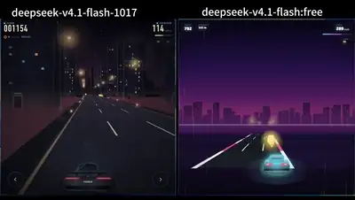</a><br><a href="https://www.sandbase.ai/lab/ai-videos/deepseek-v4-1-flash-1017/2112444725987037410?utm_source=github&utm_medium=readme&utm_campaign=awesome-deepseek-v4.1-flash-1017&utm_content=card"><b>DeepSeek V4.1 Flash vs 1017 game scene</b></a><br><sub><a href="https://x.com/TokenHarborAI/status/2112444725987037410">@TokenHarborAI</a> · 0:10</sub></td><td width="33%" valign="top"><a href="https://www.sandbase.ai/lab/media/x/deepseek-v4-1-flash-1017/2112480737110700384/video.mp4"></a><br><a href="https://www.sandbase.ai/lab/ai-videos/deepseek-v4-1-flash-1017/2112480737110700384?utm_source=github&utm_medium=readme&utm_campaign=awesome-deepseek-v4.1-flash-1017&utm_content=card"><b>DeepSeek versus MiniMax code generation comparison</b></a><br><sub><a href="https://x.com/CodeByNZ/status/2112480737110700384">@CodeByNZ</a> · 0:37</sub></td><td width="33%" valign="top"><a href="https://www.sandbase.ai/lab/media/x/deepseek-v4-1-flash-1017/2112495928498164091/video.mp4"></a><br><a href="https://www.sandbase.ai/lab/ai-videos/deepseek-v4-1-flash-1017/2112495928498164091?utm_source=github&utm_medium=readme&utm_campaign=awesome-deepseek-v4.1-flash-1017&utm_content=card"><b>Isometric flood control game model comparison</b></a><br><sub><a href="https://x.com/sonnnanonaisa/status/2112495928498164091">@sonnnanonaisa</a> · 0:30</sub></td></tr>
<tr><td width="33%" valign="top"><a href="https://www.sandbase.ai/lab/media/x/deepseek-v4-1-flash-1017/2112503076049576095/video.mp4"></a><br><a href="https://www.sandbase.ai/lab/ai-videos/deepseek-v4-1-flash-1017/2112503076049576095?utm_source=github&utm_medium=readme&utm_campaign=awesome-deepseek-v4.1-flash-1017&utm_content=card"><b>DeepSeek V4.1 Flash versus MiniMax M3.1 Flash</b></a><br><sub><a href="https://x.com/AiHubMix/status/2112503076049576095">@AiHubMix</a> · 0:32</sub></td><td width="33%" valign="top"><a href="https://www.sandbase.ai/lab/media/x/deepseek-v4-1-flash-1017/2112517168550265168/video.mp4"></a><br><a href="https://www.sandbase.ai/lab/ai-videos/deepseek-v4-1-flash-1017/2112517168550265168?utm_source=github&utm_medium=readme&utm_campaign=awesome-deepseek-v4.1-flash-1017&utm_content=card"><b>Comparison of 3D rocket launches in Three.js</b></a><br><sub><a href="https://x.com/Bhavani_00007/status/2112517168550265168">@Bhavani_00007</a> · 0:20</sub></td><td width="33%" valign="top"><a href="https://www.sandbase.ai/lab/media/x/deepseek-v4-1-flash-1017/2112521347805143490/video.mp4"></a><br><a href="https://www.sandbase.ai/lab/ai-videos/deepseek-v4-1-flash-1017/2112521347805143490?utm_source=github&utm_medium=readme&utm_campaign=awesome-deepseek-v4.1-flash-1017&utm_content=card"><b>Pixel art cat riding a bicycle model comparison</b></a><br><sub><a href="https://x.com/IFITALEX/status/2112521347805143490">@IFITALEX</a> · 0:21 · <a href="https://www.sandbase.ai/lab/ai-videos/deepseek-v4-1-flash-1017/2112521347805143490?utm_source=github&utm_medium=readme&utm_campaign=awesome-deepseek-v4.1-flash-1017&utm_content=card">prompt</a></sub></td></tr>
<tr><td width="33%" valign="top"><a href="https://www.sandbase.ai/lab/media/x/deepseek-v4-1-flash-1017/2112532217624674383/video.mp4"></a><br><a href="https://www.sandbase.ai/lab/ai-videos/deepseek-v4-1-flash-1017/2112532217624674383?utm_source=github&utm_medium=readme&utm_campaign=awesome-deepseek-v4.1-flash-1017&utm_content=card"><b>Running cow animation compared across three models</b></a><br><sub><a href="https://x.com/pipeline_os/status/2112532217624674383">@pipeline_os</a> · 0:14</sub></td><td width="33%" valign="top"><a href="https://www.sandbase.ai/lab/media/x/deepseek-v4-1-flash-1017/2112562717567631788/video.mp4"></a><br><a href="https://www.sandbase.ai/lab/ai-videos/deepseek-v4-1-flash-1017/2112562717567631788?utm_source=github&utm_medium=readme&utm_campaign=awesome-deepseek-v4.1-flash-1017&utm_content=card"><b>Pelican Mafia test comparing OpenCode Go and API</b></a><br><sub><a href="https://x.com/VulKan42069/status/2112562717567631788">@VulKan42069</a> · 1:18</sub></td><td width="33%" valign="top"><a href="https://www.sandbase.ai/lab/media/x/deepseek-v4-1-flash-1017/2112564497105953123/video.mp4"></a><br><a href="https://www.sandbase.ai/lab/ai-videos/deepseek-v4-1-flash-1017/2112564497105953123?utm_source=github&utm_medium=readme&utm_campaign=awesome-deepseek-v4.1-flash-1017&utm_content=card"><b>DeepSeek versus MiniMax code output comparison</b></a><br><sub><a href="https://x.com/EnvolDev/status/2112564497105953123">@EnvolDev</a> · 0:25</sub></td></tr>
<tr><td width="33%" valign="top"><a href="https://www.sandbase.ai/lab/media/x/deepseek-v4-1-flash-1017/2112573104996089906/video.mp4"></a><br><a href="https://www.sandbase.ai/lab/ai-videos/deepseek-v4-1-flash-1017/2112573104996089906?utm_source=github&utm_medium=readme&utm_campaign=awesome-deepseek-v4.1-flash-1017&utm_content=card"><b>Four AI models coding a rocket launch</b></a><br><sub><a href="https://x.com/RafaCrackYT/status/2112573104996089906">@RafaCrackYT</a> · 0:30</sub></td><td width="33%" valign="top"><a href="https://www.sandbase.ai/lab/media/x/deepseek-v4-1-flash-1017/2112612815471304985/video.mp4"></a><br><a href="https://www.sandbase.ai/lab/ai-videos/deepseek-v4-1-flash-1017/2112612815471304985?utm_source=github&utm_medium=readme&utm_campaign=awesome-deepseek-v4.1-flash-1017&utm_content=card"><b>Voxel worlds generated on different DGX Spark setups</b></a><br><sub><a href="https://x.com/niklaslenz_ai/status/2112612815471304985">@niklaslenz_ai</a> · 0:38</sub></td><td width="33%" valign="top"><a href="https://www.sandbase.ai/lab/media/x/deepseek-v4-1-flash-1017/2112861737980494273/video.mp4"></a><br><a href="https://www.sandbase.ai/lab/ai-videos/deepseek-v4-1-flash-1017/2112861737980494273?utm_source=github&utm_medium=readme&utm_campaign=awesome-deepseek-v4.1-flash-1017&utm_content=card"><b>Comparison of 3D medieval castles in HTML</b></a><br><sub><a href="https://x.com/marcthecreatorr/status/2112861737980494273">@marcthecreatorr</a> · 0:46</sub></td></tr>
<tr><td width="33%" valign="top"><a href="https://www.sandbase.ai/lab/media/x/deepseek-v4-1-flash-1017/2112891767293132906/video.mp4"></a><br><a href="https://www.sandbase.ai/lab/ai-videos/deepseek-v4-1-flash-1017/2112891767293132906?utm_source=github&utm_medium=readme&utm_campaign=awesome-deepseek-v4.1-flash-1017&utm_content=card"><b>Comparison of running elephant animations</b></a><br><sub><a href="https://x.com/pipeline_os/status/2112891767293132906">@pipeline_os</a> · 0:14</sub></td><td width="33%" valign="top"><a href="https://www.sandbase.ai/lab/media/x/deepseek-v4-1-flash-1017/2112897791022264814/video.mp4"></a><br><a href="https://www.sandbase.ai/lab/ai-videos/deepseek-v4-1-flash-1017/2112897791022264814?utm_source=github&utm_medium=readme&utm_campaign=awesome-deepseek-v4.1-flash-1017&utm_content=card"><b>Comparison of 3D jet engine cutaways</b></a><br><sub><a href="https://x.com/olezhavich/status/2112897791022264814">@olezhavich</a> · 0:29</sub></td><td width="33%" valign="top"><a href="https://www.sandbase.ai/lab/media/x/deepseek-v4-1-flash-1017/2112914304060252404/video.mp4"></a><br><a href="https://www.sandbase.ai/lab/ai-videos/deepseek-v4-1-flash-1017/2112914304060252404?utm_source=github&utm_medium=readme&utm_campaign=awesome-deepseek-v4.1-flash-1017&utm_content=card"><b>Procedural turbofan assembly comparison</b></a><br><sub><a href="https://x.com/itsfazley/status/2112914304060252404">@itsfazley</a> · 0:11</sub></td></tr>
<tr><td width="33%" valign="top"><a href="https://www.sandbase.ai/lab/media/x/deepseek-v4-1-flash-1017/2112979787069137309/video.mp4"></a><br><a href="https://www.sandbase.ai/lab/ai-videos/deepseek-v4-1-flash-1017/2112979787069137309?utm_source=github&utm_medium=readme&utm_campaign=awesome-deepseek-v4.1-flash-1017&utm_content=card"><b>Pigeon riding a unicycle Halloween animation comparison</b></a><br><sub><a href="https://x.com/olezhavich/status/2112979787069137309">@olezhavich</a> · 0:14</sub></td><td width="33%" valign="top"><a href="https://www.sandbase.ai/lab/media/x/deepseek-v4-1-flash-1017/2112995029337936362/video.mp4"></a><br><a href="https://www.sandbase.ai/lab/ai-videos/deepseek-v4-1-flash-1017/2112995029337936362?utm_source=github&utm_medium=readme&utm_campaign=awesome-deepseek-v4.1-flash-1017&utm_content=card"><b>Four frontier models compared on the lighthouse benchmark</b></a><br><sub><a href="https://x.com/EnvolDev/status/2112995029337936362">@EnvolDev</a> · 0:25</sub></td><td width="33%" valign="top"><a href="https://www.sandbase.ai/lab/media/x/deepseek-v4-1-flash-1017/2113290373329977539/video.mp4">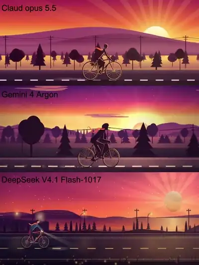</a><br><a href="https://www.sandbase.ai/lab/ai-videos/deepseek-v4-1-flash-1017/2113290373329977539?utm_source=github&utm_medium=readme&utm_campaign=awesome-deepseek-v4.1-flash-1017&utm_content=card"><b>Three models generating atmospheric landscape scenes compared</b></a><br><sub><a href="https://x.com/pipeline_os/status/2113290373329977539">@pipeline_os</a> · 0:14</sub></td></tr>
<tr><td width="33%" valign="top"><a href="https://www.sandbase.ai/lab/media/x/deepseek-v4-1-flash-1017/2113363382808023135/video.mp4">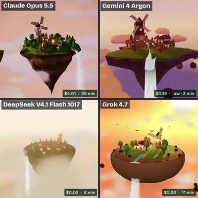</a><br><a href="https://www.sandbase.ai/lab/ai-videos/deepseek-v4-1-flash-1017/2113363382808023135?utm_source=github&utm_medium=readme&utm_campaign=awesome-deepseek-v4.1-flash-1017&utm_content=card"><b>Sky island scenes compared across four models</b></a><br><sub><a href="https://x.com/buzzhive_ai/status/2113363382808023135">@buzzhive_ai</a> · 0:15</sub></td><td width="33%" valign="top"><a href="https://www.sandbase.ai/lab/media/x/deepseek-v4-1-flash-1017/2113446055589056718/video.mp4">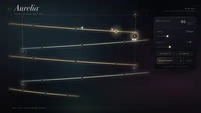</a><br><a href="https://www.sandbase.ai/lab/ai-videos/deepseek-v4-1-flash-1017/2113446055589056718?utm_source=github&utm_medium=readme&utm_campaign=awesome-deepseek-v4.1-flash-1017&utm_content=card"><b>Provider benchmark comparison on DeepSeek-V4.1</b></a><br><sub><a href="https://x.com/nothingto12/status/2113446055589056718">@nothingto12</a> · 0:15</sub></td><td width="33%" valign="top"><a href="https://www.sandbase.ai/lab/media/x/deepseek-v4-1-flash-1017/2113527245918654911/video.mp4">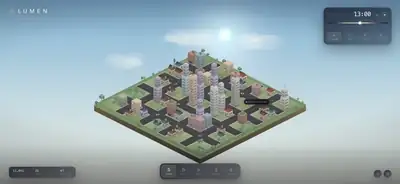</a><br><a href="https://www.sandbase.ai/lab/ai-videos/deepseek-v4-1-flash-1017/2113527245918654911?utm_source=github&utm_medium=readme&utm_campaign=awesome-deepseek-v4.1-flash-1017&utm_content=card"><b>Provider performance comparison on DeepSeek V4.1 Flash</b></a><br><sub><a href="https://x.com/nothingto12/status/2113527245918654911">@nothingto12</a> · 0:20</sub></td></tr>
<tr><td width="33%" valign="top"><a href="https://www.sandbase.ai/lab/media/x/deepseek-v4-1-flash-1017/2113605044289650733/video.mp4"></a><br><a href="https://www.sandbase.ai/lab/ai-videos/deepseek-v4-1-flash-1017/2113605044289650733?utm_source=github&utm_medium=readme&utm_campaign=awesome-deepseek-v4.1-flash-1017&utm_content=card"><b>Three.js electric motor animation model comparison</b></a><br><sub><a href="https://x.com/EvoLinkAi/status/2113605044289650733">@EvoLinkAi</a> · 0:40</sub></td><td width="33%" valign="top"><a href="https://www.sandbase.ai/lab/media/x/deepseek-v4-1-flash-1017/2113623569691517105/video.mp4">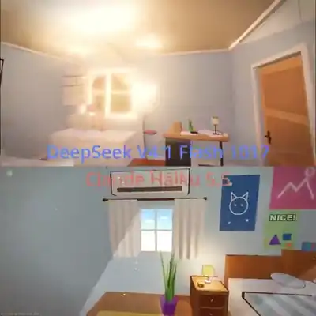</a><br><a href="https://www.sandbase.ai/lab/ai-videos/deepseek-v4-1-flash-1017/2113623569691517105?utm_source=github&utm_medium=readme&utm_campaign=awesome-deepseek-v4.1-flash-1017&utm_content=card"><b>Head-to-head comparison of 3D bedroom designs</b></a><br><sub><a href="https://x.com/BuildFastWithAI/status/2113623569691517105">@BuildFastWithAI</a> · 0:25</sub></td><td width="33%" valign="top"><a href="https://www.sandbase.ai/lab/media/x/deepseek-v4-1-flash-1017/2113707025066492154/video.mp4"></a><br><a href="https://www.sandbase.ai/lab/ai-videos/deepseek-v4-1-flash-1017/2113707025066492154?utm_source=github&utm_medium=readme&utm_campaign=awesome-deepseek-v4.1-flash-1017&utm_content=card"><b>Comparison of 3D campfire code generation</b></a><br><sub><a href="https://x.com/EvoLinkAi/status/2113707025066492154">@EvoLinkAi</a> · 0:30 · <a href="https://www.sandbase.ai/lab/ai-videos/deepseek-v4-1-flash-1017/2113707025066492154?utm_source=github&utm_medium=readme&utm_campaign=awesome-deepseek-v4.1-flash-1017&utm_content=card">prompt</a></sub></td></tr>
<tr><td width="33%" valign="top"><a href="https://www.sandbase.ai/lab/media/x/deepseek-v4-1-flash-1017/2113766577816686673/video.mp4">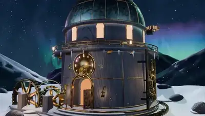</a><br><a href="https://www.sandbase.ai/lab/ai-videos/deepseek-v4-1-flash-1017/2113766577816686673?utm_source=github&utm_medium=readme&utm_campaign=awesome-deepseek-v4.1-flash-1017&utm_content=card"><b>Blender render comparison between two providers</b></a><br><sub><a href="https://x.com/nothingto12/status/2113766577816686673">@nothingto12</a> · 0:20</sub></td><td width="33%" valign="top"><a href="https://www.sandbase.ai/lab/media/x/deepseek-v4-1-flash-1017/2113815793150439650/video.mp4">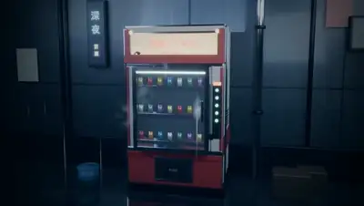</a><br><a href="https://www.sandbase.ai/lab/ai-videos/deepseek-v4-1-flash-1017/2113815793150439650?utm_source=github&utm_medium=readme&utm_campaign=awesome-deepseek-v4.1-flash-1017&utm_content=card"><b>DeepSeek-v4.1 provider comparison on the same prompt</b></a><br><sub><a href="https://x.com/nothingto12/status/2113815793150439650">@nothingto12</a> · 0:20</sub></td><td width="33%" valign="top"><a href="https://www.sandbase.ai/lab/media/x/deepseek-v4-1-flash-1017/2113989179382350015/video.mp4">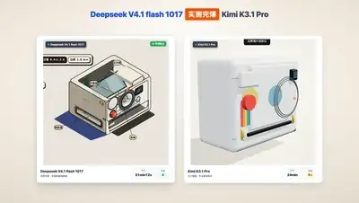</a><br><a href="https://www.sandbase.ai/lab/ai-videos/deepseek-v4-1-flash-1017/2113989179382350015?utm_source=github&utm_medium=readme&utm_campaign=awesome-deepseek-v4.1-flash-1017&utm_content=card"><b>Deconstructed 3D Polaroid camera generation comparison</b></a><br><sub><a href="https://x.com/IFITALEX/status/2113989179382350015">@IFITALEX</a> · 0:22 · <a href="https://www.sandbase.ai/lab/ai-videos/deepseek-v4-1-flash-1017/2113989179382350015?utm_source=github&utm_medium=readme&utm_campaign=awesome-deepseek-v4.1-flash-1017&utm_content=card">prompt</a></sub></td></tr>
<tr><td width="33%" valign="top"><a href="https://www.sandbase.ai/lab/media/x/deepseek-v4-1-flash-1017/2114070923116491139/video.mp4">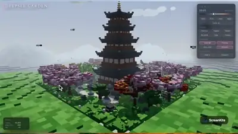</a><br><a href="https://www.sandbase.ai/lab/ai-videos/deepseek-v4-1-flash-1017/2114070923116491139?utm_source=github&utm_medium=readme&utm_campaign=awesome-deepseek-v4.1-flash-1017&utm_content=card"><b>Minimax M3.1 compared to DeepSeek V4.1 scene</b></a><br><sub><a href="https://x.com/Chris_Wozniczek/status/2114070923116491139">@Chris_Wozniczek</a> · 1:46</sub></td><td width="33%" valign="top"><a href="https://www.sandbase.ai/lab/media/x/deepseek-v4-1-flash-1017/2114074078340649183/video.mp4">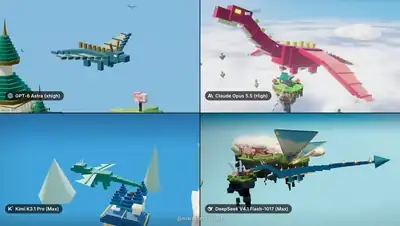</a><br><a href="https://www.sandbase.ai/lab/ai-videos/deepseek-v4-1-flash-1017/2114074078340649183?utm_source=github&utm_medium=readme&utm_campaign=awesome-deepseek-v4.1-flash-1017&utm_content=card"><b>Floating kingdom single HTML file comparison</b></a><br><sub><a href="https://x.com/marcthecreatorr/status/2114074078340649183">@marcthecreatorr</a> · 1:07</sub></td><td width="33%" valign="top"><a href="https://www.sandbase.ai/lab/media/x/deepseek-v4-1-flash-1017/2114092835729445213/video.mp4">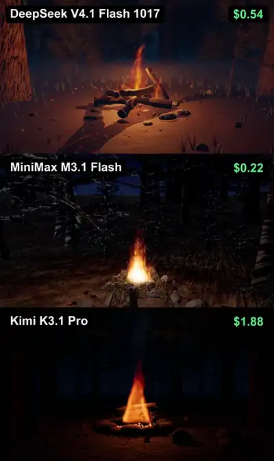</a><br><a href="https://www.sandbase.ai/lab/ai-videos/deepseek-v4-1-flash-1017/2114092835729445213?utm_source=github&utm_medium=readme&utm_campaign=awesome-deepseek-v4.1-flash-1017&utm_content=card"><b>DeepSeek vs MiniMax vs Kimi on the same task</b></a><br><sub><a href="https://x.com/rubenssoto_ai/status/2114092835729445213">@rubenssoto_ai</a> · 0:30</sub></td></tr>
<tr><td width="33%" valign="top"><a href="https://www.sandbase.ai/lab/media/x/deepseek-v4-1-flash-1017/2114120889629311075/video.mp4"></a><br><a href="https://www.sandbase.ai/lab/ai-videos/deepseek-v4-1-flash-1017/2114120889629311075?utm_source=github&utm_medium=readme&utm_campaign=awesome-deepseek-v4.1-flash-1017&utm_content=card"><b>Western saloon doorway generation comparison</b></a><br><sub><a href="https://x.com/buzzhive_ai/status/2114120889629311075">@buzzhive_ai</a> · 0:15</sub></td><td width="33%" valign="top"><a href="https://www.sandbase.ai/lab/media/x/deepseek-v4-1-flash-1017/2114145338256998843/video.mp4"></a><br><a href="https://www.sandbase.ai/lab/ai-videos/deepseek-v4-1-flash-1017/2114145338256998843?utm_source=github&utm_medium=readme&utm_campaign=awesome-deepseek-v4.1-flash-1017&utm_content=card"><b>Candy Bear 3D Model Generation Comparison</b></a><br><sub><a href="https://x.com/leo114119/status/2114145338256998843">@leo114119</a></sub></td><td width="33%" valign="top"><a href="https://www.sandbase.ai/lab/media/x/deepseek-v4-1-flash-1017/2114356555864850705/video.mp4">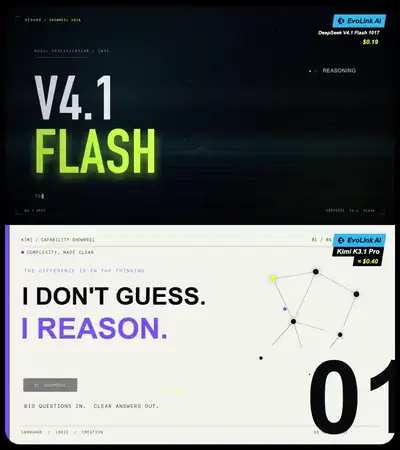</a><br><a href="https://www.sandbase.ai/lab/ai-videos/deepseek-v4-1-flash-1017/2114356555864850705?utm_source=github&utm_medium=readme&utm_campaign=awesome-deepseek-v4.1-flash-1017&utm_content=card"><b>DeepSeek versus Kimi showreels comparison</b></a><br><sub><a href="https://x.com/EvoLinkAi/status/2114356555864850705">@EvoLinkAi</a> · 0:15</sub></td></tr>
<tr><td width="33%" valign="top"><a href="https://www.sandbase.ai/lab/media/x/deepseek-v4-1-flash-1017/2114458953329639485/video.mp4">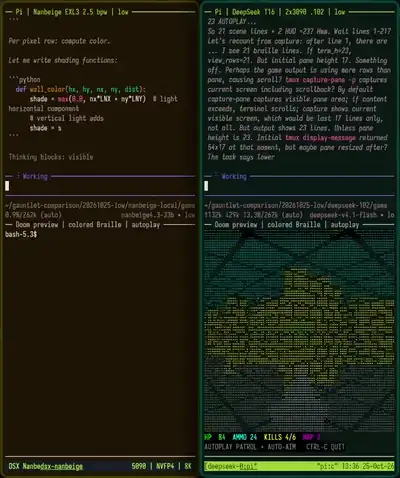</a><br><a href="https://www.sandbase.ai/lab/ai-videos/deepseek-v4-1-flash-1017/2114458953329639485?utm_source=github&utm_medium=readme&utm_campaign=awesome-deepseek-v4.1-flash-1017&utm_content=card"><b>Comparing models coding a terminal Doom game</b></a><br><sub><a href="https://x.com/lxe/status/2114458953329639485">@lxe</a> · 1:17</sub></td><td width="33%" valign="top"><a href="https://www.sandbase.ai/lab/media/x/deepseek-v4-1-flash-1017/2114743342793900183/video.mp4">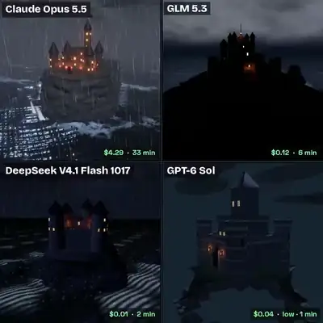</a><br><a href="https://www.sandbase.ai/lab/ai-videos/deepseek-v4-1-flash-1017/2114743342793900183?utm_source=github&utm_medium=readme&utm_campaign=awesome-deepseek-v4.1-flash-1017&utm_content=card"><b>Castle on a sea cliff storm comparison</b></a><br><sub><a href="https://x.com/buzzhive_ai/status/2114743342793900183">@buzzhive_ai</a> · 0:15</sub></td><td width="33%" valign="top"><a href="https://www.sandbase.ai/lab/media/x/deepseek-v4-1-flash-1017/2114831026883317972/video.mp4">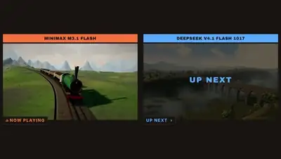</a><br><a href="https://www.sandbase.ai/lab/ai-videos/deepseek-v4-1-flash-1017/2114831026883317972?utm_source=github&utm_medium=readme&utm_campaign=awesome-deepseek-v4.1-flash-1017&utm_content=card"><b>Highland express animation comparison between AI models</b></a><br><sub><a href="https://x.com/Chris_Wozniczek/status/2114831026883317972">@Chris_Wozniczek</a> · 2:31</sub></td></tr>
<tr><td width="33%" valign="top"><a href="https://www.sandbase.ai/lab/media/x/deepseek-v4-1-flash-1017/2115132404549792068/video.mp4">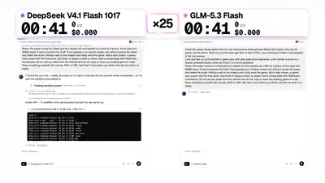</a><br><a href="https://www.sandbase.ai/lab/ai-videos/deepseek-v4-1-flash-1017/2115132404549792068?utm_source=github&utm_medium=readme&utm_campaign=awesome-deepseek-v4.1-flash-1017&utm_content=card"><b>Comparison of models generating Nokia snake game</b></a><br><sub><a href="https://x.com/entrptaher/status/2115132404549792068">@entrptaher</a> · 0:33</sub></td></tr>
</table>

</details>

**[See all 256 on SandBase Lab →](https://www.sandbase.ai/lab/ai-videos/deepseek-v4-1-flash-1017?utm_source=github&utm_medium=readme&utm_campaign=awesome-deepseek-v4.1-flash-1017&utm_content=section)**

<a id="recreate"></a>

## Recreate a video with DeepSeek V4.1 Flash 1017

Every video page on [SandBase Lab](https://www.sandbase.ai/lab/ai-videos/deepseek-v4-1-flash-1017?utm_source=github&utm_medium=readme&utm_campaign=awesome-deepseek-v4.1-flash-1017&utm_content=recreate) has a **Recreate** button: it sends the post to V4.1 Flash in the Lab text arena and returns the code, ready to play in the browser.

With the API, DeepSeek V4.1 Flash 1017 is `deepseek/deepseek-v4.1-flash` on SandBase (OpenAI-compatible); the id has served the 1017 checkpoint since October 17, 2026. Put a prompt in `prompt.txt`, create a key in the [console](https://www.sandbase.ai/console/keys?utm_source=github&utm_medium=readme&utm_campaign=awesome-deepseek-v4.1-flash-1017), and run:

```bash
jq -n --rawfile prompt prompt.txt \
  '{model: "deepseek/deepseek-v4.1-flash", max_tokens: 32000, messages: [{role: "user", content: $prompt}]}' |
curl -sS --max-time 900 https://api.sandbase.ai/v1/chat/completions \
  -H "Authorization: Bearer $SANDBASE_API_KEY" \
  -H "Content-Type: application/json" \
  -d @- | jq -r '.choices[0].message.content' | sed '/^```/d' > deepseek.html
```

Open `deepseek.html` in a browser, or run it in a [SandBase Sandbox](https://www.sandbase.ai/landing/sandbox?utm_source=github&utm_medium=readme&utm_campaign=awesome-deepseek-v4.1-flash-1017) to keep generated code isolated. The model reasons before it answers and those tokens count toward `max_tokens`, so leave room. Full walkthrough: [tutorial](docs/tutorial.md). Pricing: [model page](https://www.sandbase.ai/model/deepseek/deepseek-v4.1-flash?utm_source=github&utm_medium=readme&utm_campaign=awesome-deepseek-v4.1-flash-1017).

<a id="faq"></a>

## FAQ

### What is DeepSeek V4.1 Flash 1017?

DeepSeek-V4.1-Flash-1017 is the October 17, 2026 update of DeepSeek V4.1 Flash, the September model it replaced. DeepSeek moved its `deepseek-flash` API name to it with no change to the calling method or price, and published the weights under the MIT license. On SandBase it is `deepseek/deepseek-v4.1-flash`, with a 1M-token context window and up to 384K output tokens. Source: [the 1017 update, explained](https://blog.sandbase.ai/deepseek-v4-1-flash-1017-update-2026/?utm_source=github&utm_medium=readme&utm_campaign=awesome-deepseek-v4.1-flash-1017&utm_content=reading).

### How are these DeepSeek V4.1 Flash 1017 videos made?

The model doesn't render video. It writes a web page (HTML with Three.js, WebGL, Canvas or SVG), and the creator records the page playing. Some creators ran it in DeepSeek's Harness, where it also drove Blender. See the [tutorial](docs/tutorial.md).

### Where do I find the prompt for a video?

Videos tagged **prompt** come with the creator's prompt on their Lab page. The [prompt index](docs/prompts.md) lists all of them.

### How do I write a good DeepSeek V4.1 Flash 1017 prompt?

Ask for one self-contained HTML file, list every input and rule, ban external assets, and ask it to test its own page. Leave a large `max_tokens`: hidden reasoning shares that budget. Details and a template: [prompt guide](docs/prompt-guide.md).

### How do I use the DeepSeek V4.1 Flash 1017 API?

On SandBase the model id is `deepseek/deepseek-v4.1-flash` on the OpenAI-compatible `/v1/chat/completions` endpoint. One key works for every model, and existing code picked up 1017 without changes. See [Recreate](#recreate) and the [model page](https://www.sandbase.ai/model/deepseek/deepseek-v4.1-flash?utm_source=github&utm_medium=readme&utm_campaign=awesome-deepseek-v4.1-flash-1017).

### Is DeepSeek V4.1 Flash 1017 better than Claude Opus 5.5, GPT-6 or Gemini 4 Argon?

It depends on the rival. In creators' same-prompt tests against Opus 5.5, Opus usually wins on polish and controls while V4.1 Flash costs a small fraction (for example $0.23 against about $6). Against GPT-6.1 Sol and GPT-6 Luna, several creators preferred the DeepSeek result at a lower price. Against Argon, one creator reports the same seven game prompts cost $0.21 against $1.34. On the Lab [Evals boards](https://www.sandbase.ai/lab/evals?utm_source=github&utm_medium=readme&utm_campaign=awesome-deepseek-v4.1-flash-1017) (Artificial Analysis data, 2026-10-17) the V4.1 Flash row trails Opus 5.5, GPT-6 Astra, GPT-6.1 Sol and Argon on the Intelligence Index and costs less per task than all four; that row has not changed since before the 1017 release. Details: [model comparison](docs/model-comparison.md).

### How much does one video cost?

Creators report from about $0.03 (a 24-second Three.js tour) to about $5 (a 2-million-voxel world on max reasoning); most one-shot pages cost cents. The list price on SandBase is $0.30 per million input tokens and $1.20 per million output tokens, and reasoning tokens bill as output.

### Can I reuse these videos?

No, not by default. They belong to their creators. See [MEDIA-RIGHTS](MEDIA-RIGHTS.md).

<a id="reading"></a>

## Further reading

In-depth articles on the SandBase blog, with our own runs, token counts and costs:

- [DeepSeek V4.1-Flash-1017: What the October Update Changes](https://blog.sandbase.ai/deepseek-v4-1-flash-1017-update-2026/?utm_source=github&utm_medium=readme&utm_campaign=awesome-deepseek-v4.1-flash-1017&utm_content=reading)
- [DeepSeek V4.1-Flash-1017 in Python: Tested Code for Tools, JSON and Reasoning](https://blog.sandbase.ai/deepseek-v4-1-flash-1017-api-python-tutorial-2026/?utm_source=github&utm_medium=readme&utm_campaign=awesome-deepseek-v4.1-flash-1017&utm_content=reading)
- [DeepSeek V4.1 Flash vs V4 Pro: Prices, Vision, Pro Status](https://blog.sandbase.ai/deepseek-v4-1-flash-vs-v4-flash-pro-2026/?utm_source=github&utm_medium=readme&utm_campaign=awesome-deepseek-v4.1-flash-1017&utm_content=reading)
- [DeepSeek V4.1 Flash API: Preview Access and Harness Setup](https://blog.sandbase.ai/deepseek-v4-1-flash-api-harness-preview-2026/?utm_source=github&utm_medium=readme&utm_campaign=awesome-deepseek-v4.1-flash-1017&utm_content=reading)

<a id="contribute"></a>

## Suggest a video

Know a DeepSeek V4.1 Flash 1017 creation that should be here? [Open a submission](https://github.com/sandbase-lab/awesome-deepseek-v4.1-flash-1017/issues/new?template=submit-video.yml) with the original X post. Accepted posts are added on SandBase Lab and show up here on the next daily sync. If this list helped you, a ⭐ helps others find it.

## Credits & rights

Every video, prompt and post belongs to its creator. Cards credit the author and link to the original post. The MIT license covers this repository's scripts only. To correct a credit or remove a video, see [MEDIA-RIGHTS](MEDIA-RIGHTS.md).

Not affiliated with or endorsed by DeepSeek.

---

Maintained by [SandBase Lab](https://www.sandbase.ai/lab/?utm_source=github&utm_medium=readme&utm_campaign=awesome-deepseek-v4.1-flash-1017) · [All AI video collections](https://www.sandbase.ai/lab/ai-videos?utm_source=github&utm_medium=readme&utm_campaign=awesome-deepseek-v4.1-flash-1017)
