# Awesome DeepSeek V4.1 Flash 1017

[English](README.md) · 简体中文

[](https://awesome.re) [](#contents) [](docs/zh-CN/prompts.md) [](https://github.com/sandbase-lab/awesome-deepseek-v4.1-flash-1017/actions/workflows/sync.yml) [](https://www.sandbase.ai/model/deepseek/deepseek-v4.1-flash?utm_source=github&utm_medium=readme&utm_campaign=awesome-deepseek-v4.1-flash-1017)

[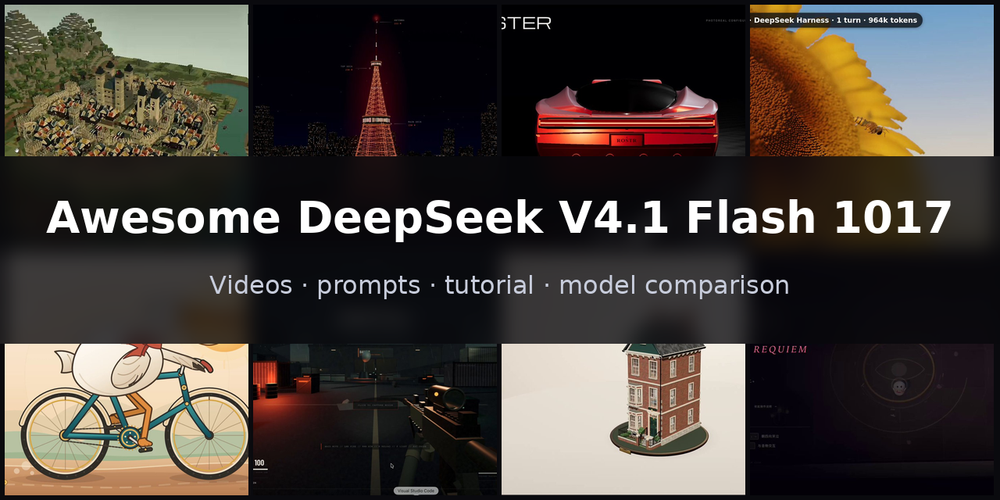](https://www.sandbase.ai/lab/ai-videos/deepseek-v4-1-flash-1017?lang=zh-CN&utm_source=github&utm_medium=readme&utm_campaign=awesome-deepseek-v4.1-flash-1017&utm_content=banner)

精选 **DeepSeek V4.1 Flash 1017 案例**合集：用 DeepSeek-V4.1-Flash-1017（DeepSeek V4.1 Flash 在 2026 年 10 月 17 日的更新版）做出的视频、提示词和演示。包括 Three.js / WebGL 3D 场景、SVG 与 Canvas 动画、动效和可在浏览器里玩的游戏，大多是模型根据提示词写成的代码，均注明作者并链接原帖。

共 **206 条视频**，来自 **131 位创作者** · **28 条**附作者提示词 · 每天从 [SandBase Lab](https://www.sandbase.ai/lab/ai-videos/deepseek-v4-1-flash-1017?lang=zh-CN&utm_source=github&utm_medium=readme&utm_campaign=awesome-deepseek-v4.1-flash-1017&utm_content=stats) 同步

## 从这里开始

| 我想… | 去这里 |
|---|---|
| 看视频 | 在下方 [按分类浏览](#contents)，或 [在 SandBase Lab 大屏播放](https://www.sandbase.ai/lab/ai-videos/deepseek-v4-1-flash-1017?lang=zh-CN&utm_source=github&utm_medium=readme&utm_campaign=awesome-deepseek-v4.1-flash-1017&utm_content=quickstart) |
| 复制提示词 | [提示词索引](docs/zh-CN/prompts.md)：所有附带提示词的视频 |
| 自己写提示词 | [提示词写法](docs/zh-CN/prompt-guide.md)：7 条写法和一个填空模板 |
| 做一个视频 | [教程](docs/zh-CN/tutorial.md)：提示词 → HTML → MP4，含 API、CLI 调用和录屏脚本 |
| 选模型 | [DeepSeek V4.1 Flash 1017 对比 Claude Opus 5.5、GPT-6 和 Gemini 4 Argon](docs/zh-CN/model-comparison.md) |
| 马上试试 | [在 Lab 竞技场运行 DeepSeek V4.1 Flash 1017](https://www.sandbase.ai/lab/x/llm-arena?models=deepseek%2Fdeepseek-v4.1-flash&lang=zh-CN&utm_source=github&utm_medium=readme&utm_campaign=awesome-deepseek-v4.1-flash-1017&utm_content=quickstart)，和其他模型并排对比 |

<a id="contents"></a>

## 目录

- [精选](#featured) (8)
- [3D 场景](#3d-scene) (68)
- [动效](#motion-graphics) (19)
- [游戏](#game) (17)
- [产品界面](#ui-demo) (6)
- [粒子与形状](#particles) (2)
- [讲解](#explainer) (3)
- [发布片](#launch-film) (6)
- [测试对比](#comparison) (85)
- [用 DeepSeek V4.1 Flash 1017 复刻视频](#recreate)
- [常见问题](#faq)
- [延伸阅读](#reading)
- [推荐作品](#contribute)

点击预览图播放视频；点击标题前往 SandBase Lab 查看原帖、提示词，并一键 **复刻**；**@作者** 链接到 X 原帖。

<a id="featured"></a>

## 精选

<table>
<tr><td width="33%" valign="top"><a href="https://www.sandbase.ai/lab/media/x/deepseek-v4-1-flash-1017/2111442747999789204/video.mp4">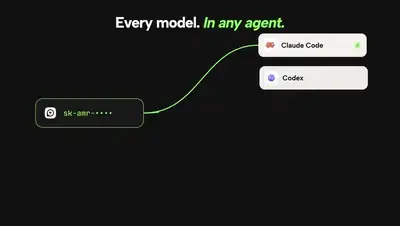</a><br><a href="https://www.sandbase.ai/lab/ai-videos/deepseek-v4-1-flash-1017/2111442747999789204?lang=zh-CN&utm_source=github&utm_medium=readme&utm_campaign=awesome-deepseek-v4.1-flash-1017&utm_content=card"><b>OpenDesign API接入教程动效</b></a><br><sub><a href="https://x.com/tuturetom/status/2111442747999789204">@tuturetom</a> · 1:07</sub></td><td width="33%" valign="top"><a href="https://www.sandbase.ai/lab/media/x/deepseek-v4-1-flash-1017/2111411889217651196/video.mp4">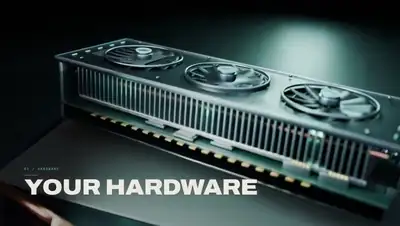</a><br><a href="https://www.sandbase.ai/lab/ai-videos/deepseek-v4-1-flash-1017/2111411889217651196?lang=zh-CN&utm_source=github&utm_medium=readme&utm_campaign=awesome-deepseek-v4.1-flash-1017&utm_content=card"><b>DeepSeek V4.1 生成的 Blender 与 Three.js 场景</b></a><br><sub><a href="https://x.com/superalesha/status/2111411889217651196">@superalesha</a> · 0:24</sub></td><td width="33%" valign="top"><a href="https://www.sandbase.ai/lab/media/x/deepseek-v4-1-flash-1017/2111401362713968942/video.mp4"></a><br><a href="https://www.sandbase.ai/lab/ai-videos/deepseek-v4-1-flash-1017/2111401362713968942?lang=zh-CN&utm_source=github&utm_medium=readme&utm_campaign=awesome-deepseek-v4.1-flash-1017&utm_content=card"><b>代码生成的庞大中世纪体素世界</b></a><br><sub><a href="https://x.com/marcthecreatorr/status/2111401362713968942">@marcthecreatorr</a> · 0:51</sub></td></tr>
<tr><td width="33%" valign="top"><a href="https://www.sandbase.ai/lab/media/x/deepseek-v4-1-flash-1017/2111464046113493422/video.mp4">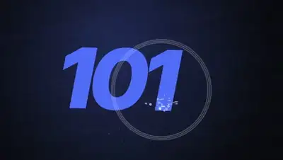</a><br><a href="https://www.sandbase.ai/lab/ai-videos/deepseek-v4-1-flash-1017/2111464046113493422?lang=zh-CN&utm_source=github&utm_medium=readme&utm_campaign=awesome-deepseek-v4.1-flash-1017&utm_content=card"><b>AI生成的动态设计视频</b></a><br><sub><a href="https://x.com/yohakujpn/status/2111464046113493422">@yohakujpn</a> · 0:35</sub></td><td width="33%" valign="top"><a href="https://www.sandbase.ai/lab/media/x/deepseek-v4-1-flash-1017/2111416511932117424/video.mp4">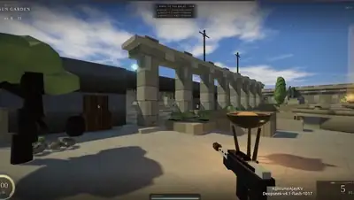</a><br><a href="https://www.sandbase.ai/lab/ai-videos/deepseek-v4-1-flash-1017/2111416511932117424?lang=zh-CN&utm_source=github&utm_medium=readme&utm_campaign=awesome-deepseek-v4.1-flash-1017&utm_content=card"><b>纯代码生成的 DeepSeek 第一人称射击游戏</b></a><br><sub><a href="https://x.com/ItsmeAjayKV/status/2111416511932117424">@ItsmeAjayKV</a> · 2:30</sub></td><td width="33%" valign="top"><a href="https://www.sandbase.ai/lab/media/x/deepseek-v4-1-flash-1017/2111454840337600839/video.mp4"></a><br><a href="https://www.sandbase.ai/lab/ai-videos/deepseek-v4-1-flash-1017/2111454840337600839?lang=zh-CN&utm_source=github&utm_medium=readme&utm_campaign=awesome-deepseek-v4.1-flash-1017&utm_content=card"><b>SVG 生成的踩踏板动画角色</b></a><br><sub><a href="https://x.com/SahilPanhotra/status/2111454840337600839">@SahilPanhotra</a> · 0:10</sub></td></tr>
<tr><td width="33%" valign="top"><a href="https://www.sandbase.ai/lab/media/x/deepseek-v4-1-flash-1017/2112464983002906928/video.mp4">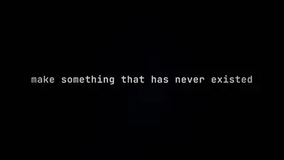</a><br><a href="https://www.sandbase.ai/lab/ai-videos/deepseek-v4-1-flash-1017/2112464983002906928?lang=zh-CN&utm_source=github&utm_medium=readme&utm_campaign=awesome-deepseek-v4.1-flash-1017&utm_content=card"><b>DeepSeek生成的WebGL2粒子短片</b></a><br><sub><a href="https://x.com/SamiBizConsult/status/2112464983002906928">@SamiBizConsult</a> · 0:48</sub></td><td width="33%" valign="top"><a href="https://www.sandbase.ai/lab/media/x/deepseek-v4-1-flash-1017/2111865800705331296/video.mp4">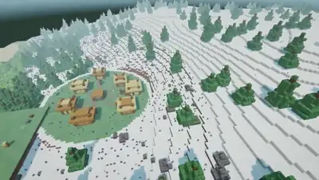</a><br><a href="https://www.sandbase.ai/lab/ai-videos/deepseek-v4-1-flash-1017/2111865800705331296?lang=zh-CN&utm_source=github&utm_medium=readme&utm_campaign=awesome-deepseek-v4.1-flash-1017&utm_content=card"><b>单 HTML 文件实现的我的世界游戏</b></a><br><sub><a href="https://x.com/dummerspast39/status/2111865800705331296">@dummerspast39</a> · 1:56</sub></td></tr>
</table>

<a id="3d-scene"></a>

## 3D 场景

<table>
<tr><td width="33%" valign="top"><a href="https://www.sandbase.ai/lab/media/x/deepseek-v4-1-flash-1017/2111307024797753793/video.mp4"></a><br><a href="https://www.sandbase.ai/lab/ai-videos/deepseek-v4-1-flash-1017/2111307024797753793?lang=zh-CN&utm_source=github&utm_medium=readme&utm_campaign=awesome-deepseek-v4.1-flash-1017&utm_content=card"><b>DeepSeek V4.1F-1017 生成的作品</b></a><br><sub><a href="https://x.com/teortaxesTex/status/2111307024797753793">@teortaxesTex</a> · 0:16</sub></td><td width="33%" valign="top"><a href="https://www.sandbase.ai/lab/media/x/deepseek-v4-1-flash-1017/2111377927791067250/video.mp4">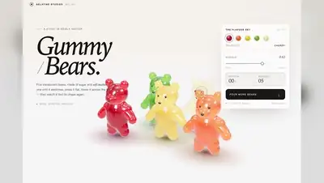</a><br><a href="https://www.sandbase.ai/lab/ai-videos/deepseek-v4-1-flash-1017/2111377927791067250?lang=zh-CN&utm_source=github&utm_medium=readme&utm_campaign=awesome-deepseek-v4.1-flash-1017&utm_content=card"><b>可交互拉伸果冻熊物理模拟</b></a><br><sub><a href="https://x.com/0xNotFounder/status/2111377927791067250">@0xNotFounder</a> · 0:16</sub></td><td width="33%" valign="top"><a href="https://www.sandbase.ai/lab/media/x/deepseek-v4-1-flash-1017/2111387136264126744/video.mp4">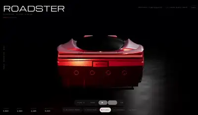</a><br><a href="https://www.sandbase.ai/lab/ai-videos/deepseek-v4-1-flash-1017/2111387136264126744?lang=zh-CN&utm_source=github&utm_medium=readme&utm_campaign=awesome-deepseek-v4.1-flash-1017&utm_content=card"><b>特斯拉 Roadster 交互式 3D 演示</b></a><br><sub><a href="https://x.com/dtzy_88/status/2111387136264126744">@dtzy_88</a> · 0:18</sub></td></tr>
<tr><td width="33%" valign="top"><a href="https://www.sandbase.ai/lab/media/x/deepseek-v4-1-flash-1017/2111388754573398252/video.mp4">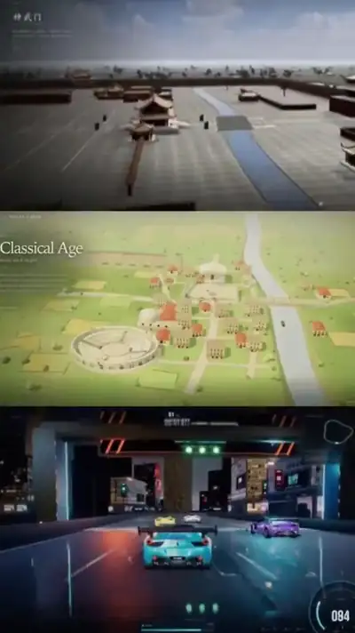</a><br><a href="https://www.sandbase.ai/lab/ai-videos/deepseek-v4-1-flash-1017/2111388754573398252?lang=zh-CN&utm_source=github&utm_medium=readme&utm_campaign=awesome-deepseek-v4.1-flash-1017&utm_content=card"><b>四个3D动态场景效果展示</b></a><br><sub><a href="https://x.com/YxzRainy/status/2111388754573398252">@YxzRainy</a> · 0:15</sub></td><td width="33%" valign="top"><a href="https://www.sandbase.ai/lab/media/x/deepseek-v4-1-flash-1017/2111390831244460473/video.mp4">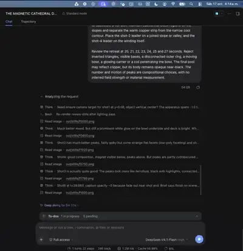</a><br><a href="https://www.sandbase.ai/lab/ai-videos/deepseek-v4-1-flash-1017/2111390831244460473?lang=zh-CN&utm_source=github&utm_medium=readme&utm_campaign=awesome-deepseek-v4.1-flash-1017&utm_content=card"><b>DeepSeek V4.1 速度与3D生成能力测试</b></a><br><sub><a href="https://x.com/SPAC89/status/2111390831244460473">@SPAC89</a> · 1:06</sub></td><td width="33%" valign="top"><a href="https://www.sandbase.ai/lab/media/x/deepseek-v4-1-flash-1017/2111395155505033338/video.mp4">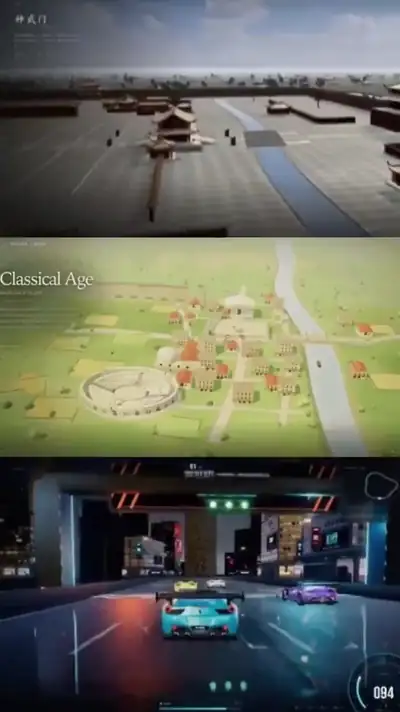</a><br><a href="https://www.sandbase.ai/lab/ai-videos/deepseek-v4-1-flash-1017/2111395155505033338?lang=zh-CN&utm_source=github&utm_medium=readme&utm_campaign=awesome-deepseek-v4.1-flash-1017&utm_content=card"><b>DeepSeek 生成的四个 3D 演示项目</b></a><br><sub><a href="https://x.com/AndyL5cc/status/2111395155505033338">@AndyL5cc</a> · 0:15</sub></td></tr>
</table>

<details>
<summary><b>展开全部 68 条</b></summary>

<table>
<tr><td width="33%" valign="top"><a href="https://www.sandbase.ai/lab/media/x/deepseek-v4-1-flash-1017/2111401362713968942/video.mp4"></a><br><a href="https://www.sandbase.ai/lab/ai-videos/deepseek-v4-1-flash-1017/2111401362713968942?lang=zh-CN&utm_source=github&utm_medium=readme&utm_campaign=awesome-deepseek-v4.1-flash-1017&utm_content=card"><b>代码生成的庞大中世纪体素世界</b></a><br><sub><a href="https://x.com/marcthecreatorr/status/2111401362713968942">@marcthecreatorr</a> · 0:51</sub></td><td width="33%" valign="top"><a href="https://www.sandbase.ai/lab/media/x/deepseek-v4-1-flash-1017/2111411889217651196/video.mp4"></a><br><a href="https://www.sandbase.ai/lab/ai-videos/deepseek-v4-1-flash-1017/2111411889217651196?lang=zh-CN&utm_source=github&utm_medium=readme&utm_campaign=awesome-deepseek-v4.1-flash-1017&utm_content=card"><b>DeepSeek V4.1 生成的 Blender 与 Three.js 场景</b></a><br><sub><a href="https://x.com/superalesha/status/2111411889217651196">@superalesha</a> · 0:24</sub></td><td width="33%" valign="top"><a href="https://www.sandbase.ai/lab/media/x/deepseek-v4-1-flash-1017/2111416683713957990/video.mp4">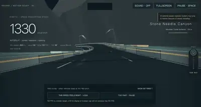</a><br><a href="https://www.sandbase.ai/lab/ai-videos/deepseek-v4-1-flash-1017/2111416683713957990?lang=zh-CN&utm_source=github&utm_medium=readme&utm_campaign=awesome-deepseek-v4.1-flash-1017&utm_content=card"><b>过山车式高速公路骑行模拟</b></a><br><sub><a href="https://x.com/y3185381880/status/2111416683713957990">@y3185381880</a> · 0:42</sub></td></tr>
<tr><td width="33%" valign="top"><a href="https://www.sandbase.ai/lab/media/x/deepseek-v4-1-flash-1017/2111426130549117402/video.mp4"></a><br><a href="https://www.sandbase.ai/lab/ai-videos/deepseek-v4-1-flash-1017/2111426130549117402?lang=zh-CN&utm_source=github&utm_medium=readme&utm_campaign=awesome-deepseek-v4.1-flash-1017&utm_content=card"><b>体素风穿旗袍骑独轮车的鹈鹕</b></a><br><sub><a href="https://x.com/UFO2002616/status/2111426130549117402">@UFO2002616</a> · 0:42 · <a href="https://www.sandbase.ai/lab/ai-videos/deepseek-v4-1-flash-1017/2111426130549117402?lang=zh-CN&utm_source=github&utm_medium=readme&utm_campaign=awesome-deepseek-v4.1-flash-1017&utm_content=card">提示词</a></sub></td><td width="33%" valign="top"><a href="https://www.sandbase.ai/lab/media/x/deepseek-v4-1-flash-1017/2111429622734762462/video.mp4">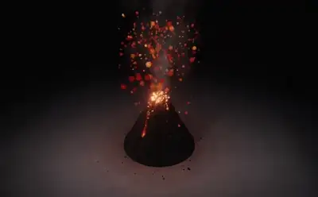</a><br><a href="https://www.sandbase.ai/lab/ai-videos/deepseek-v4-1-flash-1017/2111429622734762462?lang=zh-CN&utm_source=github&utm_medium=readme&utm_campaign=awesome-deepseek-v4.1-flash-1017&utm_content=card"><b>3D 火山喷发模拟演示</b></a><br><sub><a href="https://x.com/hungryturbo/status/2111429622734762462">@hungryturbo</a> · 0:14</sub></td><td width="33%" valign="top"><a href="https://www.sandbase.ai/lab/media/x/deepseek-v4-1-flash-1017/2111434381323907105/video.mp4">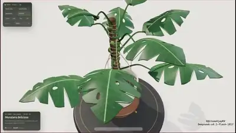</a><br><a href="https://www.sandbase.ai/lab/ai-videos/deepseek-v4-1-flash-1017/2111434381323907105?lang=zh-CN&utm_source=github&utm_medium=readme&utm_campaign=awesome-deepseek-v4.1-flash-1017&utm_content=card"><b>Three.js 单次生成的 3D 场景</b></a><br><sub><a href="https://x.com/ItsmeAjayKV/status/2111434381323907105">@ItsmeAjayKV</a> · 0:36</sub></td></tr>
<tr><td width="33%" valign="top"><a href="https://www.sandbase.ai/lab/media/x/deepseek-v4-1-flash-1017/2111438320773570573/video.mp4"></a><br><a href="https://www.sandbase.ai/lab/ai-videos/deepseek-v4-1-flash-1017/2111438320773570573?lang=zh-CN&utm_source=github&utm_medium=readme&utm_campaign=awesome-deepseek-v4.1-flash-1017&utm_content=card"><b>巴黎体素风格埃菲尔铁塔</b></a><br><sub><a href="https://x.com/nawariokra/status/2111438320773570573">@nawariokra</a> · 0:59</sub></td><td width="33%" valign="top"><a href="https://www.sandbase.ai/lab/media/x/deepseek-v4-1-flash-1017/2111438861318418817/video.mp4">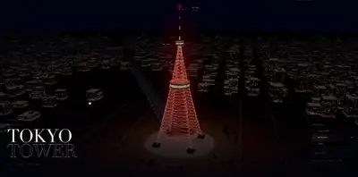</a><br><a href="https://www.sandbase.ai/lab/ai-videos/deepseek-v4-1-flash-1017/2111438861318418817?lang=zh-CN&utm_source=github&utm_medium=readme&utm_campaign=awesome-deepseek-v4.1-flash-1017&utm_content=card"><b>Three.js 3D东京塔场景</b></a><br><sub><a href="https://x.com/vincent_ddup/status/2111438861318418817">@vincent_ddup</a> · 0:48 · <a href="https://www.sandbase.ai/lab/ai-videos/deepseek-v4-1-flash-1017/2111438861318418817?lang=zh-CN&utm_source=github&utm_medium=readme&utm_campaign=awesome-deepseek-v4.1-flash-1017&utm_content=card">提示词</a></sub></td><td width="33%" valign="top"><a href="https://www.sandbase.ai/lab/media/x/deepseek-v4-1-flash-1017/2111440821484667343/video.mp4">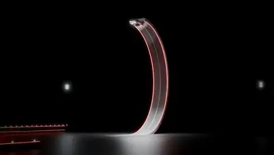</a><br><a href="https://www.sandbase.ai/lab/ai-videos/deepseek-v4-1-flash-1017/2111440821484667343?lang=zh-CN&utm_source=github&utm_medium=readme&utm_campaign=awesome-deepseek-v4.1-flash-1017&utm_content=card"><b>DeepSeek V4.1 单次生成测试视频</b></a><br><sub><a href="https://x.com/MaxForAI/status/2111440821484667343">@MaxForAI</a> · 0:46</sub></td></tr>
<tr><td width="33%" valign="top"><a href="https://www.sandbase.ai/lab/media/x/deepseek-v4-1-flash-1017/2111441312323088473/video.mp4"></a><br><a href="https://www.sandbase.ai/lab/ai-videos/deepseek-v4-1-flash-1017/2111441312323088473?lang=zh-CN&utm_source=github&utm_medium=readme&utm_campaign=awesome-deepseek-v4.1-flash-1017&utm_content=card"><b>Three.js 制作的特斯拉 Roadster 遥测轨迹仿真</b></a><br><sub><a href="https://x.com/IFITALEX/status/2111441312323088473">@IFITALEX</a> · 0:20 · <a href="https://www.sandbase.ai/lab/ai-videos/deepseek-v4-1-flash-1017/2111441312323088473?lang=zh-CN&utm_source=github&utm_medium=readme&utm_campaign=awesome-deepseek-v4.1-flash-1017&utm_content=card">提示词</a></sub></td><td width="33%" valign="top"><a href="https://www.sandbase.ai/lab/media/x/deepseek-v4-1-flash-1017/2111442531594670085/video.mp4">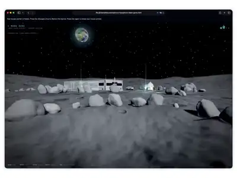</a><br><a href="https://www.sandbase.ai/lab/ai-videos/deepseek-v4-1-flash-1017/2111442531594670085?lang=zh-CN&utm_source=github&utm_medium=readme&utm_campaign=awesome-deepseek-v4.1-flash-1017&utm_content=card"><b>3D月球基地交互展示</b></a><br><sub><a href="https://x.com/a_g_e_n_c/status/2111442531594670085">@a_g_e_n_c</a> · 0:14</sub></td><td width="33%" valign="top"><a href="https://www.sandbase.ai/lab/media/x/deepseek-v4-1-flash-1017/2111450021849944508/video.mp4">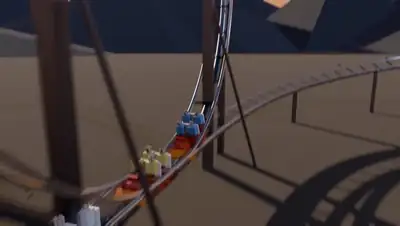</a><br><a href="https://www.sandbase.ai/lab/ai-videos/deepseek-v4-1-flash-1017/2111450021849944508?lang=zh-CN&utm_source=github&utm_medium=readme&utm_campaign=awesome-deepseek-v4.1-flash-1017&utm_content=card"><b>通过Blender生成的3D过山车视频</b></a><br><sub><a href="https://x.com/Yunn260414/status/2111450021849944508">@Yunn260414</a> · 0:28 · <a href="https://www.sandbase.ai/lab/ai-videos/deepseek-v4-1-flash-1017/2111450021849944508?lang=zh-CN&utm_source=github&utm_medium=readme&utm_campaign=awesome-deepseek-v4.1-flash-1017&utm_content=card">提示词</a></sub></td></tr>
<tr><td width="33%" valign="top"><a href="https://www.sandbase.ai/lab/media/x/deepseek-v4-1-flash-1017/2111450154448609633/video.mp4"></a><br><a href="https://www.sandbase.ai/lab/ai-videos/deepseek-v4-1-flash-1017/2111450154448609633?lang=zh-CN&utm_source=github&utm_medium=readme&utm_campaign=awesome-deepseek-v4.1-flash-1017&utm_content=card"><b>Three.js 生成的三层维多利亚风格联排别墅</b></a><br><sub><a href="https://x.com/ItsmeAjayKV/status/2111450154448609633">@ItsmeAjayKV</a> · 0:54</sub></td><td width="33%" valign="top"><a href="https://www.sandbase.ai/lab/media/x/deepseek-v4-1-flash-1017/2111454710498766979/video.mp4"></a><br><a href="https://www.sandbase.ai/lab/ai-videos/deepseek-v4-1-flash-1017/2111454710498766979?lang=zh-CN&utm_source=github&utm_medium=readme&utm_campaign=awesome-deepseek-v4.1-flash-1017&utm_content=card"><b>基于参考图生成的Blender 3D模型</b></a><br><sub><a href="https://x.com/npaka123/status/2111454710498766979">@npaka123</a> · 0:04 · <a href="https://www.sandbase.ai/lab/ai-videos/deepseek-v4-1-flash-1017/2111454710498766979?lang=zh-CN&utm_source=github&utm_medium=readme&utm_campaign=awesome-deepseek-v4.1-flash-1017&utm_content=card">提示词</a></sub></td><td width="33%" valign="top"><a href="https://www.sandbase.ai/lab/media/x/deepseek-v4-1-flash-1017/2111456300563603569/video.mp4">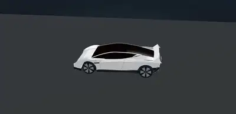</a><br><a href="https://www.sandbase.ai/lab/ai-videos/deepseek-v4-1-flash-1017/2111456300563603569?lang=zh-CN&utm_source=github&utm_medium=readme&utm_campaign=awesome-deepseek-v4.1-flash-1017&utm_content=card"><b>包含内部结构的特斯拉Roadster三维模型</b></a><br><sub><a href="https://x.com/tspy/status/2111456300563603569">@tspy</a> · 1:04</sub></td></tr>
<tr><td width="33%" valign="top"><a href="https://www.sandbase.ai/lab/media/x/deepseek-v4-1-flash-1017/2111459465472176150/video.mp4">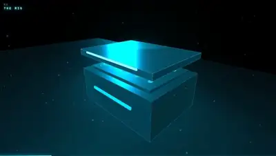</a><br><a href="https://www.sandbase.ai/lab/ai-videos/deepseek-v4-1-flash-1017/2111459465472176150?lang=zh-CN&utm_source=github&utm_medium=readme&utm_campaign=awesome-deepseek-v4.1-flash-1017&utm_content=card"><b>Three.js漫游展示测试平台</b></a><br><sub><a href="https://x.com/wikiwayne/status/2111459465472176150">@wikiwayne</a> · 0:26</sub></td><td width="33%" valign="top"><a href="https://www.sandbase.ai/lab/media/x/deepseek-v4-1-flash-1017/2111462244668031446/video.mp4">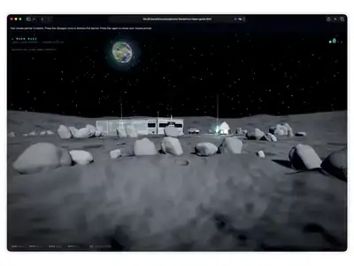</a><br><a href="https://www.sandbase.ai/lab/ai-videos/deepseek-v4-1-flash-1017/2111462244668031446?lang=zh-CN&utm_source=github&utm_medium=readme&utm_campaign=awesome-deepseek-v4.1-flash-1017&utm_content=card"><b>Three.js交互式月球基地</b></a><br><sub><a href="https://x.com/Octoberry/status/2111462244668031446">@Octoberry</a> · 0:14</sub></td><td width="33%" valign="top"><a href="https://www.sandbase.ai/lab/media/x/deepseek-v4-1-flash-1017/2111466763959271873/video.mp4">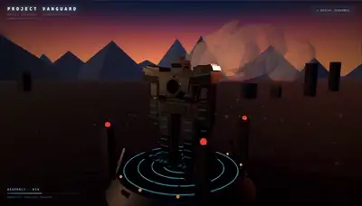</a><br><a href="https://www.sandbase.ai/lab/ai-videos/deepseek-v4-1-flash-1017/2111466763959271873?lang=zh-CN&utm_source=github&utm_medium=readme&utm_campaign=awesome-deepseek-v4.1-flash-1017&utm_content=card"><b>Three.js 中的机器人组装与发射测试</b></a><br><sub><a href="https://x.com/alohaproxy/status/2111466763959271873">@alohaproxy</a> · 0:37</sub></td></tr>
<tr><td width="33%" valign="top"><a href="https://www.sandbase.ai/lab/media/x/deepseek-v4-1-flash-1017/2111468860935127532/video.mp4"></a><br><a href="https://www.sandbase.ai/lab/ai-videos/deepseek-v4-1-flash-1017/2111468860935127532?lang=zh-CN&utm_source=github&utm_medium=readme&utm_campaign=awesome-deepseek-v4.1-flash-1017&utm_content=card"><b>向日葵上的 3D 蜜蜂场景</b></a><br><sub><a href="https://x.com/loktar00/status/2111468860935127532">@loktar00</a> · 1:30</sub></td><td width="33%" valign="top"><a href="https://www.sandbase.ai/lab/media/x/deepseek-v4-1-flash-1017/2111485486175039679/video.mp4">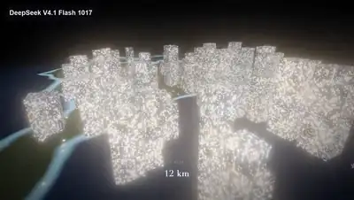</a><br><a href="https://www.sandbase.ai/lab/ai-videos/deepseek-v4-1-flash-1017/2111485486175039679?lang=zh-CN&utm_source=github&utm_medium=readme&utm_campaign=awesome-deepseek-v4.1-flash-1017&utm_content=card"><b>从地球轨道缩放到单个原子的动画</b></a><br><sub><a href="https://x.com/benjistacked/status/2111485486175039679">@benjistacked</a> · 0:29</sub></td><td width="33%" valign="top"><a href="https://www.sandbase.ai/lab/media/x/deepseek-v4-1-flash-1017/2111487932515410366/video.mp4"></a><br><a href="https://www.sandbase.ai/lab/ai-videos/deepseek-v4-1-flash-1017/2111487932515410366?lang=zh-CN&utm_source=github&utm_medium=readme&utm_campaign=awesome-deepseek-v4.1-flash-1017&utm_content=card"><b>复刻的3D除草机场景视频</b></a><br><sub><a href="https://x.com/GeekCatX/status/2111487932515410366">@GeekCatX</a> · 0:44</sub></td></tr>
<tr><td width="33%" valign="top"><a href="https://www.sandbase.ai/lab/media/x/deepseek-v4-1-flash-1017/2111488300192334142/video.mp4">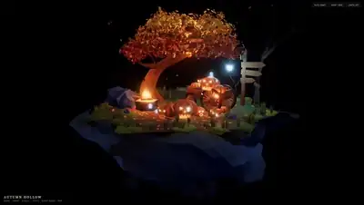</a><br><a href="https://www.sandbase.ai/lab/ai-videos/deepseek-v4-1-flash-1017/2111488300192334142?lang=zh-CN&utm_source=github&utm_medium=readme&utm_campaign=awesome-deepseek-v4.1-flash-1017&utm_content=card"><b>等待万圣节的女孩3D场景</b></a><br><sub><a href="https://x.com/abhinavflac/status/2111488300192334142">@abhinavflac</a> · 0:17</sub></td><td width="33%" valign="top"><a href="https://www.sandbase.ai/lab/media/x/deepseek-v4-1-flash-1017/2111498348880433384/video.mp4">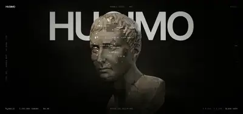</a><br><a href="https://www.sandbase.ai/lab/ai-videos/deepseek-v4-1-flash-1017/2111498348880433384?lang=zh-CN&utm_source=github&utm_medium=readme&utm_campaign=awesome-deepseek-v4.1-flash-1017&utm_content=card"><b>含3D雕塑元素的交互式Three.js网页</b></a><br><sub><a href="https://x.com/Huoimo/status/2111498348880433384">@Huoimo</a> · 0:17</sub></td><td width="33%" valign="top"><a href="https://www.sandbase.ai/lab/media/x/deepseek-v4-1-flash-1017/2111503929083359640/video.mp4">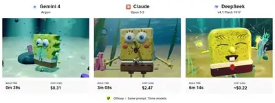</a><br><a href="https://www.sandbase.ai/lab/ai-videos/deepseek-v4-1-flash-1017/2111503929083359640?lang=zh-CN&utm_source=github&utm_medium=readme&utm_campaign=awesome-deepseek-v4.1-flash-1017&utm_content=card"><b>Three.js制作的海绵宝宝水下场景</b></a><br><sub><a href="https://x.com/yuhasbeentaken/status/2111503929083359640">@yuhasbeentaken</a> · 0:30</sub></td></tr>
<tr><td width="33%" valign="top"><a href="https://www.sandbase.ai/lab/media/x/deepseek-v4-1-flash-1017/2111512236753830100/video.mp4">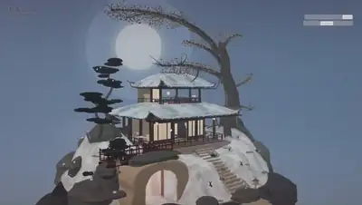</a><br><a href="https://www.sandbase.ai/lab/ai-videos/deepseek-v4-1-flash-1017/2111512236753830100?lang=zh-CN&utm_source=github&utm_medium=readme&utm_campaign=awesome-deepseek-v4.1-flash-1017&utm_content=card"><b>展示季节更迭的浮空小岛</b></a><br><sub><a href="https://x.com/doe_naps/status/2111512236753830100">@doe_naps</a> · 0:40</sub></td><td width="33%" valign="top"><a href="https://www.sandbase.ai/lab/media/x/deepseek-v4-1-flash-1017/2111527586832765275/video.mp4">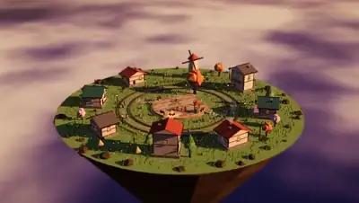</a><br><a href="https://www.sandbase.ai/lab/ai-videos/deepseek-v4-1-flash-1017/2111527586832765275?lang=zh-CN&utm_source=github&utm_medium=readme&utm_campaign=awesome-deepseek-v4.1-flash-1017&utm_content=card"><b>纯代码生成的3D小村庄</b></a><br><sub><a href="https://x.com/AndyL5cc/status/2111527586832765275">@AndyL5cc</a> · 0:20</sub></td><td width="33%" valign="top"><a href="https://www.sandbase.ai/lab/media/x/deepseek-v4-1-flash-1017/2111545919661289674/video.mp4">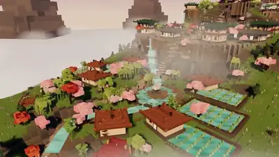</a><br><a href="https://www.sandbase.ai/lab/ai-videos/deepseek-v4-1-flash-1017/2111545919661289674?lang=zh-CN&utm_source=github&utm_medium=readme&utm_campaign=awesome-deepseek-v4.1-flash-1017&utm_content=card"><b>云端可交互体素村庄的漫游动画</b></a><br><sub><a href="https://x.com/TechMDAI/status/2111545919661289674">@TechMDAI</a> · 0:38</sub></td></tr>
<tr><td width="33%" valign="top"><a href="https://www.sandbase.ai/lab/media/x/deepseek-v4-1-flash-1017/2111551744756846721/video.mp4">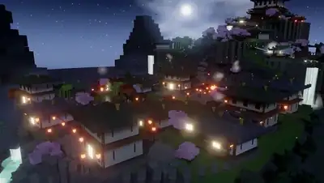</a><br><a href="https://www.sandbase.ai/lab/ai-videos/deepseek-v4-1-flash-1017/2111551744756846721?lang=zh-CN&utm_source=github&utm_medium=readme&utm_campaign=awesome-deepseek-v4.1-flash-1017&utm_content=card"><b>云端之上的交互式体素村庄</b></a><br><sub><a href="https://x.com/TechMDAI/status/2111551744756846721">@TechMDAI</a> · 0:38</sub></td><td width="33%" valign="top"><a href="https://www.sandbase.ai/lab/media/x/deepseek-v4-1-flash-1017/2111580009664307475/video.mp4">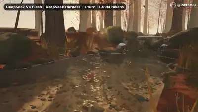</a><br><a href="https://www.sandbase.ai/lab/ai-videos/deepseek-v4-1-flash-1017/2111580009664307475?lang=zh-CN&utm_source=github&utm_medium=readme&utm_campaign=awesome-deepseek-v4.1-flash-1017&utm_content=card"><b>DeepSeek 生成的惬意秋日场景</b></a><br><sub><a href="https://x.com/loktar00/status/2111580009664307475">@loktar00</a> · 0:40</sub></td><td width="33%" valign="top"><a href="https://www.sandbase.ai/lab/media/x/deepseek-v4-1-flash-1017/2111580937246900357/video.mp4">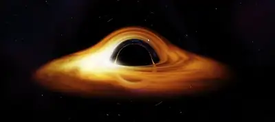</a><br><a href="https://www.sandbase.ai/lab/ai-videos/deepseek-v4-1-flash-1017/2111580937246900357?lang=zh-CN&utm_source=github&utm_medium=readme&utm_campaign=awesome-deepseek-v4.1-flash-1017&utm_content=card"><b>Three.js渲染星际穿越卡冈图雅黑洞</b></a><br><sub><a href="https://x.com/TokenGremlin/status/2111580937246900357">@TokenGremlin</a> · 0:12</sub></td></tr>
<tr><td width="33%" valign="top"><a href="https://www.sandbase.ai/lab/media/x/deepseek-v4-1-flash-1017/2111581758575550546/video.mp4"></a><br><a href="https://www.sandbase.ai/lab/ai-videos/deepseek-v4-1-flash-1017/2111581758575550546?lang=zh-CN&utm_source=github&utm_medium=readme&utm_campaign=awesome-deepseek-v4.1-flash-1017&utm_content=card"><b>Three.js构建的暴风雨中的灯塔</b></a><br><sub><a href="https://x.com/TokenGremlin/status/2111581758575550546">@TokenGremlin</a> · 0:30 · <a href="https://www.sandbase.ai/lab/ai-videos/deepseek-v4-1-flash-1017/2111581758575550546?lang=zh-CN&utm_source=github&utm_medium=readme&utm_campaign=awesome-deepseek-v4.1-flash-1017&utm_content=card">提示词</a></sub></td><td width="33%" valign="top"><a href="https://www.sandbase.ai/lab/media/x/deepseek-v4-1-flash-1017/2111584413280792581/video.mp4">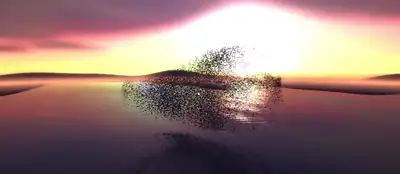</a><br><a href="https://www.sandbase.ai/lab/ai-videos/deepseek-v4-1-flash-1017/2111584413280792581?lang=zh-CN&utm_source=github&utm_medium=readme&utm_campaign=awesome-deepseek-v4.1-flash-1017&utm_content=card"><b>Three.js模拟椋鸟群与猎鹰互动</b></a><br><sub><a href="https://x.com/TokenGremlin/status/2111584413280792581">@TokenGremlin</a> · 0:28 · <a href="https://www.sandbase.ai/lab/ai-videos/deepseek-v4-1-flash-1017/2111584413280792581?lang=zh-CN&utm_source=github&utm_medium=readme&utm_campaign=awesome-deepseek-v4.1-flash-1017&utm_content=card">提示词</a></sub></td><td width="33%" valign="top"><a href="https://www.sandbase.ai/lab/media/x/deepseek-v4-1-flash-1017/2111659534817353905/video.mp4">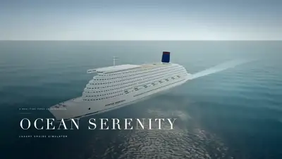</a><br><a href="https://www.sandbase.ai/lab/ai-videos/deepseek-v4-1-flash-1017/2111659534817353905?lang=zh-CN&utm_source=github&utm_medium=readme&utm_campaign=awesome-deepseek-v4.1-flash-1017&utm_content=card"><b>Three.js游轮模拟器与宣传视频</b></a><br><sub><a href="https://x.com/izag82161/status/2111659534817353905">@izag82161</a> · 0:15</sub></td></tr>
<tr><td width="33%" valign="top"><a href="https://www.sandbase.ai/lab/media/x/deepseek-v4-1-flash-1017/2111709068356419724/video.mp4">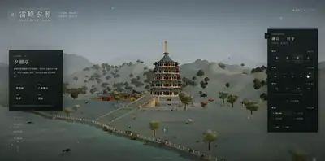</a><br><a href="https://www.sandbase.ai/lab/ai-videos/deepseek-v4-1-flash-1017/2111709068356419724?lang=zh-CN&utm_source=github&utm_medium=readme&utm_campaign=awesome-deepseek-v4.1-flash-1017&utm_content=card"><b>可交互西湖雷峰塔3D场景</b></a><br><sub><a href="https://x.com/NFT_Chen/status/2111709068356419724">@NFT_Chen</a> · 0:59</sub></td><td width="33%" valign="top"><a href="https://www.sandbase.ai/lab/media/x/deepseek-v4-1-flash-1017/2111757593806819789/video.mp4">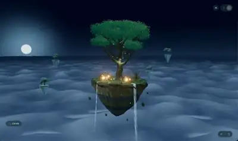</a><br><a href="https://www.sandbase.ai/lab/ai-videos/deepseek-v4-1-flash-1017/2111757593806819789?lang=zh-CN&utm_source=github&utm_medium=readme&utm_campaign=awesome-deepseek-v4.1-flash-1017&utm_content=card"><b>带棉花云的3D悬浮海岛</b></a><br><sub><a href="https://x.com/YxzRainy/status/2111757593806819789">@YxzRainy</a> · 0:13</sub></td><td width="33%" valign="top"><a href="https://www.sandbase.ai/lab/media/x/deepseek-v4-1-flash-1017/2111759181321822604/video.mp4">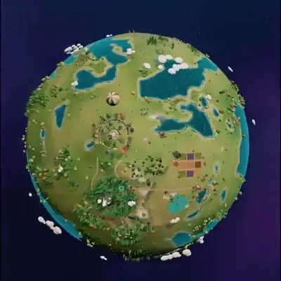</a><br><a href="https://www.sandbase.ai/lab/ai-videos/deepseek-v4-1-flash-1017/2111759181321822604?lang=zh-CN&utm_source=github&utm_medium=readme&utm_campaign=awesome-deepseek-v4.1-flash-1017&utm_content=card"><b>可交互可旋转的低多边形 3D 小小星球</b></a><br><sub><a href="https://x.com/NFT_Chen/status/2111759181321822604">@NFT_Chen</a> · 0:27</sub></td></tr>
<tr><td width="33%" valign="top"><a href="https://www.sandbase.ai/lab/media/x/deepseek-v4-1-flash-1017/2111795634827354332/video.mp4">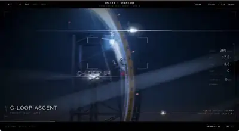</a><br><a href="https://www.sandbase.ai/lab/ai-videos/deepseek-v4-1-flash-1017/2111795634827354332?lang=zh-CN&utm_source=github&utm_medium=readme&utm_campaign=awesome-deepseek-v4.1-flash-1017&utm_content=card"><b>Three.js特斯拉跑车物理特技动画</b></a><br><sub><a href="https://x.com/my189/status/2111795634827354332">@my189</a> · 0:13 · <a href="https://www.sandbase.ai/lab/ai-videos/deepseek-v4-1-flash-1017/2111795634827354332?lang=zh-CN&utm_source=github&utm_medium=readme&utm_campaign=awesome-deepseek-v4.1-flash-1017&utm_content=card">提示词</a></sub></td><td width="33%" valign="top"><a href="https://www.sandbase.ai/lab/media/x/deepseek-v4-1-flash-1017/2111807210976379052/video.mp4"></a><br><a href="https://www.sandbase.ai/lab/ai-videos/deepseek-v4-1-flash-1017/2111807210976379052?lang=zh-CN&utm_source=github&utm_medium=readme&utm_campaign=awesome-deepseek-v4.1-flash-1017&utm_content=card"><b>Blender 中生成的带有体积云的火箭场景</b></a><br><sub><a href="https://x.com/superalesha/status/2111807210976379052">@superalesha</a> · 0:32</sub></td><td width="33%" valign="top"><a href="https://www.sandbase.ai/lab/media/x/deepseek-v4-1-flash-1017/2111827460409229336/video.mp4">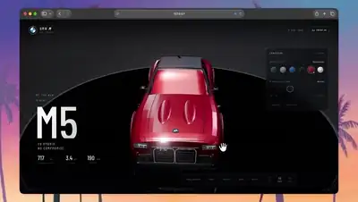</a><br><a href="https://www.sandbase.ai/lab/ai-videos/deepseek-v4-1-flash-1017/2111827460409229336?lang=zh-CN&utm_source=github&utm_medium=readme&utm_campaign=awesome-deepseek-v4.1-flash-1017&utm_content=card"><b>使用Three.js构建的3D宝马M5</b></a><br><sub><a href="https://x.com/k2sbhai/status/2111827460409229336">@k2sbhai</a> · 0:31</sub></td></tr>
<tr><td width="33%" valign="top"><a href="https://www.sandbase.ai/lab/media/x/deepseek-v4-1-flash-1017/2111830546313781515/video.mp4">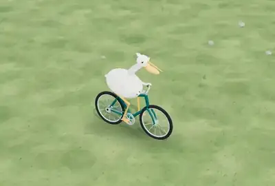</a><br><a href="https://www.sandbase.ai/lab/ai-videos/deepseek-v4-1-flash-1017/2111830546313781515?lang=zh-CN&utm_source=github&utm_medium=readme&utm_campaign=awesome-deepseek-v4.1-flash-1017&utm_content=card"><b>Three.js 打造鹈鹕骑自行车 3D 场景</b></a><br><sub><a href="https://x.com/dextune/status/2111830546313781515">@dextune</a> · 0:30 · <a href="https://www.sandbase.ai/lab/ai-videos/deepseek-v4-1-flash-1017/2111830546313781515?lang=zh-CN&utm_source=github&utm_medium=readme&utm_campaign=awesome-deepseek-v4.1-flash-1017&utm_content=card">提示词</a></sub></td><td width="33%" valign="top"><a href="https://www.sandbase.ai/lab/media/x/deepseek-v4-1-flash-1017/2111832005222793362/video.mp4">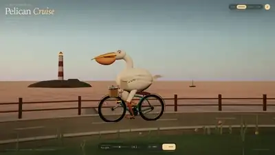</a><br><a href="https://www.sandbase.ai/lab/ai-videos/deepseek-v4-1-flash-1017/2111832005222793362?lang=zh-CN&utm_source=github&utm_medium=readme&utm_campaign=awesome-deepseek-v4.1-flash-1017&utm_content=card"><b>Three.js 打造鹈鹕骑自行车的 3D 交互场景</b></a><br><sub><a href="https://x.com/0xmomonifty/status/2111832005222793362">@0xmomonifty</a> · 0:20 · <a href="https://www.sandbase.ai/lab/ai-videos/deepseek-v4-1-flash-1017/2111832005222793362?lang=zh-CN&utm_source=github&utm_medium=readme&utm_campaign=awesome-deepseek-v4.1-flash-1017&utm_content=card">提示词</a></sub></td><td width="33%" valign="top"><a href="https://www.sandbase.ai/lab/media/x/deepseek-v4-1-flash-1017/2111850077966995855/video.mp4">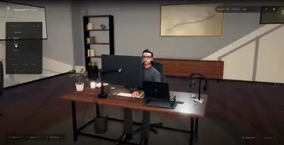</a><br><a href="https://www.sandbase.ai/lab/ai-videos/deepseek-v4-1-flash-1017/2111850077966995855?lang=zh-CN&utm_source=github&utm_medium=readme&utm_campaign=awesome-deepseek-v4.1-flash-1017&utm_content=card"><b>使用 Three.js 构建的交互式 3D 开发者工作空间</b></a><br><sub><a href="https://x.com/WaelAbdrabbo/status/2111850077966995855">@WaelAbdrabbo</a> · 0:23</sub></td></tr>
<tr><td width="33%" valign="top"><a href="https://www.sandbase.ai/lab/media/x/deepseek-v4-1-flash-1017/2111852714174881987/video.mp4">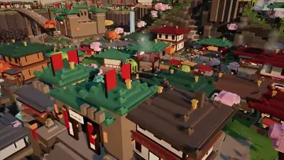</a><br><a href="https://www.sandbase.ai/lab/ai-videos/deepseek-v4-1-flash-1017/2111852714174881987?lang=zh-CN&utm_source=github&utm_medium=readme&utm_campaign=awesome-deepseek-v4.1-flash-1017&utm_content=card"><b>云端可交互体素村落3D场景</b></a><br><sub><a href="https://x.com/TechMDAI/status/2111852714174881987">@TechMDAI</a> · 1:11</sub></td><td width="33%" valign="top"><a href="https://www.sandbase.ai/lab/media/x/deepseek-v4-1-flash-1017/2111905877016170549/video.mp4">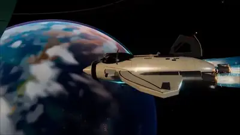</a><br><a href="https://www.sandbase.ai/lab/ai-videos/deepseek-v4-1-flash-1017/2111905877016170549?lang=zh-CN&utm_source=github&utm_medium=readme&utm_campaign=awesome-deepseek-v4.1-flash-1017&utm_content=card"><b>单 HTML 文件中的 Three.js 演示</b></a><br><sub><a href="https://x.com/beyondwudan/status/2111905877016170549">@beyondwudan</a> · 0:48</sub></td><td width="33%" valign="top"><a href="https://www.sandbase.ai/lab/media/x/deepseek-v4-1-flash-1017/2112000994930237463/video.mp4">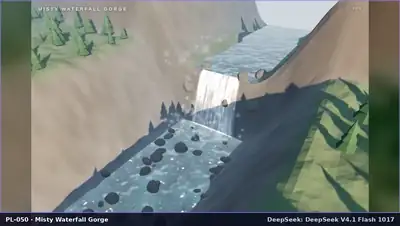</a><br><a href="https://www.sandbase.ai/lab/ai-videos/deepseek-v4-1-flash-1017/2112000994930237463?lang=zh-CN&utm_source=github&utm_medium=readme&utm_campaign=awesome-deepseek-v4.1-flash-1017&utm_content=card"><b>薄雾瀑布峡谷场景</b></a><br><sub><a href="https://x.com/wikiwayne/status/2112000994930237463">@wikiwayne</a> · 1:05</sub></td></tr>
<tr><td width="33%" valign="top"><a href="https://www.sandbase.ai/lab/media/x/deepseek-v4-1-flash-1017/2112064816475177269/video.mp4"></a><br><a href="https://www.sandbase.ai/lab/ai-videos/deepseek-v4-1-flash-1017/2112064816475177269?lang=zh-CN&utm_source=github&utm_medium=readme&utm_campaign=awesome-deepseek-v4.1-flash-1017&utm_content=card"><b>用 Three.js 和 Remotion 制作的 3D 视频</b></a><br><sub><a href="https://x.com/direkturcrypto/status/2112064816475177269">@direkturcrypto</a> · 1:01</sub></td><td width="33%" valign="top"><a href="https://www.sandbase.ai/lab/media/x/deepseek-v4-1-flash-1017/2112095534123229361/video.mp4">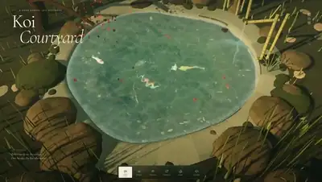</a><br><a href="https://www.sandbase.ai/lab/ai-videos/deepseek-v4-1-flash-1017/2112095534123229361?lang=zh-CN&utm_source=github&utm_medium=readme&utm_campaign=awesome-deepseek-v4.1-flash-1017&utm_content=card"><b>可交互的 3D 锦鲤鱼塘与游动鱼群</b></a><br><sub><a href="https://x.com/SahilPanhotra/status/2112095534123229361">@SahilPanhotra</a> · 0:24</sub></td><td width="33%" valign="top"><a href="https://www.sandbase.ai/lab/media/x/deepseek-v4-1-flash-1017/2112132875042820585/video.mp4">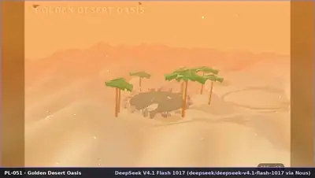</a><br><a href="https://www.sandbase.ai/lab/ai-videos/deepseek-v4-1-flash-1017/2112132875042820585?lang=zh-CN&utm_source=github&utm_medium=readme&utm_campaign=awesome-deepseek-v4.1-flash-1017&utm_content=card"><b>日落时分的金色沙漠绿洲场景</b></a><br><sub><a href="https://x.com/wikiwayne/status/2112132875042820585">@wikiwayne</a> · 1:02</sub></td></tr>
<tr><td width="33%" valign="top"><a href="https://www.sandbase.ai/lab/media/x/deepseek-v4-1-flash-1017/2112160485114270128/video.mp4">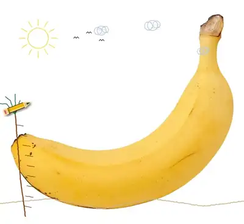</a><br><a href="https://www.sandbase.ai/lab/ai-videos/deepseek-v4-1-flash-1017/2112160485114270128?lang=zh-CN&utm_source=github&utm_medium=readme&utm_campaign=awesome-deepseek-v4.1-flash-1017&utm_content=card"><b>DeepSeek V4.1 Flash 香蕉渲染测试</b></a><br><sub><a href="https://x.com/AdamHoltererer/status/2112160485114270128">@AdamHoltererer</a> · 0:06</sub></td><td width="33%" valign="top"><a href="https://www.sandbase.ai/lab/media/x/deepseek-v4-1-flash-1017/2112170183209226383/video.mp4">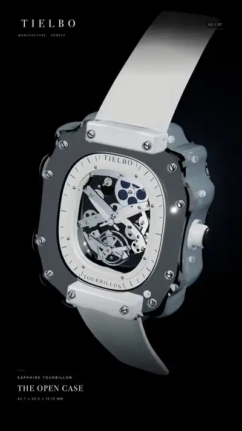</a><br><a href="https://www.sandbase.ai/lab/ai-videos/deepseek-v4-1-flash-1017/2112170183209226383?lang=zh-CN&utm_source=github&utm_medium=readme&utm_campaign=awesome-deepseek-v4.1-flash-1017&utm_content=card"><b>Three.js 机械镂空陀飞轮手表建模</b></a><br><sub><a href="https://x.com/GeekCatX/status/2112170183209226383">@GeekCatX</a> · 0:30 · <a href="https://www.sandbase.ai/lab/ai-videos/deepseek-v4-1-flash-1017/2112170183209226383?lang=zh-CN&utm_source=github&utm_medium=readme&utm_campaign=awesome-deepseek-v4.1-flash-1017&utm_content=card">提示词</a></sub></td><td width="33%" valign="top"><a href="https://www.sandbase.ai/lab/media/x/deepseek-v4-1-flash-1017/2112189081870618781/video.mp4"></a><br><a href="https://www.sandbase.ai/lab/ai-videos/deepseek-v4-1-flash-1017/2112189081870618781?lang=zh-CN&utm_source=github&utm_medium=readme&utm_campaign=awesome-deepseek-v4.1-flash-1017&utm_content=card"><b>单次生成的 Three.js 小熊软糖</b></a><br><sub><a href="https://x.com/k2sbhai/status/2112189081870618781">@k2sbhai</a> · 0:54</sub></td></tr>
<tr><td width="33%" valign="top"><a href="https://www.sandbase.ai/lab/media/x/deepseek-v4-1-flash-1017/2112221137598115861/video.mp4"></a><br><a href="https://www.sandbase.ai/lab/ai-videos/deepseek-v4-1-flash-1017/2112221137598115861?lang=zh-CN&utm_source=github&utm_medium=readme&utm_campaign=awesome-deepseek-v4.1-flash-1017&utm_content=card"><b>单文件HTML制作应县木塔搭建动画</b></a><br><sub><a href="https://x.com/BigAvenu3/status/2112221137598115861">@BigAvenu3</a> · 0:24</sub></td><td width="33%" valign="top"><a href="https://www.sandbase.ai/lab/media/x/deepseek-v4-1-flash-1017/2112243591472980063/video.mp4"></a><br><a href="https://www.sandbase.ai/lab/ai-videos/deepseek-v4-1-flash-1017/2112243591472980063?lang=zh-CN&utm_source=github&utm_medium=readme&utm_campaign=awesome-deepseek-v4.1-flash-1017&utm_content=card"><b>本地运行 DeepSeek 进行 Solidcraft 3D 建模</b></a><br><sub><a href="https://x.com/jaita/status/2112243591472980063">@jaita</a> · 0:37</sub></td><td width="33%" valign="top"><a href="https://www.sandbase.ai/lab/media/x/deepseek-v4-1-flash-1017/2112293216913347010/video.mp4"></a><br><a href="https://www.sandbase.ai/lab/ai-videos/deepseek-v4-1-flash-1017/2112293216913347010?lang=zh-CN&utm_source=github&utm_medium=readme&utm_campaign=awesome-deepseek-v4.1-flash-1017&utm_content=card"><b>UFO降落白宫草坪3D场景</b></a><br><sub><a href="https://x.com/Tech2Wild/status/2112293216913347010">@Tech2Wild</a> · 0:41</sub></td></tr>
<tr><td width="33%" valign="top"><a href="https://www.sandbase.ai/lab/media/x/deepseek-v4-1-flash-1017/2112511913129071096/video.mp4"></a><br><a href="https://www.sandbase.ai/lab/ai-videos/deepseek-v4-1-flash-1017/2112511913129071096?lang=zh-CN&utm_source=github&utm_medium=readme&utm_campaign=awesome-deepseek-v4.1-flash-1017&utm_content=card"><b>DGX Sparks上构建的体素世界</b></a><br><sub><a href="https://x.com/niklaslenz_ai/status/2112511913129071096">@niklaslenz_ai</a> · 0:37</sub></td><td width="33%" valign="top"><a href="https://www.sandbase.ai/lab/media/x/deepseek-v4-1-flash-1017/2112582117234548777/video.mp4"></a><br><a href="https://www.sandbase.ai/lab/ai-videos/deepseek-v4-1-flash-1017/2112582117234548777?lang=zh-CN&utm_source=github&utm_medium=readme&utm_campaign=awesome-deepseek-v4.1-flash-1017&utm_content=card"><b>DeepSeek-V4.1-Flash 生成的体素世界</b></a><br><sub><a href="https://x.com/niklaslenz_ai/status/2112582117234548777">@niklaslenz_ai</a> · 0:37</sub></td><td width="33%" valign="top"><a href="https://www.sandbase.ai/lab/media/x/deepseek-v4-1-flash-1017/2112662860187013546/video.mp4"></a><br><a href="https://www.sandbase.ai/lab/ai-videos/deepseek-v4-1-flash-1017/2112662860187013546?lang=zh-CN&utm_source=github&utm_medium=readme&utm_campaign=awesome-deepseek-v4.1-flash-1017&utm_content=card"><b>DeepSeek智能体构建的体素世界</b></a><br><sub><a href="https://x.com/niklaslenz_ai/status/2112662860187013546">@niklaslenz_ai</a> · 0:36</sub></td></tr>
<tr><td width="33%" valign="top"><a href="https://www.sandbase.ai/lab/media/x/deepseek-v4-1-flash-1017/2112683575958995221/video.mp4"></a><br><a href="https://www.sandbase.ai/lab/ai-videos/deepseek-v4-1-flash-1017/2112683575958995221?lang=zh-CN&utm_source=github&utm_medium=readme&utm_campaign=awesome-deepseek-v4.1-flash-1017&utm_content=card"><b>程序化生成的无限档案库场景</b></a><br><sub><a href="https://x.com/quimedesu/status/2112683575958995221">@quimedesu</a> · 0:22</sub></td><td width="33%" valign="top"><a href="https://www.sandbase.ai/lab/media/x/deepseek-v4-1-flash-1017/2112696676758491263/video.mp4"></a><br><a href="https://www.sandbase.ai/lab/ai-videos/deepseek-v4-1-flash-1017/2112696676758491263?lang=zh-CN&utm_source=github&utm_medium=readme&utm_campaign=awesome-deepseek-v4.1-flash-1017&utm_content=card"><b>带有落瓣与池塘的体素宝塔花园</b></a><br><sub><a href="https://x.com/WescheNex1q/status/2112696676758491263">@WescheNex1q</a> · 0:20</sub></td><td width="33%" valign="top"><a href="https://www.sandbase.ai/lab/media/x/deepseek-v4-1-flash-1017/2112836206723563684/video.mp4"></a><br><a href="https://www.sandbase.ai/lab/ai-videos/deepseek-v4-1-flash-1017/2112836206723563684?lang=zh-CN&utm_source=github&utm_medium=readme&utm_campaign=awesome-deepseek-v4.1-flash-1017&utm_content=card"><b>带游动锦鲤的3D庭院水池</b></a><br><sub><a href="https://x.com/SahilPanhotra/status/2112836206723563684">@SahilPanhotra</a> · 0:34</sub></td></tr>
<tr><td width="33%" valign="top"><a href="https://www.sandbase.ai/lab/media/x/deepseek-v4-1-flash-1017/2112960492696457278/video.mp4"></a><br><a href="https://www.sandbase.ai/lab/ai-videos/deepseek-v4-1-flash-1017/2112960492696457278?lang=zh-CN&utm_source=github&utm_medium=readme&utm_campaign=awesome-deepseek-v4.1-flash-1017&utm_content=card"><b>Three.js呈现的写实天空与水面</b></a><br><sub><a href="https://x.com/rubenssoto_ai/status/2112960492696457278">@rubenssoto_ai</a> · 1:00</sub></td><td width="33%" valign="top"><a href="https://www.sandbase.ai/lab/media/x/deepseek-v4-1-flash-1017/2113002016394096769/video.mp4"></a><br><a href="https://www.sandbase.ai/lab/ai-videos/deepseek-v4-1-flash-1017/2113002016394096769?lang=zh-CN&utm_source=github&utm_medium=readme&utm_campaign=awesome-deepseek-v4.1-flash-1017&utm_content=card"><b>DeepSeek生成的二战体素场景</b></a><br><sub><a href="https://x.com/Tech2Wild/status/2113002016394096769">@Tech2Wild</a> · 1:05</sub></td></tr>
</table>

</details>

<a id="motion-graphics"></a>

## 动效

<table>
<tr><td width="33%" valign="top"><a href="https://www.sandbase.ai/lab/media/x/deepseek-v4-1-flash-1017/2111392745155936690/video.mp4"></a><br><a href="https://www.sandbase.ai/lab/ai-videos/deepseek-v4-1-flash-1017/2111392745155936690?lang=zh-CN&utm_source=github&utm_medium=readme&utm_campaign=awesome-deepseek-v4.1-flash-1017&utm_content=card"><b>SVG 制作的鹈鹕骑单车动画</b></a><br><sub><a href="https://x.com/GKev1n/status/2111392745155936690">@GKev1n</a> · 0:11</sub></td><td width="33%" valign="top"><a href="https://www.sandbase.ai/lab/media/x/deepseek-v4-1-flash-1017/2111415760681849025/video.mp4"></a><br><a href="https://www.sandbase.ai/lab/ai-videos/deepseek-v4-1-flash-1017/2111415760681849025?lang=zh-CN&utm_source=github&utm_medium=readme&utm_campaign=awesome-deepseek-v4.1-flash-1017&utm_content=card"><b>DeepSeek生成的孔雀测试动画</b></a><br><sub><a href="https://x.com/SahilPanhotra/status/2111415760681849025">@SahilPanhotra</a> · 0:10</sub></td><td width="33%" valign="top"><a href="https://www.sandbase.ai/lab/media/x/deepseek-v4-1-flash-1017/2111417566224896054/video.mp4"></a><br><a href="https://www.sandbase.ai/lab/ai-videos/deepseek-v4-1-flash-1017/2111417566224896054?lang=zh-CN&utm_source=github&utm_medium=readme&utm_campaign=awesome-deepseek-v4.1-flash-1017&utm_content=card"><b>犀牛骑长颈鹿穿越热带草原的SVG动画</b></a><br><sub><a href="https://x.com/atomtanstudio/status/2111417566224896054">@atomtanstudio</a> · 0:16</sub></td></tr>
<tr><td width="33%" valign="top"><a href="https://www.sandbase.ai/lab/media/x/deepseek-v4-1-flash-1017/2111454840337600839/video.mp4"></a><br><a href="https://www.sandbase.ai/lab/ai-videos/deepseek-v4-1-flash-1017/2111454840337600839?lang=zh-CN&utm_source=github&utm_medium=readme&utm_campaign=awesome-deepseek-v4.1-flash-1017&utm_content=card"><b>SVG 生成的踩踏板动画角色</b></a><br><sub><a href="https://x.com/SahilPanhotra/status/2111454840337600839">@SahilPanhotra</a> · 0:10</sub></td><td width="33%" valign="top"><a href="https://www.sandbase.ai/lab/media/x/deepseek-v4-1-flash-1017/2111460614656913914/video.mp4"></a><br><a href="https://www.sandbase.ai/lab/ai-videos/deepseek-v4-1-flash-1017/2111460614656913914?lang=zh-CN&utm_source=github&utm_medium=readme&utm_campaign=awesome-deepseek-v4.1-flash-1017&utm_content=card"><b>SVG 绘制的鹈鹕骑车动画</b></a><br><sub><a href="https://x.com/aizhibeibei/status/2111460614656913914">@aizhibeibei</a> · 0:06 · <a href="https://www.sandbase.ai/lab/ai-videos/deepseek-v4-1-flash-1017/2111460614656913914?lang=zh-CN&utm_source=github&utm_medium=readme&utm_campaign=awesome-deepseek-v4.1-flash-1017&utm_content=card">提示词</a></sub></td><td width="33%" valign="top"><a href="https://www.sandbase.ai/lab/media/x/deepseek-v4-1-flash-1017/2111464046113493422/video.mp4"></a><br><a href="https://www.sandbase.ai/lab/ai-videos/deepseek-v4-1-flash-1017/2111464046113493422?lang=zh-CN&utm_source=github&utm_medium=readme&utm_campaign=awesome-deepseek-v4.1-flash-1017&utm_content=card"><b>AI生成的动态设计视频</b></a><br><sub><a href="https://x.com/yohakujpn/status/2111464046113493422">@yohakujpn</a> · 0:35</sub></td></tr>
</table>

<details>
<summary><b>展开全部 19 条</b></summary>

<table>
<tr><td width="33%" valign="top"><a href="https://www.sandbase.ai/lab/media/x/deepseek-v4-1-flash-1017/2111476965429645706/video.mp4"></a><br><a href="https://www.sandbase.ai/lab/ai-videos/deepseek-v4-1-flash-1017/2111476965429645706?lang=zh-CN&utm_source=github&utm_medium=readme&utm_campaign=awesome-deepseek-v4.1-flash-1017&utm_content=card"><b>带背景音乐的芙莉莲SVG绘制展示</b></a><br><sub><a href="https://x.com/notjazii/status/2111476965429645706">@notjazii</a> · 0:29</sub></td><td width="33%" valign="top"><a href="https://www.sandbase.ai/lab/media/x/deepseek-v4-1-flash-1017/2111506897656545394/video.mp4"></a><br><a href="https://www.sandbase.ai/lab/ai-videos/deepseek-v4-1-flash-1017/2111506897656545394?lang=zh-CN&utm_source=github&utm_medium=readme&utm_campaign=awesome-deepseek-v4.1-flash-1017&utm_content=card"><b>DeepSeek V4.1 Flash 视觉生成测试</b></a><br><sub><a href="https://x.com/seanphan/status/2111506897656545394">@seanphan</a> · 0:45</sub></td><td width="33%" valign="top"><a href="https://www.sandbase.ai/lab/media/x/deepseek-v4-1-flash-1017/2111517607304319355/video.mp4"></a><br><a href="https://www.sandbase.ai/lab/ai-videos/deepseek-v4-1-flash-1017/2111517607304319355?lang=zh-CN&utm_source=github&utm_medium=readme&utm_campaign=awesome-deepseek-v4.1-flash-1017&utm_content=card"><b>纯代码生成的电子游戏史纪录片预告片</b></a><br><sub><a href="https://x.com/NFT_Chen/status/2111517607304319355">@NFT_Chen</a> · 2:00</sub></td></tr>
<tr><td width="33%" valign="top"><a href="https://www.sandbase.ai/lab/media/x/deepseek-v4-1-flash-1017/2111549642668458009/video.mp4"></a><br><a href="https://www.sandbase.ai/lab/ai-videos/deepseek-v4-1-flash-1017/2111549642668458009?lang=zh-CN&utm_source=github&utm_medium=readme&utm_campaign=awesome-deepseek-v4.1-flash-1017&utm_content=card"><b>猴子爬树的SVG动画</b></a><br><sub><a href="https://x.com/Huoimo/status/2111549642668458009">@Huoimo</a> · 0:15</sub></td><td width="33%" valign="top"><a href="https://www.sandbase.ai/lab/media/x/deepseek-v4-1-flash-1017/2111580391161110899/video.mp4"></a><br><a href="https://www.sandbase.ai/lab/ai-videos/deepseek-v4-1-flash-1017/2111580391161110899?lang=zh-CN&utm_source=github&utm_medium=readme&utm_campaign=awesome-deepseek-v4.1-flash-1017&utm_content=card"><b>DeepSeek生成的Cerebras芯片基准测试演示</b></a><br><sub><a href="https://x.com/SPAC89/status/2111580391161110899">@SPAC89</a> · 0:18</sub></td><td width="33%" valign="top"><a href="https://www.sandbase.ai/lab/media/x/deepseek-v4-1-flash-1017/2111623294810251526/video.mp4"></a><br><a href="https://www.sandbase.ai/lab/ai-videos/deepseek-v4-1-flash-1017/2111623294810251526?lang=zh-CN&utm_source=github&utm_medium=readme&utm_campaign=awesome-deepseek-v4.1-flash-1017&utm_content=card"><b>DeepSeek-V4.1卫星简报风格视频</b></a><br><sub><a href="https://x.com/lemomo_ai/status/2111623294810251526">@lemomo_ai</a> · 0:58</sub></td></tr>
<tr><td width="33%" valign="top"><a href="https://www.sandbase.ai/lab/media/x/deepseek-v4-1-flash-1017/2111623798428446964/video.mp4"></a><br><a href="https://www.sandbase.ai/lab/ai-videos/deepseek-v4-1-flash-1017/2111623798428446964?lang=zh-CN&utm_source=github&utm_medium=readme&utm_campaign=awesome-deepseek-v4.1-flash-1017&utm_content=card"><b>浓缩咖啡机制作拿铁的像素风剖面动画</b></a><br><sub><a href="https://x.com/loktar00/status/2111623798428446964">@loktar00</a> · 0:52</sub></td><td width="33%" valign="top"><a href="https://www.sandbase.ai/lab/media/x/deepseek-v4-1-flash-1017/2111700522344517825/video.mp4"></a><br><a href="https://www.sandbase.ai/lab/ai-videos/deepseek-v4-1-flash-1017/2111700522344517825?lang=zh-CN&utm_source=github&utm_medium=readme&utm_campaign=awesome-deepseek-v4.1-flash-1017&utm_content=card"><b>为 Pie 制作的动态图形视频</b></a><br><sub><a href="https://x.com/hieuSSR/status/2111700522344517825">@hieuSSR</a> · 0:15</sub></td><td width="33%" valign="top"><a href="https://www.sandbase.ai/lab/media/x/deepseek-v4-1-flash-1017/2111741087710949431/video.mp4"></a><br><a href="https://www.sandbase.ai/lab/ai-videos/deepseek-v4-1-flash-1017/2111741087710949431?lang=zh-CN&utm_source=github&utm_medium=readme&utm_campaign=awesome-deepseek-v4.1-flash-1017&utm_content=card"><b>用 Remotion 生成的模型能力自证视频</b></a><br><sub><a href="https://x.com/cheery9998/status/2111741087710949431">@cheery9998</a> · 0:52</sub></td></tr>
<tr><td width="33%" valign="top"><a href="https://www.sandbase.ai/lab/media/x/deepseek-v4-1-flash-1017/2111795761994461291/video.mp4"></a><br><a href="https://www.sandbase.ai/lab/ai-videos/deepseek-v4-1-flash-1017/2111795761994461291?lang=zh-CN&utm_source=github&utm_medium=readme&utm_campaign=awesome-deepseek-v4.1-flash-1017&utm_content=card"><b>DeepSeek V4.1 Flash 1017 生成视频</b></a><br><sub><a href="https://x.com/direkturcrypto/status/2111795761994461291">@direkturcrypto</a> · 0:54</sub></td><td width="33%" valign="top"><a href="https://www.sandbase.ai/lab/media/x/deepseek-v4-1-flash-1017/2111987269594984920/video.mp4"></a><br><a href="https://www.sandbase.ai/lab/ai-videos/deepseek-v4-1-flash-1017/2111987269594984920?lang=zh-CN&utm_source=github&utm_medium=readme&utm_campaign=awesome-deepseek-v4.1-flash-1017&utm_content=card"><b>使用 MUSE AI 制作的动态设计测试</b></a><br><sub><a href="https://x.com/tirtaVEX/status/2111987269594984920">@tirtaVEX</a> · 0:22</sub></td><td width="33%" valign="top"><a href="https://www.sandbase.ai/lab/media/x/deepseek-v4-1-flash-1017/2112314662712729941/video.mp4"></a><br><a href="https://www.sandbase.ai/lab/ai-videos/deepseek-v4-1-flash-1017/2112314662712729941?lang=zh-CN&utm_source=github&utm_medium=readme&utm_campaign=awesome-deepseek-v4.1-flash-1017&utm_content=card"><b>DeepSeek用JS制作的自述歌曲动画</b></a><br><sub><a href="https://x.com/quimedesu/status/2112314662712729941">@quimedesu</a> · 4:42</sub></td></tr>
<tr><td width="33%" valign="top"><a href="https://www.sandbase.ai/lab/media/x/deepseek-v4-1-flash-1017/2112623058586677349/video.mp4"></a><br><a href="https://www.sandbase.ai/lab/ai-videos/deepseek-v4-1-flash-1017/2112623058586677349?lang=zh-CN&utm_source=github&utm_medium=readme&utm_campaign=awesome-deepseek-v4.1-flash-1017&utm_content=card"><b>本地运行测试与示例生成视频</b></a><br><sub><a href="https://x.com/seanphan/status/2112623058586677349">@seanphan</a> · 0:45</sub></td></tr>
</table>

</details>

<a id="game"></a>

## 游戏

<table>
<tr><td width="33%" valign="top"><a href="https://www.sandbase.ai/lab/media/x/deepseek-v4-1-flash-1017/2111410853522129220/video.mp4"></a><br><a href="https://www.sandbase.ai/lab/ai-videos/deepseek-v4-1-flash-1017/2111410853522129220?lang=zh-CN&utm_source=github&utm_medium=readme&utm_campaign=awesome-deepseek-v4.1-flash-1017&utm_content=card"><b>Three.js 构建的第一人称射击游戏</b></a><br><sub><a href="https://x.com/YifeiZhou/status/2111410853522129220">@YifeiZhou</a> · 1:36 · <a href="https://www.sandbase.ai/lab/ai-videos/deepseek-v4-1-flash-1017/2111410853522129220?lang=zh-CN&utm_source=github&utm_medium=readme&utm_campaign=awesome-deepseek-v4.1-flash-1017&utm_content=card">提示词</a></sub></td><td width="33%" valign="top"><a href="https://www.sandbase.ai/lab/media/x/deepseek-v4-1-flash-1017/2111416511932117424/video.mp4"></a><br><a href="https://www.sandbase.ai/lab/ai-videos/deepseek-v4-1-flash-1017/2111416511932117424?lang=zh-CN&utm_source=github&utm_medium=readme&utm_campaign=awesome-deepseek-v4.1-flash-1017&utm_content=card"><b>纯代码生成的 DeepSeek 第一人称射击游戏</b></a><br><sub><a href="https://x.com/ItsmeAjayKV/status/2111416511932117424">@ItsmeAjayKV</a> · 2:30</sub></td><td width="33%" valign="top"><a href="https://www.sandbase.ai/lab/media/x/deepseek-v4-1-flash-1017/2111426732217532722/video.mp4"></a><br><a href="https://www.sandbase.ai/lab/ai-videos/deepseek-v4-1-flash-1017/2111426732217532722?lang=zh-CN&utm_source=github&utm_medium=readme&utm_campaign=awesome-deepseek-v4.1-flash-1017&utm_content=card"><b>DeepSeek生成的七款可玩网页游戏</b></a><br><sub><a href="https://x.com/wikiwayne/status/2111426732217532722">@wikiwayne</a> · 1:04</sub></td></tr>
<tr><td width="33%" valign="top"><a href="https://www.sandbase.ai/lab/media/x/deepseek-v4-1-flash-1017/2111439745150857295/video.mp4"></a><br><a href="https://www.sandbase.ai/lab/ai-videos/deepseek-v4-1-flash-1017/2111439745150857295?lang=zh-CN&utm_source=github&utm_medium=readme&utm_campaign=awesome-deepseek-v4.1-flash-1017&utm_content=card"><b>基于 Three.js 构建的游戏展示</b></a><br><sub><a href="https://x.com/vibe_aikaka/status/2111439745150857295">@vibe_aikaka</a> · 0:35</sub></td><td width="33%" valign="top"><a href="https://www.sandbase.ai/lab/media/x/deepseek-v4-1-flash-1017/2111477584924209246/video.mp4"></a><br><a href="https://www.sandbase.ai/lab/ai-videos/deepseek-v4-1-flash-1017/2111477584924209246?lang=zh-CN&utm_source=github&utm_medium=readme&utm_campaign=awesome-deepseek-v4.1-flash-1017&utm_content=card"><b>Three.js复刻以撒结合风格肉鸽游戏</b></a><br><sub><a href="https://x.com/zmdsb259414/status/2111477584924209246">@zmdsb259414</a> · 4:02 · <a href="https://www.sandbase.ai/lab/ai-videos/deepseek-v4-1-flash-1017/2111477584924209246?lang=zh-CN&utm_source=github&utm_medium=readme&utm_campaign=awesome-deepseek-v4.1-flash-1017&utm_content=card">提示词</a></sub></td><td width="33%" valign="top"><a href="https://www.sandbase.ai/lab/media/x/deepseek-v4-1-flash-1017/2111512124379828381/video.mp4"></a><br><a href="https://www.sandbase.ai/lab/ai-videos/deepseek-v4-1-flash-1017/2111512124379828381?lang=zh-CN&utm_source=github&utm_medium=readme&utm_campaign=awesome-deepseek-v4.1-flash-1017&utm_content=card"><b>DeepSeek生成的3D马里奥游戏</b></a><br><sub><a href="https://x.com/quimedesu/status/2111512124379828381">@quimedesu</a> · 0:37</sub></td></tr>
</table>

<details>
<summary><b>展开全部 17 条</b></summary>

<table>
<tr><td width="33%" valign="top"><a href="https://www.sandbase.ai/lab/media/x/deepseek-v4-1-flash-1017/2111529924096147823/video.mp4"></a><br><a href="https://www.sandbase.ai/lab/ai-videos/deepseek-v4-1-flash-1017/2111529924096147823?lang=zh-CN&utm_source=github&utm_medium=readme&utm_campaign=awesome-deepseek-v4.1-flash-1017&utm_content=card"><b>程序化街头飙车游戏Demo</b></a><br><sub><a href="https://x.com/XingYao47854/status/2111529924096147823">@XingYao47854</a> · 0:42</sub></td><td width="33%" valign="top"><a href="https://www.sandbase.ai/lab/media/x/deepseek-v4-1-flash-1017/2111565644370248128/video.mp4"></a><br><a href="https://www.sandbase.ai/lab/ai-videos/deepseek-v4-1-flash-1017/2111565644370248128?lang=zh-CN&utm_source=github&utm_medium=readme&utm_campaign=awesome-deepseek-v4.1-flash-1017&utm_content=card"><b>Three.js制作的可玩迷你游戏及预告片</b></a><br><sub><a href="https://x.com/DerekNee/status/2111565644370248128">@DerekNee</a> · 1:03</sub></td><td width="33%" valign="top"><a href="https://www.sandbase.ai/lab/media/x/deepseek-v4-1-flash-1017/2111623304469791193/video.mp4"></a><br><a href="https://www.sandbase.ai/lab/ai-videos/deepseek-v4-1-flash-1017/2111623304469791193?lang=zh-CN&utm_source=github&utm_medium=readme&utm_campaign=awesome-deepseek-v4.1-flash-1017&utm_content=card"><b>Three.js 霓虹隧道飞行网页游戏</b></a><br><sub><a href="https://x.com/FromSummerF/status/2111623304469791193">@FromSummerF</a> · 0:59</sub></td></tr>
<tr><td width="33%" valign="top"><a href="https://www.sandbase.ai/lab/media/x/deepseek-v4-1-flash-1017/2111749742929883258/video.mp4"></a><br><a href="https://www.sandbase.ai/lab/ai-videos/deepseek-v4-1-flash-1017/2111749742929883258?lang=zh-CN&utm_source=github&utm_medium=readme&utm_campaign=awesome-deepseek-v4.1-flash-1017&utm_content=card"><b>可玩赛车小游戏与SVG相机演示</b></a><br><sub><a href="https://x.com/datouboshibb/status/2111749742929883258">@datouboshibb</a> · 0:15 · <a href="https://www.sandbase.ai/lab/ai-videos/deepseek-v4-1-flash-1017/2111749742929883258?lang=zh-CN&utm_source=github&utm_medium=readme&utm_campaign=awesome-deepseek-v4.1-flash-1017&utm_content=card">提示词</a></sub></td><td width="33%" valign="top"><a href="https://www.sandbase.ai/lab/media/x/deepseek-v4-1-flash-1017/2111770397570126118/video.mp4"></a><br><a href="https://www.sandbase.ai/lab/ai-videos/deepseek-v4-1-flash-1017/2111770397570126118?lang=zh-CN&utm_source=github&utm_medium=readme&utm_campaign=awesome-deepseek-v4.1-flash-1017&utm_content=card"><b>原生 WebGL 从零手搓可玩的我的世界</b></a><br><sub><a href="https://x.com/XingYao47854/status/2111770397570126118">@XingYao47854</a> · 1:45 · <a href="https://www.sandbase.ai/lab/ai-videos/deepseek-v4-1-flash-1017/2111770397570126118?lang=zh-CN&utm_source=github&utm_medium=readme&utm_campaign=awesome-deepseek-v4.1-flash-1017&utm_content=card">提示词</a></sub></td><td width="33%" valign="top"><a href="https://www.sandbase.ai/lab/media/x/deepseek-v4-1-flash-1017/2111855752830910655/video.mp4"></a><br><a href="https://www.sandbase.ai/lab/ai-videos/deepseek-v4-1-flash-1017/2111855752830910655?lang=zh-CN&utm_source=github&utm_medium=readme&utm_campaign=awesome-deepseek-v4.1-flash-1017&utm_content=card"><b>基于 C++ 和 DirectX 制作的节奏赛车游戏</b></a><br><sub><a href="https://x.com/quimedesu/status/2111855752830910655">@quimedesu</a> · 2:09</sub></td></tr>
<tr><td width="33%" valign="top"><a href="https://www.sandbase.ai/lab/media/x/deepseek-v4-1-flash-1017/2111865800705331296/video.mp4"></a><br><a href="https://www.sandbase.ai/lab/ai-videos/deepseek-v4-1-flash-1017/2111865800705331296?lang=zh-CN&utm_source=github&utm_medium=readme&utm_campaign=awesome-deepseek-v4.1-flash-1017&utm_content=card"><b>单 HTML 文件实现的我的世界游戏</b></a><br><sub><a href="https://x.com/dummerspast39/status/2111865800705331296">@dummerspast39</a> · 1:56</sub></td><td width="33%" valign="top"><a href="https://www.sandbase.ai/lab/media/x/deepseek-v4-1-flash-1017/2112114744870248643/video.mp4"></a><br><a href="https://www.sandbase.ai/lab/ai-videos/deepseek-v4-1-flash-1017/2112114744870248643?lang=zh-CN&utm_source=github&utm_medium=readme&utm_campaign=awesome-deepseek-v4.1-flash-1017&utm_content=card"><b>端到端完整项目生成演示</b></a><br><sub><a href="https://x.com/FinanceYF5/status/2112114744870248643">@FinanceYF5</a> · 0:15</sub></td><td width="33%" valign="top"><a href="https://www.sandbase.ai/lab/media/x/deepseek-v4-1-flash-1017/2112160375299055863/video.mp4"></a><br><a href="https://www.sandbase.ai/lab/ai-videos/deepseek-v4-1-flash-1017/2112160375299055863?lang=zh-CN&utm_source=github&utm_medium=readme&utm_campaign=awesome-deepseek-v4.1-flash-1017&utm_content=card"><b>DeepSeek V4.1 Flash 游戏测试</b></a><br><sub><a href="https://x.com/AdamHoltererer/status/2112160375299055863">@AdamHoltererer</a> · 0:42</sub></td></tr>
<tr><td width="33%" valign="top"><a href="https://www.sandbase.ai/lab/media/x/deepseek-v4-1-flash-1017/2112522568523714617/video.mp4"></a><br><a href="https://www.sandbase.ai/lab/ai-videos/deepseek-v4-1-flash-1017/2112522568523714617?lang=zh-CN&utm_source=github&utm_medium=readme&utm_campaign=awesome-deepseek-v4.1-flash-1017&utm_content=card"><b>DeepSeek 构建的切片大师游戏</b></a><br><sub><a href="https://x.com/TypingMindApp/status/2112522568523714617">@TypingMindApp</a> · 0:48</sub></td><td width="33%" valign="top"><a href="https://www.sandbase.ai/lab/media/x/deepseek-v4-1-flash-1017/2112896112847982928/video.mp4"></a><br><a href="https://www.sandbase.ai/lab/ai-videos/deepseek-v4-1-flash-1017/2112896112847982928?lang=zh-CN&utm_source=github&utm_medium=readme&utm_campaign=awesome-deepseek-v4.1-flash-1017&utm_content=card"><b>生成的我的世界风3D箱庭游戏</b></a><br><sub><a href="https://x.com/jun1228909/status/2112896112847982928">@jun1228909</a> · 0:17 · <a href="https://www.sandbase.ai/lab/ai-videos/deepseek-v4-1-flash-1017/2112896112847982928?lang=zh-CN&utm_source=github&utm_medium=readme&utm_campaign=awesome-deepseek-v4.1-flash-1017&utm_content=card">提示词</a></sub></td></tr>
</table>

</details>

<a id="ui-demo"></a>

## 产品界面

<table>
<tr><td width="33%" valign="top"><a href="https://www.sandbase.ai/lab/media/x/deepseek-v4-1-flash-1017/2111453908002562494/video.mp4"></a><br><a href="https://www.sandbase.ai/lab/ai-videos/deepseek-v4-1-flash-1017/2111453908002562494?lang=zh-CN&utm_source=github&utm_medium=readme&utm_campaign=awesome-deepseek-v4.1-flash-1017&utm_content=card"><b>Three.js 构建的 3D 地球仪表盘</b></a><br><sub><a href="https://x.com/aibuilderclub_/status/2111453908002562494">@aibuilderclub_</a> · 0:37</sub></td><td width="33%" valign="top"><a href="https://www.sandbase.ai/lab/media/x/deepseek-v4-1-flash-1017/2111456771533611064/video.mp4"></a><br><a href="https://www.sandbase.ai/lab/ai-videos/deepseek-v4-1-flash-1017/2111456771533611064?lang=zh-CN&utm_source=github&utm_medium=readme&utm_campaign=awesome-deepseek-v4.1-flash-1017&utm_content=card"><b>AI生成的特斯拉实验演示</b></a><br><sub><a href="https://x.com/alannnfx/status/2111456771533611064">@alannnfx</a> · 0:46</sub></td><td width="33%" valign="top"><a href="https://www.sandbase.ai/lab/media/x/deepseek-v4-1-flash-1017/2111470277309997492/video.mp4"></a><br><a href="https://www.sandbase.ai/lab/ai-videos/deepseek-v4-1-flash-1017/2111470277309997492?lang=zh-CN&utm_source=github&utm_medium=readme&utm_campaign=awesome-deepseek-v4.1-flash-1017&utm_content=card"><b>开源浏览器技能项目的动态展示视频</b></a><br><sub><a href="https://x.com/hqmank/status/2111470277309997492">@hqmank</a> · 0:20</sub></td></tr>
<tr><td width="33%" valign="top"><a href="https://www.sandbase.ai/lab/media/x/deepseek-v4-1-flash-1017/2111795739361677717/video.mp4"></a><br><a href="https://www.sandbase.ai/lab/ai-videos/deepseek-v4-1-flash-1017/2111795739361677717?lang=zh-CN&utm_source=github&utm_medium=readme&utm_campaign=awesome-deepseek-v4.1-flash-1017&utm_content=card"><b>DeepSeek V4.1 Flash 生成的动效设计网站</b></a><br><sub><a href="https://x.com/lotar_vk/status/2111795739361677717">@lotar_vk</a> · 0:29</sub></td><td width="33%" valign="top"><a href="https://www.sandbase.ai/lab/media/x/deepseek-v4-1-flash-1017/2111893173933130039/video.mp4"></a><br><a href="https://www.sandbase.ai/lab/ai-videos/deepseek-v4-1-flash-1017/2111893173933130039?lang=zh-CN&utm_source=github&utm_medium=readme&utm_campaign=awesome-deepseek-v4.1-flash-1017&utm_content=card"><b>DeepSeek V4.1 Flash在M3 Ultra运行演示</b></a><br><sub><a href="https://x.com/ivanfioravanti/status/2111893173933130039">@ivanfioravanti</a> · 0:11</sub></td><td width="33%" valign="top"><a href="https://www.sandbase.ai/lab/media/x/deepseek-v4-1-flash-1017/2112219791381479492/video.mp4"></a><br><a href="https://www.sandbase.ai/lab/ai-videos/deepseek-v4-1-flash-1017/2112219791381479492?lang=zh-CN&utm_source=github&utm_medium=readme&utm_campaign=awesome-deepseek-v4.1-flash-1017&utm_content=card"><b>结合Claude Code与DeepSeek Flash的工作流</b></a><br><sub><a href="https://x.com/zer0point_eth/status/2112219791381479492">@zer0point_eth</a> · 0:20</sub></td></tr>
</table>

<a id="particles"></a>

## 粒子与形状

<table>
<tr><td width="33%" valign="top"><a href="https://www.sandbase.ai/lab/media/x/deepseek-v4-1-flash-1017/2111876302714044632/video.mp4"></a><br><a href="https://www.sandbase.ai/lab/ai-videos/deepseek-v4-1-flash-1017/2111876302714044632?lang=zh-CN&utm_source=github&utm_medium=readme&utm_campaign=awesome-deepseek-v4.1-flash-1017&utm_content=card"><b>浏览器中十万个节拍器的自同步模拟</b></a><br><sub><a href="https://x.com/aijoey/status/2111876302714044632">@aijoey</a> · 1:26</sub></td><td width="33%" valign="top"><a href="https://www.sandbase.ai/lab/media/x/deepseek-v4-1-flash-1017/2112464983002906928/video.mp4"></a><br><a href="https://www.sandbase.ai/lab/ai-videos/deepseek-v4-1-flash-1017/2112464983002906928?lang=zh-CN&utm_source=github&utm_medium=readme&utm_campaign=awesome-deepseek-v4.1-flash-1017&utm_content=card"><b>DeepSeek生成的WebGL2粒子短片</b></a><br><sub><a href="https://x.com/SamiBizConsult/status/2112464983002906928">@SamiBizConsult</a> · 0:48</sub></td></tr>
</table>

<a id="explainer"></a>

## 讲解

<table>
<tr><td width="33%" valign="top"><a href="https://www.sandbase.ai/lab/media/x/deepseek-v4-1-flash-1017/2111442747999789204/video.mp4"></a><br><a href="https://www.sandbase.ai/lab/ai-videos/deepseek-v4-1-flash-1017/2111442747999789204?lang=zh-CN&utm_source=github&utm_medium=readme&utm_campaign=awesome-deepseek-v4.1-flash-1017&utm_content=card"><b>OpenDesign API接入教程动效</b></a><br><sub><a href="https://x.com/tuturetom/status/2111442747999789204">@tuturetom</a> · 1:07</sub></td><td width="33%" valign="top"><a href="https://www.sandbase.ai/lab/media/x/deepseek-v4-1-flash-1017/2111917405404361211/video.mp4"></a><br><a href="https://www.sandbase.ai/lab/ai-videos/deepseek-v4-1-flash-1017/2111917405404361211?lang=zh-CN&utm_source=github&utm_medium=readme&utm_campaign=awesome-deepseek-v4.1-flash-1017&utm_content=card"><b>使用 Grok Bot 和 DeepSeek Flash 搭建自动化智能体</b></a><br><sub><a href="https://x.com/yurshevv/status/2111917405404361211">@yurshevv</a> · 0:20</sub></td><td width="33%" valign="top"><a href="https://www.sandbase.ai/lab/media/x/deepseek-v4-1-flash-1017/2112145681582620767/video.mp4"></a><br><a href="https://www.sandbase.ai/lab/ai-videos/deepseek-v4-1-flash-1017/2112145681582620767?lang=zh-CN&utm_source=github&utm_medium=readme&utm_campaign=awesome-deepseek-v4.1-flash-1017&utm_content=card"><b>Roadster 2讲解项目与完整发布包</b></a><br><sub><a href="https://x.com/ZhihuFrontier/status/2112145681582620767">@ZhihuFrontier</a> · 0:44</sub></td></tr>
</table>

<a id="launch-film"></a>

## 发布片

<table>
<tr><td width="33%" valign="top"><a href="https://www.sandbase.ai/lab/media/x/deepseek-v4-1-flash-1017/2111400595412160727/video.mp4"></a><br><a href="https://www.sandbase.ai/lab/ai-videos/deepseek-v4-1-flash-1017/2111400595412160727?lang=zh-CN&utm_source=github&utm_medium=readme&utm_campaign=awesome-deepseek-v4.1-flash-1017&utm_content=card"><b>tool-mode项目发布介绍视频</b></a><br><sub><a href="https://x.com/trydotworks/status/2111400595412160727">@trydotworks</a> · 1:00</sub></td><td width="33%" valign="top"><a href="https://www.sandbase.ai/lab/media/x/deepseek-v4-1-flash-1017/2111402753566310600/video.mp4"></a><br><a href="https://www.sandbase.ai/lab/ai-videos/deepseek-v4-1-flash-1017/2111402753566310600?lang=zh-CN&utm_source=github&utm_medium=readme&utm_campaign=awesome-deepseek-v4.1-flash-1017&utm_content=card"><b>DeepSeek鲸鱼宣传动画</b></a><br><sub><a href="https://x.com/hiwise_aigc/status/2111402753566310600">@hiwise_aigc</a> · 0:36 · <a href="https://www.sandbase.ai/lab/ai-videos/deepseek-v4-1-flash-1017/2111402753566310600?lang=zh-CN&utm_source=github&utm_medium=readme&utm_campaign=awesome-deepseek-v4.1-flash-1017&utm_content=card">提示词</a></sub></td><td width="33%" valign="top"><a href="https://www.sandbase.ai/lab/media/x/deepseek-v4-1-flash-1017/2111451107318993293/video.mp4"></a><br><a href="https://www.sandbase.ai/lab/ai-videos/deepseek-v4-1-flash-1017/2111451107318993293?lang=zh-CN&utm_source=github&utm_medium=readme&utm_campaign=awesome-deepseek-v4.1-flash-1017&utm_content=card"><b>网站创意宣传短片</b></a><br><sub><a href="https://x.com/hkdom/status/2111451107318993293">@hkdom</a> · 1:47 · <a href="https://www.sandbase.ai/lab/ai-videos/deepseek-v4-1-flash-1017/2111451107318993293?lang=zh-CN&utm_source=github&utm_medium=readme&utm_campaign=awesome-deepseek-v4.1-flash-1017&utm_content=card">提示词</a></sub></td></tr>
<tr><td width="33%" valign="top"><a href="https://www.sandbase.ai/lab/media/x/deepseek-v4-1-flash-1017/2111538273797771729/video.mp4"></a><br><a href="https://www.sandbase.ai/lab/ai-videos/deepseek-v4-1-flash-1017/2111538273797771729?lang=zh-CN&utm_source=github&utm_medium=readme&utm_campaign=awesome-deepseek-v4.1-flash-1017&utm_content=card"><b>DeepSeek自身宣传短视频展示</b></a><br><sub><a href="https://x.com/kdnbmb/status/2111538273797771729">@kdnbmb</a> · 0:05</sub></td><td width="33%" valign="top"><a href="https://www.sandbase.ai/lab/media/x/deepseek-v4-1-flash-1017/2112282060757078494/video.mp4"></a><br><a href="https://www.sandbase.ai/lab/ai-videos/deepseek-v4-1-flash-1017/2112282060757078494?lang=zh-CN&utm_source=github&utm_medium=readme&utm_campaign=awesome-deepseek-v4.1-flash-1017&utm_content=card"><b>模型发布动态视频展示</b></a><br><sub><a href="https://x.com/noctus91/status/2112282060757078494">@noctus91</a> · 0:48</sub></td><td width="33%" valign="top"><a href="https://www.sandbase.ai/lab/media/x/deepseek-v4-1-flash-1017/2112943758828511496/video.mp4"></a><br><a href="https://www.sandbase.ai/lab/ai-videos/deepseek-v4-1-flash-1017/2112943758828511496?lang=zh-CN&utm_source=github&utm_medium=readme&utm_campaign=awesome-deepseek-v4.1-flash-1017&utm_content=card"><b>经典解密游戏博士的家3D重制版宣传片</b></a><br><sub><a href="https://x.com/qizong007/status/2112943758828511496">@qizong007</a> · 0:30</sub></td></tr>
</table>

<a id="comparison"></a>

## 测试对比

<table>
<tr><td width="33%" valign="top"><a href="https://www.sandbase.ai/lab/media/x/deepseek-v4-1-flash-1017/2111371468399689740/video.mp4"></a><br><a href="https://www.sandbase.ai/lab/ai-videos/deepseek-v4-1-flash-1017/2111371468399689740?lang=zh-CN&utm_source=github&utm_medium=readme&utm_campaign=awesome-deepseek-v4.1-flash-1017&utm_content=card"><b>DeepSeek Flash 新旧版本同提示词对比</b></a><br><sub><a href="https://x.com/karanC_12/status/2111371468399689740">@karanC_12</a> · 0:11</sub></td><td width="33%" valign="top"><a href="https://www.sandbase.ai/lab/media/x/deepseek-v4-1-flash-1017/2111394568725774765/video.mp4"></a><br><a href="https://www.sandbase.ai/lab/ai-videos/deepseek-v4-1-flash-1017/2111394568725774765?lang=zh-CN&utm_source=github&utm_medium=readme&utm_campaign=awesome-deepseek-v4.1-flash-1017&utm_content=card"><b>海龟提示词生成速度对比测试</b></a><br><sub><a href="https://x.com/teortaxesTex/status/2111394568725774765">@teortaxesTex</a> · 0:17</sub></td><td width="33%" valign="top"><a href="https://www.sandbase.ai/lab/media/x/deepseek-v4-1-flash-1017/2111398174548214218/video.mp4"></a><br><a href="https://www.sandbase.ai/lab/ai-videos/deepseek-v4-1-flash-1017/2111398174548214218?lang=zh-CN&utm_source=github&utm_medium=readme&utm_campaign=awesome-deepseek-v4.1-flash-1017&utm_content=card"><b>SpaceX超重型助推器捕获动画对比</b></a><br><sub><a href="https://x.com/adamshafizullah/status/2111398174548214218">@adamshafizullah</a> · 0:22 · <a href="https://www.sandbase.ai/lab/ai-videos/deepseek-v4-1-flash-1017/2111398174548214218?lang=zh-CN&utm_source=github&utm_medium=readme&utm_campaign=awesome-deepseek-v4.1-flash-1017&utm_content=card">提示词</a></sub></td></tr>
<tr><td width="33%" valign="top"><a href="https://www.sandbase.ai/lab/media/x/deepseek-v4-1-flash-1017/2111413922989224089/video.mp4"></a><br><a href="https://www.sandbase.ai/lab/ai-videos/deepseek-v4-1-flash-1017/2111413922989224089?lang=zh-CN&utm_source=github&utm_medium=readme&utm_campaign=awesome-deepseek-v4.1-flash-1017&utm_content=card"><b>GPT 6.1 Sol 与 DeepSeek V4.1 对比</b></a><br><sub><a href="https://x.com/SPAC89/status/2111413922989224089">@SPAC89</a> · 0:20</sub></td><td width="33%" valign="top"><a href="https://www.sandbase.ai/lab/media/x/deepseek-v4-1-flash-1017/2111417280366031318/video.mp4"></a><br><a href="https://www.sandbase.ai/lab/ai-videos/deepseek-v4-1-flash-1017/2111417280366031318?lang=zh-CN&utm_source=github&utm_medium=readme&utm_campaign=awesome-deepseek-v4.1-flash-1017&utm_content=card"><b>AI 模型座头鲸跃水生成测试对比</b></a><br><sub><a href="https://x.com/Bhavani_00007/status/2111417280366031318">@Bhavani_00007</a> · 0:18</sub></td><td width="33%" valign="top"><a href="https://www.sandbase.ai/lab/media/x/deepseek-v4-1-flash-1017/2111421758691827905/video.mp4"></a><br><a href="https://www.sandbase.ai/lab/ai-videos/deepseek-v4-1-flash-1017/2111421758691827905?lang=zh-CN&utm_source=github&utm_medium=readme&utm_campaign=awesome-deepseek-v4.1-flash-1017&utm_content=card"><b>玩具熊的五夜后宫游戏生成对比</b></a><br><sub><a href="https://x.com/kepochnik/status/2111421758691827905">@kepochnik</a> · 2:24</sub></td></tr>
</table>

<details>
<summary><b>展开全部 85 条</b></summary>

<table>
<tr><td width="33%" valign="top"><a href="https://www.sandbase.ai/lab/media/x/deepseek-v4-1-flash-1017/2111427716142571554/video.mp4"></a><br><a href="https://www.sandbase.ai/lab/ai-videos/deepseek-v4-1-flash-1017/2111427716142571554?lang=zh-CN&utm_source=github&utm_medium=readme&utm_campaign=awesome-deepseek-v4.1-flash-1017&utm_content=card"><b>Opus 5.5与DeepSeek V4.1 Flash对比</b></a><br><sub><a href="https://x.com/marcthecreatorr/status/2111427716142571554">@marcthecreatorr</a> · 0:57</sub></td><td width="33%" valign="top"><a href="https://www.sandbase.ai/lab/media/x/deepseek-v4-1-flash-1017/2111433898194305091/video.mp4"></a><br><a href="https://www.sandbase.ai/lab/ai-videos/deepseek-v4-1-flash-1017/2111433898194305091?lang=zh-CN&utm_source=github&utm_medium=readme&utm_campaign=awesome-deepseek-v4.1-flash-1017&utm_content=card"><b>DeepSeek与Opus同提示词对比</b></a><br><sub><a href="https://x.com/Haleeeemahh/status/2111433898194305091">@Haleeeemahh</a> · 0:15</sub></td><td width="33%" valign="top"><a href="https://www.sandbase.ai/lab/media/x/deepseek-v4-1-flash-1017/2111440154078703961/video.mp4"></a><br><a href="https://www.sandbase.ai/lab/ai-videos/deepseek-v4-1-flash-1017/2111440154078703961?lang=zh-CN&utm_source=github&utm_medium=readme&utm_campaign=awesome-deepseek-v4.1-flash-1017&utm_content=card"><b>果冻小熊3D交互物理效果对比</b></a><br><sub><a href="https://x.com/wquguru/status/2111440154078703961">@wquguru</a> · 0:30</sub></td></tr>
<tr><td width="33%" valign="top"><a href="https://www.sandbase.ai/lab/media/x/deepseek-v4-1-flash-1017/2111446763475435807/video.mp4"></a><br><a href="https://www.sandbase.ai/lab/ai-videos/deepseek-v4-1-flash-1017/2111446763475435807?lang=zh-CN&utm_source=github&utm_medium=readme&utm_campaign=awesome-deepseek-v4.1-flash-1017&utm_content=card"><b>Astra与DeepSeek测试锦鲤环境对比</b></a><br><sub><a href="https://x.com/notjazii/status/2111446763475435807">@notjazii</a> · 0:32</sub></td><td width="33%" valign="top"><a href="https://www.sandbase.ai/lab/media/x/deepseek-v4-1-flash-1017/2111452292994261133/video.mp4"></a><br><a href="https://www.sandbase.ai/lab/ai-videos/deepseek-v4-1-flash-1017/2111452292994261133?lang=zh-CN&utm_source=github&utm_medium=readme&utm_campaign=awesome-deepseek-v4.1-flash-1017&utm_content=card"><b>Opus 5 与 DeepSeek 体素艺术生成对比</b></a><br><sub><a href="https://x.com/badboyfoxy/status/2111452292994261133">@badboyfoxy</a> · 0:37</sub></td><td width="33%" valign="top"><a href="https://www.sandbase.ai/lab/media/x/deepseek-v4-1-flash-1017/2111466670405599370/video.mp4"></a><br><a href="https://www.sandbase.ai/lab/ai-videos/deepseek-v4-1-flash-1017/2111466670405599370?lang=zh-CN&utm_source=github&utm_medium=readme&utm_campaign=awesome-deepseek-v4.1-flash-1017&utm_content=card"><b>动态图形作品集多模型对比实测</b></a><br><sub><a href="https://x.com/aGim_asf/status/2111466670405599370">@aGim_asf</a> · 0:15 · <a href="https://www.sandbase.ai/lab/ai-videos/deepseek-v4-1-flash-1017/2111466670405599370?lang=zh-CN&utm_source=github&utm_medium=readme&utm_campaign=awesome-deepseek-v4.1-flash-1017&utm_content=card">提示词</a></sub></td></tr>
<tr><td width="33%" valign="top"><a href="https://www.sandbase.ai/lab/media/x/deepseek-v4-1-flash-1017/2111472170190684243/video.mp4"></a><br><a href="https://www.sandbase.ai/lab/ai-videos/deepseek-v4-1-flash-1017/2111472170190684243?lang=zh-CN&utm_source=github&utm_medium=readme&utm_campaign=awesome-deepseek-v4.1-flash-1017&utm_content=card"><b>多模型第一人称跑酷游戏生成对比</b></a><br><sub><a href="https://x.com/thehypedotnews/status/2111472170190684243">@thehypedotnews</a> · 0:30 · <a href="https://www.sandbase.ai/lab/ai-videos/deepseek-v4-1-flash-1017/2111472170190684243?lang=zh-CN&utm_source=github&utm_medium=readme&utm_campaign=awesome-deepseek-v4.1-flash-1017&utm_content=card">提示词</a></sub></td><td width="33%" valign="top"><a href="https://www.sandbase.ai/lab/media/x/deepseek-v4-1-flash-1017/2111474429410566422/video.mp4"></a><br><a href="https://www.sandbase.ai/lab/ai-videos/deepseek-v4-1-flash-1017/2111474429410566422?lang=zh-CN&utm_source=github&utm_medium=readme&utm_campaign=awesome-deepseek-v4.1-flash-1017&utm_content=card"><b>特斯拉超跑体素场景对比</b></a><br><sub><a href="https://x.com/atomic_chat_hq/status/2111474429410566422">@atomic_chat_hq</a> · 0:16</sub></td><td width="33%" valign="top"><a href="https://www.sandbase.ai/lab/media/x/deepseek-v4-1-flash-1017/2111476518694384061/video.mp4"></a><br><a href="https://www.sandbase.ai/lab/ai-videos/deepseek-v4-1-flash-1017/2111476518694384061?lang=zh-CN&utm_source=github&utm_medium=readme&utm_campaign=awesome-deepseek-v4.1-flash-1017&utm_content=card"><b>体素鹈鹕基准测试场景对比</b></a><br><sub><a href="https://x.com/VulKan42069/status/2111476518694384061">@VulKan42069</a> · 0:18</sub></td></tr>
<tr><td width="33%" valign="top"><a href="https://www.sandbase.ai/lab/media/x/deepseek-v4-1-flash-1017/2111478113624600842/video.mp4"></a><br><a href="https://www.sandbase.ai/lab/ai-videos/deepseek-v4-1-flash-1017/2111478113624600842?lang=zh-CN&utm_source=github&utm_medium=readme&utm_campaign=awesome-deepseek-v4.1-flash-1017&utm_content=card"><b>完整音乐视频生成任务对比</b></a><br><sub><a href="https://x.com/Iampuranthapa/status/2111478113624600842">@Iampuranthapa</a> · 2:54</sub></td><td width="33%" valign="top"><a href="https://www.sandbase.ai/lab/media/x/deepseek-v4-1-flash-1017/2111495903672438850/video.mp4"></a><br><a href="https://www.sandbase.ai/lab/ai-videos/deepseek-v4-1-flash-1017/2111495903672438850?lang=zh-CN&utm_source=github&utm_medium=readme&utm_campaign=awesome-deepseek-v4.1-flash-1017&utm_content=card"><b>DeepSeek模型基准测试结果与动画测试</b></a><br><sub><a href="https://x.com/erhanmeydan/status/2111495903672438850">@erhanmeydan</a> · 0:11</sub></td><td width="33%" valign="top"><a href="https://www.sandbase.ai/lab/media/x/deepseek-v4-1-flash-1017/2111501438564331534/video.mp4"></a><br><a href="https://www.sandbase.ai/lab/ai-videos/deepseek-v4-1-flash-1017/2111501438564331534?lang=zh-CN&utm_source=github&utm_medium=readme&utm_campaign=awesome-deepseek-v4.1-flash-1017&utm_content=card"><b>火箭发射场景生成效果对比</b></a><br><sub><a href="https://x.com/Bhavani_00007/status/2111501438564331534">@Bhavani_00007</a> · 0:25</sub></td></tr>
<tr><td width="33%" valign="top"><a href="https://www.sandbase.ai/lab/media/x/deepseek-v4-1-flash-1017/2111506980733120860/video.mp4"></a><br><a href="https://www.sandbase.ai/lab/ai-videos/deepseek-v4-1-flash-1017/2111506980733120860?lang=zh-CN&utm_source=github&utm_medium=readme&utm_campaign=awesome-deepseek-v4.1-flash-1017&utm_content=card"><b>GPT 6.1 Sol与DeepSeek生成效果对比</b></a><br><sub><a href="https://x.com/AiHubMix/status/2111506980733120860">@AiHubMix</a> · 0:15</sub></td><td width="33%" valign="top"><a href="https://www.sandbase.ai/lab/media/x/deepseek-v4-1-flash-1017/2111508406217658697/video.mp4"></a><br><a href="https://www.sandbase.ai/lab/ai-videos/deepseek-v4-1-flash-1017/2111508406217658697?lang=zh-CN&utm_source=github&utm_medium=readme&utm_campaign=awesome-deepseek-v4.1-flash-1017&utm_content=card"><b>初音未来SVG手绘动画过程对比</b></a><br><sub><a href="https://x.com/leo114119/status/2111508406217658697">@leo114119</a> · 0:22</sub></td><td width="33%" valign="top"><a href="https://www.sandbase.ai/lab/media/x/deepseek-v4-1-flash-1017/2111513156589629941/video.mp4"></a><br><a href="https://www.sandbase.ai/lab/ai-videos/deepseek-v4-1-flash-1017/2111513156589629941?lang=zh-CN&utm_source=github&utm_medium=readme&utm_campaign=awesome-deepseek-v4.1-flash-1017&utm_content=card"><b>电动机 3D 动画原理解释对比</b></a><br><sub><a href="https://x.com/rubenssoto_ai/status/2111513156589629941">@rubenssoto_ai</a> · 0:40 · <a href="https://www.sandbase.ai/lab/ai-videos/deepseek-v4-1-flash-1017/2111513156589629941?lang=zh-CN&utm_source=github&utm_medium=readme&utm_campaign=awesome-deepseek-v4.1-flash-1017&utm_content=card">提示词</a></sub></td></tr>
<tr><td width="33%" valign="top"><a href="https://www.sandbase.ai/lab/media/x/deepseek-v4-1-flash-1017/2111533418068804062/video.mp4"></a><br><a href="https://www.sandbase.ai/lab/ai-videos/deepseek-v4-1-flash-1017/2111533418068804062?lang=zh-CN&utm_source=github&utm_medium=readme&utm_campaign=awesome-deepseek-v4.1-flash-1017&utm_content=card"><b>Kimi K3 与 DeepSeek V4.1 游戏生成对比</b></a><br><sub><a href="https://x.com/notjazii/status/2111533418068804062">@notjazii</a> · 0:59</sub></td><td width="33%" valign="top"><a href="https://www.sandbase.ai/lab/media/x/deepseek-v4-1-flash-1017/2111533791084941417/video.mp4"></a><br><a href="https://www.sandbase.ai/lab/ai-videos/deepseek-v4-1-flash-1017/2111533791084941417?lang=zh-CN&utm_source=github&utm_medium=readme&utm_campaign=awesome-deepseek-v4.1-flash-1017&utm_content=card"><b>DeepSeek在真实PR测试中的表现对比</b></a><br><sub><a href="https://x.com/avyvar/status/2111533791084941417">@avyvar</a> · 0:09</sub></td><td width="33%" valign="top"><a href="https://www.sandbase.ai/lab/media/x/deepseek-v4-1-flash-1017/2111534337435062671/video.mp4"></a><br><a href="https://www.sandbase.ai/lab/ai-videos/deepseek-v4-1-flash-1017/2111534337435062671?lang=zh-CN&utm_source=github&utm_medium=readme&utm_campaign=awesome-deepseek-v4.1-flash-1017&utm_content=card"><b>Three.js生成的3D海岛场景对比</b></a><br><sub><a href="https://x.com/YxzRainy/status/2111534337435062671">@YxzRainy</a> · 1:37</sub></td></tr>
<tr><td width="33%" valign="top"><a href="https://www.sandbase.ai/lab/media/x/deepseek-v4-1-flash-1017/2111548462093484543/video.mp4"></a><br><a href="https://www.sandbase.ai/lab/ai-videos/deepseek-v4-1-flash-1017/2111548462093484543?lang=zh-CN&utm_source=github&utm_medium=readme&utm_campaign=awesome-deepseek-v4.1-flash-1017&utm_content=card"><b>章鱼叠衣服场景生成模型对比</b></a><br><sub><a href="https://x.com/benjistacked/status/2111548462093484543">@benjistacked</a> · 0:20</sub></td><td width="33%" valign="top"><a href="https://www.sandbase.ai/lab/media/x/deepseek-v4-1-flash-1017/2111564905765572869/video.mp4"></a><br><a href="https://www.sandbase.ai/lab/ai-videos/deepseek-v4-1-flash-1017/2111564905765572869?lang=zh-CN&utm_source=github&utm_medium=readme&utm_campaign=awesome-deepseek-v4.1-flash-1017&utm_content=card"><b>新旧DeepSeek Flash模型同提示词对比</b></a><br><sub><a href="https://x.com/filicroval/status/2111564905765572869">@filicroval</a> · 1:00</sub></td><td width="33%" valign="top"><a href="https://www.sandbase.ai/lab/media/x/deepseek-v4-1-flash-1017/2111580341626687586/video.mp4"></a><br><a href="https://www.sandbase.ai/lab/ai-videos/deepseek-v4-1-flash-1017/2111580341626687586?lang=zh-CN&utm_source=github&utm_medium=readme&utm_campaign=awesome-deepseek-v4.1-flash-1017&utm_content=card"><b>四款AI模型生成埃菲尔铁塔对比</b></a><br><sub><a href="https://x.com/EnvolDev/status/2111580341626687586">@EnvolDev</a> · 0:20</sub></td></tr>
<tr><td width="33%" valign="top"><a href="https://www.sandbase.ai/lab/media/x/deepseek-v4-1-flash-1017/2111589919806435647/video.mp4"></a><br><a href="https://www.sandbase.ai/lab/ai-videos/deepseek-v4-1-flash-1017/2111589919806435647?lang=zh-CN&utm_source=github&utm_medium=readme&utm_campaign=awesome-deepseek-v4.1-flash-1017&utm_content=card"><b>DeepSeek模型生成宝塔性能对比</b></a><br><sub><a href="https://x.com/WescheNex1q/status/2111589919806435647">@WescheNex1q</a> · 0:12</sub></td><td width="33%" valign="top"><a href="https://www.sandbase.ai/lab/media/x/deepseek-v4-1-flash-1017/2111593580766605505/video.mp4"></a><br><a href="https://www.sandbase.ai/lab/ai-videos/deepseek-v4-1-flash-1017/2111593580766605505?lang=zh-CN&utm_source=github&utm_medium=readme&utm_campaign=awesome-deepseek-v4.1-flash-1017&utm_content=card"><b>可拖拽发光水母生成效果对比</b></a><br><sub><a href="https://x.com/zhallen122/status/2111593580766605505">@zhallen122</a> · 0:15</sub></td><td width="33%" valign="top"><a href="https://www.sandbase.ai/lab/media/x/deepseek-v4-1-flash-1017/2111600798861815811/video.mp4"></a><br><a href="https://www.sandbase.ai/lab/ai-videos/deepseek-v4-1-flash-1017/2111600798861815811?lang=zh-CN&utm_source=github&utm_medium=readme&utm_campaign=awesome-deepseek-v4.1-flash-1017&utm_content=card"><b>DeepSeek Flash与Opus 5.5代码生成对比</b></a><br><sub><a href="https://x.com/maxt3chno/status/2111600798861815811">@maxt3chno</a> · 0:31</sub></td></tr>
<tr><td width="33%" valign="top"><a href="https://www.sandbase.ai/lab/media/x/deepseek-v4-1-flash-1017/2111635788194611231/video.mp4"></a><br><a href="https://www.sandbase.ai/lab/ai-videos/deepseek-v4-1-flash-1017/2111635788194611231?lang=zh-CN&utm_source=github&utm_medium=readme&utm_campaign=awesome-deepseek-v4.1-flash-1017&utm_content=card"><b>DeepSeek 两代 Flash 模型测试对比</b></a><br><sub><a href="https://x.com/trypalomino/status/2111635788194611231">@trypalomino</a> · 0:27</sub></td><td width="33%" valign="top"><a href="https://www.sandbase.ai/lab/media/x/deepseek-v4-1-flash-1017/2111694047081353382/video.mp4"></a><br><a href="https://www.sandbase.ai/lab/ai-videos/deepseek-v4-1-flash-1017/2111694047081353382?lang=zh-CN&utm_source=github&utm_medium=readme&utm_campaign=awesome-deepseek-v4.1-flash-1017&utm_content=card"><b>不同模型同提示词生成对比</b></a><br><sub><a href="https://x.com/AIMind_Ai/status/2111694047081353382">@AIMind_Ai</a> · 0:30</sub></td><td width="33%" valign="top"><a href="https://www.sandbase.ai/lab/media/x/deepseek-v4-1-flash-1017/2111701818195714110/video.mp4"></a><br><a href="https://www.sandbase.ai/lab/ai-videos/deepseek-v4-1-flash-1017/2111701818195714110?lang=zh-CN&utm_source=github&utm_medium=readme&utm_campaign=awesome-deepseek-v4.1-flash-1017&utm_content=card"><b>Three.js东京塔建模对比</b></a><br><sub><a href="https://x.com/seki_anos/status/2111701818195714110">@seki_anos</a> · 0:15</sub></td></tr>
<tr><td width="33%" valign="top"><a href="https://www.sandbase.ai/lab/media/x/deepseek-v4-1-flash-1017/2111702872467685716/video.mp4"></a><br><a href="https://www.sandbase.ai/lab/ai-videos/deepseek-v4-1-flash-1017/2111702872467685716?lang=zh-CN&utm_source=github&utm_medium=readme&utm_campaign=awesome-deepseek-v4.1-flash-1017&utm_content=card"><b>两款模型生成火箭发射场景对比</b></a><br><sub><a href="https://x.com/parves075/status/2111702872467685716">@parves075</a> · 0:25</sub></td><td width="33%" valign="top"><a href="https://www.sandbase.ai/lab/media/x/deepseek-v4-1-flash-1017/2111717582118240676/video.mp4"></a><br><a href="https://www.sandbase.ai/lab/ai-videos/deepseek-v4-1-flash-1017/2111717582118240676?lang=zh-CN&utm_source=github&utm_medium=readme&utm_campaign=awesome-deepseek-v4.1-flash-1017&utm_content=card"><b>纯JS废弃村庄电影感画面生成对比</b></a><br><sub><a href="https://x.com/abhinavflac/status/2111717582118240676">@abhinavflac</a> · 0:15</sub></td><td width="33%" valign="top"><a href="https://www.sandbase.ai/lab/media/x/deepseek-v4-1-flash-1017/2111750475930570800/video.mp4"></a><br><a href="https://www.sandbase.ai/lab/ai-videos/deepseek-v4-1-flash-1017/2111750475930570800?lang=zh-CN&utm_source=github&utm_medium=readme&utm_campaign=awesome-deepseek-v4.1-flash-1017&utm_content=card"><b>三款模型3D马匹模拟对比</b></a><br><sub><a href="https://x.com/AI_Screening/status/2111750475930570800">@AI_Screening</a> · 0:15</sub></td></tr>
<tr><td width="33%" valign="top"><a href="https://www.sandbase.ai/lab/media/x/deepseek-v4-1-flash-1017/2111766954386006493/video.mp4"></a><br><a href="https://www.sandbase.ai/lab/ai-videos/deepseek-v4-1-flash-1017/2111766954386006493?lang=zh-CN&utm_source=github&utm_medium=readme&utm_campaign=awesome-deepseek-v4.1-flash-1017&utm_content=card"><b>DeepSeek V4.1 Flash 对比 Claude Opus 5.5 同提示词测试</b></a><br><sub><a href="https://x.com/0xdominus/status/2111766954386006493">@0xdominus</a> · 0:25</sub></td><td width="33%" valign="top"><a href="https://www.sandbase.ai/lab/media/x/deepseek-v4-1-flash-1017/2111785787419508875/video.mp4"></a><br><a href="https://www.sandbase.ai/lab/ai-videos/deepseek-v4-1-flash-1017/2111785787419508875?lang=zh-CN&utm_source=github&utm_medium=readme&utm_campaign=awesome-deepseek-v4.1-flash-1017&utm_content=card"><b>DeepSeek V4.1 Flash对比Gemini 4 Argon</b></a><br><sub><a href="https://x.com/Adidotdev/status/2111785787419508875">@Adidotdev</a> · 0:41</sub></td><td width="33%" valign="top"><a href="https://www.sandbase.ai/lab/media/x/deepseek-v4-1-flash-1017/2111793164474634612/video.mp4"></a><br><a href="https://www.sandbase.ai/lab/ai-videos/deepseek-v4-1-flash-1017/2111793164474634612?lang=zh-CN&utm_source=github&utm_medium=readme&utm_campaign=awesome-deepseek-v4.1-flash-1017&utm_content=card"><b>四款大模型在鹈鹕特技任务上的对比</b></a><br><sub><a href="https://x.com/VulKan42069/status/2111793164474634612">@VulKan42069</a> · 0:45</sub></td></tr>
<tr><td width="33%" valign="top"><a href="https://www.sandbase.ai/lab/media/x/deepseek-v4-1-flash-1017/2111809171716751720/video.mp4"></a><br><a href="https://www.sandbase.ai/lab/ai-videos/deepseek-v4-1-flash-1017/2111809171716751720?lang=zh-CN&utm_source=github&utm_medium=readme&utm_campaign=awesome-deepseek-v4.1-flash-1017&utm_content=card"><b>Opus与DeepSeek大坝决堤模拟对比</b></a><br><sub><a href="https://x.com/RafaCrackYT/status/2111809171716751720">@RafaCrackYT</a> · 0:30</sub></td><td width="33%" valign="top"><a href="https://www.sandbase.ai/lab/media/x/deepseek-v4-1-flash-1017/2111812592087835087/video.mp4"></a><br><a href="https://www.sandbase.ai/lab/ai-videos/deepseek-v4-1-flash-1017/2111812592087835087?lang=zh-CN&utm_source=github&utm_medium=readme&utm_campaign=awesome-deepseek-v4.1-flash-1017&utm_content=card"><b>火山场景构建模型实测对比</b></a><br><sub><a href="https://x.com/WescheNex1q/status/2111812592087835087">@WescheNex1q</a> · 0:16</sub></td><td width="33%" valign="top"><a href="https://www.sandbase.ai/lab/media/x/deepseek-v4-1-flash-1017/2111830601636651209/video.mp4"></a><br><a href="https://www.sandbase.ai/lab/ai-videos/deepseek-v4-1-flash-1017/2111830601636651209?lang=zh-CN&utm_source=github&utm_medium=readme&utm_campaign=awesome-deepseek-v4.1-flash-1017&utm_content=card"><b>模型间 3D 场景生成效果对比</b></a><br><sub><a href="https://x.com/NFT_Chen/status/2111830601636651209">@NFT_Chen</a> · 1:20</sub></td></tr>
<tr><td width="33%" valign="top"><a href="https://www.sandbase.ai/lab/media/x/deepseek-v4-1-flash-1017/2111844370731430358/video.mp4"></a><br><a href="https://www.sandbase.ai/lab/ai-videos/deepseek-v4-1-flash-1017/2111844370731430358?lang=zh-CN&utm_source=github&utm_medium=readme&utm_campaign=awesome-deepseek-v4.1-flash-1017&utm_content=card"><b>浣熊洗碗动画生成效果对比</b></a><br><sub><a href="https://x.com/benjistacked/status/2111844370731430358">@benjistacked</a> · 0:20 · <a href="https://www.sandbase.ai/lab/ai-videos/deepseek-v4-1-flash-1017/2111844370731430358?lang=zh-CN&utm_source=github&utm_medium=readme&utm_campaign=awesome-deepseek-v4.1-flash-1017&utm_content=card">提示词</a></sub></td><td width="33%" valign="top"><a href="https://www.sandbase.ai/lab/media/x/deepseek-v4-1-flash-1017/2111847739994800134/video.mp4"></a><br><a href="https://www.sandbase.ai/lab/ai-videos/deepseek-v4-1-flash-1017/2111847739994800134?lang=zh-CN&utm_source=github&utm_medium=readme&utm_campaign=awesome-deepseek-v4.1-flash-1017&utm_content=card"><b>三款模型复刻憨豆先生车顶驾驶场景</b></a><br><sub><a href="https://x.com/UFO2002616/status/2111847739994800134">@UFO2002616</a> · 4:01</sub></td><td width="33%" valign="top"><a href="https://www.sandbase.ai/lab/media/x/deepseek-v4-1-flash-1017/2111859521555665041/video.mp4"></a><br><a href="https://www.sandbase.ai/lab/ai-videos/deepseek-v4-1-flash-1017/2111859521555665041?lang=zh-CN&utm_source=github&utm_medium=readme&utm_campaign=awesome-deepseek-v4.1-flash-1017&utm_content=card"><b>动态图形短片生成效果对比</b></a><br><sub><a href="https://x.com/CodeByNZ/status/2111859521555665041">@CodeByNZ</a> · 0:15</sub></td></tr>
<tr><td width="33%" valign="top"><a href="https://www.sandbase.ai/lab/media/x/deepseek-v4-1-flash-1017/2111861310619029557/video.mp4"></a><br><a href="https://www.sandbase.ai/lab/ai-videos/deepseek-v4-1-flash-1017/2111861310619029557?lang=zh-CN&utm_source=github&utm_medium=readme&utm_campaign=awesome-deepseek-v4.1-flash-1017&utm_content=card"><b>四款AI模型纯代码重现1996年巴黎对比</b></a><br><sub><a href="https://x.com/RafaCrackYT/status/2111861310619029557">@RafaCrackYT</a> · 0:30</sub></td><td width="33%" valign="top"><a href="https://www.sandbase.ai/lab/media/x/deepseek-v4-1-flash-1017/2111861351891210374/video.mp4"></a><br><a href="https://www.sandbase.ai/lab/ai-videos/deepseek-v4-1-flash-1017/2111861351891210374?lang=zh-CN&utm_source=github&utm_medium=readme&utm_campaign=awesome-deepseek-v4.1-flash-1017&utm_content=card"><b>天上宫阙3D体素场景模型对比</b></a><br><sub><a href="https://x.com/MingTian685474/status/2111861351891210374">@MingTian685474</a> · 0:30</sub></td><td width="33%" valign="top"><a href="https://www.sandbase.ai/lab/media/x/deepseek-v4-1-flash-1017/2111873944777019561/video.mp4"></a><br><a href="https://www.sandbase.ai/lab/ai-videos/deepseek-v4-1-flash-1017/2111873944777019561?lang=zh-CN&utm_source=github&utm_medium=readme&utm_campaign=awesome-deepseek-v4.1-flash-1017&utm_content=card"><b>Claude与DeepSeek同Prompt生成对比</b></a><br><sub><a href="https://x.com/AIMind_Ai/status/2111873944777019561">@AIMind_Ai</a> · 0:30</sub></td></tr>
<tr><td width="33%" valign="top"><a href="https://www.sandbase.ai/lab/media/x/deepseek-v4-1-flash-1017/2111882446094692823/video.mp4"></a><br><a href="https://www.sandbase.ai/lab/ai-videos/deepseek-v4-1-flash-1017/2111882446094692823?lang=zh-CN&utm_source=github&utm_medium=readme&utm_campaign=awesome-deepseek-v4.1-flash-1017&utm_content=card"><b>单次调用与带 Harness 生成效果对比</b></a><br><sub><a href="https://x.com/ItsmeAjayKV/status/2111882446094692823">@ItsmeAjayKV</a> · 0:34</sub></td><td width="33%" valign="top"><a href="https://www.sandbase.ai/lab/media/x/deepseek-v4-1-flash-1017/2111921937865687247/video.mp4"></a><br><a href="https://www.sandbase.ai/lab/ai-videos/deepseek-v4-1-flash-1017/2111921937865687247?lang=zh-CN&utm_source=github&utm_medium=readme&utm_campaign=awesome-deepseek-v4.1-flash-1017&utm_content=card"><b>Canvas 螺旋星系动画生成效果对比</b></a><br><sub><a href="https://x.com/WescheNex1q/status/2111921937865687247">@WescheNex1q</a> · 0:09 · <a href="https://www.sandbase.ai/lab/ai-videos/deepseek-v4-1-flash-1017/2111921937865687247?lang=zh-CN&utm_source=github&utm_medium=readme&utm_campaign=awesome-deepseek-v4.1-flash-1017&utm_content=card">提示词</a></sub></td><td width="33%" valign="top"><a href="https://www.sandbase.ai/lab/media/x/deepseek-v4-1-flash-1017/2111943617761919146/video.mp4"></a><br><a href="https://www.sandbase.ai/lab/ai-videos/deepseek-v4-1-flash-1017/2111943617761919146?lang=zh-CN&utm_source=github&utm_medium=readme&utm_campaign=awesome-deepseek-v4.1-flash-1017&utm_content=card"><b>果冻猫动画生成对比：Opus 对决 DeepSeek</b></a><br><sub><a href="https://x.com/semichenkko/status/2111943617761919146">@semichenkko</a> · 0:16</sub></td></tr>
<tr><td width="33%" valign="top"><a href="https://www.sandbase.ai/lab/media/x/deepseek-v4-1-flash-1017/2112061476517159338/video.mp4"></a><br><a href="https://www.sandbase.ai/lab/ai-videos/deepseek-v4-1-flash-1017/2112061476517159338?lang=zh-CN&utm_source=github&utm_medium=readme&utm_campaign=awesome-deepseek-v4.1-flash-1017&utm_content=card"><b>Three.js套娃打开与排列动画对比</b></a><br><sub><a href="https://x.com/yangyang_2048/status/2112061476517159338">@yangyang_2048</a> · 0:15</sub></td><td width="33%" valign="top"><a href="https://www.sandbase.ai/lab/media/x/deepseek-v4-1-flash-1017/2112103012638277944/video.mp4"></a><br><a href="https://www.sandbase.ai/lab/ai-videos/deepseek-v4-1-flash-1017/2112103012638277944?lang=zh-CN&utm_source=github&utm_medium=readme&utm_campaign=awesome-deepseek-v4.1-flash-1017&utm_content=card"><b>Three.js 低多边形循环奔跑骏马对比</b></a><br><sub><a href="https://x.com/aGim_asf/status/2112103012638277944">@aGim_asf</a> · 0:18</sub></td><td width="33%" valign="top"><a href="https://www.sandbase.ai/lab/media/x/deepseek-v4-1-flash-1017/2112109810749497376/video.mp4"></a><br><a href="https://www.sandbase.ai/lab/ai-videos/deepseek-v4-1-flash-1017/2112109810749497376?lang=zh-CN&utm_source=github&utm_medium=readme&utm_campaign=awesome-deepseek-v4.1-flash-1017&utm_content=card"><b>两款模型生成交互式锦鲤池效果对比</b></a><br><sub><a href="https://x.com/sonnnanonaisa/status/2112109810749497376">@sonnnanonaisa</a> · 0:32</sub></td></tr>
<tr><td width="33%" valign="top"><a href="https://www.sandbase.ai/lab/media/x/deepseek-v4-1-flash-1017/2112125242415956183/video.mp4"></a><br><a href="https://www.sandbase.ai/lab/ai-videos/deepseek-v4-1-flash-1017/2112125242415956183?lang=zh-CN&utm_source=github&utm_medium=readme&utm_campaign=awesome-deepseek-v4.1-flash-1017&utm_content=card"><b>MiniMax M3.1 Flash 与 DeepSeek V4.1 Flash 对比</b></a><br><sub><a href="https://x.com/SPAC89/status/2112125242415956183">@SPAC89</a> · 0:30</sub></td><td width="33%" valign="top"><a href="https://www.sandbase.ai/lab/media/x/deepseek-v4-1-flash-1017/2112133888613224558/video.mp4"></a><br><a href="https://www.sandbase.ai/lab/ai-videos/deepseek-v4-1-flash-1017/2112133888613224558?lang=zh-CN&utm_source=github&utm_medium=readme&utm_campaign=awesome-deepseek-v4.1-flash-1017&utm_content=card"><b>M3.1-Flash Max 与 DeepSeek 对比</b></a><br><sub><a href="https://x.com/bbfu0382/status/2112133888613224558">@bbfu0382</a> · 0:30</sub></td><td width="33%" valign="top"><a href="https://www.sandbase.ai/lab/media/x/deepseek-v4-1-flash-1017/2112166495925014555/video.mp4"></a><br><a href="https://www.sandbase.ai/lab/ai-videos/deepseek-v4-1-flash-1017/2112166495925014555?lang=zh-CN&utm_source=github&utm_medium=readme&utm_campaign=awesome-deepseek-v4.1-flash-1017&utm_content=card"><b>多模型公路汽车行驶动画对比</b></a><br><sub><a href="https://x.com/SamgreyAi/status/2112166495925014555">@SamgreyAi</a> · 0:12</sub></td></tr>
<tr><td width="33%" valign="top"><a href="https://www.sandbase.ai/lab/media/x/deepseek-v4-1-flash-1017/2112207013971214693/video.mp4"></a><br><a href="https://www.sandbase.ai/lab/ai-videos/deepseek-v4-1-flash-1017/2112207013971214693?lang=zh-CN&utm_source=github&utm_medium=readme&utm_campaign=awesome-deepseek-v4.1-flash-1017&utm_content=card"><b>JavaScript房间漫游效果对比</b></a><br><sub><a href="https://x.com/grokkedd/status/2112207013971214693">@grokkedd</a> · 0:25 · <a href="https://www.sandbase.ai/lab/ai-videos/deepseek-v4-1-flash-1017/2112207013971214693?lang=zh-CN&utm_source=github&utm_medium=readme&utm_campaign=awesome-deepseek-v4.1-flash-1017&utm_content=card">提示词</a></sub></td><td width="33%" valign="top"><a href="https://www.sandbase.ai/lab/media/x/deepseek-v4-1-flash-1017/2112211798493397408/video.mp4"></a><br><a href="https://www.sandbase.ai/lab/ai-videos/deepseek-v4-1-flash-1017/2112211798493397408?lang=zh-CN&utm_source=github&utm_medium=readme&utm_campaign=awesome-deepseek-v4.1-flash-1017&utm_content=card"><b>DeepSeek V4.1 Flash 与 MiniMax M3.1 Flash 跑分对比</b></a><br><sub><a href="https://x.com/rubenssoto_ai/status/2112211798493397408">@rubenssoto_ai</a> · 0:30</sub></td><td width="33%" valign="top"><a href="https://www.sandbase.ai/lab/media/x/deepseek-v4-1-flash-1017/2112213068415726002/video.mp4"></a><br><a href="https://www.sandbase.ai/lab/ai-videos/deepseek-v4-1-flash-1017/2112213068415726002?lang=zh-CN&utm_source=github&utm_medium=readme&utm_campaign=awesome-deepseek-v4.1-flash-1017&utm_content=card"><b>DeepSeek与Astra生成的日本车站对比</b></a><br><sub><a href="https://x.com/GKev1n/status/2112213068415726002">@GKev1n</a> · 0:18</sub></td></tr>
<tr><td width="33%" valign="top"><a href="https://www.sandbase.ai/lab/media/x/deepseek-v4-1-flash-1017/2112214607607562377/video.mp4"></a><br><a href="https://www.sandbase.ai/lab/ai-videos/deepseek-v4-1-flash-1017/2112214607607562377?lang=zh-CN&utm_source=github&utm_medium=readme&utm_campaign=awesome-deepseek-v4.1-flash-1017&utm_content=card"><b>MiniMax与DeepSeek模型生成效果对比</b></a><br><sub><a href="https://x.com/marcthecreatorr/status/2112214607607562377">@marcthecreatorr</a> · 0:59</sub></td><td width="33%" valign="top"><a href="https://www.sandbase.ai/lab/media/x/deepseek-v4-1-flash-1017/2112227205300564211/video.mp4"></a><br><a href="https://www.sandbase.ai/lab/ai-videos/deepseek-v4-1-flash-1017/2112227205300564211?lang=zh-CN&utm_source=github&utm_medium=readme&utm_campaign=awesome-deepseek-v4.1-flash-1017&utm_content=card"><b>Three.js交互式锦鲤池模型对比</b></a><br><sub><a href="https://x.com/aGim_asf/status/2112227205300564211">@aGim_asf</a> · 0:22</sub></td><td width="33%" valign="top"><a href="https://www.sandbase.ai/lab/media/x/deepseek-v4-1-flash-1017/2112235760073994630/video.mp4"></a><br><a href="https://www.sandbase.ai/lab/ai-videos/deepseek-v4-1-flash-1017/2112235760073994630?lang=zh-CN&utm_source=github&utm_medium=readme&utm_campaign=awesome-deepseek-v4.1-flash-1017&utm_content=card"><b>两款模型生成3D压力球对比</b></a><br><sub><a href="https://x.com/filicroval/status/2112235760073994630">@filicroval</a> · 0:40</sub></td></tr>
<tr><td width="33%" valign="top"><a href="https://www.sandbase.ai/lab/media/x/deepseek-v4-1-flash-1017/2112246508376444987/video.mp4"></a><br><a href="https://www.sandbase.ai/lab/ai-videos/deepseek-v4-1-flash-1017/2112246508376444987?lang=zh-CN&utm_source=github&utm_medium=readme&utm_campaign=awesome-deepseek-v4.1-flash-1017&utm_content=card"><b>DeepSeek 与 Opus 网页设计效果对比</b></a><br><sub><a href="https://x.com/borjaperfra/status/2112246508376444987">@borjaperfra</a> · 0:35 · <a href="https://www.sandbase.ai/lab/ai-videos/deepseek-v4-1-flash-1017/2112246508376444987?lang=zh-CN&utm_source=github&utm_medium=readme&utm_campaign=awesome-deepseek-v4.1-flash-1017&utm_content=card">提示词</a></sub></td><td width="33%" valign="top"><a href="https://www.sandbase.ai/lab/media/x/deepseek-v4-1-flash-1017/2112247645955895455/video.mp4"></a><br><a href="https://www.sandbase.ai/lab/ai-videos/deepseek-v4-1-flash-1017/2112247645955895455?lang=zh-CN&utm_source=github&utm_medium=readme&utm_campaign=awesome-deepseek-v4.1-flash-1017&utm_content=card"><b>四款模型代码生成特斯拉Roadster第一人称驾驶</b></a><br><sub><a href="https://x.com/RafaCrackYT/status/2112247645955895455">@RafaCrackYT</a> · 0:30</sub></td><td width="33%" valign="top"><a href="https://www.sandbase.ai/lab/media/x/deepseek-v4-1-flash-1017/2112295977461699019/video.mp4"></a><br><a href="https://www.sandbase.ai/lab/ai-videos/deepseek-v4-1-flash-1017/2112295977461699019?lang=zh-CN&utm_source=github&utm_medium=readme&utm_campaign=awesome-deepseek-v4.1-flash-1017&utm_content=card"><b>相同提示词下的模型效果对比</b></a><br><sub><a href="https://x.com/loktar00/status/2112295977461699019">@loktar00</a> · 1:00</sub></td></tr>
<tr><td width="33%" valign="top"><a href="https://www.sandbase.ai/lab/media/x/deepseek-v4-1-flash-1017/2112379305720524915/video.mp4"></a><br><a href="https://www.sandbase.ai/lab/ai-videos/deepseek-v4-1-flash-1017/2112379305720524915?lang=zh-CN&utm_source=github&utm_medium=readme&utm_campaign=awesome-deepseek-v4.1-flash-1017&utm_content=card"><b>Canopy Wave 上的 3D 电机挑战模型对比</b></a><br><sub><a href="https://x.com/CanopyWave_CW/status/2112379305720524915">@CanopyWave_CW</a> · 0:40</sub></td><td width="33%" valign="top"><a href="https://www.sandbase.ai/lab/media/x/deepseek-v4-1-flash-1017/2112389779677642902/video.mp4"></a><br><a href="https://www.sandbase.ai/lab/ai-videos/deepseek-v4-1-flash-1017/2112389779677642902?lang=zh-CN&utm_source=github&utm_medium=readme&utm_campaign=awesome-deepseek-v4.1-flash-1017&utm_content=card"><b>三大模型生成 Three.js 体素宝塔对比</b></a><br><sub><a href="https://x.com/Rohit_115/status/2112389779677642902">@Rohit_115</a> · 1:50</sub></td><td width="33%" valign="top"><a href="https://www.sandbase.ai/lab/media/x/deepseek-v4-1-flash-1017/2112396790993494187/video.mp4"></a><br><a href="https://www.sandbase.ai/lab/ai-videos/deepseek-v4-1-flash-1017/2112396790993494187?lang=zh-CN&utm_source=github&utm_medium=readme&utm_campaign=awesome-deepseek-v4.1-flash-1017&utm_content=card"><b>两款模型生成的360度产品展示页对比</b></a><br><sub><a href="https://x.com/intheworldofai/status/2112396790993494187">@intheworldofai</a> · 0:15</sub></td></tr>
<tr><td width="33%" valign="top"><a href="https://www.sandbase.ai/lab/media/x/deepseek-v4-1-flash-1017/2112480737110700384/video.mp4"></a><br><a href="https://www.sandbase.ai/lab/ai-videos/deepseek-v4-1-flash-1017/2112480737110700384?lang=zh-CN&utm_source=github&utm_medium=readme&utm_campaign=awesome-deepseek-v4.1-flash-1017&utm_content=card"><b>DeepSeek与MiniMax代码生成对比测试</b></a><br><sub><a href="https://x.com/CodeByNZ/status/2112480737110700384">@CodeByNZ</a> · 0:37</sub></td><td width="33%" valign="top"><a href="https://www.sandbase.ai/lab/media/x/deepseek-v4-1-flash-1017/2112495928498164091/video.mp4"></a><br><a href="https://www.sandbase.ai/lab/ai-videos/deepseek-v4-1-flash-1017/2112495928498164091?lang=zh-CN&utm_source=github&utm_medium=readme&utm_campaign=awesome-deepseek-v4.1-flash-1017&utm_content=card"><b>等距防洪游戏多模型对比测试</b></a><br><sub><a href="https://x.com/sonnnanonaisa/status/2112495928498164091">@sonnnanonaisa</a> · 0:30</sub></td><td width="33%" valign="top"><a href="https://www.sandbase.ai/lab/media/x/deepseek-v4-1-flash-1017/2112503076049576095/video.mp4"></a><br><a href="https://www.sandbase.ai/lab/ai-videos/deepseek-v4-1-flash-1017/2112503076049576095?lang=zh-CN&utm_source=github&utm_medium=readme&utm_campaign=awesome-deepseek-v4.1-flash-1017&utm_content=card"><b>DeepSeek 与 MiniMax 模型生成效果对比</b></a><br><sub><a href="https://x.com/AiHubMix/status/2112503076049576095">@AiHubMix</a> · 0:32</sub></td></tr>
<tr><td width="33%" valign="top"><a href="https://www.sandbase.ai/lab/media/x/deepseek-v4-1-flash-1017/2112517168550265168/video.mp4"></a><br><a href="https://www.sandbase.ai/lab/ai-videos/deepseek-v4-1-flash-1017/2112517168550265168?lang=zh-CN&utm_source=github&utm_medium=readme&utm_campaign=awesome-deepseek-v4.1-flash-1017&utm_content=card"><b>Three.js 3D火箭发射效果对比</b></a><br><sub><a href="https://x.com/Bhavani_00007/status/2112517168550265168">@Bhavani_00007</a> · 0:20</sub></td><td width="33%" valign="top"><a href="https://www.sandbase.ai/lab/media/x/deepseek-v4-1-flash-1017/2112521347805143490/video.mp4"></a><br><a href="https://www.sandbase.ai/lab/ai-videos/deepseek-v4-1-flash-1017/2112521347805143490?lang=zh-CN&utm_source=github&utm_medium=readme&utm_campaign=awesome-deepseek-v4.1-flash-1017&utm_content=card"><b>像素风橘猫骑自行车模型对比测试</b></a><br><sub><a href="https://x.com/IFITALEX/status/2112521347805143490">@IFITALEX</a> · 0:21 · <a href="https://www.sandbase.ai/lab/ai-videos/deepseek-v4-1-flash-1017/2112521347805143490?lang=zh-CN&utm_source=github&utm_medium=readme&utm_campaign=awesome-deepseek-v4.1-flash-1017&utm_content=card">提示词</a></sub></td><td width="33%" valign="top"><a href="https://www.sandbase.ai/lab/media/x/deepseek-v4-1-flash-1017/2112532217624674383/video.mp4"></a><br><a href="https://www.sandbase.ai/lab/ai-videos/deepseek-v4-1-flash-1017/2112532217624674383?lang=zh-CN&utm_source=github&utm_medium=readme&utm_campaign=awesome-deepseek-v4.1-flash-1017&utm_content=card"><b>三款模型奔跑奶牛动画效果对比</b></a><br><sub><a href="https://x.com/pipeline_os/status/2112532217624674383">@pipeline_os</a> · 0:14</sub></td></tr>
<tr><td width="33%" valign="top"><a href="https://www.sandbase.ai/lab/media/x/deepseek-v4-1-flash-1017/2112562717567631788/video.mp4"></a><br><a href="https://www.sandbase.ai/lab/ai-videos/deepseek-v4-1-flash-1017/2112562717567631788?lang=zh-CN&utm_source=github&utm_medium=readme&utm_campaign=awesome-deepseek-v4.1-flash-1017&utm_content=card"><b>鹈鹕黑帮测试对比OpenCode与官方API输出</b></a><br><sub><a href="https://x.com/VulKan42069/status/2112562717567631788">@VulKan42069</a> · 1:18</sub></td><td width="33%" valign="top"><a href="https://www.sandbase.ai/lab/media/x/deepseek-v4-1-flash-1017/2112564497105953123/video.mp4"></a><br><a href="https://www.sandbase.ai/lab/ai-videos/deepseek-v4-1-flash-1017/2112564497105953123?lang=zh-CN&utm_source=github&utm_medium=readme&utm_campaign=awesome-deepseek-v4.1-flash-1017&utm_content=card"><b>DeepSeek与MiniMax代码生成对比</b></a><br><sub><a href="https://x.com/EnvolDev/status/2112564497105953123">@EnvolDev</a> · 0:25</sub></td><td width="33%" valign="top"><a href="https://www.sandbase.ai/lab/media/x/deepseek-v4-1-flash-1017/2112573104996089906/video.mp4"></a><br><a href="https://www.sandbase.ai/lab/ai-videos/deepseek-v4-1-flash-1017/2112573104996089906?lang=zh-CN&utm_source=github&utm_medium=readme&utm_campaign=awesome-deepseek-v4.1-flash-1017&utm_content=card"><b>四款AI模型纯代码构建火箭发射</b></a><br><sub><a href="https://x.com/RafaCrackYT/status/2112573104996089906">@RafaCrackYT</a> · 0:30</sub></td></tr>
<tr><td width="33%" valign="top"><a href="https://www.sandbase.ai/lab/media/x/deepseek-v4-1-flash-1017/2112612815471304985/video.mp4"></a><br><a href="https://www.sandbase.ai/lab/ai-videos/deepseek-v4-1-flash-1017/2112612815471304985?lang=zh-CN&utm_source=github&utm_medium=readme&utm_campaign=awesome-deepseek-v4.1-flash-1017&utm_content=card"><b>不同DGX Spark配置下的体素世界生成对比</b></a><br><sub><a href="https://x.com/niklaslenz_ai/status/2112612815471304985">@niklaslenz_ai</a> · 0:38</sub></td><td width="33%" valign="top"><a href="https://www.sandbase.ai/lab/media/x/deepseek-v4-1-flash-1017/2112861737980494273/video.mp4"></a><br><a href="https://www.sandbase.ai/lab/ai-videos/deepseek-v4-1-flash-1017/2112861737980494273?lang=zh-CN&utm_source=github&utm_medium=readme&utm_campaign=awesome-deepseek-v4.1-flash-1017&utm_content=card"><b>单HTML文件3D中世纪城堡效果对比</b></a><br><sub><a href="https://x.com/marcthecreatorr/status/2112861737980494273">@marcthecreatorr</a> · 0:46</sub></td><td width="33%" valign="top"><a href="https://www.sandbase.ai/lab/media/x/deepseek-v4-1-flash-1017/2112891767293132906/video.mp4"></a><br><a href="https://www.sandbase.ai/lab/ai-videos/deepseek-v4-1-flash-1017/2112891767293132906?lang=zh-CN&utm_source=github&utm_medium=readme&utm_campaign=awesome-deepseek-v4.1-flash-1017&utm_content=card"><b>奔跑大象动画模型对比</b></a><br><sub><a href="https://x.com/pipeline_os/status/2112891767293132906">@pipeline_os</a> · 0:14</sub></td></tr>
<tr><td width="33%" valign="top"><a href="https://www.sandbase.ai/lab/media/x/deepseek-v4-1-flash-1017/2112897791022264814/video.mp4"></a><br><a href="https://www.sandbase.ai/lab/ai-videos/deepseek-v4-1-flash-1017/2112897791022264814?lang=zh-CN&utm_source=github&utm_medium=readme&utm_campaign=awesome-deepseek-v4.1-flash-1017&utm_content=card"><b>3D喷气发动机剖面模型对比</b></a><br><sub><a href="https://x.com/olezhavich/status/2112897791022264814">@olezhavich</a> · 0:29</sub></td><td width="33%" valign="top"><a href="https://www.sandbase.ai/lab/media/x/deepseek-v4-1-flash-1017/2112914304060252404/video.mp4"></a><br><a href="https://www.sandbase.ai/lab/ai-videos/deepseek-v4-1-flash-1017/2112914304060252404?lang=zh-CN&utm_source=github&utm_medium=readme&utm_campaign=awesome-deepseek-v4.1-flash-1017&utm_content=card"><b>两款模型程序化涡扇装配分解对比</b></a><br><sub><a href="https://x.com/itsfazley/status/2112914304060252404">@itsfazley</a> · 0:11</sub></td><td width="33%" valign="top"><a href="https://www.sandbase.ai/lab/media/x/deepseek-v4-1-flash-1017/2112979787069137309/video.mp4"></a><br><a href="https://www.sandbase.ai/lab/ai-videos/deepseek-v4-1-flash-1017/2112979787069137309?lang=zh-CN&utm_source=github&utm_medium=readme&utm_campaign=awesome-deepseek-v4.1-flash-1017&utm_content=card"><b>戴南瓜帽骑独轮车鸽子的万圣节动画对比</b></a><br><sub><a href="https://x.com/olezhavich/status/2112979787069137309">@olezhavich</a> · 0:14</sub></td></tr>
<tr><td width="33%" valign="top"><a href="https://www.sandbase.ai/lab/media/x/deepseek-v4-1-flash-1017/2112995029337936362/video.mp4"></a><br><a href="https://www.sandbase.ai/lab/ai-videos/deepseek-v4-1-flash-1017/2112995029337936362?lang=zh-CN&utm_source=github&utm_medium=readme&utm_campaign=awesome-deepseek-v4.1-flash-1017&utm_content=card"><b>四大前沿模型灯塔基准对比测试</b></a><br><sub><a href="https://x.com/EnvolDev/status/2112995029337936362">@EnvolDev</a> · 0:25</sub></td></tr>
</table>

</details>

**[在 SandBase Lab 查看全部 206 条 →](https://www.sandbase.ai/lab/ai-videos/deepseek-v4-1-flash-1017?lang=zh-CN&utm_source=github&utm_medium=readme&utm_campaign=awesome-deepseek-v4.1-flash-1017&utm_content=section)**

<a id="recreate"></a>

## 用 DeepSeek V4.1 Flash 1017 复刻视频

[SandBase Lab](https://www.sandbase.ai/lab/ai-videos/deepseek-v4-1-flash-1017?lang=zh-CN&utm_source=github&utm_medium=readme&utm_campaign=awesome-deepseek-v4.1-flash-1017&utm_content=recreate) 的每个视频页都有 **复刻** 按钮：在 Lab 文本竞技场把帖子内容发给 V4.1 Flash，返回可在浏览器直接播放的代码。

用 API 的话，DeepSeek V4.1 Flash 1017 在 SandBase 上的模型 ID 是 `deepseek/deepseek-v4.1-flash`（兼容 OpenAI），从 2026 年 10 月 17 日起由 1017 版本提供服务。把提示词写进 `prompt.txt`，在 [控制台](https://www.sandbase.ai/console/keys?utm_source=github&utm_medium=readme&utm_campaign=awesome-deepseek-v4.1-flash-1017) 创建 Key，然后运行：

```bash
jq -n --rawfile prompt prompt.txt \
  '{model: "deepseek/deepseek-v4.1-flash", max_tokens: 32000, messages: [{role: "user", content: $prompt}]}' |
curl -sS --max-time 900 https://api.sandbase.ai/v1/chat/completions \
  -H "Authorization: Bearer $SANDBASE_API_KEY" \
  -H "Content-Type: application/json" \
  -d @- | jq -r '.choices[0].message.content' | sed '/^```/d' > deepseek.html
```

用浏览器打开 `deepseek.html`，或在 [SandBase Sandbox](https://www.sandbase.ai/landing/sandbox?utm_source=github&utm_medium=readme&utm_campaign=awesome-deepseek-v4.1-flash-1017) 中运行，让生成的代码保持隔离。模型会先推理再作答，推理 token 也计入 `max_tokens`，请留足余量。完整步骤见 [教程](docs/zh-CN/tutorial.md)，价格见 [模型页](https://www.sandbase.ai/model/deepseek/deepseek-v4.1-flash?utm_source=github&utm_medium=readme&utm_campaign=awesome-deepseek-v4.1-flash-1017)。

<a id="faq"></a>

## 常见问题

### DeepSeek V4.1 Flash 1017 是什么？

DeepSeek-V4.1-Flash-1017 是 DeepSeek V4.1 Flash 在 2026 年 10 月 17 日的更新版，替换了 9 月发布的 V4.1 Flash。DeepSeek 把 `deepseek-flash` 这个 API 名称直接切到了新版本，调用方式和价格不变，权重以 MIT 许可开源。在 SandBase 上它是 `deepseek/deepseek-v4.1-flash`，上下文窗口 100 万 token，最多输出 384K token。来源：[1017 更新解读](https://blog.sandbase.ai/zh-CN/deepseek-v4-1-flash-1017-update-2026/?utm_source=github&utm_medium=readme&utm_campaign=awesome-deepseek-v4.1-flash-1017&utm_content=reading)。

### 这些 DeepSeek V4.1 Flash 1017 视频是怎么做出来的？

模型并不直接渲染视频。它写出一个网页（用 Three.js、WebGL、Canvas 或 SVG 的 HTML），作者再把页面播放过程录下来。也有作者在 DeepSeek Harness 里运行，让它调用 Blender 建模。见 [教程](docs/zh-CN/tutorial.md)。

### 在哪里找到视频的提示词？

标有 **提示词** 的视频，其 Lab 页面上有作者的提示词。[提示词索引](docs/zh-CN/prompts.md) 列出了全部。

### 怎么写好 DeepSeek V4.1 Flash 1017 提示词？

要求输出一个独立的 HTML 文件，列清每个操作和规则，禁止外部素材，并让它自测页面。`max_tokens` 要给足：隐藏的推理 token 也占用这个额度。详细写法和模板见 [提示词写法](docs/zh-CN/prompt-guide.md)。

### 怎么调用 DeepSeek V4.1 Flash 1017 API？

在 SandBase 上模型 ID 是 `deepseek/deepseek-v4.1-flash`，使用兼容 OpenAI 的 `/v1/chat/completions` 接口，一个 Key 调用所有模型；原有代码无需修改就已切到 1017。见 [复刻](#recreate) 和 [模型页](https://www.sandbase.ai/model/deepseek/deepseek-v4.1-flash?utm_source=github&utm_medium=readme&utm_campaign=awesome-deepseek-v4.1-flash-1017)。

### DeepSeek V4.1 Flash 1017 比 Claude Opus 5.5、GPT-6 或 Gemini 4 Argon 更强吗？

要看和谁比。创作者与 Opus 5.5 的同提示词对比中，Opus 通常在精致度和操控上胜出，而 V4.1 Flash 的花费只是零头（例如 $0.23 对约 $6）。与 GPT-6.1 Sol、GPT-6 Luna 对比时，好几位创作者更喜欢 DeepSeek 的结果，而且更便宜。与 Argon 相比，一位创作者报告同样 7 个游戏提示词花费 $0.21 对 $1.34。在 Lab [Evals 榜单](https://www.sandbase.ai/lab/evals?lang=zh-CN&utm_source=github&utm_medium=readme&utm_campaign=awesome-deepseek-v4.1-flash-1017)（Artificial Analysis 数据，2026-10-17）上，V4.1 Flash 这一行的智能指数低于 Opus 5.5、GPT-6 Astra、GPT-6.1 Sol 和 Argon，单任务成本则低于这四个模型；这一行自 1017 发布前以来没有变化。详见 [模型对比](docs/zh-CN/model-comparison.md)。

### 做一个视频要花多少钱？

创作者报告从约 $0.03（一段 24 秒的 Three.js 漫游）到约 $5（max 推理下 200 万体素的世界）不等，多数一次生成的页面只要几美分。SandBase 标价为每百万输入 token $0.30、每百万输出 token $1.20，推理 token 按输出计费。

### 可以转用这些视频吗？

默认不可以，视频归作者所有。见 [MEDIA-RIGHTS](MEDIA-RIGHTS.md)。

<a id="reading"></a>

## 延伸阅读

SandBase 博客上的深度文章，包含我们自己的实测、token 数和成本：

- [DeepSeek V4.1-Flash-1017：这次 10 月更新改了什么](https://blog.sandbase.ai/zh-CN/deepseek-v4-1-flash-1017-update-2026/?utm_source=github&utm_medium=readme&utm_campaign=awesome-deepseek-v4.1-flash-1017&utm_content=reading)
- [DeepSeek V4.1-Flash-1017 Python 实测：工具调用、JSON 与推理控制](https://blog.sandbase.ai/zh-CN/deepseek-v4-1-flash-1017-api-python-tutorial-2026/?utm_source=github&utm_medium=readme&utm_campaign=awesome-deepseek-v4.1-flash-1017&utm_content=reading)
- [DeepSeek V4.1 Flash vs V4 Pro：价格、看图与 Pro 现状](https://blog.sandbase.ai/zh-CN/deepseek-v4-1-flash-vs-v4-flash-pro-2026/?utm_source=github&utm_medium=readme&utm_campaign=awesome-deepseek-v4.1-flash-1017&utm_content=reading)
- [DeepSeek V4.1 Flash 怎么用？内测 API 型号与 Harness 配置](https://blog.sandbase.ai/zh-CN/deepseek-v4-1-flash-api-harness-preview-2026/?utm_source=github&utm_medium=readme&utm_campaign=awesome-deepseek-v4.1-flash-1017&utm_content=reading)

<a id="contribute"></a>

## 推荐作品

发现了应该收录的 DeepSeek V4.1 Flash 1017 作品？附上 X 原帖 [提交给我们](https://github.com/sandbase-lab/awesome-deepseek-v4.1-flash-1017/issues/new?template=submit-video.yml)。通过后会先加入 SandBase Lab，下一次每日同步时出现在这里。觉得有用的话，点个 ⭐ 能让更多人看到。

## 致谢与权利

所有视频、提示词和帖子归作者所有。每张卡片都注明作者并链接原帖。MIT 许可证只覆盖本仓库的脚本。更正署名或下架视频请见 [MEDIA-RIGHTS](MEDIA-RIGHTS.md)。

与 DeepSeek 无隶属或背书关系。

---

由 [SandBase Lab](https://www.sandbase.ai/lab/?lang=zh-CN&utm_source=github&utm_medium=readme&utm_campaign=awesome-deepseek-v4.1-flash-1017) 维护 · [全部 AI 视频合集](https://www.sandbase.ai/lab/ai-videos?lang=zh-CN&utm_source=github&utm_medium=readme&utm_campaign=awesome-deepseek-v4.1-flash-1017)
